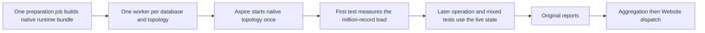

# ADR-142: One live benchmark session per database and native topology

Status: Accepted decision; implementation and Linux qualification pending.
Date: 2026-10-17.

## Context

A comparison runs two measurement jobs per database (one per native topology). Preparing infrastructure for each operation cell separately would spend the run on setup, so the real tests share one live infrastructure session, with a measured initial load of one million records and no warmup or per-case reset.

## Decision

One Linux runner owns one database's native one-node or three-node topology for
the entire session. Aspire starts and disposes that topology once. Separate
native TUnit cases share its fixture; the first performs and measures the actual
million-record load. Later operation and mixed tests use the resulting live
state, with bounded clients, real acknowledgements, original operation samples
and exact final-state oracles. The canonical inventory and unsupported native
capabilities are explicit; a document-only implementation does not qualify the
complete database/model comparison requirement.

One preparation job builds the solution and compiled native runtime bundle. Workers
import and hash-check same-source/run/attempt DLLs/PDBs, NuGet assets and required
Aspire tools without their own restore/build. The primary KeyLoad AppHost contains
native server project processes and Azurite for development and functional tests.
The separate LoadTests AppHost contains selected database infrastructure only;
the native workload client owns requests and measurements outside its resource
graph. KeyLoad and its workload client are never containers in ordinary execution.
External databases keep their pinned native images and image user defaults. Each
owned lifecycle removes only its own resources, including anonymous volumes.
Native SDK container publication remains explicit release work.

The preparation and each worker retain original reports. Aggregation requires
all 22 database/topology workers, native test outcomes, artifact identities,
source identity, measured counts and matching operation statistics. Failed
original cases retain null metrics; missing or corrupted originals fail closed.
Website remains an independently qualified downstream consumer.

No warmup, hidden reseed, per-test database restart, retry that improves samples,
legacy producer, report compatibility fallback or fabricated unavailable report
is part of this design. Reusable native operations and transport retain their
actual contracts.

Local sessions preserve real source/DLL/PDB/process evidence without invented
GitHub provenance. Public aggregation still authenticates original GitHub source,
run, attempt, jobs and artifacts. Actual workload results remain distinct from
matched native-process resource qualification, which is open; no container-shaped
identity or resource observation may stand in for a native server process.

## Consequences and qualification

The measurement matrix is 11 databases × two topologies = 22 jobs. Shared
preparation, aggregation and Website dispatch make 25 comparison-flow jobs. The
existing functional cluster heavy-load correctness job remains separately present
until its owner moves it without losing acceptance coverage. A job failure may
leave later prerequisites failed; original case outcomes must show this honestly.

[SessionExecution](../Features/BenchmarkComparisons/SessionExecution.md) owns
REQ/AC-BSESSION-001..008, adapter inventory, disjoint implementation ownership,
native regression mappings and the concrete Linux completion gates. Exact-source
build, formatting, contract tests, real native sessions, cluster SDK/MCP acceptance,
complete supported-family accounting and website provenance remain mandatory.
Neither this decision nor a copied binary bundle proves execution or performance.
