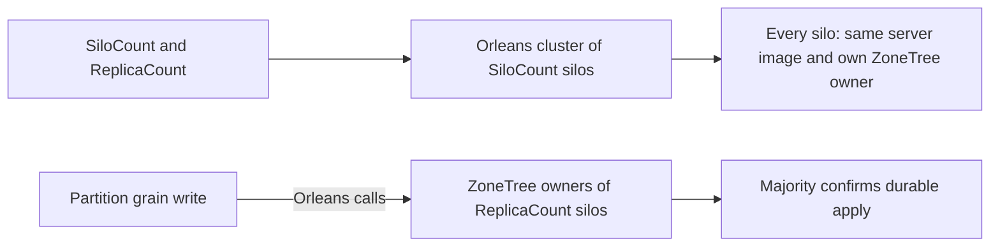

# ADR-143: Silo count and replica count

Status: Accepted by owner direction 2026-10-17, simplified 2026-10-18 under [ADR-136](ADR-136-native-orleans-partition-ownership.md). Implementation under local verification; Linux qualification pending.

## Decision

Two independent startup options describe a deployment:

| Option | Meaning | Rule |
|---|---|---|
| `KeyLoad:SiloCount` | Number of Orleans silos in the cluster | Positive. Orleans owns membership and scaling; KeyLoad imposes no maximum. |
| `KeyLoad:ReplicaCount` | Number of copies of each partition's data | Positive, not larger than `SiloCount`. Default 3. |

Every silo runs the same server image with its own silo-local ZoneTree owner. A write is copied through Orleans calls to the ZoneTree owners of `ReplicaCount` silos and is acknowledged after a majority of those copies confirm durable local apply:

| ReplicaCount | Majority | Tolerated copy outages for writes |
|---|---|---|
| 1 | 1 | none |
| 2 | 2 | none |
| 3 | 2 | 1 |
| 5 | 3 | 2 |

## Boundaries

- Both options are read at startup. There is no live resizing, data movement or persisted-data migration.
- Catalogs, routing, validation and restore use the actual configured copy count; nothing in the product requires exactly three copies. Three is only the default.
- Local AppHost runs publish the server with the .NET SDK `PublishContainer` target when no pinned image is selected; product and comparison images use the central `Directory.Build.props` pins without a Dockerfile.
- Public HTTP/MCP JSON, signed authorization, Orleans aliases/Ids and partition identity are unchanged.
- Process recovery, real SDK/MCP operations, behaviour under faults and joined shutdown need real Aspire execution; a build or model test cannot qualify them. Exact-source Linux, recovery, cluster and endurance gates stay open until their evidence exists.
