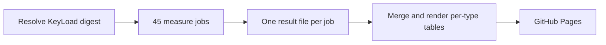

# ADR-150: Per-type benchmark jobs

Status: Accepted by owner direction 2026-10-31. Source rewritten; the first
per-type Linux Benchmarks run is pending.
Feature: [BenchmarkComparisons](../Features/BenchmarkComparisons.md), REQ-BC-030..036.

## Context

The previous pipeline ran one live session per database and topology, behind a
preparation job that built and hashed a compiled runtime bundle, and an
aggregation that authenticated GitHub metadata, receipts, process identities and
resource observations before Website could show a figure. In practice:

- KeyLoad appeared only under a Multi-model heading with document numbers; no other
  data type compared KeyLoad with the specialist databases of that type.
- The preparation job took about 40 minutes before the first measurement started.
- About 40,000 lines of evidence machinery (plan and finalize scripts, bundle and
  identity proofs, resource observation, receipts, composite actions and adapter
  control tests) guarded the numbers but produced none, and a failure anywhere in
  it left the site without results.

## Decision

- **One job per database, data type and node count.** `benchmarks.yml` has a small
  `image` job that resolves `ghcr.io/managedcode/keyload:latest` to one digest and
  45 `measure` jobs: KeyLoad in all ten types at 1 and 3 nodes, and each specialist
  database in its types at the node counts it supports. A job builds
  `benchmarks/KeyLoad.ComparisonHost` in Release, starts its database through
  `build/KeyLoad.LoadTests.AppHost` from the TUnit fixture and runs the TUnit class
  of its type.
- **One shared module per type.** Ten types (documents, key-value, relational,
  graph, vector, search, time-series, analytics, queue, events) each have one
  dataset, one scenario with its cases, schedule and verification, and one driver
  interface. A database implements only the driver. Seed 1729, 16 clients, 100,000
  measured operations per case and 1,000,000-record datasets apply to every
  database.
- **Plain result files.** The fixture rewrites
  `results/<database-slug>-<type>-n<nodes>.json` after every case; the job uploads
  it as `benchmark-<slug>-<type>-n<nodes>` whether it passed or failed. A failed
  case keeps its real error and no number is invented.
- **Website renders one run.** Benchmarks dispatches Website with its run id.
  Website downloads that run's `benchmark-*` artifacts (or the latest completed
  run's), merges them, renders one comparison table per data type with KeyLoad in
  every type and deploys Pages. Without result files the build fails and the
  current Pages stay.
- **Deleted.** The compiled runtime bundle, hash and identity proofs, resource
  observation, authenticated aggregation, receipts, settled GitHub metadata
  capture, session plan and finalize scripts, the composite workflow actions, the
  adapter control tests, the `benchmarks/KeyLoad.Comparisons` library and the
  Release job that built a benchmark image. ADR-021, 034, 043, 044, 045, 049, 050,
  056, 068, 076, 080, 085, 103, 109, 112, 122 and 142 described them and are
  removed; ADR-059, ADR-063 and ADR-069 keep only their storage-recovery, phase
  diagnostics and raw ZoneTree read decisions.

## Consequences

- Every data type shows KeyLoad beside the databases built for that type, on the
  same dataset and scenario.
- Measurement starts after the database is ready instead of after a 40-minute
  preparation; a failed job affects only its own cell.
- A dataset or scenario change is made once and applies to every database of the
  type. Adding a database means one driver, one AppHost resource and its matrix rows.
- The site trusts the Benchmarks run that produced the files. The figures describe
  one run on GitHub-hosted runners with unmatched hardware; they make no
  production readiness, durability or equal-guarantee claim.
- KeyLoad uses one partition per job, so its 3-node figures measure replication,
  not partition fan-out. Databases without a supported 3-node deployment show
  single-node results only.
- Changing the job layout, types, cases, datasets, counts or the result contract
  needs the owner's approval.
