# KeyLoad architecture and ownership map

Read the root and nearest project-local AGENTS.md before changing this solution.
The product specification is [product-specification.md](design/product-specification.md).
The [documentation index](README.md) lists the canonical Feature specifications;
each owning Feature defines stable REQ/AC, callers, boundaries, flows, tests and a
Mermaid diagram. The [ADR catalog](ADR/README.md) records decisions with their
implementation contracts. This document is a navigation map, not a replacement
specification or a readiness claim: the diagrams show ownership and contracts,
not proof that every target is implemented or qualified.

## Product

KeyLoad is **one database for AI agents**. Documents, typed tables, graphs, blobs,
queues, events, vectors/search and time series coexist in one database and
reference one another through canonical identities. Logical tables, collections
and queues organize that one database; they are not isolated model silos.

SQL is the familiar shared language for combining those models in one bounded
request. T-SQL syntax is parsed with Microsoft ScriptDOM and lowered into closed
typed operations ([ADR-130](ADR/ADR-130-microsoft-scriptdom-tsql.md)); SQL, the
.NET SDK and MCP all reach the same authorized bounded database operations
([ADR-054](ADR/ADR-054-central-sql.md), [ADR-065](ADR/ADR-065-full-sql-client-compatibility.md),
[versioned conformance inventory](implementation/sql-client-conformance.json)).
The motivating flows are queue messages -> referenced entities -> knowledge graph,
and graph relationships -> queued actions, owned by
[DatabaseComposition](Features/DatabaseComposition.md) and
[ADR-067](ADR/ADR-067-composable-agent-database.md). Typed rows reuse collection
entity storage so graph and vector references keep one identity
([RelationalStorage](Features/RelationalStorage.md),
[ADR-055](ADR/ADR-055-typed-relational-rows.md)).

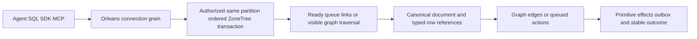

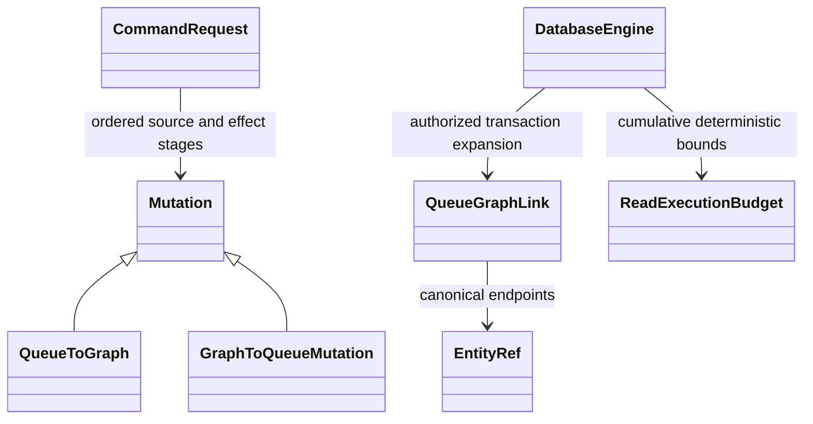

## Cluster and execution concept

Microsoft Orleans is the cluster
([ADR-136](ADR/ADR-136-orleans-partition-ownership.md),
[ADR-036](ADR/ADR-036-orleans-foundation.md)). Orleans does all of the
clustering: membership, silo discovery, failure detection, the distributed grain
directory, placement, activation migration and repartitioning, internal
communication (grain calls, Grain Service calls and Orleans streams), timers,
reminders, durable jobs and scaling. KeyLoad adds no clustering mechanism of its
own; scaling means adding silos to the Orleans cluster.

- **Connection grain.** Every connected client has one Orleans grain
  ([ADR-125](ADR/ADR-125-connection-owned-execution.md),
  [connection ownership](Features/ClientApi.md#persistent-connection-ownership)).
  Each operation carries its own verified identity, fresh persisted
  authorization, per-operation data bounds, cancellation and idempotent command
  outcome. No node, tenant, principal or connection pool throttles callers
  ([ADR-145](ADR/ADR-145-no-request-throttling.md)).
  The connection grain never caches trusted roles and never owns storage.
- **Partition grains.** A logical partition grain is an ordinary Orleans grain
  that serializes and routes the commands of one logical (atomic) partition.
- **Silo-local ZoneTree owner.** Each silo hosts a Grain Service; typed Orleans
  calls can address it on another silo. The physical owner retains ZoneTree,
  WAL/journals, locks and ordered apply. Local scoped services borrow that exact
  open session through DI. Isolated stores open during silo startup.
  Shared storage opens lazily for its ordinary database grain and closes after
  that activation's original work and borrowers join. Open handles never move
  with activations.
- **Copies.** The writer finds the target silos through Orleans
  membership (`IClusterMembershipService` / `IManagementGrain`) and sends the
  write through ordinary Orleans calls to the ZoneTree owner Grain Services on
  `KeyLoad:ReplicaCount` silos. The owner set and its canonical position are
  cached per Orleans membership version; silo cuts are re-read only after a
  membership change or a failed copy, not on every write. The write is
  acknowledged after every configured copy confirms persisted apply. `ReplicaCount` is positive, defaults
  to 1 and is not larger than `KeyLoad:SiloCount`; `KeyLoad:StorageMode` selects
  `IsolatedVolumes` (each silo owns its own disk, the default) or `SharedVolume`
  (one shared disk, `ReplicaCount=1`)
  ([ADR-143](ADR/ADR-143-independent-silo-replica-topology.md)). An unfinished original command can complete on
  a missing copy through a stable-ID retry; unrelated gaps require explicit
  recovery and general empty-copy restoration remains unqualified.
- **Request flow.** Public API (HTTP, .NET SDK, MCP, SQL) -> connection grain ->
  partition grains -> ZoneTree owner on the same node or on other nodes through
  Orleans -> results are gathered -> returned to the caller.
- **Background work.** Queue deadlines, due and recurring work, remote
  transfers, ANN projection and time-series chunk work never check leadership.
  Orleans `[StatelessWorker(1)]` grains share one pool key per work kind, so each
  silo runs one polling activation. On an Orleans grain timer whose interval is a
  typed option (for example 5 seconds) the activation reads the next page of
  persisted due records from the storage owner and dispatches them through the
  normal grain -> ZoneTree owner path. Nothing is buffered in memory.
- **Identifiers.** Every grain key and every identifier for objects, counters
  and storage keys comes from one shared helper per identity kind. Keys are
  case-sensitive.

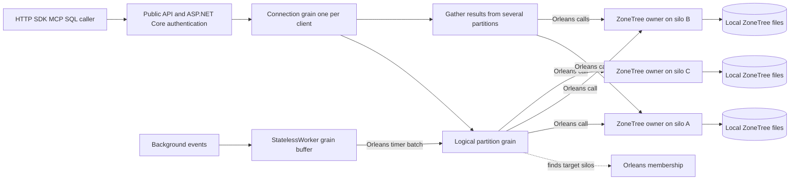

### Storage-mode contract and current qualification

Two storage modes are required. With a **shared volume**, all silos can reach the
configured partition paths without copying data. One ordinary Orleans grain owns
each open physical partition; the other silos call it. Orleans owns activation
placement and movement. The storage owner closes its actual handles before another
activation reopens that partition. The store's owner lock and `commands.wal` open with
exclusive file sharing, so several live writable instances over the same files are
unsupported.
The actual filesystem must preserve the required locking and flush semantics.

With **isolated volumes**, typed Orleans calls reach the owners of the required
logical partitions. The caller bounds parallel work and merges partial results.
A physical replica is another copy of one partition, not another partition to count
in the result. Stateless workers perform interchangeable Task-based work using
Orleans-managed activation pools.

The source implements lazy shared-session acquisition and joined close, isolated
full-copy routing, and ordinary partition grains for `PartitionQuery` and
`DistributedSearch`. A request pins one actual owner per distinct logical
partition and preserves its expiry, cumulative budgets and read-cut checks across
all leaf stages. Full copies remain copies of the same database; this does not
implement a partition-to-disk sharding scheme. Both modes still require complete
runtime and exact-source Linux qualification, including the deployed shared
volume's locking and flush behavior.

Sources: [Orleans stateless workers](https://learn.microsoft.com/en-us/dotnet/orleans/grains/stateless-worker-grains),
[grain directory](https://learn.microsoft.com/en-us/dotnet/orleans/host/grain-directory),
and [the pinned ZoneTree WAL open contract](https://github.com/ZoneTree/ZoneTree/blob/dea002a935e0de8ed6bae98b526556c440b6b467/src/ZoneTree/WAL/Sync/SyncFileSystemWriteAheadLog.cs).

Credentials and authorization policies are persisted in the database; callers
never supply trusted roles. Standard ASP.NET Core authentication admits HTTP,
SDK and MCP callers, and ManagedCode.Orleans.Identity carries the verified
call-local identity between grains. OpenTelemetry logs, traces and metrics come
from the Orleans, ASP.NET Core and Aspire integrations without
credentials, payloads or unbounded labels. Orleans execution and
scheduling choices are mapped per grain and method in
[ExecutionPrimitives](Features/OrleansExecution/ExecutionPrimitives.md) and
[ADR-110](ADR/ADR-110-orleans-execution-primitives.md); the broader
[Orleans capability review](Features/OrleansExecution/CapabilityReview.md) covers
Streams, transactions, durable jobs and per-silo services. Orleans
transactional grain state does not by itself make ZoneTree writes atomic; it
needs a provider that participates in the canonical ZoneTree commit.

## Runtime projects and process entry

Runtime projects under `src/` have distinct consumers and responsibilities:
Abstractions (shared contracts), Client (external SDK), Cli (operator
executable), Core (database semantics and authorization evaluation), Query (SQL
compilation, search and change feeds), Clustering (Orleans grains, routing and
copies through calls to `ReplicaCount` silo-local ZoneTree owners),
Storage.ZoneTree (physical storage, local archive transfer and file IO),
Server (host composition, public API, health, service discovery, resilience and
OpenTelemetry) and Diagnostics (BCL-only bounded phase telemetry shared by
storage and replication). Diagnostics stays independent so low-level storage
does not depend on domain execution or the server host.

`src/` contains runtime product code only. Compiler rules live in `analyzers/`;
the Aspire AppHost and shared build targets live in `build/`; tests and
benchmarks keep their own roots. Recovery tests own their child-process
scenarios in the same test assembly. Compiler analyzers, the AppHost, benchmark
entry, generated-consumer fixtures, the execution
comparison library and the TUnit comparison host keep their distinct execution
boundaries.

Each `Program.cs` shows initialization, mode selection, host composition, run and
joined shutdown; compiler rule KLD0020 rejects forwarding-only entry wrappers.
Runtime code reads time through an owned `TimeProvider`
([TimeProvider](Features/ResourceExecution/TimeProvider.md),
[ADR-115](ADR/ADR-115-time-provider.md)), operational policy through validated
typed options ([ADR-113](ADR/ADR-113-centralized-runtime-options.md)), runtime
identities through named constants ([ADR-111](ADR/ADR-111-magic-runtime-values.md))
and synchronization through Orleans turns, `System.Threading.Lock` or
`SemaphoreSlim.WaitAsync` ([ADR-108](ADR/ADR-108-typed-synchronization.md)).

## Complete repository boundary

All KeyLoad-owned backend, clients, contracts, frontend, tests, infrastructure and
docs live here and are versioned together. Independently owned ManagedCode
dependencies remain in their owning repositories; repair, release and verified
NuGet publication follow root policy.

| Project/module | Purpose and entry points | Canonical slices / protected boundary |
|---|---|---|
| src/KeyLoad.Abstractions | CommandRequest.cs, PartitionRef.cs, Mutation.cs and `<SliceName>/` contract folders | Shared public and storage contracts for every canonical slice. |
| src/KeyLoad.Core | DatabaseEngine.cs, AtomicCommandCommit.cs, CommandOutcomeApplication.cs, DocumentStorage/Execution/DocumentStorageExecutionDocuments.cs, Messaging/Execution/MessagingExecutionMessaging.cs, GraphTraversal/, TimeSeries/, Search/ | Shared node-local execution context and feature-owned operation components; authorization and model effects share the ordered atomic commit. |
| src/KeyLoad.Diagnostics | Models/DatabasePhaseKind.cs, Models/DatabasePhaseSnapshot.cs | BCL-only scalar phase observations, with no database state, public control endpoint or framework dependency. |
| src/KeyLoad.Storage.ZoneTree | ZoneTreeStore.cs, StorageEngine/Execution/ZoneTreeStoreRuntime.cs, StorageEngine/Recovery/ZoneTreeCheckpointManager.cs | StorageEngine, PointCache and Restore; files, WAL, checkpoints and local archives stay with the silo-local ZoneTree owner. |
| src/KeyLoad.Query | QueryExecution/Queries/QueryEngine.cs, QueryExecution/Execution/SqlParser.cs, Search/Queries/QueryExecution/SearchEngine.cs, ChangeFeeds/Queries/LiveQueryExecutor.cs | QueryExecution, Search, ChangeFeeds; one authorized typed AST and bounded read cut. |
| src/KeyLoad.Clustering | RequestExecution/Grains/ConnectionGrain.cs, RequestExecution/Grains/CommandPartitionGrain.cs, RequestExecution/Queries/Connections/ConnectionReadExecution.cs, `<SliceName>/GrainServices/` | OrleansExecution; connection and partition grains route through Orleans to the silo-local ZoneTree owners. |
| src/KeyLoad | Program.cs, NodeOptions.cs, ClientApi/, OrleansHosting/Hosting/OrleansNode.Composition.cs | Composition root, Orleans host and public API; caller identity never supplies trusted roles. |
| src/KeyLoad.Client | ClientApi/Transport/KeyLoadClient.cs, QueryExecution/Queries/KeyLoadQuery.cs | ClientApi transport; business operations mirror the same canonical slices as core, contracts, API and tests. |
| src/KeyLoad.Cli | Program.cs, ClientApi/Transport/CliClientApi.cs, Restore/Commands/CliBackupRestore.cs | Administrative entry point with typed ClientApi and backup/restore owners. |
| build/KeyLoad.AppHost | Program.cs, Hosting/, OrleansHosting/Resources/ClusterTelemetryResources.cs, TestInfrastructure/ | Aspire owns cluster resources, readiness, test dependencies, scoped process faults and joined shutdown. |
| tests/KeyLoad.UnitTests | TestDatabase.cs and `<SliceName>/` folders | Matching product slices; contract and engine regressions. |
| tests/KeyLoad.RecoveryTests | Program.cs, StorageRecovery/Cases/, feature-owned Processes/ and Execution/ | TUnit recovery tests and their real child-process scenarios in the same test assembly. |
| tests/KeyLoad.IntegrationTests | ClusterFixture.cs, StorageReplication/Cases/Cluster/ClusterTests.cs, ResourceExecution/Cases/RequestBodyLimitClusterTests.cs | Aspire-owned cluster fixtures; business cases mirror their owning slices through the real .NET SDK and official MCP client. |
| benchmarks/KeyLoad.ComparisonHost | Session/, Orchestration/ | Selected live benchmark topology, measured workloads and original result artifacts. |
| benchmarks/KeyLoad.Benchmarks | Program.cs | BenchmarkComparisons; embedded microbenchmark development, no public claim without CI evidence. |
| benchmarks/KeyLoad.BenchmarkScenarios | Benchmarks/EmbeddedBenchmarks.cs | BenchmarkComparisons; [ADR-047](ADR/ADR-047-embedded-benchmark-host.md) public fixture library for the external generated consumer. |
| benchmarks/KeyLoad.Comparisons | Session/, Targets/ | BenchmarkComparisons; public library with shared workload/oracle and official engine clients. |
| benchmarks/KeyLoad.ComparisonHost | Session/ | BenchmarkComparisons; TUnit C# client workload container under [ADR-117](ADR/ADR-117-tunit-ci-entry.md). |
| site | Features/BenchmarkComparisons/index.html, bootstrap.mjs; scripts/build.mjs | BenchmarkComparisons; product introduction and public views of qualified GitHub JSON. |
| tests/KeyLoad.SiteTests | KeyLoad.SiteTests.csproj, Cases/, Fixtures/ | BenchmarkComparisons; TUnit suite over the actual Node modules and authentic GitHub report files. |
| .github/workflows | build-and-tests.yml, benchmarks.yml, website.yml, release.yml | RepositoryGovernance, BenchmarkComparisons, ReleaseDelivery; separate build/test, benchmark, website and release workflows. |
| scripts | Features/RepositoryGovernance/verify.mjs, Features/BenchmarkComparisons/session-plan.mjs | RepositoryGovernance and BenchmarkComparisons; static repository verification and benchmark session tooling with Node built-ins. |
| analyzers/KeyLoad.Analyzers | KeyLoad.Analyzers.csproj, Analyzers/, Analysis/ | CodeQuality; source-owned Roslyn diagnostics attached to compilation, never runtime storage or routing. |
| tests/KeyLoad.Analyzers.Tests | KeyLoad.Analyzers.Tests.csproj, Cases/, Fixtures/ | CodeQuality; real Roslyn/Orleans metadata checks. |
| docs | design/, Features/, ADR/, implementation/ | Product specification and canonical slice/decision records. |

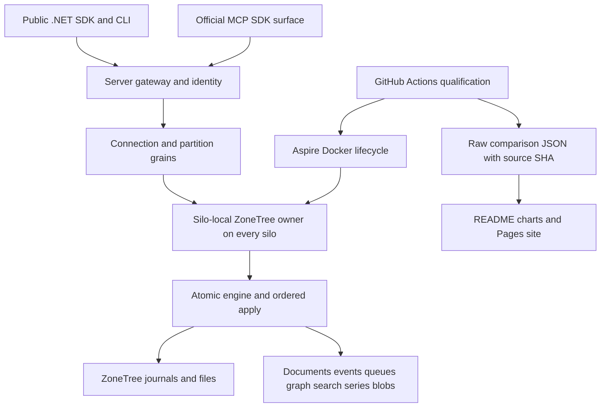

## Feature ownership convention

Every C# project under `src/`, `tests/` and `benchmarks/` places named slices
directly under its project directory as `<project>/<SliceName>/<Role>/`. Each
slice groups actual responsibilities in populated role folders such as
`Grains/`, `Commands/`, `Queries/`, `Models/`, `Contracts/`, `Streaming/`,
`Identity/`, `Serialization/` and `Topology/`; a slice is an ownership boundary,
not a flat file collection. Test support uses explicit `Scenarios/`, `Fixtures/`,
`Assertions/`, `Contracts/`, `Lifecycle/`, `Observations/` and `Serialization/`
roles, with related subjects grouped beneath the role (for example
`Search/Scenarios/FullText/`); thematic folders stay inside `Cases/`. Scripts,
site and documentation keep their module paths. Namespaces, Orleans aliases and
field IDs stay stable across structural moves. The owner contract and checks are
in [RepositoryGovernance](Features/RepositoryGovernance.md) and
[ADR-032](ADR/ADR-032-mcaf-governance.md).

Canonical slice names use PascalCase consistently: RepositoryGovernance,
BenchmarkComparisons, DatabaseComposition, DocumentStorage, RelationalStorage,
EventStreams, Messaging, GraphTraversal, TimeSeries, Search, QueryExecution,
Authorization, ChangeFeeds, StorageRecovery, StorageReplication, OrleansExecution,
ClientApi, BackupRestore (project folder `Restore/`), BlobStorage,
ResourceExecution, InternalSerialization, AdminDashboard, AnalyticsStore,
CodeQuality, ReleaseDelivery and TestInfrastructure. Their owning contracts and
navigation are in the [Feature index](README.md). Shared entry points,
composition roots, truly shared contracts and global infrastructure may remain
outside slice folders. A non-applicable surface is recorded as N/A with its
reason in the feature spec. Shared atomic commit and outcome dispatch stay
outside slice folders because they join multiple mutation families.

## Shared request contracts

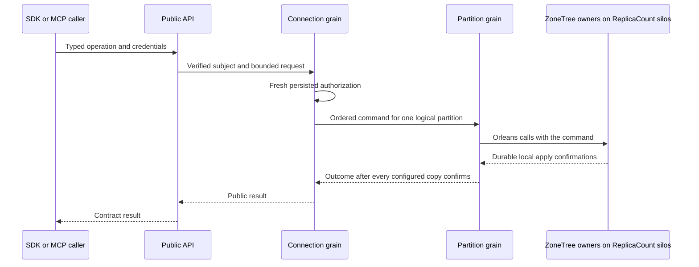

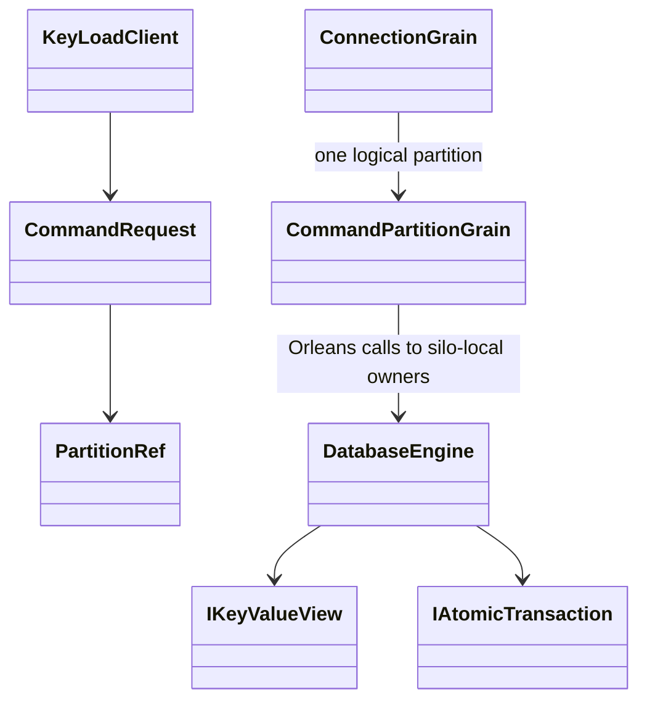

Official MCP and simple agent adapters belong to [ClientApi](Features/ClientApi.md)
and [ADR-039](ADR/ADR-039-official-mcp-agent-api.md); business operations keep
their own Feature owners. The MCP host exposes bounded search/route/invoke tools
through ManagedCode.MCPGateway and ManagedCode.MarkdownLd.Kb tool-metadata graphs
([ToolDiscovery](Features/ClientApi/ToolDiscovery.md),
[ADR-104](ADR/ADR-104-mcp-gateway-tool-discovery.md)); the graph holds public
operation documentation only. Streamed results and long operations use
ManagedCode.Communication CQRS `IAsyncEnumerable` contracts through Orleans
([RuntimeCqrs](Features/OrleansExecution/RuntimeCqrs.md),
[ADR-082](ADR/ADR-082-cqrs-streams.md)). enumeration does not move
node-owned storage or replace persisted authority.

## SQL and relational model

[ADR-132](ADR/ADR-132-create-table-command-identity.md) defines the
[bounded CREATE TABLE operation](Features/RelationalStorage/CreateTable.md) with a
caller-stable SQL command identity on the connection-owned execution path.
Canonical typed resources stay in ZoneTree behind the ordered apply gate. The
PostgreSQL wire/Npgsql session is a separately qualified transport, not a
PostgreSQL grammar or SQL Server TDS promise.

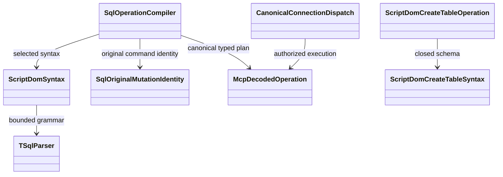

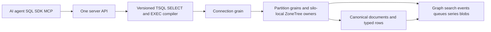

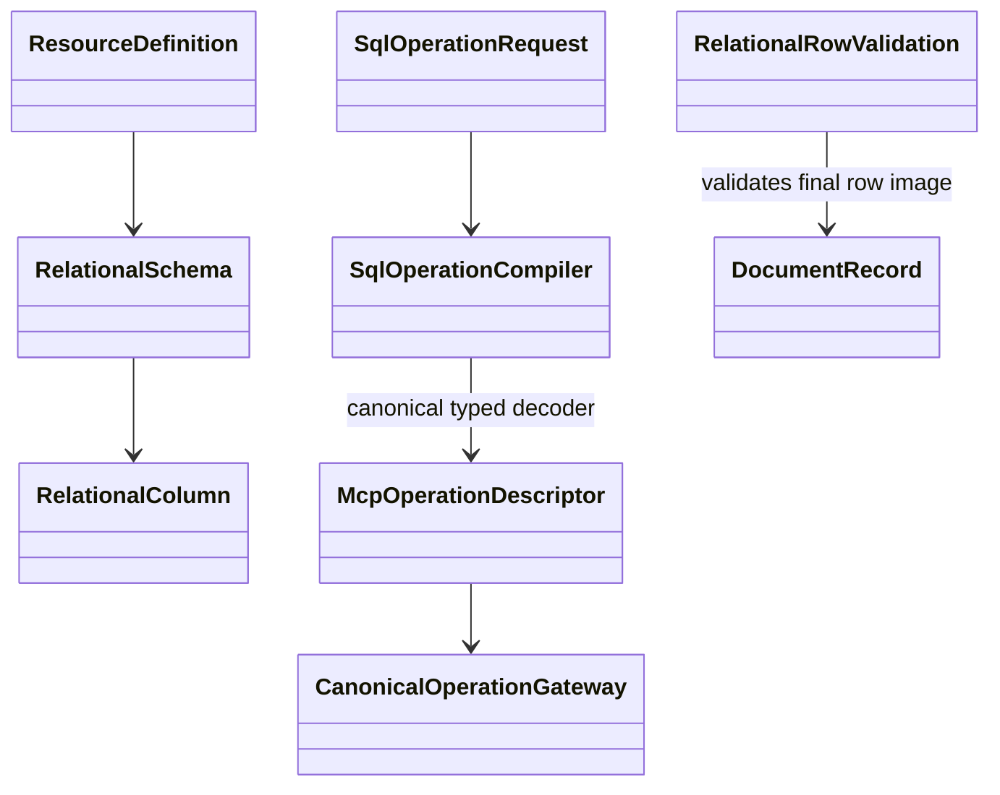

[ResourcePolicyUpdates](Features/Authorization/ResourcePolicyUpdates.md) and
[ADR-093](ADR/ADR-093-resource-policy-updates.md) define policy-only CAS through
the replicated ConfigureResource path; advancing a resource version invalidates
existing cursors and index fences, and physical schema changes stay separate.

## Storage, atomic commit and recovery

File API contracts and server transfers use ManagedCode.Storage. ZoneTree stores
file metadata, access policy, publication state and physical-storage references;
provider-owned physical files contain the payload bytes. Database command and
replica journals carry metadata, never file content. See
[ADR-038](ADR/ADR-038-chunked-blob-storage.md) and
[BlobStorage](Features/BlobStorage.md) for the publication boundary and open
physical-provider qualification gates.


ZoneTree is the canonical storage for every KeyLoad-owned model and
ZoneTree.FullTextSearch is the selected derived text index
([ADR-071](ADR/ADR-071-canonical-zonetree-providers.md),
[FullTextProjection](Features/Search/FullTextProjection.md)). The
silo-local ZoneTree owner keeps WAL, ordered apply and file ownership on
its node. Current storage accepts only the formats in
[CurrentFormat](Features/StorageRecovery/CurrentFormat.md) and rejects
unsupported or corrupt versions before effects
([ADR-011](ADR/ADR-011-current-format.md),
[ADR-116](ADR/ADR-116-first-release-current-format.md)). Process-kill recovery
tests do not prove power-loss durability.

Document CRUD handlers and transaction-scoped image carriers belong to
`Core/DocumentStorage/`; read budgets, the analytical-read gate and cache
reservations belong to `Core/ResourceExecution/`. `DatabaseEngine` holds the
shared storage context, validated policy snapshots and its analytical-read gate. Feature-owned static
operation components contain the command, query and validation implementations;
extension methods pass that same context explicitly. They preserve the existing
atomic transaction and persisted authorization boundary. Local numeric checks
and complete runtime qualification are separate gates
([ADR-041](ADR/ADR-041-read-only-public-collections.md)).

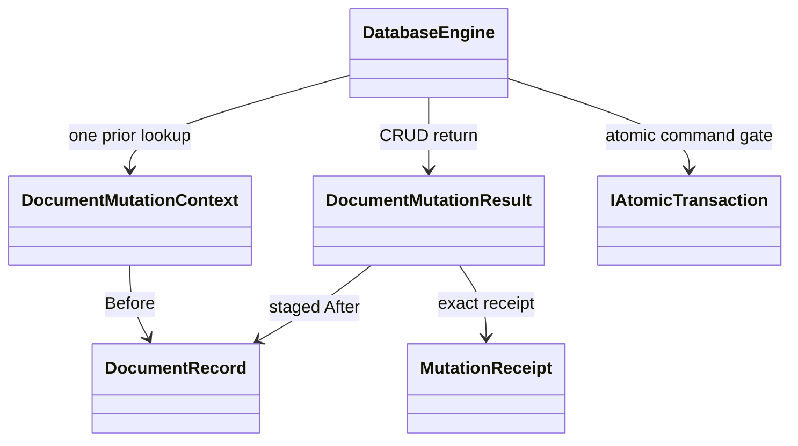

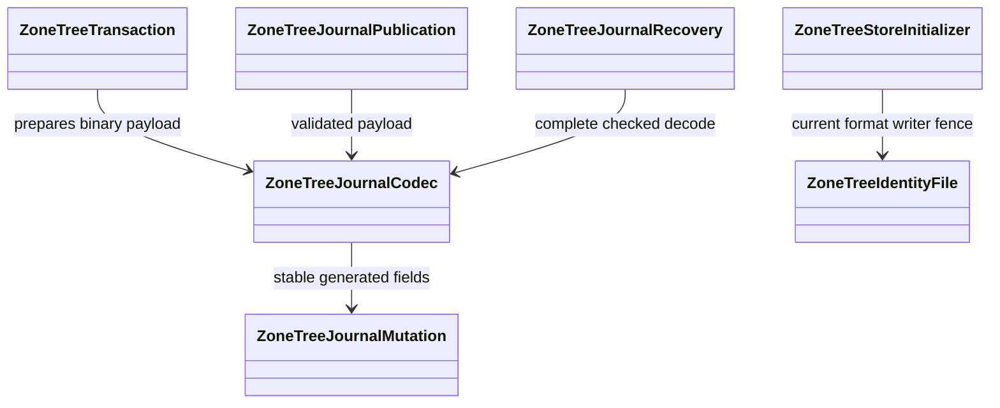

[RuntimeReadCuts](Features/StorageRecovery/RuntimeReadCuts.md) under
[ADR-097](ADR/ADR-097-read-cut-leases.md) supplies provider-owned snapshot
lifetimes for bounded reads. A real-process inspector checks an original store
without the normal runtime, then releases it for a normal reopen:

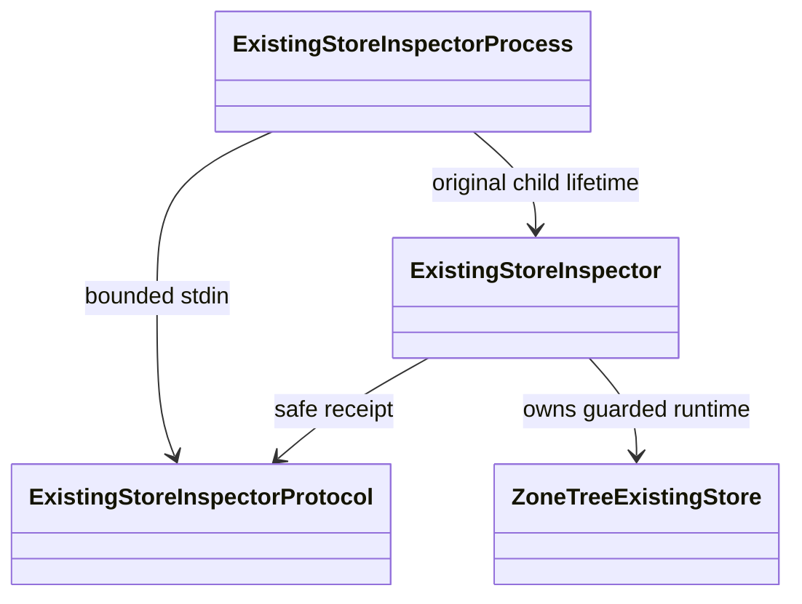

Public chunked blobs and partial reads belong to
[BlobStorage](Features/BlobStorage.md) and
[ADR-038](ADR/ADR-038-chunked-blob-storage.md); backup archive pieces are a
separate storage protocol.

## Internal serialization

[ADR-060](ADR/ADR-060-internal-serialization.md) and
[InternalSerialization](Features/InternalSerialization.md) require execution
generated Orleans payloads with stable aliases and field IDs across owned
persistence, grain requests/replies, copies sent to ZoneTree owners and signed
claims. Public HTTP/MCP JSON, exact user content, frozen canonical fingerprint
identities, sortable keys, raw ZoneTree values, fixed checksum framing and blob
bytes keep their concrete protocols. generated bytes are not canonical
hashes for unordered values. Readers reject unsupported formats before effects.

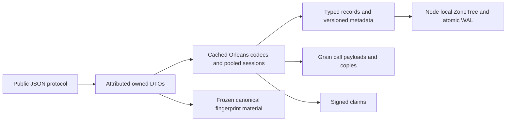

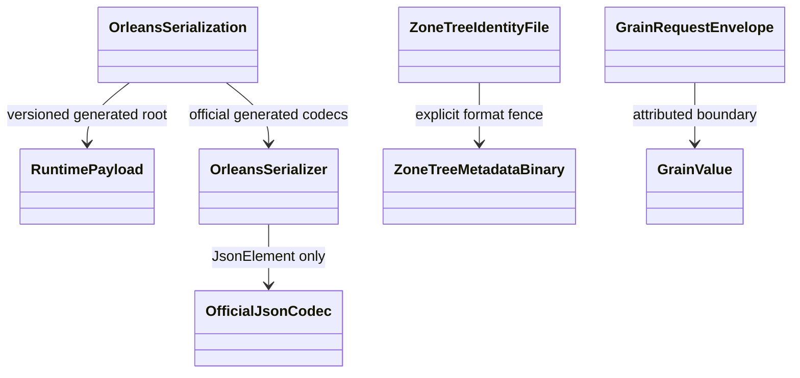

## Query, search and read budgets

[ResourceExecution](Features/ResourceExecution.md) and
[ADR-035](ADR/ADR-035-memory-performance.md) own common budgets in shared
node-local building blocks; operation behavior stays in its canonical slice.
[ClientApi](Features/ClientApi.md) owns HTTP response streaming. Scoped document
and vector visitors feed QueryExecution and Search without raw pages;
GraphTraversal keeps cut-scoped visibility decisions. The shared canonical JSON
writer streams fingerprints to a hash and preserves exact signatures.

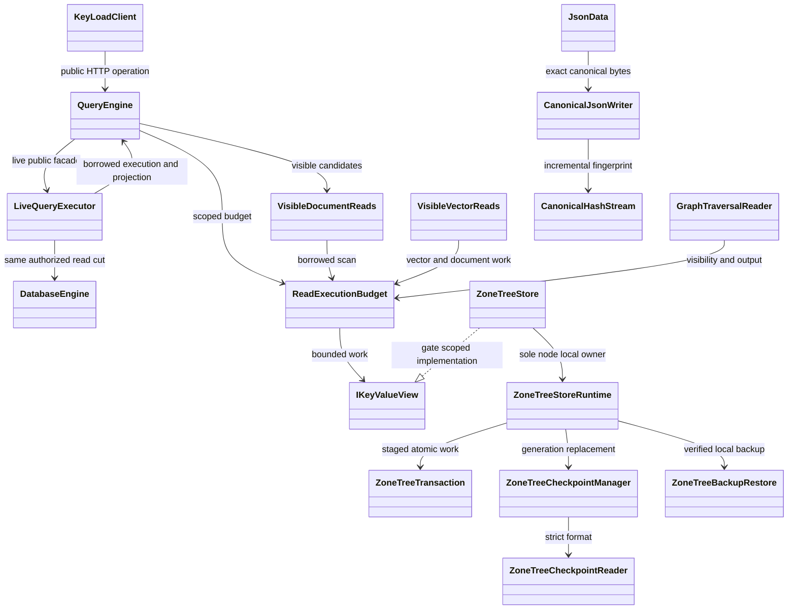

search scheduling follows
[ADR-081](ADR/ADR-081-awaited-search-execution.md): one analytical
reservation spans the complete awaited read and settlement while the
connection grain yields. Index generations have bounded leases and
retirement ([OnlineGenerationLifetime](Features/Search/OnlineGenerationLifetime.md));
global retrieval merges bounded per-modality windows before RRF
([GlobalBranchWindows](Features/Search/GlobalBranchWindows.md)). SIMD execution
uses execution .NET vector intrinsics with scalar code only for bounded tails and
independent correctness oracles ([Search](Features/Search.md)); acceleration
claims need comparable GitHub measurements.

[ADR-019](ADR/ADR-019-managed-ann.md), [ManagedAnn](Features/Search/ManagedAnn.md)
and [ManagedAnnSeed](Features/Search/ManagedAnnSeed.md) define the managed ANN
candidate: a private builder copies bounded canonical vector input captured in
one node-local read cut into owned packed arrays, and each search uses its own
admitted scratch with the exact metric implementation. ANN projection updates
are background work under the StatelessWorker pattern above.

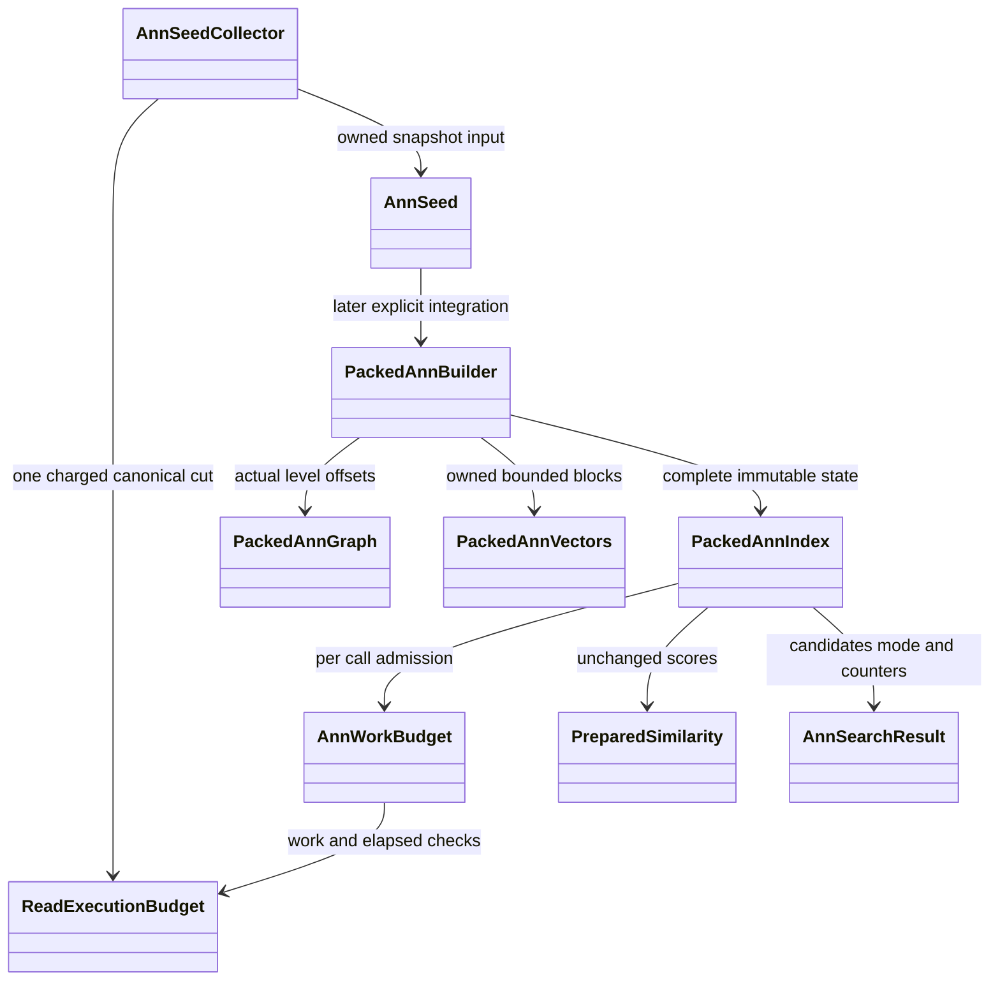

## Time series

[ADR-052](ADR/ADR-052-timeseries-bounded-aggregates.md) defines the
[TimeSeries](Features/TimeSeries.md) latest/aggregate/window slice. Typed
Abstractions DTOs mirror Client, Server and Core owners. Core uses the published
ManagedCode.TimeSeries library inside one budgeted storage cut, and shared
StorageRecovery reverse visitors support bounded latest reads. Chunk work runs
under the StatelessWorker background pattern.

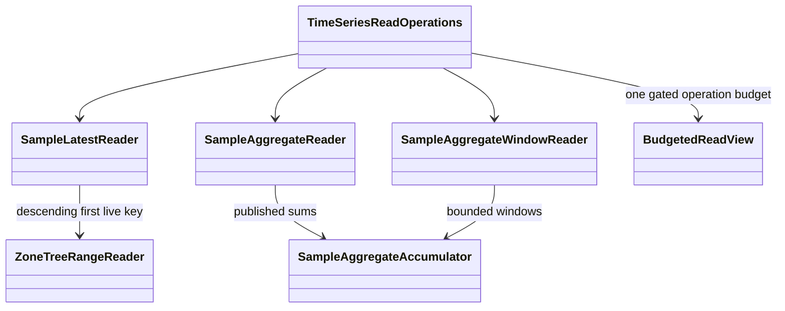

## Memory and caches

[ADR-058](ADR/ADR-058-orleans-coordinated-cache-memory.md) keeps RAM acceleration
under the ResourceExecution slice. The common retained pool and the embedded
positive point-value cache are disposable node-local state over committed
ZoneTree data. Cached state never replaces persisted authorization, committed
ZoneTree state or the acknowledgement from every configured copy of copies, and it never moves
files or handles.

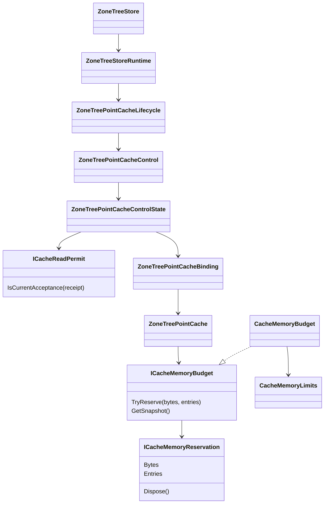

## Diagnostics

[ADR-063](ADR/ADR-063-bounded-database-phase-profiling.md) defines the optional
bounded database phase bank. Process mode is disabled by default; private
capture runs outside database gates.

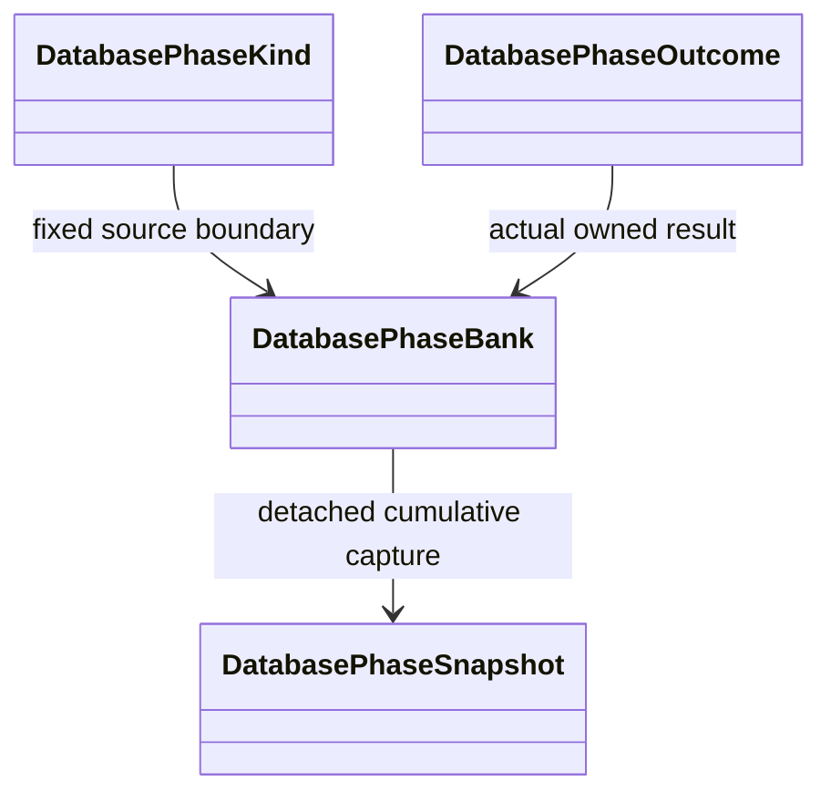

## Admin console and website identity

The [AdminDashboard](Features/AdminDashboard.md) slice under
[ADR-051](ADR/ADR-051-admin-dashboard.md) hosts the read-only console in
`src/KeyLoad/AdminDashboard/Assets/`, with shared Abstractions DTOs, Core
catalog/queue readers and a matching Client SDK. It uses the connection grain
with call-local authorized reads; physical observations are reported per node.
The public `site/` is its own surface. Both share one visual identity under
[ADR-053](ADR/ADR-053-unified-visual-identity.md): the console owns the canonical
`brand.css`/`logo.svg` and the site keeps byte-identical mirrors.
[SiteMetadata](Features/BenchmarkComparisons/SiteMetadata.md) adds mirrored
PNG/ICO exports, static landing SEO/OG/JSON-LD and a share card.

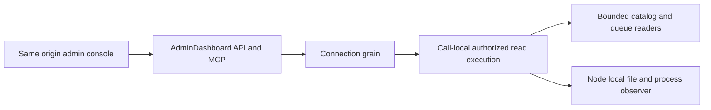

## Code quality

[CodeQuality](Features/CodeQuality.md) is a compile-time slice defined by
[ADR-033](ADR/ADR-033-code-quality.md). Central SDK/style analysis and
source-owned Roslyn rules produce compiler/IDE findings and per-project SARIF
reports; builds always run with warnings as errors. This build infrastructure has
no database runtime or persistence surface.

```mermaid
flowchart LR
    Rules[CodeQuality rule sources] --> Analyzer[KeyLoad.Analyzers]
    Analyzer --> Compiler[SDK Roslyn compiler and IDE]
    Policy[EditorConfig and central MSBuild] --> Compiler
    Projects[Solution projects] --> Compiler
    Compiler --> SARIF[Compiler diagnostic reports]
    Tests[Real compilation TUnit regressions] --> Analyzer
```

```mermaid
classDiagram
    class DiagnosticAnalyzer
    class LiteralMachineKeyAnalyzer
    class OrleansGenerateSerializerAnalyzer
    class CSharpCompilation
    class Diagnostic
    DiagnosticAnalyzer <|-- LiteralMachineKeyAnalyzer
    DiagnosticAnalyzer <|-- OrleansGenerateSerializerAnalyzer
    CSharpCompilation --> DiagnosticAnalyzer
    DiagnosticAnalyzer --> Diagnostic
```

## Benchmark comparisons

[Shared benchmark sessions](Features/BenchmarkComparisons/SessionExecution.md)
under [ADR-142](ADR/ADR-142-shared-live-benchmark-sessions.md) run exactly two
measurement jobs per database: one node and three nodes. The current cohort has
16 systems and 32 topology rows; the [additional database contract](Features/BenchmarkComparisons/AdditionalDatabases.md) records native one-node adapters and open replicated deployment work. An admitted job
owns one live Aspire topology and runs separate real TUnit cases against
it, starting with a measured million-record load. Declared unavailable topologies
retain explicit unavailable results without allocating standalone substitutes. Original per-case outcomes,
TRX, runtime/image identities and resource observations feed one
authenticated complete-cohort aggregation; failed or incomplete cohorts cannot
refresh published metrics. Scales are exactly 100,000 and 1,000,000 records
([ScaledWorkloads](Features/BenchmarkComparisons/ScaledWorkloads.md),
[ADR-069](ADR/ADR-069-representative-scaled-workloads.md)). The
[owning feature](Features/BenchmarkComparisons.md) holds the criteria.

```mermaid
flowchart LR
    Plan[Canonical session inventory] --> Prepare[Common compiled runner and images]
    Prepare --> Worker[One database and node count per job]
    Worker --> Aspire[One owned live Aspire topology]
    Aspire --> Tests[Separate TUnit workload cases]
    Tests --> Originals[Original reports, TRX and runtime evidence]
    Originals --> Aggregate[Complete authenticated cohort]
    Aggregate --> Site[Qualified website metrics]
```

[ADR-043](ADR/ADR-043-comparison-library-host.md) keeps the comparison library
separate from the sole workload host;
[ADR-044](ADR/ADR-044-benchmark-immutable-contracts.md) and
[ADR-045](ADR/ADR-045-postgres-schema-ownership.md) own immutable harness
contracts and transient PostgreSQL schemas.
[ADR-049](ADR/ADR-049-genuine-neo4j-harness.md) keeps genuine Neo4j protocol and
acknowledgement checks inside the Aspire lifecycle, and
[ADR-050](ADR/ADR-050-timeseries-timescale-comparison.md) compares KeyLoad time
series with TimescaleDB and ManagedCode.TimeSeries, reporting each arm's storage
and acknowledgement guarantees separately.

```mermaid
flowchart LR
    ComparisonHost[Separate benchmark session owner] --> AppHost[Selected Aspire database infrastructure]
    ComparisonHost --> ComparisonLibrary[Public workload and target library]
```

```mermaid
classDiagram
    class ComparisonHost
    class BenchmarkSession
    class Neo4jTarget
    class Neo4jQueryResponse
    ComparisonHost --> BenchmarkSession : measured workload against actual endpoint
    BenchmarkSession --> Neo4jTarget : target contract
    Neo4jTarget --> Neo4jQueryResponse : parsed acknowledgement
```

```mermaid
flowchart LR
    Corpus[Deterministic UTC samples] --> KeyLoad[KeyLoad cluster via SDK]
    Corpus --> Timescale[TimescaleDB via Npgsql]
    Corpus --> MCTS[ManagedCode.TimeSeries memory aggregation]
    KeyLoad --> Oracle[Separate result and guarantees]
    Timescale --> Oracle
    MCTS --> Oracle
```

Embedded ZoneTree microbenchmarks
([ADR-047](ADR/ADR-047-embedded-benchmark-host.md)) use the actual generated
consumer for local development and never qualify the required scales.

```mermaid
classDiagram
    class BenchmarkProgram
    class EmbeddedBenchmarks
    class GeneratedBenchmarkRunner
    class ZoneTreeStore
    BenchmarkProgram --> EmbeddedBenchmarks : BenchmarkSwitcher selects assembly
    GeneratedBenchmarkRunner --|> EmbeddedBenchmarks : upstream generated inheritance
    EmbeddedBenchmarks --> ZoneTreeStore : owns actual embedded fixture storage
```

[ADR-080](ADR/ADR-080-benchmark-failure-isolation.md) keeps the full planned-cell
inventory while terminal workload failures coexist with successful measurements:
a failed job stays failed, has a null report and shows no numeric result.

```mermaid
flowchart LR
  Job[Independent Aspire cell] --> Result[Measured or failed null report]
  GitHub[Actual job steps and immutable artifact] --> Proof[Same source run attempt validation]
  Result --> Proof
  Proof --> Aggregate[Complete planned-cell aggregate]
  Aggregate --> Qualification[Site tests browser coverage freshness]
  Qualification --> Site[Values or no data and original job links]
```

## Delivery workflows

[ADR-064](ADR/ADR-064-workflow-release-delivery.md) and
[ADR-062](ADR/ADR-062-workflow-separation.md) define exactly four workflows.
`build-and-tests.yml` (`Build and Tests`) owns PR/main/manual build, format,
rules, analyzers, unit, process recovery and Docker/Aspire cluster SDK/MCP tests;
benchmark contracts run only in Benchmarks
([ADR-117](ADR/ADR-117-tunit-ci-entry.md)). `benchmarks.yml`
(`Benchmarks`) owns the isolated Linux database groups and authenticated
aggregation and ends with a bounded dispatch of `website.yml` (`Website`).
Website publishes independently on trusted main changes or manual dispatch and
uses the newest ready authenticated benchmark aggregate when one exists
([ADR-112](ADR/ADR-112-independent-website-publication.md)). `release.yml`
(`Release`) stays manual ([ReleaseDelivery](Features/ReleaseDelivery.md)):
self-contained server/CLI archives, the server image published by the .NET SDK
`PublishContainer` target to `ghcr.io/managedcode/keyload` under the commit SHA and
`latest` tags, and the benchmark image archive. Benchmarks runs its KeyLoad cells
from the image `latest` resolves to, pinned by digest. Packaging does not establish
runtime or endurance qualification.

```mermaid
flowchart LR
    Source[PR or main source] --> CI[Build and Tests]
    Main[Main source] --> Benchmarks[All isolated benchmarks]
    Benchmarks --> Aggregate[Complete authenticated JSON]
    Aggregate --> Dispatch[Settled final Website dispatch]
    Dispatch --> Site[Website gates and Pages publication]
    Main --> Site
    Manual[Manual main release] --> Build[Self-contained archives and images]
    Build --> Registry[GHCR server image SHA and latest]
    Registry --> Benchmarks
```

```mermaid
flowchart LR
  Source[Website source] --> Website[Separate Website qualification]
  Producer[Ready Benchmarks JSON] --> Website
  Website --> Content[Product site without metrics]
  Website --> Measured[Product site with authenticated metrics]
  Content --> Fresh[Recheck source and available data]
  Measured --> Fresh
  Fresh --> Pages[Pages]
```

Delivered-source qualification comes only from exact-source Linux GitHub runs
with their original artifacts; local runs are development evidence.
