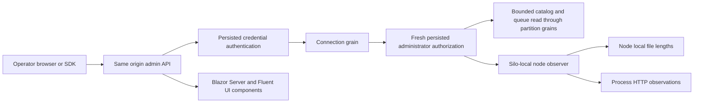

# AdminDashboard

The console owns the canonical logo and the shared PNG/ICO icon set that the
public site mirrors byte for byte under [ADR-053](../ADR/ADR-053-unified-visual-identity.md).
It serves only those finite public icon GET/HEAD assets and `noindex,nofollow`;
all operational authorization and existing console contracts remain required.

This is the durable requirements and acceptance contract; the decision and implementation contract are in [ADR-051](../ADR/ADR-051-admin-dashboard.md). Goal: attractive runtime administration with sizes, throughput, tables/collections, queues and files.

| Requirement | Acceptance | Intended automated proof |
|---|---|---|
| REQ-AD-001 persisted administrator authorization and grain isolation | AC-AD-001 | AdminCatalogTests, AdminDashboardClusterTests |
| REQ-AD-002 honest bounded physical storage observation | AC-AD-002 | AdminStorageObservationTests, AdminDashboardClusterTests |
| REQ-AD-003 actual process HTTP throughput/duration counters | AC-AD-003 | AdminHttpMetricsTests, AdminDashboardBrowserTests |
| REQ-AD-004 bounded metadata/catalog and authorized document/blob browsing | AC-AD-004 | AdminCatalogTests, AdminDashboardClusterTests, browser |
| REQ-AD-005 non-consuming queue counters/metadata | AC-AD-005 | AdminQueueTests, AdminDashboardClusterTests |
| REQ-AD-006 accessible responsive usable administration console | AC-AD-006 | AdminDashboardBrowserTests and explicit subjective screenshot review |
| REQ-AD-007 integrated .NET/official MCP callers and honest qualification | AC-AD-007 | MCP inventory and cluster tests; canonical GitHub gates |
| REQ-AD-008 bounded failed-request log for operators | AC-AD-008 | AdminHttpMetricsTests, AdminHttpMetricsMiddlewareTests, AdminDashboardClusterTests |
| REQ-AD-009 cluster nodes as reported by Orleans membership for the node view | AC-AD-009 | AdminDashboardClusterTests (SDK and official MCP) |
| REQ-AD-010 light console in the shared KeyLoad identity (ADR-053) | AC-AD-010 | AdminDashboardBrowserTests, SiteBrandParityTests; desktop/mobile review |

## Canonical slice map

- Public DTO/protocol: `src/KeyLoad.Abstractions/AdminDashboard/`.
- Gated catalog/queue behavior: `src/KeyLoad.Core/AdminDashboard/`.
- Grain composition: the caller's connection grain, the existing read enum and the silo-local node administration service; no new durable grain state or grain-owned filesystem.
- API, observations, Blazor Server components and exact asset hosting: `src/KeyLoad/AdminDashboard/`, with server-rendered `Components/`, circuit-owned `Execution/` and the small static `Assets/` surface. Existing shared server configuration is composition only.
- .NET SDK: `src/KeyLoad.Client/AdminDashboard/`; official MCP/agent declarations consume these same typed capabilities.
- Tests: `tests/KeyLoad.FunctionalTests/AdminDashboard/`, `tests/KeyLoad.ClusterTests/AdminDashboard/`.
- Infrastructure: the existing unit, recovery and Aspire cluster gates; public `site/` and Pages publication N/A because operational administration is hosted by the database server, not the public benchmark site.
- Persisted schema/migrations N/A: observation uses existing records and writes no new database state. Benchmark workload N/A: observation does not establish performance superiority.

Empty/loading/error, stale/disconnected observations, unauthorized/revoked callers, invalid scope/limits, bounded pagination, due-but-unswept queues, changed files, cancellation and reconnect resets are required flows. Physical bytes have separate canonical/journal/backups categories; published blob lengths are logical metadata. No sum across replica copies is labelled unique database size. Runtime values are actual current observations, independent of benchmark GitHub evidence.

## Scope, actors and boundaries

Goal: a polished same-origin database console at `/admin`, showing real cluster node metrics, database and file sizes, throughput, collections/tables, document rows, blob metadata and non-consuming queue inspection. Canonical feature: `AdminDashboard`.

In scope: read-only runtime administration, authenticated typed HTTP/.NET SDK/official MCP operations, bounded pages and live observation. Out of scope: schema/data edits, queue receive/ack/redrive, backup buttons, public Pages publication, SMID implementation, changes to durability, replication or routing ownership, and performance supremacy. Existing database operations remain their owning slices.

Actors: an operator with a current persisted administrator principal, an unauthorized/revoked/expired caller, and an unauthenticated visitor loading only the credential-free server-rendered shell. Authorization is reloaded freshly on the connection grain. The API key is submitted over the Blazor Server circuit, retained in circuit memory and cleared on disconnect/disposal. Server-owned HTTP reads target Kestrel's listening address using the existing typed SDK and Bearer authentication; every operation reloads persisted credentials and administrator authority. The browser cannot select the server destination. User enters tenant/database and atomic partition key; a resource supplies its persisted transaction-domain identity. A catalog resource is not a physical partition. Scope defaults are editable conveniences, not claims about all database tenants.

Server composition enables the SDK's static web assets manifest for execution
from build output, including Aspire project resources without a launch profile.
The shell owns the complete Content-Security-Policy response header, including
`frame-ancestors 'none'`; interactive rendering adds no second frame policy.
The real shell test requires a nonempty JavaScript bootstrap response as well as
the original security headers, and the browser case requires a live server circuit.
Circuit-owned HTTP reads select an actual Kestrel listener after excluding the
explicitly configured HTTP/2-only and SQL wire ports.
The data view receives the current catalog as a component parameter, so an
asynchronous scope load updates the rendered resources even when the selected
view name stays the same.

## Criteria and pass/fail

- **AC-AD-001 / REQ-AD-001**: `/admin` and a finite exact static-asset whitelist load without a key; every dashboard data operation requires current persisted administrator authority. Missing credential fails unauthenticated; nonadmin/revoked/expired keys fail with safe errors. No trusted client roles, broad `/admin` authentication exemption, secrets, absolute filesystem paths, localStorage/sessionStorage or credential-bearing URLs. Dashboard APIs execute on the caller's connection grain with current read cuts.
- **AC-AD-002 / REQ-AD-002**: snapshot identifies the actual executing node, incarnation, capture time, applied/read generation and configured copy count (`KeyLoad:ReplicaCount`). File lengths distinguish canonical database files, backups and the observed node total; these are physical observations, not unique logical/cluster bytes. Enumeration visits at most 2,048 entries, lasts at most a cooperative 250 ms budget, returns at most 200 file summaries, honors cancellation and never follows symlinks. Missing/changing/unreadable files or exceeded bounds are explicit incomplete/unavailable observations, never a fabricated complete zero. One concurrent filesystem observation per node; saturation fails promptly. These observational reads do not own files or mutate storage.
- **AC-AD-003 / REQ-AD-003**: process-local HTTP counters capture completed public API requests, failed requests and elapsed duration without high-cardinality labels/payloads; dashboard polling, status observations, static, Blazor transport, health and internal routes are excluded. UI computes HTTP requests/s and average response duration only from two samples of the same node/process and monotonic counters, retaining at most 120 samples. New process, failed observation and reconnect reset/mark history unavailable. Cluster throughput is not inferred from one node.
- **AC-AD-004 / REQ-AD-004**: catalog uses explicit tenant/database and exclusive resource-name continuation, 1..100 limit (default 50), gated read plus bounded byte/cancellation budget. It returns metadata only (name/kind/domain/schema/index count/paused), no keys or policies. Collection rows use existing authorized query AST/cursor, 25-row pages; blob pages use existing authorized metadata listing and expose actual logical published length. Empty/missing/unsupported kinds and invalid scope/limits produce clear states. Razor encodes text by default; stored HTML is text, not executable markup.
- **AC-AD-005 / REQ-AD-005**: queue page reads persisted counters and at most 100 metadata records (default 50), with exclusive message-ID continuation; messages expose lifecycle, attempts, versions and times without payload/header/lease-owner tokens. Inspection never receives, sweeps, claims, ACKs or changes ready sequence/counters/commit position. Due scheduled and expired leases remain their persisted states until ordinary queue work transitions them. Stored and in-flight counts are exact persisted counters; page state counts are not presented as total Ready/DLQ counts.
- **AC-AD-006 / REQ-AD-006**: console provides coherent grouped navigation in a Fluent UI navigation (overview, collections, queues, files, cluster and the ADR-053 additions), readable metric cards and measured throughput plot, scope controls, manual refresh and bounded automatic refresh, paginated tables, document JSON details, empty/loading/unauthorized/disconnected/error states. Desktop and 390 px mobile layouts fit without page overflow; keyboard navigation, visible focus, labels, status announcements and reduced-motion behavior work. Disconnect clears credential and all sensitive DOM/history; one in-flight refresh per session and abort/epoch handling prevent stale post-disconnect renders. Background tabs suspend polling; overlapping polls cannot accumulate.
- **AC-AD-007 / REQ-AD-007**: all three new reads are available through typed .NET SDK and explicit official MCP catalog/agent gateway with read-only/nondestructive hints and unchanged prior operation semantics. TUnit/Microsoft.Testing.Platform regressions use actual file-backed stores and actual Docker/Aspire cluster + real .NET/official MCP clients; browser tests use the real server/browser, no mocked API or doubles. Exact-SHA GitHub build/format/analyzer/governance/unit/recovery/cluster/browser receipts and artifacts must exist before qualification is claimed. Required coverage thresholds stay mandatory; absent collector/result is an open gate, not success.

- **AC-AD-008 / REQ-AD-008**: `AdminHttpSnapshot.RecentFailures` keeps the newest 50 failed `/v1` and `/mcp` requests (status ≥ 400, aborted or faulted), newest first. Each entry holds the completion time, normalised method (unknown methods become `OTHER`), matched route template (or `unmatched`), status, aborted flag and duration.
  - It never holds a raw path, query, payload, header or credential.
  - Successful and excluded (dashboard polling, status, static, health) requests are never logged.
  - The log resets with the process. The Errors view filters 4xx/5xx/aborted and clears on disconnect.
- **AC-AD-009 / REQ-AD-009**: the snapshot carries the executing node identity and the cluster nodes reported by Orleans membership.
  - The Nodes view draws the executing node and the remaining nodes, and labels other nodes as not observed from this node. Membership never implies peer health.
- **AC-AD-010 / REQ-AD-010**: the console uses the shared brand (ADR-053) in a light theme with grouped navigation:
  - Monitoring: overview, performance, errors.
  - Data: catalog, collections, queues, blob storage.
  - Infrastructure: nodes, disk usage.
  - It also has KPI sparklines, stacked request activity with a crosshair tooltip, a storage donut, catalog kind chips (page counts, never totals) and a disk category bar with largest files.
  - All AC-AD-006 hooks and behaviours stay intact. No horizontal overflow at 1440 and 390 px. A mobile menu toggle exposes `aria-expanded`.
    - The console uses Microsoft.FluentUI.AspNetCore.Components 5.0.1 (MIT), interactive server rendering, Fluent buttons, inputs, cards and data grids. No WebAssembly render mode is enabled.
  - The navigation groups remain Monitoring, Data and Infrastructure. Mobile navigation exposes `aria-expanded`; all data grids scroll within their own container.
  - The server circuit owns the bounded timer, one active read, cancellation and joined cleanup. A small visibility module reports actual tab visibility; it owns no application state or rendering.
  - Playwright 1.63.0 (MIT) owns the browser, context, page, locators and screenshots. The replaced CDP client and manual Chrome process transport are removed.

## Criterion-to-test matrix

| Criteria | Test/level | Assertions and verification |
|---|---|---|
| 001 | AdminCatalogTests / unit real store; AdminDashboardClusterTests / cluster; AdminDashboardBrowserTests / browser | admin vs member/revoked/missing credentials; exact static whitelist; request IDs; no secret or traversal; unit and cluster suites |
| 002 | AdminStorageObservationTests / real files; AdminDashboardClusterTests | actual known file lengths, limits, incomplete symlink/error/cancel, node identities, physical accounting; unit and cluster suites |
| 003 | AdminHttpMetricsTests / real counters; AdminDashboardBrowserTests / real API traffic | monotonic successes/errors/time, exclusion and reset, bounded chart samples; cluster browser suite |
| 004 | AdminCatalogTests / real store; AdminDashboardClusterTests; browser | pagination positive/zero/over-limit/cross-tenant scopes, real document/blob flow and hostile text; unit and cluster suites |
| 005 | AdminQueueTests / real store; AdminDashboardClusterTests | empty and populated lanes, metadata pagination, state/counter/read-position unchanged; unit and cluster suites |
| 006 | AdminDashboardBrowserTests / real cluster + actual Playwright browser | navigation, credential disconnect, empty/error/loading, document viewing, viewport overflow, keyboard; cluster browser suite; manual visual inspection adds design evidence only |
| 007 | AdminDashboardClusterTests with real SDK/official MCP operations | discovered operation metadata, real catalog/nonconsuming-queue agreement and persisted auth failure; all canonical gates |
| 008 | AdminHttpMetricsTests, AdminHttpMetricsMiddlewareTests / unit; AdminDashboardClusterTests / cluster | bound, order, exact fields, template-not-path, exclusions, real SDK failure appears; unit and cluster suites |
| 009 | AdminDashboardClusterTests / cluster SDK and official MCP | all cluster nodes appear, the executing node is identified, SDK and MCP agree |
| 010 | AdminDashboardBrowserTests / Playwright Chromium; SiteBrandParityTests / pages | navigation across all nine views, overflow, reduced motion, brand parity; screenshots reviewed |

Manual exception: subjective visual polish is inspected via desktop/mobile screenshots; it does not replace functional browser qualification. Current dashboard reads use the existing persisted model and dependencies. ADR-051 defines the implementation contract. Exported telemetry privacy uses REQ/AC-AUTH-TELEMETRY-001 and [ADR-121](../ADR/ADR-121-exported-telemetry-privacy.md). Existing bounded dashboard counters/failure rows remain observable and never become raw log/trace payload. The actual Kestrel administration → denial → healthy catalog case supplements existing cluster administrator/counter cases; the export privacy gate is closed only by that case.

## Development browser checks

Build the solution, then install the pinned Playwright Chromium browser with `pwsh tests/KeyLoad.ClusterTests/bin/Debug/net10.0/playwright.ps1 install chromium`.
The Build and Tests workflow installs Chromium and its Linux dependencies before tests. `KEYLOAD_ADMIN_CHROME_PATH` optionally selects an existing browser executable through Playwright's launch API.
Run the TUnit entry with Detailed output and a filter for `AdminDashboardBrowserTests` or `AdminBrowserLifetimeTests`. Screenshots are written under `artifacts/qualification/admin-dashboard` at 1920x1080 and 390x1080. These focused checks do not close distributed fault, recovery, coverage or delivered-source qualification gates.
