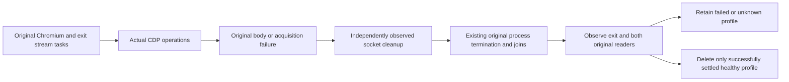

# Original administration browser process ownership

KL-015 and AdminDashboard AC-AD-006 native verification infrastructure. [AdminDashboard](../AdminDashboard.md) and [ADR-117](../../ADR/ADR-117-native-tunit-ci-entry.md) retain the actual Aspire RF3/SDK/official MCP and full browser acceptance gates.

REQ-ABO-001: capture the original Chromium process, uncancelled exit task and both output readers inside the protected acquisition path. Preserve the existing browser executable contract, command arguments, bounded-memory drainage, CDP protocol, polling cadence and operation deadline. Every CDP, launch, endpoint, protocol or body failure must preserve its original error and independently settle all actually acquired owners. A cleanup threshold is a diagnostic failure, never permission to release a live Process or delete its profile.

AC-ABO-001: AdminBrowserOwnedLifetimeTests.RealChromeProtocolErrorThenHealthyOperationJoinsOriginalProcessAndReadersAcrossRepeatedDispose uses the genuine configured headless Chromium and original CDP socket, evaluates a complete literal value, observes a genuine protocol error then repeats the healthy operation. Repeated disposal callers observe one memoized original task; actual original exit/stdout/stderr tasks finish successfully with identical identities before the healthy profile is removed. The original complete RF3 AdminDashboardBrowserTests body uses the existing failure ledger, preserves its profile on body failure and independently observes disposal. No fake browser, custom clock, process replacement, isolated child launch protocol or product hook is added.

REQ-ABO-002: CDP cleanup failure cannot skip process termination and joins. Existing LocalImageOwnedProcessLifetime and OwnedProcessFailureObserver own original process settlement and exception observation. Startup acquisition and cleanup failures retain both original errors; process/readers/handle failures preserve the profile. Memoized CDP/process disposal re-observes the original failure. An unknown original exit or reader state prevents handle disposal/profile deletion. Failed body evidence is explicitly retained by the owning caller; all native UI export consumers must use the same original failure ledger and PreserveEvidence rule.

The source repair batch covers launch acquisition, CDP/process cleanup independence and early profile deletion together. Source review, strict compilation, real configured-Chromium discovery/execution, original browser RF3 flow and exact-source Linux qualification remain OPEN until Root retains original artifacts. Local lifecycle proof is not database RF3, UI telemetry export or production readiness proof.
