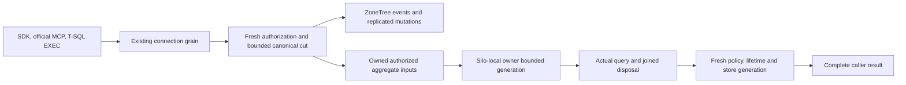

# AnalyticsStore

AnalyticsStore is an independently named user resource. Canonical events live in
ZoneTree; bounded generations compute aggregates from currently authorized
captures. Orleans owns request execution and the silo-local storage lifetime.

| Requirement | Acceptance | Completion gate |
|---|---|---|
| REQ-ANALYTICS-001 | AC-ANALYTICS-001 | Configure three independent AnalyticsStore resources with immutable declared dimensions and numeric metrics. SDK and official MCP callers ingest and independently query each store. Resource kind, schema, generated Orleans aliases and IDs remain stable. |
| REQ-ANALYTICS-002 | AC-ANALYTICS-002 | Existing authorized Batch commits canonical event replacement/deletion, expected revisions, row metadata and links to node-local ZoneTree through acknowledgement from every configured copy across the `KeyLoad:ReplicaCount` copies. Failed CAS changes neither event nor generation. Same operation replay returns the original receipt. |
| REQ-ANALYTICS-003 | AC-ANALYTICS-003 | Bounded event reads enforce current persisted scope, row and field policies. Aggregate inputs contain only currently visible rows, with raw-use authorization for selected dimensions and metrics. Fresh persisted subject/policy, resource lifetime, read generation and store generation are revalidated before publishing output. |
| REQ-ANALYTICS-004 | AC-ANALYTICS-004 | The centrally pinned ZoneTree.Analytics 1.0.2 executes each aggregate from a complete authorized canonical capture in a fresh derived generation. Track, Flush, Query and Dispose calls are synchronous. accepted/processed/dropped/rejected/error counters and the complete raw-event query plan are checked. Limits refuse incomplete results rather than returning a partial aggregate. |
| REQ-ANALYTICS-005 | AC-ANALYTICS-005 | The silo-local ZoneTree owner (the node's Orleans Grain Service) owns derived directories, engines and shutdown. Cancellation joins the actual operation and disposal; a failed join blocks subsequent generation acquisition and physical owner release. |
| REQ-ANALYTICS-006 | AC-ANALYTICS-006 | Both canonical key families participate in bounded partition inventory, snapshots/backup and resource cleanup. Effect capture includes the store and every linked resource through the existing observed resource binder; a retired resource prevents new effects. |
| REQ-ANALYTICS-007 | AC-ANALYTICS-007 | HTTP/SDK, official MCP and versioned T-SQL EXEC catalog calls share the same typed operations and connection-owned Orleans execution. A public functional scenario proves three independent stores through create, ingest, replacement, deletion, raw read and complete aggregate. |
| REQ-ANALYTICS-008 | AC-ANALYTICS-008 | Full solution build, meaningful TUnit operations, real process recovery and Aspire-owned cluster SDK/MCP gates pass. No performance, endurance, production-readiness or full-SQL claim follows from source presence. |

The schema declares ordinally sorted unique dimension and metric names. Events have an ID,
UTC timestamp, string dimensions, finite numeric metrics, optional persisted row
access, canonical entity links and monotonic event revisions. Schema changes that
would reinterpret retained events are rejected. Replacement requires the exact
prior revision, with zero reserved for an absent event. Deletion records a
canonical tombstone. A store generation advances with every successful mutation.
Mutation receipt revision is that store generation; event CAS revisions remain
separate and are returned with event reads.

Reads use a half-open UTC time range and ordinal ID continuation. Continuation is
explicitly a new read rather than a persisted snapshot token. Aggregation supports
Count, Sum, Average, Min and Max, grouped by declared dimensions. Count selects no
source metric. KeyLoad sets no group, record, byte or lifetime ceiling
([ADR-149](../ADR/ADR-149-no-operation-limits.md)): it sizes the engine's
ingestion queue by the captured row count, never truncates dimension values and
sets the engine query timeout only from the caller's explicit expiry. The output
must fit the grain reply ceiling.
Canonical timestamps may be ahead of system UTC. Each disposable generation
configures the engine's ingestion skew to include its latest already captured
timestamp. Original timestamps, capture limits and complete-ingestion checks stay
authoritative; the requested range alone cannot expand ingestion skew.

Initial entity links target existing, readable, nondeleted collection documents in
the same atomic partition. They use the existing canonical EntityRef identity and
fresh document/row authorization at the mutation cut. This stage does not claim a
cross-partition transaction or a general resolver for every model. Aggregate
queries do not group by links or dereference linked content. Raw link disclosure
remains subject to current access and field policy.

The selected published package is ZoneTree.Analytics 1.0.2 under its original MIT
license. Its package metadata identifies source commit
`3fae17a7c94b5b444c457fdd00ed119d13179487`. Each query builds its own bounded
raw-event generation from the captured current canonical events and forces the
RawEvents query source. Updates and deletes are reflected by that new
capture, without a second authoritative database or a stale rollup fallback.
Public schema names map to ordinal keys; public names are never truncated
to fit identifier bounds.

The generation lives under the silo-local ZoneTree owner's
`derived-user-analytics/<lifetime-digest>/<generation>` directory. Its identity is
resource/lifetime-specific; three stores are not three Site aliases in one shared
engine. Core captures immutable authorized data under its read cut and releases
the gated view before synchronous Track/Flush/Query work. The silo-local
owner retains the original operation and engine through actual synchronous
Dispose, then removes the disposable directory only after successful joined close.
The connection operation holds the shared analytical admission through the execution
join and fresh source/authorization validation before output publication. The
final validation uses the remaining original read budget; it does not renew the
explicit expiry. The internal same-process result
and snapshot never become an extra public or inter-grain payload. The raw execution
files are never read as authority, do not acknowledge a database mutation and are
excluded from canonical backup authority. Interrupted disposable
generations are removed at the next opening under the acquired physical lock;
they are never reused as trusted projections.

Existing OpenTelemetry logs, traces and metrics remain the foundation.
User analytics events and dimensions are not telemetry labels or diagnostic
payloads. Measured performance is a separate Linux GitHub gate.

Core owns the canonical AnalyticsStore feature and its adapter; Server
owns generation lifetime on the silo-local ZoneTree owner; Clustering reuses the
existing connection read capability path; Abstractions, Client and ClientApi own
typed public contracts and existing transport composition.

Applicable decisions are [ADR-071](../ADR/ADR-071-canonical-zonetree-providers.md)
for canonical storage, [ADR-125](../ADR/ADR-125-connection-owned-execution.md)
for connection execution, [ADR-130](../ADR/ADR-130-microsoft-scriptdom-tsql.md)
for catalog-driven T-SQL EXEC, and
[ADR-136](../ADR/ADR-136-orleans-partition-ownership.md) for the silo-local
ZoneTree owner.

AC-ANALYTICS-001/002/007 map to the added real FunctionalGateUserAnalytics
scenario. AC-ANALYTICS-002/003/004 map to AnalyticsStoreTests and the
additional policy-publication tests. AC-ANALYTICS-006 maps to
AnalyticsSharedIntegrationTests, including actual family pages, family inventory and
D2 enrollment. AC-ANALYTICS-005 maps to physical-host lifecycle tests, and
AC-ANALYTICS-008 requires the build, TUnit, process-recovery and Aspire cluster
runs. Source presence and narrow build or recovery results do not close these
complete current-source analytics qualification gates.
