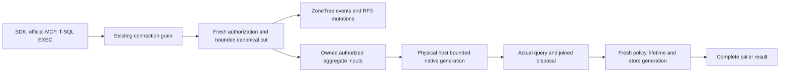

# AnalyticsStore

Status: reviewed implementation adopted into canonical source in R638; combined
compilation and runtime qualification remain open. This is an independently named
user resource, separate from the existing node operational analytics report.

| Requirement | Acceptance | Completion gate |
|---|---|---|
| REQ-ANALYTICS-001 | AC-ANALYTICS-001 | Configure three independent AnalyticsStore resources with immutable declared dimensions and numeric metrics. SDK and official MCP callers ingest and independently query each store. Resource kind, schema, generated Orleans aliases and IDs remain stable. |
| REQ-ANALYTICS-002 | AC-ANALYTICS-002 | Existing authorized Batch commits canonical event replacement/deletion, expected revisions, row metadata and links to node-local ZoneTree through ordered RF3 acknowledgement. Failed CAS changes neither event nor generation. Same operation replay returns the original receipt. |
| REQ-ANALYTICS-003 | AC-ANALYTICS-003 | Bounded event reads enforce current persisted scope, row and field policies. Aggregate inputs contain only currently visible rows, with raw-use authorization for selected dimensions and metrics. Fresh persisted subject/policy, resource lifetime, read generation and store generation are revalidated before publishing native output. |
| REQ-ANALYTICS-004 | AC-ANALYTICS-004 | Native ZoneTree.Analytics 1.0.0 executes each aggregate from a complete authorized canonical capture in a fresh derived generation. Native accepted/processed/dropped/error counters and complete query plan are checked. Limits refuse incomplete results rather than returning a partial aggregate. |
| REQ-ANALYTICS-005 | AC-ANALYTICS-005 | The existing physical PartitionHost owns derived directories, engines and shutdown. Original generations are bounded by the existing MaxConcurrentQueries allowance without a waiting queue. Cancellation joins the actual native operation and disposal; a failed join blocks subsequent generation acquisition and physical owner release. |
| REQ-ANALYTICS-006 | AC-ANALYTICS-006 | Both canonical key families participate in partition roster/export/import/cleanup and D2 inventory. D1 effect capture includes the store and every linked resource through the existing observed resource binder; retirement prevents new effects. |
| REQ-ANALYTICS-007 | AC-ANALYTICS-007 | HTTP/SDK, official MCP and versioned T-SQL EXEC catalog calls share the same typed operations and connection-owned Orleans execution. A public functional scenario proves three independent stores through create, ingest, replacement, deletion, raw read and complete aggregate. |
| REQ-ANALYTICS-008 | AC-ANALYTICS-008 | Full solution build, meaningful TUnit operations, real process recovery and Aspire-owned Docker RF3 SDK/MCP gates pass on their recorded exact source. Linux GitHub qualification remains separate. No performance, endurance, production-readiness or full-SQL claim follows from source presence. |

The schema declares ordinally sorted unique dimension and metric names. Events have an ID,
UTC timestamp, string dimensions, finite numeric metrics, optional persisted row
access, canonical entity links and monotonic event revisions. Schema changes that
would reinterpret retained events are rejected. Replacement requires the exact
prior revision, with zero reserved for an absent event. Deletion records a
canonical tombstone. A store generation advances with every successful mutation.
Mutation receipt revision is that store generation; event CAS revisions remain
separate and are returned with event reads.

Reads use a half-open UTC time range and ordinal ID continuation. Continuation is
explicitly a new read rather than a persisted snapshot token. Aggregation supports
Count, Sum, Average, Min and Max, grouped by declared dimensions. Count selects no
source metric. Requested groups, captured records, bytes, query lifetime and output
are bounded by actual server limits; overflow fails the complete aggregate.

Initial entity links target existing, readable, nondeleted collection documents in
the same atomic partition. They use the existing canonical EntityRef identity and
fresh document/row authorization at the mutation cut. This stage does not claim a
cross-partition transaction or a general resolver for every model. Aggregate
queries do not group by links or dereference linked content. Raw link disclosure
remains subject to current access and field policy.

The selected published package is ZoneTree.Analytics 1.0.0 under its original MIT
license, reviewed against source commit
`f7511306bbf0c375a918fc8a93845b1f596777b7`. Its native event erasure does not
recompute existing rollup totals. Each query therefore rebuilds its own bounded
raw-event generation from the captured current canonical events and forces the
native RawEvents query source. Updates and deletes are reflected by that new
capture, without a second authoritative database or a stale rollup fallback.
Public schema names map to ordinal native keys; public names are never truncated
to fit native identifier bounds.

The generation lives under the actual physical host's
`derived-user-analytics/<lifetime-digest>/<generation>` directory. Its identity is
resource/lifetime-specific; three stores are not three Site aliases in one shared
engine. Core captures immutable authorized data under its read cut and releases
the gated view before any native await. The physical runtime retains the original
task and native engine, joins disposal, then removes the disposable directory.
The connection operation holds the shared analytical admission through the native
join, a final actual RF3 read barrier and fresh source/authorization validation
before output publication. The final barrier uses the remaining original read
budget; it does not renew the deadline. The internal same-process native result
and snapshot never become an extra public or inter-grain payload. The raw native
files are never read as authority, do not acknowledge a database mutation and are
excluded from canonical movement/backup authority. Interrupted disposable
generations are removed at the next opening under the acquired physical lock;
they are never reused as trusted projections.

Existing native OpenTelemetry logs, traces and metrics remain the foundation.
User analytics events and dimensions are not telemetry labels or diagnostic
payloads. The operational node report and its independent qualification remain
unchanged. Measured performance is a separate Linux GitHub gate.

Implementation owners: Core owns the canonical AnalyticsStore feature and its
native adapter; Server owns physical generation lifetime; Clustering reuses the
existing connection read capability path; Abstractions, Client and ClientApi own
typed public contracts and existing transport composition. The dependency order
is contracts → canonical authorization/state → native projection and lifecycle →
public operations → focused correctness/recovery → Aspire RF3 → Linux acceptance.

Applicable decisions are [ADR-071](../ADR/ADR-071-canonical-zonetree-providers.md)
for canonical storage, [ADR-125](../ADR/ADR-125-connection-owned-execution.md)
for connection execution, [ADR-130](../ADR/ADR-130-microsoft-scriptdom-tsql.md)
for catalog-driven T-SQL EXEC, and
[ADR-136](../ADR/ADR-136-native-orleans-partition-ownership.md) for the physical
owner. [ADR-134](../ADR/ADR-134-node-owned-derived-analytics.md) continues to own
the separate operational report; its operational-only API is not reclassified as
user analytics. Remote lifetime-read qualification in
[ADR-139](../ADR/ADR-139-resource-lifetime-read-fence.md) remains separately open.

AC-ANALYTICS-001/002/007 map to the added real FunctionalGateUserAnalytics
scenario. AC-ANALYTICS-002/003/004 map to AnalyticsStoreNativeTests and the
additional policy-publication tests. AC-ANALYTICS-006 maps to
AnalyticsSharedIntegrationTests, including actual native family pages, roster and
D2 enrollment. AC-ANALYTICS-005 maps to physical-host lifecycle tests, and
AC-ANALYTICS-008 requires the integrator's actual build/TUnit/process/Aspire RF3
and Linux receipts. These are test-source mappings; none is an execution result.
