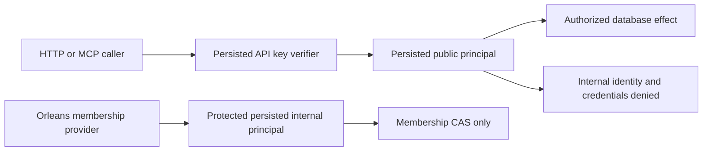
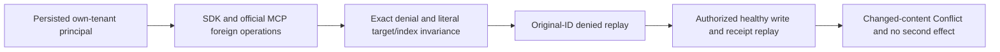
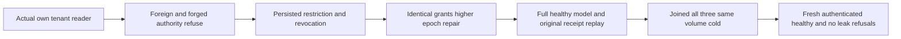
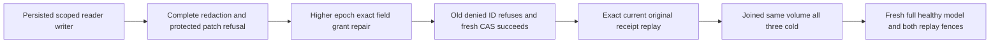
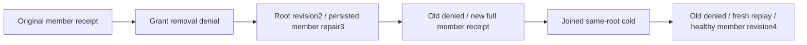
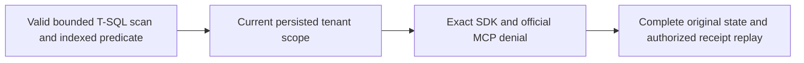

# Authorization

Database-persisted API-key verifiers, principals, grants and policy epochs determine
every public operation. HTTP/MCP callers cannot supply trusted roles. Existing
authorization and field/row projection remain subject to ADR-032's layout debt;
the cluster control boundary is defined by [ADR-036](../ADR/ADR-036-orleans-foundation.md).

| Requirement | Acceptance and evidence |
|---|---|
| REQ-AUTH-001: public identity and grants come from the replicated database after a quorum read | AC-REP-005: real SDK/MCP invalid, expired, revoked and unauthorized calls fail before effects, including after failover |
| REQ-AUTH-002: public credential changes cannot disable or impersonate the cluster's membership authority | AC-AUTH-002: a persisted protected internal principal has no public API key; even an administrator cannot edit it or create a credential for it; revoking a public administrator does not revoke internal membership |
| REQ-AUTH-003: internal authority can perform only its approved membership control operation | AC-AUTH-003: ordinary callers cannot submit Membership; the internal principal cannot submit data/security operations; real store outcomes preserve exact denial and unchanged effects |

### Current unit case-to-acceptance crosswalk

| Native case class | Existing requirement / acceptance | Evidence boundary |
|---|---|---|
| `ClusterPrincipalPolicyTests`, `ClusterPrincipalInitializationIntegrityTests`, `StorageRecovery.PartitionHostRecoveryTests.MissingProtectedPrincipalInVerifiedPendingImageRejectsHostAndSafeRetry`, `ModifiedProtectedPrincipalInVerifiedPendingImageRejectsHostAndSafeRetry`, `ValidProtectedPrincipalInVerifiedPendingImageOpensAtRecoveredCut` | REQ-AUTH-002 / AC-AUTH-002 | Protected internal-principal bootstrap/idempotence, public edit/credential denial, snapshot copy, and missing/modified/corrupt row rejection at an existing apply cut. The three StorageRecovery cases exercise a real verified pending-image install: absent/modified principal state rejects both host-open attempts; valid principal state is present after install/reopen. This is local store/snapshot evidence, not quorum or RF3 proof. |
| `ClusterPrincipalAuthorizationTests` | REQ-AUTH-003 / AC-AUTH-003 | Ordinary/public internal-membership denial, internal data/security denial, and internal membership after public-root revocation. |
| `DocumentRowTenantMutationAuthorizationTests` | REQ-AUTH-005 / AC-AUTH-005, with the owning document boundary REQ-DSTORE-003 / AC-DSTORE-003 | Put/Patch/Delete cannot forge row owner or tenant. It does not cover all row-scoped read/query adapters. |
| `DocumentFieldMutationAuthorizationTests`, `DocumentReplacementFieldAuthorizationTests`, `DocumentDeleteIndexAuthorizationTests` | REQ-AUTH-006 / AC-AUTH-006, with the owning document boundary REQ-DSTORE-003 / AC-DSTORE-003 | Persisted field-write and index-use grants are independently enforced on the tested mutation paths; this is not the complete adapter/lineage matrix. |
| `ResourcePolicyUpdateTests`, `ResourcePolicyUpdateRejectionTests`, `ResourcePolicyUpdateVisibilityTests` | See the exact REQ-RPOL-001..004 mapping in [ResourcePolicyUpdates](Authorization/ResourcePolicyUpdates.md) | The unit cases map to RPOL-001/002/003; RPOL-004 remains the real SDK/MCP RF3 criterion. The blob-quota exclusion case is validator-only, not a store-apply flow. |

`SignedEnvelopeTests` is physically under the Authorization test directory but
is owned by InternalSerialization: map it only to REQ-IS-007 / AC-IS-007 in
[InternalSerialization acceptance](InternalSerialization/Acceptance.md#requirements-and-acceptance).
It is not evidence for public credential verification or persisted principal
authorization.

Slice map: new policy code `src/KeyLoad.Core/Features/Authorization/`; focused
tests mirror `tests/KeyLoad.UnitTests/Features/Authorization/`. HTTP/MCP adapters
remain ClientApi and invoke Orleans request grains. Principals/API keys remain
existing shared public contracts. Frontend: N/A, no independent UI is introduced.

TASK-ROUTE-AUTH owns only new policy and its real ZoneTree regressions; the lead
adds the existing DatabaseEngine integration guards and host bootstrap call.
No test doubles or local execution. TUnit unit gates and Docker RF3 public-key
revocation/membership readiness provide the combined proof. The policy's bootstrap
is process-composition authority, not an HTTP/MCP operation: seed an absent internal
principal only at apply cut zero; a missing or modified protected row at an existing
cut fails closed. Quorum catch-up makes the replicated catalog authoritative before
any public authentication. No secrets are added to the protected principal.

## Повний public authorization contract

Актори: API-key caller, persisted administrator/resource owner та protected internal membership identity. Current source: [principal/key contracts](../../src/KeyLoad.Abstractions/Contracts.cs), [DatabaseEngine](../../src/KeyLoad.Core/DatabaseEngine.cs), [AuthorizationPolicy](../../src/KeyLoad.Security/Features/Authorization/Execution/AuthorizationPolicy.cs), [mutation checks](../../src/KeyLoad.Core/MutationAuthorization.cs), [server binding](../../src/KeyLoad.Server/Program.cs). Persisted public credentials/grants уже існують; новий quorum/bootstrap/internal control ремонт та широка SDK/MCP parity ще потребують qualification.

| Вимога | Acceptance / flows | Test mapping |
|---|---|---|
| REQ-AUTH-004: тільки persisted verifier/principal створює public server identity | AC-AUTH-004: valid stored credential дає exact principal; unknown/expired/revoked/malformed key та client-supplied trusted roles fail closed без effects; restart/failover зберігають каталог | Existing `UnsignedPeerRequestsAndClientSuppliedPrincipalAreRejected` у [ClusterTests](../../tests/KeyLoad.IntegrationTests/Features/ClusterReplication/Cases/ClusterTests.cs); invalid catalog tests у [TransactionTests](../../tests/KeyLoad.UnitTests/TransactionTests.cs); full credential edge/RF3 parity PLANNED |
| REQ-AUTH-005: tenant/database/resource/row capability enforcement спільний для read/write | AC-AUTH-005: wrong scope/owner/project/row grants не відкривають дані чи effects; forged resource identity не авторизує іншу collection; internal membership authority не перетворюється на public admin | Existing `RowScopeAndTenantCannotBeForged` у [SecurityAndQueryTests](../../tests/KeyLoad.UnitTests/SecurityAndQueryTests.cs), `AShadowedMutationResourceCannotAuthorizeWritesToAnotherCollection` у TransactionTests; REQ-AUTH-001–003 збережені |
| REQ-AUTH-006: field read/use/write та omit-default projection застосовуються наскрізно | AC-AUTH-006: nested/aliased protected fields не витікають у payload/headers/metadata; predicate/sort/index/vector use і replace/patch перевіряють окремі grants; різні query adapters мають однакові omissions | Existing `NestedSensitiveFieldsAreOmittedAndAliasedPredicateAndSortAreDenied`, [QueryAdapterTests](../../tests/KeyLoad.UnitTests/QueryAdapterTests.cs) adapter omission cases, [ChangeFeedTests](../../tests/KeyLoad.UnitTests/ChangeFeedTests.cs) PII cases; full lineage matrix PLANNED |
| REQ-AUTH-007: current policy epoch перевіряється на request/page/cache boundary | AC-AUTH-007: revoke/ACL/policy change invalidates відповідний cursor/result без cached payload leakage; invalid token/history/scope дає typed failure, після відмови healthy authorized call works | Existing `RevocationInvalidatesCurrentPageAndNeverReturnsCachedPayload` у SecurityAndQueryTests, feed revocation/scope tests; [ADR-022](../ADR/ADR-022-policy-epoch-revocation.md) RF3 boundary expansion PLANNED |
| REQ-AUTH-008: worker required inputs та protected effects gate перед unsafe delivery/replay | AC-AUTH-008: missing protected-input grants зупиняють claim/replay/checkpoint; changed principal policy блокує стару delivery; inbox replay не обходить current effect authority | Existing `WorkerRequiredProtectedInputFailsBeforeClaim`, [SubscriptionTests](../../tests/KeyLoad.UnitTests/SubscriptionTests.cs) `MissingRequiredWorkerInputStopsDeliveryWithoutAdvancingTheCheckpoint`, `AnotherWorkerReusesTheInboxOnlyAfterCurrentEffectPermissionsAreChecked` |
| REQ-AUTH-009: diagnostics та derived projections зберігають sensitive classification | AC-AUTH-009: PLANNED PII/token canaries не потрапляють у errors/logs/traces/search statistics чи unauthorized derived result; omitted-default lineage зберігається при rebuild/replay/backup | Existing safe projector tests — часткове source evidence; PLANNED full cross-interface diagnostics/lineage matrix KL-067/068/096/103 |

Рішення: [ADR-014 RBAC](../ADR/ADR-014-principals-rbac-row-policy.md), [ADR-015 sensitive lineage](../ADR/ADR-015-sensitive-data-lineage.md), [ADR-022 policy epoch](../ADR/ADR-022-policy-epoch-revocation.md), [ADR-029 event/message privacy](../ADR/ADR-029-event-message-classification.md). Policies/keys persisted server-side; readers і projections користуються нинішнім principal та scope. Stored raw history може містити protected input, але це не дозволяє unsafe replay до consumer.

Canonical map: Security/Core/Abstractions/Server/tests `Features/Authorization/` для policy/behavior; SDK/MCP adapters — ClientApi, business projection — owning slice. UI N/A. Shared identity/epoch/schema/host composition мають одного integration owner. Нові trust boundaries freeze через ADR → реальні adversarial tests → implementation → migration/rollout → GitHub SDK/MCP RF3 failover proof. Source/test names не доказ passing; diagnostics, coverage/complexity та current delivered-source qualification pending.

### TASK-AUTH-DENIED-REPLAY-CLOCK-001

REQ-AUTH-008, original ADR002 same-ID outcome contract and TASK-BACKUP-EVENTING-CUT-001 require current authorization to be checked before outcome reuse, while an unreplicated authorization-denied retry of a retained same command must not append another clock-only native commit. A concrete current source path authorizes before outcome selection; denial retains ForNew/persistOutcome=true, skips overwriting an existing outcome, but stages equal ClockBytes. Native ZoneTree staged writes are real journal changes. Thus repeated denied native calls advance the store position despite unchanged immutable receipt.

Freeze before correction: reuse the existing one outcome-key presence read in PersistCommandOutcome. If a previously stored key exists and replicationIndex is nonpositive, the denial has no staged domain effect; preserve current error/current policy checks and immutable outcome and return before clock staging. New rejected IDs still persist failure outcome/clock exactly once. Supplied positive replicated indexes retain original applied watermark and supplied-time clock staging unchanged, including distinct log entries that share an ID. Do not return old success after revoked permissions or weaken authorization, fingerprints/incarnation, compiled validation or token/placement checks. No storage/public/serializer format changes.

Ownership: shared Core AtomicCommandCommit.PersistCommandOutcome only; new UnitTests Authorization real native denial/replay/replicated-apply metadata/healthy flow, plus BackupRestore eventing administrator-resume denial. Before execution, root reviews exact guards, build/analyzers/format and actual full normal/scalar/recovery/RF3 Linux gates. Literal expected native positions/outcomes and full stored bytes—not implementation getters—prove unchanged embedded replay, positive supplied index advancement and healthy effects. Source review is not runtime proof or consensus qualification. Rollback removes this correction and these task contracts/regressions coherently.

AC-AUTH-REPLAY-001 has two native arguments (same evaluatedAt / later trusted evaluatedAt). CommandFingerprint freezes Id/Kind/PrincipalId/PayloadJson, explicitly excluding evaluatedAt; the tests supply actual typed trusted native operation time without substituting a clock provider or waiting. The original ADR002 permission that physical commit position may advance is retained for positive replica indexes and broader historical work; this owner-authorized task tightens only unreplicated, already-retained, no-effect authorization rejection. The native regression independently asserts current exact PermissionDenied, one failure/clock commit, immutable full-store bytes under both same-ID times, then genuine Apply indexes1/2 with exact applied watermark and supplied clock, unchanged original outcome bytes, already-applied-index idempotence and a new authorized document operation. It is not RF3 consensus proof.

The native removed-grant case also first commits a real writer document, removes its persisted grant with the next exact policy epoch, then repeats the original identity and payload with later trusted time: current PermissionDenied, immutable original success receipt, unchanged complete store bytes/position, and a healthy root revision update are required.

## TASK-KL015-CROSS-TENANT-RF3-001

REQ-AUTH-KL015-001 / AC-AUTH-KL015-001 supplements REQ/AC-AUTH005/009 and REQ/AC-CLIENT005/006 under existing ADR002/022/039. A persisted non-admin principal belongs to one native tenant, with persisted document read/write/query grants on its resource. Actual SDK and official MCP foreign-tenant GET, bounded full scan, indexed predicate and immutable Batch write must return exact PermissionDenied/safe scope detail and disclose no credential or payload canary. Canonical foreign/owned documents and actual indexed membership remain literal and unchanged after rejection/retry. Same-ID denied replay remains PermissionDenied; authorization precedes fingerprint selection, so different payload under that still-unauthorized ID must likewise remain denied. An authorized healthy command proves exact revision/effect, stable same-ID receipt replay and changed-content Conflict with no second effect.

ADR002 definitive failed writes remain logged: first denied command may advance persisted failure/clock/replica watermark without changing target documents/indexes. Same-ID public retry is stable in result/target effect, not a fabricated global storage position promise. Separate public reads do not guarantee equal cluster-wide cuts while metadata changes; positive cut and complete literal state are checked, and query errors expose no partial page. No pre-submit authorization, product lock, timeout or catalog change is introduced. Telemetry privacy has current R785 local native normal/scalar 12/12 export evidence, including the real signed AcOrl012RealSignedOperationsExportBoundedPrivateNativeTelemetry case; the exact scope and original reports are recorded in ADR-121. Original4e18 artifact paths are unavailable in this session, so that historical checkpoint is not authenticated passing evidence or current Linux qualification. This RF3 scenario separately checks actual public failure envelopes; those envelopes alone do not prove every server exporter. Native exact-source execution and original receipts are mandatory before any KL015 closure.

Canonical ownership: IntegrationTests Features/Authorization Cases/Helpers/Assertions. Existing shared ClusterFixture owns Docker/Aspire RF3 endpoints/lifetime; official session is joined with original primary+cleanup errors preserved. Existing standard catalogs/selectors remain unchanged; no LocalImage expansion.

TASK-AUTH-KL015-ORDERED-RECEIPT-001 refines AC-AUTH-KL015-001: compare complete serialized SDK replay, official MCP replay and literal healthy document output by ordered byte content. Byte-array reference identity cannot establish the required receipt contract. Preserve the entire existing persisted authorization, foreign denial, unchanged target/index, changed-content Conflict and healthy continuation flow. The original exact46a4 reference-equality failure stays retained; actual native RF3 execution remains required before closure. Existing ADR-002/022/039 contracts are unchanged.

## KL-015 exported telemetry privacy

REQ-AUTH-KL015-002 / AC-AUTH-KL015-002: actual ASP.NET/HTTP-client spans and OpenTelemetry logs must not export caller payload, raw URL/path/query, credentials, scope state or exception messages. Preserve count/duration, status, fixed normalized operation/category, severity, numeric event identity, timestamps and trace correlation. Unapproved arbitrary attributes do not become telemetry authority. The same real Kestrel request executes actual ZoneTree-backed administration, then a denied request preserves canonical state and an authorized healthy request returns a complete literal catalog. Actual exporters capture immutable span/log snapshots; canary absence alone is insufficient: exported server/client spans and failure/healthy log records must exist and preserve exact safe fields. Existing RF3 SDK/official MCP cross-tenant and admission negatives remain mandatory.

[ADR-121](../ADR/ADR-121-exported-telemetry-privacy.md) freezes this boundary. ServiceDefaults owns validated Authorization privacy options, processors and registration; UnitTests Authorization owns real Kestrel/file-backed operation/exporter lifecycle tests. Root owns integration, architecture/index/status, coherent build/image and delivery. No new package, storage format, trusted role, public endpoint or schema is introduced. Existing native Orleans telemetry policy is unchanged. Startup, primary operation, flush, stop and disposal failures remain original errors and all owned resources settle. Source authoring is not passing execution, numeric coverage, Linux qualification or KL-015 closure.

AC-AUTH-KL015-002 permits only ADR-121's closed native HTTP connection context link shape. Native span IDs and complete safe link fields must match the preprivacy observation; events, tagged/state-bearing/extra links and unsafe ancestry still suppress the original span. Normal and scalar actual HTTP fullflows plus Linux RF3 remain required.

Local REQ/AC-AUTH-KL015-002 export evidence: R785 coherent Release build green, actual native normal and scalar three-class focus each 12/12 PASS with native exit 0 and source/assembly drift zero. [ADR-121](../ADR/ADR-121-exported-telemetry-privacy.md#local-development-verification-2026-10-08) records exact scope and original report lineage. Current Linux run 37821315110 attempt 1 on exact source 3458f611 has authenticated original normal/scalar TRX with all 12 telemetry cases passed in each mode, native source/image receipts retained and after-suite identity verification successful; ADR-121 records artifact/TRX hashes. Complete unit suites each retain 19 other failures. Current exact-source Linux RF3 cross-tenant, bounded-input/query and C1 held-write/guard acceptance remain open; neither export gate marks KL-015 done or establishes full-suite/production/endurance qualification.

TASK-AUTH-KL015-COMPLETE-DENIAL-RESULT-001 refines REQ/AC-AUTH-KL015-001 under unchanged ADR-002/022/039: each actual SDK foreign-tenant GET, full scan, indexed predicate, original write/replay and changed-content denied write must have no result payload, exact PermissionDenied/safe scope detail, and a complete serialized native result containing none of the persisted credential or document/conflict/healthy canaries. Checking only Problem cannot prove that a failed result carries no payload or leaked metadata. The existing official MCP complete-result privacy, literal foreign/owned document and real index invariance, healthy exact receipt replay and Conflict/no second effect remain mandatory in the same RF3 wholeflow.

Ownership is the existing Authorization CrossTenantRf3ErrorAssertions helper and Kl015ForeignWritesScansAndIndexesAreDeniedAndAuthorizedReceiptRemainsStable case; no transport, provider, wire, storage, role, admission or timeout change is introduced. Current API payloads are reference-record DocumentResult, QueryPage and CommitReceipt; the helper's nullable reference constraint also accepts the actual Result<DocumentResult?> returned by GetAsync while requiring every denial value to be null. Root joins guarded source and runs the coherent native checks; exact-source Linux RF3 original TRX, source/image receipts and API artifact digest remain required. This stronger oracle is authored evidence until executed and does not mark KL-015 done.

### TASK-AUTH-KL015-MODEL-VIEW-DENIAL-001

REQ/AC-AUTH-005/006/009 and REQ/AC-SQLVIEW-002/003/005 require a failed event/queue SQL request to carry no partial page or protected payload/header metadata. Freeze before the test extension under unchanged ADR-014/015/022/072. The existing two real persisted model-authority cases check the SDK error code only at field-use denial and have no actual foreign model partition. Extend those same whole flows using a second genuinely administrator-seeded event/queue partition with its own tenant. The original non-admin persisted own-tenant credential must receive exact PermissionDenied/safe scope detail for both foreign SQL model sources through SDK and official MCP. Every failed SDK result must be IsFailed, Value null and contain no credential or any of the four literal event/queue payload/header canaries in complete native serialization; official MCP must retain its exact error envelope and omit those same canaries from the complete native result. Apply the complete privacy/no-page oracle to the original same-tenant denied sensitive predicate too.

Before and after foreign rejections, actual administrator native stream and message inspection plus SQL rows must equal the literal seeded histories and Ready/unclaimed queue state. Compare ordered logical rows and complete original native records, require positive cuts, and never infer equal cluster-wide cuts across separate calls. The original authorized redacted SDK/MCP read follows the denials, then a real persisted field grant exposes the literal selected value, followed by actual revocation. Original transport, topology, grant epoch, deadlines and cleanup stay unchanged. No product fix or new runtime hook is presumed from this coverage gap.

Ownership: existing QueryExecution Cases/SqlModelViewRf3QueueAuthorityTests.cs and SqlModelViewRf3EventAuthorityTests.cs; new feature-local Helpers/SqlModelViewRf3ForeignTenantFlow.cs and Assertions/SqlModelViewRf3DenialAssertions.cs; requirements here and Authorization/QueryExecution with ADR072. Root alone joins/compiles/formats/delivers. Stages: contract, guarded source-only test repair, coherent native build/discovery, both actual Aspire RF3 flows, exact-source original Linux TRX and source/image/artifact receipts. Native discovery, source review and historical weaker passes cannot qualify these stronger flows. Rollback removes these case extensions and private helpers together; wire, provider, public API, persisted format and UI are N/A. KL015 remains open until current repaired C1 and all required acceptance gates are proven.

## KL-096 immutable delivery replay and current classification

REQ/AC-AUTH-006/007/008/009 and REQ/AC-MSG-002 require current persisted field/header policy to protect an original successful queue or subscription receive replay. The original StoredOutcome bytes, original principal-policy fence, group generation/ownership, token and lease fences remain exact. A resource-only policy CAS may change its SchemaVersion without changing principal PolicyEpoch; after successful original lease validation, cached output must therefore be checked against the current projector in the same existing synchronous IKeyValueView. Queue output uses current caller; subscription output uses current persisted data principal followed by current caller, matching genuine acquisition. No nested storage read or await is introduced.

If the common current projector removes an actually retained JSON value, replay refuses PermissionDenied with fixed safe detail and no payload. Complete semantic JSON equality allows formatting changes and hidden paths absent from the retained value; it does not rewrite or redact an original receipt into a different successful receipt. The original outcome, canonical input body, lease and counters stay unchanged. Parsing remains within the existing admitted JSON/receive bounds; no new grant, limit, serializer ID, persisted family, provider, clock, retry or deadline is introduced. Higher-epoch repair never makes an old-epoch result replayable: fresh authorized work produces its own original outcome.

Ordered ownership: specs/ADR first; Core Authorization/Validation owns cached projection validation; CommandOutcomes composes it after real lease validation; native whole Unit plus real SDK/official MCP/both Q1 cases own full body/header, denial/no-effects, persisted revoke/repair, DLQ inheritance and same-root cold continuation. Original native outcome bytes are an independent local authority oracle. Normal/scalar, process and Aspire RF3 Linux source/image/UID/runtime gates remain open until actual qualification. Existing migration/conversion/fallback prohibitions remain exact; this is current-schema authorization, not stored-format compatibility.

TASK-AUTH-KL096-CACHED-DELIVERY-001 source map: existing `src/KeyLoad.Core/CommandOutcomes.cs` calls new `src/KeyLoad.Core/Features/Authorization/Validation/CachedDeliveryPrivacy.cs` strictly after native lease validation. `EventMessageSensitiveReplayTests.CurrentResourceBodyAndHeaderPolicyRefusesOriginalDeliveryThenRepairedNewWorkAndColdPreserveExactAuthority` declares four genuine native operation variants: queue body, queue header, subscription caller body and subscription data-principal header. Each variant includes original complete result/native outcome bytes, resource-only reclassification, no-body/no-effect refusal, required-input refusal, persisted revoke/higher-epoch repair, old-result denial, new-result replay, same-root reopen and final ACK/empty continuation. `AbsentProtectedPathPreservesCompleteUnicodeArrayReceiptAfterCurrentPolicyChangeAndColdThenDeniedProducerAndFreshHealthyWork` is the complete safe-replay control: Unicode, ordered arrays and null values stay semantically unchanged while an absent protected path causes harmless JSON formatting; original complete outcome replays unchanged through cold, denied producer has no effect, and new authorized work completes.

`EventMessageSensitivePublicRf3Tests.CurrentBodyHeaderPoliciesRevokeRepairOriginalRefusalFreshDeliveryDlqAndSameOwnerColdFourRoutes` declares the same four current-policy authority variants with real SDK/official MCP/both Q1 routes, persisted inspector omission, required-input refusal, revoke/repair, immutable old-command refusal, new authorized full result/receipt replay and genuine three-node same-owner cold. Queue variants additionally use actual NACK/max-attempt terminal admission, full policy-inherited DLQ inspection and actual state-version/delivery-generation redrive. Each original producer/completion/redrive receipt is compared completely on all four routes; current read generation/applied cut is acquired fresh and can advance on restart. The fixture chooses existing default policy's admitted lease maximum without changing policy ceilings or the original whole-flow deadline. Native test UIDs/counts are not inferred from these source declarations.

Exact role ownership stays under Authorization Cases/Contracts/Models/Helpers/Assertions in Unit and Integration. The existing fixture and caller owners retain credential validation, real official SDK initialization, connection lifetime, RF3 readiness, original operation cancellation and joined cleanup. Specs/ADR, guarded private source, coherent root join, canonical compiler/analyzers/format, actual discovery, normal/scalar Unit, process recovery and Linux Aspire RF3 are sequential gates. This source stage does not qualify process-kill behavior, power loss, performance, complete event/message export/trace lineage or production readiness. No internal compatibility/migration path exists; rollback removes the composed source stage before delivery and preserves immutable original evidence.

## KL-065 incoming-row authority continuation, 2026-10-10

REQ/AC-AUTH-005/007: the two original GraphIncomingPrivacyTests retain their initial hidden-source empty and hidden-target NotFound outcomes, then repair actual persisted row owners through revision-fenced root commands. A reduced scoped GraphRead grant and revoked principal refuse with complete native bytes and cut unchanged. A higher persisted epoch repairs exactly the original grants; independently literal full incoming rows, native command outcomes and receipts survive joined same-root cold reopen. No retained principal confers authority; local Unit normal/scalar development does not close all-interface Linux/RF3/cache/Explain gates.

## TASK-KL065-INCOMING-PUBLIC-CONTINUATION-002

Test-only extension of SAME GraphIncomingRf3Tests.PersistedSourceGrantHidesCrossRowsAndTargetGraphDenialIsExplicit; original declaration/UID/Args/deadline/native50/exclusiveheavy1 preserved. REQ/AC-AUTH005/007, GRAPH-XPART003/005, GRAPH002 under ADR014/102/125/117. Existing GraphIncomingRf3Scenario explicitly verifies three distinct atomic partitions on ONE physical RF3 owner. Different physical owner remains UnsupportedCapability. No public/persisted/product/options/clock seam.

Ordered flow: preserve original target-only source exclusion and target GraphRead denial. Retain full-reader original grants. Healthy admitted official MCP/SDK owner enters all four direct SDK/official MCP/Q1SDK/Q1MCP incoming routes through existing RequestCqrsRf3Callers and SqlRf3Protocol. Independent three-row literals retain all complete edges, full references, delivered revisions, redacted attributes and page version/projection; each call owns a fresh positive current cut. Persist epoch2 source database grant removal (local row only); epoch3 target DocumentsRead removal (PermissionDenied, no page); epoch4 original scoped repair (complete three rows); epoch5 Revoked (Unauthenticated, no protected page); epoch6 exact original scoped repair (complete three rows). All changes through existing authorized ConfigurePrincipal; full returned principal values compared, not caller role. Original MCP owner is created while healthy before revoke, then original requests reauthorize persisted state.

Each state operation brackets complete current administrator document images for ALL four vertices, all three partition outbox states and complete actual administrator incoming edge rows (cut observed independently, logical rows exact). All four refusal envelopes preserve errors and omit credentials/private marker; no global physical-position equality across replicated system commits or synthesized cut. Existing root administrator acts only as setup/current-state observer, never as substitute for reader admission.

Execute one real root expectedRevision1 PutDocument on original local source with identical literal document, keep exact original command/full receipt. All four stable-ID retries must return full original receipt and identical complete model/outbox images. Capture actual pre-stop NodeStatus per original three voters. Dispose caller sessions first; same fixture Kill ALL, BeginRestart ALL, Restart ALL, original readiness joined under SAME whole-flow token. Fresh callers/status after actual same-volume restart: exact NodeId/incarnation, nondecreasing ReadGeneration/Applied, full reader page/vertices, all four original receipt replays no second revision/outbox effect, then genuine fresh root expectedRevision2 write and complete healthy literal results. No cache/grant/owner/protocol bypass, new limits, retries or timeout changes.

Failure ownership uses existing RequestCqrsRf3Callers.RunOwnedAsync and ServerFailureObserver joined ledgers, fixture owns topology/root cleanup; original failures retained before disposal. New helpers only after native NotSupported creation checks. Private Integration graph build/discovery plus relevant Unit/API controls allowed; Docker heavy1 waits actual handoff. Native discovery must bind original UID, no guessed count/identity. Linux/fullsolution/RF3/coverage/cacheExplain complete KL065 remain OPEN until genuine results.

## Native refusal-envelope preflight correction

Actual existing SqlModelViewRf3AuthorizationAssertions.AssertDeniedAsync establishes that a revoked persisted credential reaches MCP HTTP authentication before tool dispatch: official Client CallAsync throws HttpRequestException with HTTP401; no structured dispatched error is fabricated. Preserve both genuine official direct/Q1 denied calls, exact Unauthorized status, and bounded original McpUnauthorizedProbe safe Problem/no operation header under the same credential/node. Capability refusals remain dispatched PermissionDenied structured envelopes. SDK generic result no-body assertions distinguish reference Value null from JsonElement Undefined/Null, preserving the actual ExecuteSqlAsync<Result<JsonElement>> type. No fallback or accepted-success branch.

## Native target collection privacy fence

GraphIncomingEdgesReader.RequireVisible→TryRequireVisible catches target collection PermissionDenied as hidden visibility and returns exact NotFound. Epoch3 target DocumentsRead reduction requires NotFound/no page, independently from preserved original target GraphRead PermissionDenied. Source GraphRead absence omits remote rows. Original principals/policies and all native public codes stay unchanged.

## TASK-KL065-INCOMING-REPLAY-ARGUMENTS-002

TASK-KL065-INCOMING-REPLAY-ARGUMENTS-002 corrects only the new Incoming fixture replay composition. Authentic original R3 normal UID9e4e729a-e869-8544-dd9d-d87073e179d2 failed canonical Q1 SDK Validation at CompositionSqlColdAssertions.ReplayAsync39 after real direct SDK/MCP full receipt replay. Native McpCommandCatalog Batch binds stable ID inside CommandRequest; McpArgumentDecoder.Command calls Request(false), permitting exactly one request key. The reused generic helper supplied an extra outer commandId reserved for HeaderCommand. Replace only GraphIncomingPublicContinuation replay with exact request-only Q1 CALL while retaining original CommandId/full request/full receipt on all SDK/official MCP/Q1 routes, complete no-effects/cold/healthy/privacy models, same original case/UID/deadline/options. No product schema/decoder/auth/transport/retry/quota change and no relaxing Validation; original failed image/TRX/log/cleanup retained. Ordered dependency: immutable READY9 manifestf76213ec + READY7 manifestaaf8a906 + separate original R3 completion7f08c0a8 → this four-path predicted-ancestor successor. Root must compose docs append union; shared Composition helper is unchanged. Local normal/scalar execution is development only, Linux/RF3 task gates remain open. Rollback removes only this correction and appendix, restoring the original retained failed fixture composition, never overriding current public boundaries. ADR014/REQ-AUTH005/007/AC-GRAPH-XPART003 apply. Native preflight proven existing APIs; new/private helper is not yet live-compiled, native get_symbol_body NotFound permits private proposal. Root alone joins source/Git and required full solution checks.

## TASK-KL065-ROW-CANDIDATE-SWAP-001

Architecture KL065/29.3 and REQ/AC-AUTH-005/007 + REQ/AC-QUERY-004/005 under ADR014 map to the same four `AcAisql008ReversedPointAndIndexPredicatesPreservePersistedRowOwnership` arguments. Preserve first point/index ownership refusals, then real acknowledged two-document owner swap with exact original bodies/revision CAS, same-engine normal/reversed current row filtering, independently literal full row/plan/current-cut, whole native no-effect images, exact original receipt/outcome replay, and joined same-root cold/current-policy healthy work. This does not claim a cache hit or add cache/public/store contracts.

Ordered implementation: existing spec/ADR appendix → original case invokes feature-owned continuation → literal query/receipt/no-effect helper → original factory/cold cleanup helper. Native preflight all existing APIs and per-new-path creation refusal precede private code. Original typed limits, clocks, deadlines, four Args/UIDs and native50 remain. Rollback removes only this case extension/helpers and appendix, preserving every original case/assertion. Root joins main and runs required complete solution/Linux gates; local development controls are not RF3 or complete KL065 closure.

Embedded durability clarification: actual ZoneTreeIdentityFile.Open creates ProcessDurable; DatabaseEngine constructor retains that identity profile and ExecuteBatch writes it into the complete original receipt. The four Unit cases independently require literal ProcessDurable, preserving true synchronous native process durability and never manufacturing RF3 acknowledgement proof. Original R4 normal4 failures from an erroneous QuorumProcessDurable fixture oracle are retained; scalar was not executed on that failed oracle. Full original request/receipt/native bytes/read cut/row/plan/replay/cold invariants remain exact. The native discovery child completed before four runtime results, but the runner was launched before waiting its pending process result; preserve that original orchestration ordering mistake separately and use sequential completed discovery before the corrected run. No durability options/product/timeouts/defaults changed.

# TASK-KL065-TRAVERSAL-ROW-CONTINUATION-001

REQ/AC-AUTH-005/007 and original KL065 hidden-path acceptance, under ADR014, retain the SAME TraversalStopsAtHiddenIntermediateVerticesAndHandlesCycles case/UID/deadline/defaults. Native GraphTraversalReader.RequireStart/CanVisit runs in the original Store.Read/current principal; the old result and visible cycle use independent complete ordered vertices/EdgeRecords, not a sampled count. Preserve every original assertion.

Ordered stages: original hidden result and root cycle -> independently complete hidden result/native-byte no-effect -> real root revision-CAS b owner Bob to Alice (original JSON unchanged) -> literal complete visible cycle -> reduced graph grant epoch2 PermissionDenied -> revoked original grants epoch3 Unauthenticated -> repaired identical grants epoch4 healthy -> exact original root command receipt/outcome replay/no-effect -> genuine same-root joined Store close/cold open -> exact NodeId/incarnation, nondecreasing ReadGeneration, complete native bytes/cut -> current persisted healthy traversal and same-ID replay -> final healthy traversal and joined cleanup. Existing original embedded ProcessDurable, current policy and atomic mutation ownership remain unchanged. Store cut is observed separately from traversal's DTO; no invented cursor/cache hit/Explain/public authority.

Ownership: existing Cases/GraphTraversalTests.cs and new feature-local Helpers/GraphTraversalRowContinuation.cs, Helpers/GraphTraversalRowCold.cs, Assertions/GraphTraversalRowAssertions.cs. No product/persisted/public format/API/provider/clock/quota changes. Root alone joins/builds/delivers. All initiating, cleanup and fatal failures retained by the existing ServerFailureObserver ledger, disposal remains genuine. Rollback removes extension/helpers/docs together. Native per-new-path NotSupported is recorded before creation; private canonical TUnit50 normal/scalar proof is development only, required full solution/Linux/public RF3 gates stay open. Docs append union with separately sealed Equality/Incoming predecessors; C# disjoint and no dependency on them.

# TASK-KL065-PROJECT-ROW-CONTINUATION-001

REQ/AC-AUTH-005/007 and original KL065 owner/project predicate acceptance under ADR014. Existing SecurityAndQueryTests.RowScopeAndTenantCannotBeForged is owner-only, ending in own-row id/hidden Get null/foreign Tenant PermissionDenied. Preserve SAME case/UID and ALL original assertions. Native RowAccess OwnerId/ProjectId are exact immutable fields0/1; current CanReadRow authorizes the OR of actual owner equality and ordinal membership in freshly persisted PrincipalRecord.Projects. No caller-trusted roles, cached membership authority, added team/public/persistence fields or ID-set claims.

Finite test-only phases: original owner/scoped denials -> literal full original SQL rows/EXPLAIN/current native cut and noeffects -> root CAS revision1 of existing hidden row keeps ownerBob/JSON{} while adding the actual projectAlpha -> current principal epoch2 OwnerAlice/RestrictRows/ProjectsAlpha and identical original scoped DocumentsRead+Query grants -> independent complete ordered hidden+mine row model through same QueryEngine -> epoch3 removesProjects, complete mine-only row/EXPLAIN/nativebytes noeffect -> epoch4 revoke original grants/project -> exact Unauthenticated/no protected page/noeffects -> epoch5 exact original project+grants repair -> complete healthy rows -> original root command sameID full receipt/outcome/native-byte noeffect -> genuine Store joined close and same-root native reopen -> exact NodeId/incarnation/nondecreasingReadGeneration/complete original bytes/cut -> fresh current principal SQL rows/EXPLAIN/replay/healthy. No request cursor is copied; each result compares actual call cut against current store.

Use exact existing ConfigurePrincipal/Batch/PutDocument/RowAccess/QueryEngine/ZoneTreeStore and TestDatabaseEngineFactory original embedded composition. Mutation receipt independently ProcessDurable/current original root epoch, no quota/default/deadline/timeprovider changes. Errors+cleanup/fatal ledgers preserved. Helpers/Assertions remain feature-local with method64/class200 bounds. Native newpath NotSupported before creation; existing intent-preserving previews before root join. Docs append union with owner/traversal/incoming predecessor docs only; C# independently guarded against actual main.

Bounded independent complete native key/value/outcome image is test-only authority oracle, not a provider/compatibility path. This contract is private source design, not implementation/PASS. Canonical native TUnit50 normal/scalar original case required; actual full solution/Linux/public RF3/caches/generation-scoped ID set and team-specific design remain honest separate gates. Root sole main writer/build/integration/Git; no Docker concurrent launch while IncomingR4 heavy1 owns resources.

# TASK-KL065-NATIVE-TASK-QUALIFICATION-001

Related original architecture29.3/KL065, REQ/AC-AUTH005/007, REQ/AC-GRAPH002, ADR014/117. Freeze before source: append ONLY KL065 to actual thirteen current strict task objects. Preserve every existing strict case union, selectors, counts, native image/source/process/TRX/cleanup/coverage predicates and separate Benchmarks/Website. Current root is sole live writer. Project membership READY6 is an explicit operation-source predecessor, not an invented new native case.

Existing-operation source map includes the complete current SecurityAndQuery, document row/tenant mutation, equality access path, SQL join row authorization, bounded partition query/public authorization, incoming/traversal/shortest-path/search authorization, node-local raw point-cache authorization and original replica security classes; the original PeerDiscoverySecurity recovery class; and genuine GraphIncoming, GraphPath authorization, cross-tenant, relational join authorization and partition-query public RF3 classes. All original Test/Arguments declarations remain, each class uses its full exact native filter. Native semantic bodies provide source candidate method/parameter/Arguments cardinality only. Do not invent instance displays, UIDs or compiled counts from these declarations.

Ordered stages: this contract/spec/ADR before candidate descriptors and closed task selectors; complete source-bound Release build and current native prepared DLL/PDB/source/image receipts; normal/scalar native census using existing bounded discovery/process/image/source owners, with unchanged source verification and artifact upload/registry cleanup. The census stage intentionally fails acceptance after retaining originals; it never executes or creates a passing receipt. Authenticate actual GitHub source/run/attempt/job/artifact/ZIP digests separately; then use the feature-local create-only proposal binder with both original profiles, current-source/full-image equality and exact unique native cases to produce only a strict task proposal and observation/review files. Root reviewed guarded graduation replaces ONLY new KL065 census object; actual complete Unit/recovery/RF3 execution and final independent verifier follow. No script authenticates supplied files as GitHub.

Original50 ordinary slots/existing exclusiveheavy1, native discovery1800s, Unit/Recovery1800s, RF3 child3600s, settlement30s and job180min remain exact. Caller scalar is distinct from server intrinsic profile. Fixture-owned Aspire realRF3, SDK/officialMCP/Q1, fresh persisted authority, no partial/noeffects and full receipt/body/cold oracles remain original. Full-suite/functional coverage and inventory/contributors are mandatory independent gates; the binder does not generate covered outcomes or relax them.

Important completeness fence: current RowAccess contains OwnerId0/ProjectId1; PrincipalRecord Projects6 and current epoch10; native CanReadRow uses owner OR ordinal project membership in current persisted principal. There is NO current native team contract, and this lane does not manufacture one. Generation-scoped ID-set design and exact cross-tenant cache-key isolation are not established by these row/query results. PeerDiscovery recovery/support declarations are not relabeled as process-kill row-policy qualification. These original whole-task implementation/qualification gaps remain explicitly OPEN even if every mapped existing operation later passes. No team/cache/fullQL/performance/endurance/power-loss/production claim, no narrowed task acceptance assertion. This is a complete current-existing-operation lane, not proof that missing product criteria exist.

Exact affected owners: docs Features Authorization/TestInfrastructure +ADR117 append; CodeQuality task contract/producer/verifier/feature-local binder; single canonical build-and-tests workflow selection. No product/public/persisted aliases/IDs/options/defaults/topology/provider/dependency changes. Rollback removes only additive KL065 candidate/binder/selector/appends before delivery; preserve thirteen originals and all authentic failure/intake evidence. Existing strict execution implementation and final verifier remain unchanged apart from closed KL065 admission; no migration/legacy fallback. Root must retain authenticated original Linux census before graduation and keep missing/duplicate/extra/changed bindings fail-closed.

# TASK-KL065-TEAM-ROW-POLICY-001

Frozen before private implementation. Architecture29.3/KL065 and REQ/AC-AUTH-005/007 require real declared team membership, distinct from existing owner/project coverage. Existing CanReadRow supports only owner/project. This tranche adds actual persisted team row policy and whole native operation controls; generation-scoped ID sets and exact cross-tenant acceleration cache implementation/qualification remain separate OPEN criteria.

Append PrincipalRecord.Teams at native Id11, initialized to the valid empty ImmutableArray; append RowAccess.TeamId at native Id2 with optional null. Existing aliases, IDs, constructor arguments and owner/project OR semantics stay exact. Both fields are ordinary public JSON through current native schema/SDK/MCP/Q1 codecs; neither is a trusted caller role. Only the existing persisted administrator ConfigurePrincipal operation publishes membership, with strict increasing PolicyEpoch. Tenant/capability checks remain before row visibility. Protected cluster and runtime-journal principals require empty teams as well as their unchanged exact original fields.

Use the existing 256 project-membership admission as a combined Projects+Teams ceiling: teams may consume remaining membership slots, never increase that ceiling. Default arrays/invalid identifiers fail Validation before catalog write. Blob current metadata validates optional TeamId exactly as owner/project, mapping malformed persisted metadata to existing Corruption. Document Put validates TeamId before row authorization/publication; Patch preserves access and cannot forge membership. No new quota, schema fallback, internal format conversion, migration, provider, policy clock or trusted-state cache.

Ordered stages: this feature/ADR appendix -> additive existing native contracts -> current policy and bounded validation/protected identity checks -> original native ConfigurePrincipal/Batch/SQL/Get operation sequence -> joined same-root cold replay/healthy literal -> current native build/discovery/normal+scalar -> delivered Linux full-suite/process/public RF3. All original cases/UIDs/Args remain untouched; new meaningful team case has no invented UID. New controls prove configured team-only row read/write, independent full literal ordered query/EXPLAIN/current cut, actual denied forged membership and other-team write, removal/revoke/higher-epoch repair, old command current-epoch refusal, original immutable outcome bytes, new current receipt and same-ID replay, actual cold NodeId/incarnation/nondecreasing generation/full native image and healthy work. Combined membership invalid-scope rejection must preserve principal state then genuine valid grant repair/work, not a property-only test.

Ownership: Abstractions AuthorizationContracts/DocumentStorageContracts; Security AuthorizationPolicy; Core ProtocolValidation, DocumentMutationCommands, BlobMetadataRules, ClusterPrincipalPolicy and RuntimeJournalIdentity; new Authorization Cases/Helpers/Assertions; append Authorization.md and ADR014. No Orleans routing/storage owner change. Native API reads and per-new-path NotSupported precede new C#. Root joins live/source/Git; isolated Unit build/testing are development only. Existing source/image/UID/coverage and RF3/recovery gates remain mandatory. Rollback removes additive team code/tests/docs together from a first-release source image; no legacy reader or conversion is supplied and no runtime compatibility rollout is claimed.

Team graph source map: same new whole team case also seeds an actual collection of owner-a/team-b/owner-c vertices and actual ab/bc graph edges via original authorized Batch. Team membership yields complete ordered a,b,c and ab,bc; removal yields onlya/noedges, revoke rejects without page, higher-epoch repair and same-root cold yield complete original graph again. Existing GraphVertexVisibility actual source owns synchronous current-principal lookup; no cache hit or reusable ID-set claim. New Assertions/TeamGraphVisibilityAssertions.cs owns independent literal vertices/edge records and full native byte/cut invariance.

## TASK-KL065-TEAM-CONTRIBUTOR-022

REQ/AC-AUTH-005/007: the new TeamRowPolicyTests.PersistedTeamMembershipRemovalRevocationRepairReplayAndSameRootColdAreComplete is a whole database operation, not a field/metadata test. It qualifies configured membership, literal SQL/Get/graph visibility, persisted forgery/foreign-tenant refusal, removal/revoke/higher-epoch repair, original outcome replay and genuine same-root cold/healthy continuation. Before contributor enrollment, obtain fresh complete current-main normal/scalar native discovery and independent PE/PDB/source observation. Enroll ONLY the actual new native instance in one existing functional group; preserve every original functional/noncontributor case and all five groups. Refresh only observed current source hashes, canonical selectors and actual native source spans, then run the unchanged strict census validator. No private UID/count/PASS transfer, changed case classification, wildcard, load contributor or inferred numerical coverage. Root owns guarded enrollment and original source/image validation; actual Linux full suites, generation-cache implementation/qualification and whole KL065 acceptance remain open. This test-only enrollment adds no dependency, runtime boundary or public contract; ADR117 supplies the existing execution contract.

## KL-065 generation-scoped native visibility ownership

Architecture 29.3 / KL065 and REQ/AC-AUTH-005/007 require a genuine generation-scoped document-ID visibility acceleration set. Team tranche READY15 is a required source predecessor for team semantics; original owner/project checks remain. This is disposable current-source state, with no persisted/public fields, aliases, protocol changes or replacement storage provider.

Exact existing APIs: KeyLoad.ICacheMemoryBudget.TryReserve(bytes, entries, out ICacheMemoryReservation) and CacheMemoryBudget, DatabaseEngine.WithQueryView, DocumentEpoch, ReadExecutionBudget.VisitRange, QueryCandidateReader.Candidate/Visit and GraphVertexVisibility.CanVisit/ReadVisibility. Core already grants Query and Server friend access. Native receipts retained beside this contract. PartitionHost creates CacheMemory before OpenCanonicalDatabase; existing shutdown joins maintenance/coordinator/materializer before CacheMemory and canonical stores. No IAtomicStore or IKeyValueView expansion.

Minimum actual scope: Core/Authorization owns an internal RowVisibilityCache, scope identity and disposable build/lookup leases; one DatabaseEngine owns it for one actual store, explicitly borrowing the SAME PartitionHost CacheMemory. Composition closes the cache after operations/apply join and before CacheMemory; embedded test fixture owns its same validated shared budget and cache lifecycle. No separately sized cache ceiling or per-query substitute. Default embedded owners without this collaborator preserve the existing canonical path and cannot be credited as cache tests.

Identity is an exact structured tuple: actual Store.Identity NodeId/incarnation/read generation, current Store.Position observed INSIDE original read view, full PartitionRef (including tenant), collection, resource schema version, source DocumentEpoch, current persisted principal ID/tenant/policy epoch. Existing strict principal epoch CAS is membership version, including owner/project/team changes. No signing key, credential, document JSON, retained PrincipalRecord, live IKeyValueView or caller role is cached.

Fill reuses ONLY the original authorized full collection scan already performed by QueryCandidateReader. It accumulates actual visible document IDs after existing current row policy checks; it does not issue a second scan, affect point/index paths, change their access-path labels, skip original scan/result limits or accept a partial prefix. Publish only after original native scan reports HasMore=false, original cancellation/budget remains valid, and owning scan has completed successfully. Partial/failed/cancelled scans dispose the unpublished draft and all accepted reservations, retaining initiating/cleanup failures. Schema/filter/SQL projection does not define visibility: every candidate in the actual complete collection scan contributes independently of residual predicate, paging or result limit.

A later matching full scan may exclude IDs absent from this COMPLETE set before current row policy; all positive IDs STILL deserialize current records, check Deleted and current CanReadRow before materialization. Native scan/byte/cancellation accounting stays exactly the original scan. Graph may borrow the same matching complete set after its current collection authorization/resource check: known-negative IDs avoid canonical vertex decode; positive IDs STILL perform current canonical read/current CanReadRow, and misses/unsupported/incomplete sets use existing actual canonical path. Never infer completeness from count, requested result limit or a graph traversal's visited IDs. No cache-hit performance claim from result equality.

Bounds/lifetime: modeled retained charge includes scope strings and tuple/index/node/list capacity, each actual copied document ID string, reference/ordinal index state and every cache/build/lookup lease; reserve the original shared byte+entry grant BEFORE owned allocation/copy. Fixed implementation representation-size terms are accounting constants, not new operational limits or measured CLR heap. Refusal to retain accelerator state leaves original canonical execution intact; it cannot authorize/deny a row or change operation outcomes. No unlimited dictionaries or uncharged growth. Retire stale same-scope entries on new current scope/epoch/cut; bounded admission may retire unpinned entries. Retired pinned entries retain the same original charges until actual final lease Dispose. No lease evicted from under caller; no advisory invalidation needed for correctness. On cache Dispose close admission and retire entries; retain uncertain/pinned ownership until actual closure. Restart reconstructs an empty disposable cache using fresh identity; old cursors/sets never bind the new generation.

Required complete operation controls: real team/owner/project corpus with same-ID cross-tenant documents; original SQL complete scan warms a real set, graph/page positive+negative paths retain complete independent literals and fresh final policy. Root revision-fenced row-owner/team changes, delete and real policy membership reduction/revoke ACK yield exact hidden/denied no-effect results despite old pinned set; higher epoch repair fresh healthy set/results. Actual shared budget contention refuses only accelerator retention, original native bounded healthy operation remains exact; cancelled original scan publishes no partial set, then fresh healthy scan. Same-root joined cold retains canonical full bytes/receipts and returns current literal pages/graph with empty new cache. Observation of cache reuse/reservations is test-only internal actual owner evidence alongside full operations, not a getter-only test. No fake clock, synthetic trusted state, quotas, deadline changes or performance claims.

Ordered owners: docs/ADR014 first; Core internal cache/scope/retention; actual DatabaseEngine composition; Query full-scan draft/terminal publication and final row checks; Graph matching lookup/current checks; PartitionHost/TestDatabase lifecycle; whole Unit normal/scalar and real existing SDK/MCP/Q1/cold acceptance. Root joins main/Git. Source/DLL/PDB/native UID/cleanup and mandatory full solution/Linux/RF3/coverage remain OPEN. This finite contract freezes integration before new native seams; implementation and passes are not claimed.

Current-cut graph bridge before source: retain only the actual SchemaVersion scalar with the ORIGINAL bounded collection-decision entry (no second map/resource object). After its original persisted collection capability/resource check, match actual store NodeId/incarnation/read generation/Position, full partition/collection, actual schema version and fresh principal tenant/id/epoch. Under SAME unchanged live native read gate, exact current physical position proves the full-scan entry's actually observed DocumentEpoch unchanged; snapshot replacement requires a new read generation and cannot match. No second scan or metadata-read budget is introduced. The full entry still records original actual DocumentEpoch; query acquisition compares it exactly with already observed ResolveCursor.SourceEpoch. Graph positive IDs still canonical-read/current CanReadRow; negative closure is valid only for this exact current cut. Existing graph collection-decision metadata reserve includes this scalar; no new collection index/map, new quota or authority.

### TASK-KL065-GENERATION-VISIBILITY-001 whole-operation regression closure

`GenerationVisibilityTests` owns two real-store operations: complete SQL/graph visible images, a foreign tenant with the same row ID and independent JSON, a held original cache pin across persisted removal/revocation/repair, original-command epoch refusal and current-command exact replay, then joined cache/store closure and same-root cold reconstruction with an empty disposable cache. The second operation exhausts the SAME original shared memory admission before a complete canonical scan, releases the genuine competing reservation, exercises actual cancelled caller refusal with complete no-effects, and ends in repaired healthy SQL/graph and same-root cold continuation. Cancellation is a real already-cancelled caller control, not a claim of a mid-scan barrier. All copied IDs and collection/index metadata remain charged through actual pin release; cache observations support the whole operation and do not replace complete literal public rows/native bytes/receipts. These are Unit normal/scalar development gates; process, RF3, authentic census/coverage and Linux task graduation remain open. No persisted/public ID, quota, clock or transport contract changes.

The retained-byte model includes pointer-aligned object/string footprints, the retained PartitionRef object, cache/lease/entry/ID/reservation and sorted-set metadata, plus conservative native Lock/wait-event/safe-handle managed metadata reserved before owner creation. The .NET10 Lock fields are source-linked to the [official runtime v10.0.12 Lock implementation](https://github.com/dotnet/runtime/blob/v10.0.12/src/libraries/System.Private.CoreLib/src/System/Threading/Lock.cs); ulong thread identity covers the larger macOS layout and conservatively overcharges the Linux uint layout. This is modeled shared admission, not measured CLR heap/RSS or kernel-memory qualification. An uncertain reservation-release failure is latched by the original owner; a later idempotent native Dispose cannot be treated as a new successful release. Retired failed entries/leases keep their original identity and charges.

The Query closure owns either its exact completed-set lease or its unpublished draft, never both: Begin is called only when Acquire returns null. Both direct nullable Dispose calls remain visible in the lexical finally; the initiating scan error is retained before cleanup and any cleanup refusal is aggregated outside finally. No second cleanup resource can be skipped because of the exclusive original acquisition path.

Final responsibility ownership: pure RowVisibilityScope/CurrentScope stay in Models; the retained mutable entry and its actual reservation closure belong to Lifecycle/RowVisibilityEntry.cs, and the modeled native layout/byte admission calculator belongs to Admission/RowVisibilityMemoryModel.cs. Execution owns the current node cache/database composition, Admission owns draft/transfer construction, QueryExecution/Queries owns the original full-scan closure. No public namespace, alias, field ID, effect or authority changes accompany this private source-role correction.

Node composition remains in the original PartitionHost: the existing canonical DatabaseEngine construction/runtime-journal preparation is factored into StorageRecovery/Hosting/PartitionDatabaseComposition, with the same store/configuration/clock/physical-owner arguments and the original shared CacheMemory. This helper owns no store or extra service. The host receives the original engine/cache pair before its unchanged transfer/log/snapshot/bootstrap stages. Direct typed field disposal after text closure and before CacheMemory closure preserves every failure in the host's original ledger, including construction refusal; failed cache ownership is never cleared or replaced.

## TASK-KL065-GENERATION-ADMISSION-EXTRACTION-003

The cache retains its original lock, closed check, scope lookup, invalidation and retirement ownership. Native lease reservation and successful constructor-to-pin transfer are owned by the existing `Admission/RowVisibilityTransfers.CreateLease`; the call occurs under the same cache gate. Direct nullable-reservation disposal and initiating/cleanup error preservation remain unchanged. No new owner, callback, quota, public/persisted contract or policy is introduced. Both original GenerationVisibilityTests whole operations verify cross-tenant/revoke/repair/replay, pinned retirement/admission/cancellation and same-root cold continuation in normal/scalar profiles. Canonical formatting, build and authentic runtime gates remain required.

### Current native generation visibility contributor enrollment

Under ADR117 and existing REQ/AC-AUTH-005/007, enroll only the two actual `GenerationVisibilityTests` native whole-operation instances after complete current-main normal/scalar discovery and independent native PE/PDB/compiled-source observation. Preserve all3301 original native cases, their classifications, all424 required noncontributors, zero exclusions and all five functional groups. Source hashes and spans must match actual native observations; selectors come from the unchanged canonical selector function. Whole SQL/graph/tenant/policy/pin/admission/cancellation/replay/cold flows are supporting operation evidence. Discovery and contributor enrollment are not numerical coverage, Linux RF3 qualification or complete KL065 acceptance.

## TASK-KL065-GENERATION-WRITE-VISIBILITY-002

The same two GenerationVisibilityTests operations additionally retain the original negative ID set while a real root-authorized row CAS changes its team visibility, retain the subsequent positive set through a real tombstone and resurrection, and verify full independent current SQL/point/native-record values. All three genuine root command receipts and original outcomes replay with no effects before and after same-root cold. Old pinned sets are data only; current positive candidates still pass fresh persisted row policy. Original tenant/epoch/revoke/repair/admission/cancel/retirement assertions, declarations, deadlines, budgets and cold ownership remain unchanged. This test-only continuation changes no public or persisted contract; local evidence is separate from Linux/RF3/resource gates.

## TASK-KL066-CURSOR-REPAIR-COLD-001

REQ/AC-AUTH007, architecture29.4 and ADR022: extend SAME original `SecurityAndQueryTests.RevocationInvalidatesCurrentPageAndNeverReturnsCachedPayload` through actual revoked epoch2 denial, persisted epoch3 repair with identical original scoped grants, old epoch1 CursorExpired/no native key-value or cut effects, independently full a/b fresh pages under one current cut, genuine same-root cold NodeId/incarnation/current generation and complete native bytes, old epoch1 refusal and fresh complete healthy pages. Original declarations, payloads, defaults/deadlines and initial denial remain. Helpers/PolicyEpochCursorContinuation and Assertions/PolicyEpochCursorAssertions own the finite test-only continuation; no product/public/storage schema or compatibility seam. Direct joined store cleanup preserves original and cleanup failures. Native50 normal/scalar required; Linux/public RF3/all-caller closure remains open.

## TASK-KL066-PUBLIC-CURSOR-COLD-002

REQ/AC-AUTH-007 and AC-RPOL-004: SAME original AcRpol004PolicyAckFencesReadersCursorsAndStaleRetriedUpdatesAcrossRf3 retains V1..V4 resource CAS, field-use refusal, administrator feed/live invalidation, original V3 retry and V4 reader repair. Its bounded test-only continuation adds an actual second acknowledged document, complete independently literal LIMIT1 pages on SDK/official MCP/Q1 SDK/Q1 MCP, persisted field-grant reduction then revoke then higher-epoch identical scoped repair, exact old-cursor refusal/no protected page, full unchanged privileged images and original seed receipt replay. The original warm clients genuinely join before all-three same-volume cold; begin all three restart owners before health waits, acquire fresh clients, compare original node/incarnation and nondecreasing generation/replication Applied separately from physical query cuts, preserve original receipt and complete current pages. Query physical horizon is independently bracketed by full privileged queries on the SAME node, never NodeStatus.Applied. Original deadline, case declaration, API/serializer IDs, grants, quotas and topology remain unchanged. Helpers/PolicyEpochPublic* and Assertions/PolicyEpochPublic* own this finite test-only flow; no product seam, retry, forced checkpoint or compatibility. Native build/discovery then normal/scalar actual RF3/source-image/cleanup and exact-source Linux coverage are required; source is not acceptance closure.

Typed no-page oracle: the direct SDK reference QueryPage failure has null Value; the Q1 SDK Result<JsonElement> failed value is its actual CLR default Undefined, never an object/array page. Both retain exact native problem code and full RFC7807 Problem, together with the exact IsSuccess/default-value refusal fields; do not serialize a failed Result<JsonElement> CLR default as a legacy public wire envelope. This corrects an impossible generic null assumption in the new test helper, changes no decoder/dependency behavior, and does not accept success/unknown/cancellation.

## TASK-AUTH-NESTED-CURRENT-REPAIR-COLD-001 complete original-case continuation

REQ/AC-AUTH-006/007/009: the SAME original NestedSensitiveFieldsAreOmittedAndAliasedPredicateAndSortAreDenied case retains every nested wildcard/odd-name redaction and protected predicate/sort refusal. Existing native SensitiveFieldPolicy defaults require persisted pii.read and pii.use; the continuation uses the same scoped reader at higher epoch2, independently complete original JSON arrays and literal odd.name value, then persisted revoke3 with Unauthenticated/no protected body/no byte/cut effects, repair4 with identical grants and full healthy reads. A genuine root revision1→2 CAS command returns the independently expected mutation receipt, exact same-ID full receipt replay and no second native effect. After actual original store closure, same-root ZoneTree cold reopens with exact NodeId/incarnation and nondecreasing ReadGeneration, complete native byte/cut identity, original receipt replay and complete current JSON/SQL healthy work. The existing TeamRowPolicyAssertions native full-image oracle and existing fatal/primary/cleanup observer are reused. No new product API, serializer/format/clock/quota, cached policy, private caller role or compatibility path. These are native store operations, not a cache-hit or RF3 claim.

Owner 2026-10-11 requires the affected combined batch to run only normal native-SIMD execution under the native50 admission; prior scalar receipts remain immutable history and are not current qualification. Public AcRpol004 remains its exact original declaration/UID/deadline and four routes, with actual fixture-owned all-three cold, fresh persisted policy and joined original warm clients. The public resource-list oracle is the native complete six-field AdminResourceInfo value; existing full V1..V4 ResourceDefinition assertions remain unchanged in the original warm case. Runtime/discovery/source-image/cleanup and Linux gates remain OPEN until authenticated actual execution. Rollback removes only these test-owned extensions and preserves all original cases and failure reports.

## TASK-KL068-FORGED-AUTHORITY-CURRENT-COLD-001

REQ/AC-AUTH-004/005/007/009, AC-MCP-002/003 and original architecture KL068: extend SAME `McpPersistedAuthorizationTests.AcMcp002CrossTenantAndForgedAuthorityAreDeniedWithoutChangingTheDocument`, preserving its original declaration/UID/deadline/native50/fixture and every foreign PermissionDenied, explicit forged principalId/roles Validation, owned Reference/Revision assertion. No new product API, grant type, persisted format, clock, quota, transport fallback or trusted caller role. Native DatabaseCredentialResolver resolves the real bearer through signed Authenticate and persisted state; McpHttpPipeline installs that native principal before endpoint execution. The existing argument decoder continues rejecting supplied authority.

Authorization-owned AdversarialAuthority Contracts/Models/Assertions/Helpers retain two genuine original seed commands and complete actual receipts. Independently literal complete original owned/foreign DocumentResult and MutationReceipt values are required. Full document and OutboxStatus images for both partitions bracket refusal/replay with unchanged semantic values; this is not a native byte or global static-cut claim. The same real own-tenant DocumentsRead principal has persisted grants removed at epoch2, revoked at epoch3, and identical original grants repaired at epoch4. SDK refusals have null Value, exact code and complete serialized-result canary/credential omission. Official MCP PermissionDenied and forged Validation retain exact safe tool envelopes. Revoked authentication is the existing native HTTP401 HttpRequestException BEFORE dispatch, with bounded canonical unauthenticated Problem/no operation header via McpUnauthorizedProbe; it is not a fabricated tool result. Higher-epoch repair does not confer foreign or administrator access.

All warm original clients join with initiating and cleanup errors retained before KillALL→BeginRestartALL→RestartALL→HealthyALL on the same original token and owned volumes. Actual immediately pre-stop/postrestart statuses preserve NodeId/incarnation and nondecreasing ReadGeneration/replication Applied; no copied physical horizon or inferred readiness. Fresh SDK/official MCP callers then require complete literal healthy owned models, foreign/forged refusal with no protected output, and exact original complete seed receipt replay/no second document/outbox effect. Public logical images do not require unchanged replication Applied during legitimate ordered replay.

Ordered integration: this frozen contract and ADR022 appendix → seven feature-local role helpers → same original case body. Shared fixture/ClientApi helpers, persisted policy and connection pipeline remain unchanged. Main writer/build/test/Docker/Git remains root; this packet has native source/API/precreation/guard proof only. Canonical normal native-SIMD50 whole RF3 execution, source/DLL/PDB/image/native UID/cleanup and authenticated Linux evidence are mandatory and OPEN. No forced-disabled/scalar profile or source-only acceptance. Q1, other models, inference/alias/highlight/export/trace and timing/statistics security-domain criteria remain OPEN; this slice does not close KL068. Rollback removes only the owning helper continuation/appendix and restores the exact original case body, retaining original failure history.

## TASK-KL068-SENSITIVE-FIELD-REPAIR-COLD-002

REQ/AC-AUTH006/007/009 and AC-MCP002/003/007 under ADR014/015/022/104/125/117 map to the SAME original McpFieldAuthorizationTests.AcMcp002FieldProjectionAndDeniedPatchHaveTheSameCanonicalAuthorityAcrossClients. Keep every original projected parity/redacted-path/private omission, denied Patch, unchanged projected body and root revision1/private-canary assertion, original UID/deadline/fixture/native50. Add independent full redacted body/metadata, complete failed envelope omission, full privileged document/outbox refusal bracket and genuine persisted higher epoch2 repair retaining identical own-tenant DocumentsRead|DocumentsWrite grants plus only native pii.read/pii.write. No pii.use/Query/foreign/admin promotion or caller-provided role.

Native SensitiveFieldPolicy defaults and AuthorizationPolicy.Project are authority: projection removes denied JsonNode paths and may normalize public Unicode/quote spelling with ToJsonString. Independent literal expected body is compared as COMPLETE semantic JSON values (array/order/null included), every DocumentResult metadata field and omission list exactly, and the original SDK/MCP serialized full-document parity remains. Do not substitute actual JSON into expected data or claim canonical stored-byte proof. Root full public OutboxStatus/document images must remain exact across refusal/replay; global replication/storage positions may legitimately advance for definitive logged errors/ordered replay.

Native DatabaseEngine.ValidateCachedResult refuses an original epoch1 failed command after epoch2 before outcome disclosure. That exact old command remains PermissionDenied/no protected body/no logical effects; healthy work is a genuinely NEW Patch GUID with actual expected revision1. It preserves the entire original public field and changes only /secret to the original conflict-canary value. Independently literal patchDocument/resource/entity/revision2 mutation and complete actual CommitReceipt are retained, and both real SDK/official MCP replay the exact new command with full original receipt/no second effect. No further epoch change is introduced in this slice; READY10 independently covers revoke/repair and cannot qualify this sensitive result.

Original warm clients join before immediately pre-stop full image/status capture and true KillALL→BeginRestartALL→RestartALL→HealthyALL, SAME original token/volumes. Fresh callers after cold require same NodeId/incarnation/nondecreasing actual generation/replication Applied, full literal revision2 raw document, original current epoch2 full receipt replay/no second effect and original epoch1 denied command still refused. Existing authenticated native client/policy/connection/cold APIs only; no new product/format/clock/quota/deadline or compatibility path. Exact native READY10 WithRootAsync is the unchanged shared bounded root HTTP/primary+cleanup owner; all new clients retain initiating/fatal/cleanup failures and throw outside finally.

Ordered dependency: actual READY10 manifest44dde6980f26b86bf04dfc457bcc2d26c3f0f476babef6abfc90880e0a847360 → this current-base append-only ADR/feature contract → eight Authorization role helpers → SAME original ClientApi case. Root alone joins main/build/test/Docker/Git; native source/precreation/guard proof is not runtime qualification. Normal native-SIMD50 original whole RF3, fresh source/DLL/PDB/image/native UID/cleanup and exact-source Linux mandatory gates remain OPEN. Wider Q1, inference/alias/highlights/export/trace/statistics/timing criteria and KL068 overall remain OPEN. Rollback removes only this test-owned continuation while restoring original case body and retaining original reports.

## TASK-KL068-AUTH-CLIENT-OWNERSHIP-004

The original forged-authority/current-policy/cold flow retains its exact clients, order, deadline and assertions. Four SDK CA2000 ownership sites use original nullable locals declared before try; actual Connect/Create is inside try and direct nullable disposal is in finally. Existing initiating/fatal/all-cleanup ledger emits only after finally. No trusted-role, protocol, quota, retry, error or result change; warm owners settle before cold. Native code-fix preflight returned NotFound at each original SDK position. Source repair remains unqualified until integrated analyzer/build and genuine original normal native-SIMD50 RF3/Linux execution.

## TASK-KL068-SQL-LABEL-INFERENCE-COLD-003

REQ/AC-AUTH006/007/009 and AC-GSEARCH006: SAME original SqlGraphSearchRf3Tests.AcGsearch006SqlGraphLabelsUsePersistedFieldGrantAndEmptySetsStayEmpty gains complete labeled-result inference refusal→persisted graph.label.use repair→healthy→revocation→identical higher-epoch repair→joined same-volume cold. Original Test/UID/deadline/fixture/node clients and original PermissionDenied/empty-label/full SDK-MCP parity stay; first original case is byte-exact. No Graph product/seed/helper, signed/persisted/public format, grant scope, clock, quota, retry or timeout changes.

Eight Authorization role owners retain original node2 SDK/node1 official MCP ownership and all initiating/fatal/cleanup errors, direct nullable finally disposal before cold. Exact existing Q1 CALL wrapper adds both Q1 transports. Independent complete alpha/beta/gamma GraphSearchResult documents/ref/revision/body/redaction/omissions/order/RRF scores/null Explanation/null Expansion and exact empty result are required on all four routes. Initial missing label grant refuses all four with no protected page; SDK/Q1 problem/default-value fields and official safe canonical error envelopes omit credential/label canaries. Revoked real persisted principal refuses SDK Unauthenticated and official HTTP401 before dispatch plus original bounded unauthorized probe. Repair restores only original scoped grants and graph.label.use, not raw read/admin/foreign privilege.

Seven independent literal complete original document values and complete OutboxStatus bracket refusals, healthy reads and genuine same-ID epoch4 ConfigurePrincipal replay/no second semantic effect. This is a public semantic model/outbox oracle, not native bytes/global static replication cut. Warm original owners settle before KillALL→BeginRestartALL→RestartALL→HealthyALL. Same-volume cold checks actual pre-stop/postrestart NodeId/incarnation/nondecreasing ReadGeneration/Applied/RoutingReady; fresh clients require complete original results, current policy result replay and unchanged full public images. No QueryPage.Source field or physical/replication cut conflation.

Docs/ADR first→eight new helpers→same original case body; depends only on actually joined AdversarialAuthorityTrial.WithRootAsync (its ownership successor is separately guarded), preserves READY11 sensitive-field packet. Native new-path NotSupported/current existing preview guards precede integration. Runtime/coverage/Linux and wider KL068 inference/statistics/highlights/export/timing domains remain OPEN. No native UID synthesis or source-only PASS; exact focused original normal native-SIMD50 RF3 required before acceptance.

## TASK-KL068-LATER-LEAF-INFERENCE-CURRENT-COLD-005

REQ/AC-AUTH005/007/009, REQ/AC-PQUERY002/006 and original KL068 cross-interface row inference: SAME AcPquery002LaterPersistedLeafDenialReturnsNoSdkOrMcpPageAndLeavesNextReadHealthy preserves original Test/UID/deadline/fixtures, node1SDK/node2official clients, later-leaf PermissionDenied and original administrator first-leaf complete healthy oracle. The two real database partitions are SAME tenant/physical RF3 owner; replicas are not independently placed query shards. No request/public/storage/authorization/placement/default contract change.

After original denial/no protected partial page through SDK/official MCP/both Q1 routes and full unchanged two literal source documents/complete per-partition OutboxStatus, persist ONLY the missing second DB resource DocumentsRead|Query scope at epoch2. Require complete independent merged row references/revision1/value-only JSON, exact order, present initialized empty omissions/no redaction/null Sources and Version1/Complete true on all4. Exact two ordered leaf partitions carry actual nonnegative separate cuts, current principal PolicyEpoch, original resource SchemaVersion1 and bounded-full-scan access path. Native leaf WithQueryView captures principal/resource/owner evidence and QueryCandidateReader has no equality index input; no synthetic global cut, replica-Applied comparison or production-derived expected rows. Original full PartitionQueryRf3Assertions oracle is retained as an additional check.

Persist second-scope reduction3 and require whole-page PermissionDenied/no effect on all4. Persist revoke4 and require SDK/Q1 Unauthenticated/default no value; official HTTP401 before dispatch and original bounded safe unauthorized probe. Repair5 restores exact original two scoped grants with original tenant/identity/field/row/team state and no administrator privilege. Retain genuine root ConfigurePrincipal command/full native PrincipalRecord result; same-ID replay requires exact original current result and unchanged model/outbox. All failures omit credential and original protected row IDs/body canaries.

Join all original warm clients, capture actual immediately pre-stop statuses/model images, KillALL→BeginRestartALL→RestartALL→HealthyALL on owned same volumes/token, then fresh callers require same NodeId/incarnation and nondecreasing generation/Applied, current routing ready, complete original images/full all4 healthy merged rows and actual original policy command replay. Original parameterless NotInParallel class is globally exclusive under pinned TUnit1.73.19, not merely a fixture key; no scheduling weakening. Initial/source helpers, pure query/merge/storage/Graph/Events/Queue/ANN/HybridExplain/distributedsearch code stay unchanged.

Docs/ADR first→eight Authorization role owners→same original case body; actual existing WithRootAsync reused, other sealed sensitive/SQL-label packets remain independent. Native API/new-path NotSupported/existing preview N/current guard/reconstruction are source proof only. Canonical current SDK analyzer/build, normal native-SIMD50 genuine RF3, Linux source/DLL/PDB/image/native cases/cleanup/coverage and wider shared timing/statistics noninterference remain OPEN. No source-only PASS/closure or unsupported highlights/export/statistics seam.

## TASK-KL068-LEXICAL-CLIENT-OWNERSHIP-006

Eight actual CA2000 acquisition sites in AdversarialAuthorityTrial, SensitiveAuthorityClients and SqlLabelAuthorityClients replace the previously unqualified nullable/direct-finally pattern with native lexical using/await-using. Same actual node clients/acquisition order/reverse disposal, signatures, operation branches, full assertions/receipts and deadlines. Body failures are recorded before implicit child disposal; surrounding catches retain actual child acquisition/disposal failure before parent disposal; final catches retain parent acquisition/disposal errors. Original fatal/nonfatal classification and exception identities remain, and existing ServerFailureObserver emits only after all scopes settle. No detached ownership, suppressions, retry, quota or protocol change. Warm clients join before original cold. Adversarial owning operation body factors privately to stay within nesting bounds without changing any operation. Original eight native code-fix checks returned NotFound; integrated SDK/native analyzer/runtime evidence remains required and OPEN. Prior packets/failures remain immutable history.

## TASK-KL068-SQL-BETWEEN-CURRENT-COLD-007

REQ/AC-AUTH006/007 and AC-SQLC006A under ADR022/054 retain SAME SqlBetweenBudgetAndAuthorityTests.AcSqlc006ABothBoundFieldsAreAuthorizedBeforeRangeExecution, original two protected-bound denials, administrator result/cut and case identity. Actual persisted use-only epoch2 permits the range but independently requires number-only revision1 JSON with ordered /lowerBound,/upperBound redactions; read+use epoch3 requires full original literal body. Revoke4 refuses without complete native-image/cut effects, identical scoped repair5 returns full healthy page. Joined same-root native close/reopen preserves NodeId/incarnation, nondecreasing read generation and all original native bytes/cut; cold reduce6 and repair7 verify current projection/privacy. No new write grant, product field, clock, quota, callback or synthesized receipt. Feature-owned Continuation/Results/Cold retain original and all joined cleanup failures. Source-only supporting Unit flow; actual native SIMD50 execution and Linux/public SDK/MCP/Q1/RF3 matrix remain OPEN.

## TASK-KL068-DISCOVERED-SESSION-CURRENT-COLD-008

REQ/AC-AUTH004/005/007/009 and AC-MCP002 under ADR022 retain SAME original McpPersistedAuthorizationTests.AcMcp002CurrentPersistedPrincipalControlsEachCallAfterDiscovery, Test/UID/deadline/scenario/credential, exact ListTools-before-read and original dispatched PermissionDenied/new-request-ID/canary/SDK denial. SAME official Node2 client survives actual persisted repair3, revoke4 and identical scoped repair5; no cached discovered session authority or reconnect masks current policy. SDK Node1 and official MCP require independent full original DocumentResult, no value on errors, native revoked HTTP401/header-free probe and complete root document/OutboxStatus no-effects brackets. Retain real repair5 ConfigurePrincipal GUID/full result for exact SDK same-ID replay before/after cold; official MCP continues actual document operation, not an invented policy envelope. Warm client owners join, all3 owned volumes Kill→BeginRestart-all→Restart-all→healthy, real current pre/post NodeStatus binds same NodeId/incarnation/nondecreasing generation/Applied and fresh current callers recover full literal document/outbox/replay. Parameterless class NotInParallel prevents parallel shared-fixture cases under pinned TUnit1.73.19; cross-process heavy1 remains mandatory. No new public/persisted field, role/clock/default/grant promotion, retry/deadline change or product cause claim. New feature-local State/Protocol/Values/Refusals/Flow/Clients/Cold preserve all original+cleanup errors through lexical ownership. Native preflight/preview/actual source/image/UID/normal-SIMD50/Linux/RF3 remains OPEN; native outage draft is not a sealed runtime-qualified packet.

## TASK-KL068-CREDENTIAL-CURRENT-COLD-009

REQ/AC-AUTH004/007/009, AC-MCP002 and ADR022 extend SAME McpCredentialLifecycleTests.AcMcp002PersistedCredentialChangesRejectTheClientAfterDiscovery original false/true Args/UIDs/deadlines/ListTools/original real-past ExpiredOffset and initial SDK/MCP401/privacy/admin-revision assertions. Source-confirmed ExecuteConfigureApiKey validates current persisted active principal, protected/verifier/identifier/movement fences then exact native PutRecord; administrator repair stores the genuinely original credential without new key, grant, role, epoch, clock, fallback or schema. Retain actual booltrue ACK/stable commandGUID and full SDK sameID bool replay; SAME old official client and SDK become healthy only after actual repair, with independent full DocumentResult and actual complete rootdoc/OutboxStatus noeffects brackets. Only common Discovery Values are reused; original MCP→native401 probe→SDK refusal ordering remains exact; its principal mutation/replay/cold are not executed. Warm owners joined→all3samevolume cold with actual status identity/generation/Applied/routing→freshfullhealthy and original credential repair replay. Lexical failure scopes retain all initiating/fatal/cleanup errors. Source-only supporting public acceptance extension; actual source/image/UID/SIMD50/Linux/RF3 and wider matrix remain OPEN. Required docs/source predecessor is READY10 Discovery after READY6 BETWEEN; no inventories or public/native fields changed.

## TASK-KL068-INITIAL-CREDENTIAL-CURRENT-COLD-010

REQ/AC-AUTH-004/009 and AC-MCP-002: the original two missing/unconfigured credential instances retain their initial HTTP401 and native probe. A separately persisted minimal scoped reader exercises complete literal SDK/official-MCP document reads and original acknowledged command/full-receipt no-effect replay. The original invalid credential remains invalid before and after all-three same-volume cold. Original warm clients join before cold; fresh clients verify full retained document/outbox images, current native status identity and healthy continuation. CredentialAuthorityCold factors only its unchanged restart sequence for reuse. Original deadlines, native50/heavy1 admission, SIMD, persisted trust and all failure ledgers remain unchanged. Source/discovery is not runtime or Linux qualification; the exact initial-case local-image enrollment and actual RF3 gate remain OPEN.

## TASK-KL065-OWNER-PROJECT-GENERATION-CONTINUATION-019

REQ/AC-AUTH005/007 and architecture29.3 / ADR014. This is a genuine missing whole-operation regression, not a missing cache provider or proven product defect. Canonical generation-scoped visibility already exists. Original GenerationVisibilityTests identities, existing team/cross-tenant/quota/cancel/full raw bytes/receipt/cold checks remain exact.

Extend original GenerationVisibilityFlow with a separate actual persisted restricted principal and separate collection in the same original store/cache/budget. Real root Batch seeds owner-visible, project-visible and neither-visible rows with independent literal bodies. Genuine full authorized SQL scan publishes a completed native visibility set. Retain actual lease through acknowledged owner CAS, current project membership removal, actual revoke, higher-epoch repair, owner-restoring CAS and project-restricting CAS. Verify OR semantics: owner still authorizes when project is foreign, current project membership is genuine persisted authority, cached old-positive/old-negative sets never decide current output.

Each read brackets complete native key/value image+cut, checks complete ordered literal QueryRows/access path/null cursor/actual cut and all three full point DocumentResults. Revoke returns original Unauthenticated for both Query/Get and leaves all bytes/cut unchanged. All real root command IDs/complete receipt fields/native original outcome bytes remain captured; exact same-ID direct native replay must add no effects or outcome rewrite. Cold reuses the existing one original GenerationVisibilityCold owner/callback, proves unchanged original rows/cut before reads, then complete owner/project literal result and original receipt/outcome replay. No new cold owner, cache-hit claim, API, alias/Id/quota/clock/provider/migration/fallback.

Ordered implementation: this contract + additive Authorization/ADR014 before new owning Helpers/Assertions and exact original Flow callback extension. Root owns current main join. Native previews/new exact NotSupported receipts required; private normal SIMD native50 focused original two cases and original source/image/cleanup proof required. No RF3/performance/Linux acceptance borrowed from Unit. Activation migration is distinct open runtime gate; snapshot/read generation correctness remains existing source scope.

## TASK-KL068-TELEMETRY-PERSISTED-REPAIR-001: same persisted credential export continuation

REQ-AUTH-009 / AC-AUTH-009 and REQ/AC-AUTH-KL015-002 map to the original `AcAuthKl015002RealHttpAndLogExportsKeepSafeMetadataAfterDenialThenHealthyCatalog` case. Its denied real Kestrel request must preserve the complete bounded canonical image and physical position. The existing root-authorized native owner then persists the complete independently literal same-member principal with unchanged tenant/grants/default fields, ClusterAdministrator=true and PolicyEpoch=2. Retain its full original native OperationResult; exact same-ID/payload replay returns the identical result bytes without another effect. The original MemberKey, freshly authenticated by the existing endpoint, must return the complete literal resource catalog at the actual post-repair cut and preserve the complete image. No caller-supplied role is accepted.

All actual native exporter records, safe span/link identities, denial/healthy log and duration metric assertions, every canary, the six unsafe-state arguments and original fixture producer/flush/cleanup ledger remain mandatory. Only the original baseline chooses persisted same-member repair; unsafe variants keep their existing bootstrap continuation. No new logger/provider/endpoint, quota, deadline, scheduling, storage/wire format or product API. Feature-local owners are the original Authorization telemetry case/Flow plus `Assertions/AuthorizationTelemetryPolicyRepair.cs`. Docs precede code; private native previews and normal SIMD/native50 whole operations precede root integration. SDK/MCP/RF3, same-root cold and current exact-source Linux security matrix are separate OPEN gates; support-source presence and local outcomes do not close KL-068 or explain the original Linux startup failures.

## TASK-KL065-GENERATION-NATIVE-ENROLLMENT-001

REQ/AC-AUTH-005/007 and ADR014 retain every original76 strict KL065 case. Add the original two `GenerationVisibilityTests` whole-operation methods as one Unit selection: complete tenant/epoch-scoped SQL and graph sets through held positive/negative leases, retirement, current owner/project/team policy changes, immutable command replay, cancellation and same-root cold. The original private native discovery emitted exactly two stable UIDs and unchanged case declarations; its case-source SHA256 `2512b1e65301a38771b9caf7c3c395ba2d01e823e6d3c23411979199f46f62d3` independently matches Main. Only actual native class/method/display/parameter metadata becomes the strict registry. Native Main discovery must match those identities after the current build before operation evidence is accepted. The expanded Linux lane has20 selections/78 cases (45 Unit,25 genuine process recovery,8 Aspire RF3). Historical76 PASS and private2 PASS do not qualify the expanded Main lane. Preserve native50/SIMD, all original criteria/assertions/limits, source/image binding and cleanup.

## TASK-KL068-REMOTE-LINK-EXPORT-001

REQ/AC-AUTH-009 and REQ/AC-AUTH-KL015-002 require the actual native remote ActivityLink context to remain outside ADR-121's closed local connection-link export shape. Append only ClientRemoteLink to the existing AuthorizationTelemetryClientWholeFlowTests arguments; original method/arguments/deadline and all existing assertions remain unchanged. The genuine native HTTP-client processor adds a remote context-only link to the denied real persisted-member request, before the original preprivacy observation and export policy. Capture the actual link IsRemote/TraceFlags in the existing bounded observation; require complete ordered local+remote contexts, nondefault distinct IDs, Recorded remote flag, null TraceState/no tags/events, and exact unsafe_state suppression rather than state_limit.

The original two-request owner then performs real root-authorized same-member epoch2 repair with identical tenant/scoped grants/defaults, complete literal principal result and exact same-ID native outcome/no-effect replay. The SAME member credential executes the healthy catalog request with the original full literal catalog/current physical position, complete canonical image invariance, all native span/log/metric/canary assertions and original joined producer/exporter/application/store failure ledger. No logger/provider/endpoint, product quota/deadline/clock, published ID, topology or telemetry allowance changes. Dependencies: immutable telemetry policy-repair READY5 plus global TUnit enum R2. Native semantic preview and current-image whole-operation runtime remain OPEN; no RF3/cold/full KL068 claim is made.

## TASK-KL068-MALFORMED-HTTP-EXPORT-001

REQ/AC-AUTH-009, REQ/AC-AUTH-KL015-002, REQ-CLIENT-002 and AC-DIAG-001/002 require actual malformed request JSON to preserve the safe original protocol error and complete exported privacy. The new dedicated AuthorizationMalformedHttpExportTests case uses real Kestrel/ZoneTree/native exporters, with the original ServerErrorMiddleware opt-in inside the same fixture's original AdminHttpMetricsMiddleware; default fixture graph/options remain unchanged. Its truncated original AdminResourcesRequest carries the existing member credential/path/header/body/scope/span canaries. Actual ReadFromJsonAsync fails before Authenticate or effects; require HTTP400 and the complete independent five-field Validation Problem literal, no canaries, complete native image/physical-position invariance. This is a parsing gate, not an authorization-denial or signed RF3 claim.

Real root-authorized same-member epoch2 repair then retains the complete original native outcome and no-effect same-ID replay. The SAME member credential must return the full literal catalog at actual current physical position, unchanged complete post-repair image, real safe native spans/links/log/metrics and all original canary/privacy oracles. A handled JSON failure occurs before the endpoint's denied log: require exactly the real HealthyEventId602 event, never synthesize a denied event; record actual400 failure and200 healthy request. Original cases keep their existing default403/two operation logs. Every original request bound/deadline, producer/export/app/store join and initiating/cleanup failure remains.

Owning paths are Authorization Cases/Fixtures/Assertions/Contracts, append-only Authorization/ClientApi/ADR121. Dependencies: telemetry READY5→enumR2 and RemoteLink11 exact shared-owner postimages. Native review/NS, owning final compiler/format/discovery/native50 affected full cohort and root/Linux/RF3/cold/full KL068 remain OPEN until their original evidence. No provider/logger/product API/schema/quota/clock/topology changes.

# TASK-KL068-REVOKED-CREDENTIAL-HTTP-EXPORT-001

## Existing contract and source-proven missing boundary
REQ/AC-AUTH-004 and REQ/AC-AUTH-009, ADR-121: the current policy-refusal403 and malformed protocol400 exporter cases do not exercise real persisted revoked-key authentication401. AuthorizationTelemetryEndpoint registers original completion and unsafe native observation before Authenticate, which executes outside its catalog catch. The existing native ServerErrorMiddleware therefore owns this refusal. No product, public DTO, persisted format or authority change is proposed.

## Ordered genuine operation
1. Reuse the original bounded Kestrel fixture, opt into existing error middleware only for this case; ordinary defaults remain unchanged. Repair the same persisted member with the existing real principal mutation/replay oracle.
2. Read the original ApiKeyRecord through actual KeyLoad.Storage.StorageRecords.GetRecord<ApiKeyRecord> inside the original Store.Read view; preserve verifier/principal/expiry/id. Submit a real authorized ConfigureApiKey command with only Revoked=true. Assert full bool result, exact same-command replay and complete native record/image/no-second-effect.
3. Send the original valid JSON request using the same actual secret, private header and native Activity/scope/metric canaries. Require exact HTTP401 five-field Problem: type urn:keyload:error:Unauthenticated, title and errorCode Unauthenticated, status401, detail The credential is unavailable or expired. Require no canary/private body in the error. Compare full canonical image and Store.Position unchanged.
4. Submit a genuinely new authorized ConfigureApiKey command restoring the actual original record, exact full bool result/replay/native bytes. Never replace the secret or inject a trusted caller.
5. Same secret freshly authenticates the original member. Require complete independent literal AdminResourcesPage at the actual current position and full image unchanged. Join both actual request producers, flush the original native logs/spans/metrics and assert original privacy/correlation/link/ancestry/size bounds. Native401 occurs before catalog logging: only genuine healthy602 log, two completed requests and one failed HTTP401 metric, with actual positive elapsed times. No invented denied601 event.
6. Original fixture RunAsync joins all server/exporter/store resources and retains all initiating, fatal and cleanup failures. No new logger/provider/clock/retry/timeout, no Docker or fake cold claim.

## Ownership and dependencies
Required exact ancestor READY16 Remote11→Malformed9, retaining already-Main telemetry5+enumR2. Proposed new Cases, Fixtures, Assertions and Contracts owners colocated in Features/Authorization; narrow existing telemetry export assertions distinguish authentication401 explicitly from malformed400 and policy403, preserving all old defaults and expected shapes. Authorization.md and ADR-121 append traceability before source creation. Stable existing public aliases/IDs untouched. New native case UID must come from actual discovery only.

## Verification and open gates
Native API proof/old guard/checkOnly N and every new path NS required. Review complete literal/native no-effect and initiating/cleanup ledgers. Future one owning private Unit build and canonical native50 SIMD-enabled execution required, preserving original limits. Main/Linux/full KL068/coverage remain OPEN. No compiler or runtime is started by this source-only contract.

## TASK-KL068-EXPIRED-CREDENTIAL-EXPORT-001

TASK-KL068-EXPIRED-CREDENTIAL-EXPORT-001 / REQ-AUTH-009 / AC-AUTH-009 / AC-DIAG-001/002.
Prerequisites: immutable READY16 then READY7. No public/persisted seam change.
Existing revoked case identity remains. New expiry case uses actual TimeProvider.System.GetUtcNow minus one minute, actual persisted ConfigureApiKey and original member principal/credential. Native authentication refuses HTTP401 before catalog work, requiring exact independent five-field Problem, all canaries absent, full native bytes and physical position unchanged.
Repair uses the exact original key, original root-authorized ConfigureApiKey command/full true result and same-ID native replay. SAME secret returns independently literal catalog; real spans/logs/metrics retain all existing privacy bounds and two requests. Then original producers/export flush, HTTP client/app Stop/dispose join, original native store join, SAME directory cold reopen with identical native execution/cache options. Retain full StoreIdentity/physical/applied cut/complete key-value bytes; cold original repair command returns exact original full result with no effects, fresh persisted Authenticate plus authorized catalog returns complete literal page. This cold read is native-store evidence, not cold HTTP/RF3 proof.
All acquisition/body/cleanup errors retained through existing ServerFailureObserver. No new clock/limit/endpoint/provider, retries, URI matrix or scheduling. Native proofs include ConfigureApiKey, Authenticate, ApplyEmbedded, AdminCatalogReader, TestDatabase.CreateConfiguredDatabase/JoinOwnedResources, ZoneTreeStore/StoreIdentity.
Ordered owners: docs first; fixture short join delegates to ColdLifetime; shared original credential flow plus exact retained call-local repair tuple; new expiry case; full cold assertions. Existing declarations/defaults unchanged. New UID only authentic discovery. Runtime/build/native analysis/current Main/Linux gates OPEN until actual evidence.

## TASK-CLIENT-STATUS-ACK-001 — nongeneric credential acknowledgement

Recommended next status-only public boundary (not part of sealed Result189)

REQ-CLIENT-STATUS-ACK-001 / AC-CLIENT-STATUS-ACK-001: ConfigureApiKey public SDK returns native nongeneric Result; success carries no public data, original failures retain their exact Problem, and stable command identity/replay/current authorization remain unchanged. Meaningful ConfigurePrincipal/Resource DTOs and all eight nullable read-domain fields remain unchanged. Existing internal durable bool acknowledgement is original ledger evidence, not a fabricated nullable public payload; preserve its original native bytes and validate true at the public status boundary before exposing success. No serializer/alias/Id/OperationKind change is proposed.

Exact native API: CommunicationEndpointExtensions.WithCommunicationResults(RouteHandlerBuilder) maps genuine nongeneric Result.Succeed() to HTTP204; Result.Fail(Problem) retains RFC7807. Native HTTP client metadata also has nongeneric SendForResultAsync, but its documented caller cancellation propagation differs from KeyLoad original-write UnknownWriteOutcome, and the exposed overload has no KeyLoad MaximumProblemBodyBytes parameter. Therefore do not blindly replace the current bounded KeyLoad transport or widen problem admission. Reuse the existing KeyLoad transport owner/message construction/bounded problem reader and error mapping, with one nongeneric status branch returning native Result.Succeed() only for the exact admitted no-content status; no fake data, default success or alternate dispatcher.

Server status projection must run only after the same CanonicalOperationGateway native command completes and after the actual genuine bool ACK is validated. Before effects, current persisted authorization and original signed connection/CQRS checks remain authorities. Unexpected native status type or false ACK fails closed; original initiating exceptions and middleware Problem mapping stay unchanged. HTTP response keeps original operation identity headers. Official MCP/SQL status output must be explicitly no-data (JSON null) under their existing success envelopes with genuine RequestId, independently reflected in the status tool output schema; never confuse this with outer-null typed query success. Current command routes/roles/input schemas/effect hints remain unchanged.

Required complete existing operations: credential revoke/expiry refuses actual SDK/official MCP request without effects, exact same credential repair command succeeds, replay has no additional database effects and returns genuine nongeneric success; two same-volume cold cuts retain original credential/command authority. Update each original bool control to its exact declared status/no-data assertion, preserving the independent complete database images and original native acknowledgement evidence; do not delete controls wholesale. Transport controls cover exact204, unexpected success shape, bounded original RFC7807, mid-body/caller cancellation mapped to original-write UnknownWriteOutcome, lost response and same-ID reconciliation. No retries/timeouts/defaults change.

Implementation order: public projection validates the original native true ACK; Authorization HTTP returns the genuine nongeneric Communication Result through its native endpoint filter; SDK admits only 204 in the existing bounded transport; MCP/SQL retain null-data envelopes and explicit output schema; complete credential repair/replay/cold and transport controls retain original receipt evidence. No persisted layout changes. This private successor depends on sealed Result189. Runtime and delivered Linux/RF3 gates remain open.

### TASK-KL065-PARTIAL-SCAN-AND-NATIVE-CUTS-003

REQ/AC-AUTH-005/007, REQ/AC-QUERY-004/005 and ADR014 preserve both original GenerationVisibilityTests operations and all original results, receipt/replay/revoke/repair/cold/no-effect and shared-admission assertions. R24 failed originals remain immutable.

The new partial-scan owner runs after the complete original occupied-budget and cancelled-caller controls. Native RowVisibilityCache.ReserveEntry legitimately retires unpinned sets under pressure; the supporting new Reader set must not prepopulate the old exact admission baseline. No old occupied snapshot expectation is removed, weakened or replaced.

The snapshot operation freezes two distinct original facts before capture: ZoneTreeStore.Position is the local durable journal cut, while DatabaseEngine.LastApplied is genuine replicated metadata. CreateSnapshot requires that original LastApplied value; full captured and installed Position must equal the original local cut and AppliedPosition must equal that original replicated cut. Original whole raw rows/outcomes, node/incarnation and exactly-next ReadGeneration remain independently checked. No synthetic applied metadata, position equality assumption, owner substitution, timeout, provider or product API change.

Private development lane only. R20/R23 originals remain sealed; R25 is their complete same-intent successor. Main source/bin/obj remain root-owned, full Linux/task qualification remains open.

Preserve the complete R25 contract, all original two case UIDs, exact cache pressure/cancel/bounds, distinct native local/applied snapshot cuts, immutable old leases, full original mutations/receipts/outcomes, revoke/repair/strict failed replay and cold continuation. R24/R25 failures remain immutable.

The unrestricted supporting Reader oracle has two distinct independently specified phases. Warm seed expects ForeignTeam revision1. The original GenerationVisibilityWriteFlow then commits visible revision2, tombstone revision3 and resurrection revision4, validating each original receipt/record/outcome/replay. The cold Reader oracle therefore explicitly uses existing ResurrectedRevision4 with original JSON and compares the complete sorted two-row payload including the main row's actual independently specified healthy revision/content. Every cursor/cut/access-path/cache-membership/full image assertion stays intact. Never construct expected rows from an observed result. No original mutation, public API, policy, deadline or quota changes.

Private development evidence only; Main root-owned. Full Linux/product qualification remains open.

## KL-065 recorded Linux task acceptance, 2026-10-11

Original architecture KL-065 / REQ/AC-AUTH-005/007 is accepted at source `f0d869c08f1a9efe30e93911c4631ad26eb87fb0`. The successful native Linux lane executed all 78 declared cases in 20 selections: 45 Unit, 25 actual process recovery and 8 Aspire RF3 SDK/official MCP cases. Exact originals prove tenant/epoch-scoped generation visibility and cache retirement, persisted owner/team/project and final row checks, hidden graph paths and scope/refusal/repair/replay/cold continuations. Root independently verified all 189 original length/SHA references, unique actual native identities and TRX results, exact Git source/PDB mappings, unchanged before/after prepared images, joined native processes/readers and the source-bound Docker image. See [Stage59 qualification](../implementation/qualification-stage59-current-joined.md) for criterion mappings and the authenticated job/artifact. Earlier development-stage open statements remain historical evidence. This accepts the original task at that source; whole-product current coverage, endurance, performance and later-source regressions remain separate gates.

## TASK-KL066-LIVE-CURRENT-POLICY-COLD-001

REQ/AC-AUTH-007 and REQ/AC-FEED-002/003/005 under ADR022 retain the original PolicyChangeAndRowAclChangeRequireANewSnapshot method and every original ACL/epoch assertion. The joined SQL PolicyEpochCursorContinuation already covers SQL page revocation/repair/cold; do not duplicate it. This exact scalar-live case currently ends at epoch2 invalidation.

Extend after that original denial: actual persisted reader revoke epoch3 rejects both fresh snapshot and original post-ACL continuation with Unauthenticated, no returned page and complete native key/value+position unchanged. Persist root-owned revision2→3 CAS of the same original document back to ownerAlice, unchanged original statusopen JSON; original full CommandRequest/CommitReceipt is retained. Persist reader epoch4 repair with identical original scoped Query+DocumentsRead+ChangesRead grants and Alice restriction. Both original epoch1 live cursors (before and after the ACL change) remain TokenInvalidated. A genuinely fresh authorized snapshot is independently exactly a/revision3/statusopen/unredacted/empty omitted fields/no Sources, logical horizon3 and actual local cut.

Acknowledged root revision3→4 replacement with statusclosed produces exact sequence4 Remove/revision4/nullRow under the fresh epoch4 cursor; same-ID root command returns full original receipt without a second effect. The consumed cursor yields full empty terminal page and complete ordinary query rows empty. All refusal/read/replay brackets retain complete original native bytes/current physical cut.

Genuine joined Store closure then same-directory native reopen uses original validated options and the original configured factory, retaining NodeId/incarnation, nondecreasing ReadGeneration, complete native bytes and exact position. Fresh current persisted authorization still rejects original post-ACL epoch1 cursor; epoch4 original cursor repeats exact acknowledged Remove/commit/entity/revision/null row under its current local cut. Original root command replays full receipt without effects. Fresh authorized snapshot/query remain empty. Cold owned store closes before original fixture cleanup; original operation and cleanup errors retained via existing observer with lexical store ownership.

Test-only scope: Authorization helper plus the one disjoint original LiveQueryTests callsite; no product/API/format/quota/clock/cached trust/change of deadline/default. Case-file preimage is explicitly pending KL079 READY4 postimage, preserving its separate retention extension. Native preview against current Main checks an equivalent disjoint callsite patch; final root join requires exact predecessor guard. No new TUnit case or fabricated UID. Focused normal nativeSIMD50 compilation/discovery/runtime, current-process/RF3/Linux/coverage remain OPEN.

## TASK-KL015-STANDARD-ASPNET-AUTH-001

Native snapshot 135dd266dcb24f519b6e254009589803 proves ServerConfiguration has no Authentication/Authorization registration or middleware. DatabaseIdentityMiddleware currently authenticates by native signed connection request and stores PrincipalRecord only in Items.

REQ-AUTH-ASPNET-001: one ASP.NET Core authentication scheme resolves the credential through the existing DatabaseCredentialResolver, actual connection-owned Orleans Authenticate request and persisted quorum authority. Its ticket contains only the actual persisted principal identifier, never role/capability claims.
AC-AUTH-ASPNET-001: genuine SDK/MCP valid, absent, malformed, revoked and expired credentials retain original success/problem/no-effects oracles; standard authentication is observable on the actual public request, credential resolution happens once.

REQ-AUTH-ASPNET-002: standard authorization requires authenticated identity on the existing public database/MCP boundary. Static GET/HEAD allowlist, health and internal signed-peer boundaries retain their exact existing scope.
AC-AUTH-ASPNET-002: supplied role headers or ClaimsPrincipal cannot create database authority; persisted revoke/repair affects the SAME SDK/MCP connection; health/internal visibility cannot grant public data access.

REQ-AUTH-ASPNET-003: existing Core signed authorization, current policy epoch and native Orleans RequestContext remain authoritative for every operation.
AC-AUTH-ASPNET-003: exact denied business outcome, unchanged canonical models/receipt, authorized repair, fresh operation, original replay and same-volume cold remain full independent oracles.

Implementation reservations:
- existing ServerConfiguration.cs: AddAuthentication/AddAuthorization; explicit UseRouting before owned identity admission, explicit global UseAuthentication after it (prevents WebApplication implicit earlier authentication), root UseAuthorization after exact exempt MapWhen/EndpointMiddleware branch. Both standard extension methods are explicit on the root builder; implicit earlier middleware must not escape admission.
- existing DatabaseIdentityMiddleware.cs: original HTTP lease/body/error owner calls standard AuthenticateAsync, binds actual native principal; no direct alternate authenticator.
- existing McpHttpPipeline.cs: retain original McpRequestState, register private state before authentication, reuse its Authenticate once inside scheme; retain body/header/admission/disposal.
- new Authorization/Identity/DatabaseAuthenticationHandler.cs: native three-argument AuthenticationHandler<AuthenticationSchemeOptions>, original decoder/current token/errors.
- new Authorization/Identity/DatabaseAuthenticatedPrincipal.cs: private nonserialized feature contains only native principal; no trusted caller flag.
- new Authorization/Hosting/DatabaseAuthenticationComposition.cs: one scheme/default fallback RequireAuthenticatedUser and original closed public path classification.
No new packages, persisted fields, public routes, issuer, serializer aliases, user store, Azure Identity, parallel policy dispatcher, role authority or deadline.
ASP.NET authentication is HTTP admission only; tickets do not cache persisted permissions. Current native operation/receipt authorization is unchanged.
Runtime gates: owning compiler, actual standard-pipeline Unit operations, existing credential/context SDK/MCP RF3 cold/replay on exact new source, Linux qualification all OPEN. No previous cohorts promoted.

## TASK-AUTH-ASPNET-MCP-MUTATION-001

REQ/AC-AUTH-ASPNET-002/003 retain the original AcMcp002CurrentPersistedPrincipalControlsEachCallAfterDiscovery case and its actual three-node Aspire owner, native authenticated context, deadline and cold/replay operations. StandardAspNetAuthorityTrial currently adds forged role/principal headers to both SDK and official MCP connections but its mutation denial is SDK-only. Extend that same complete operation with official MCP Commit using the identical SDK-denied CommandRequest, then changed content under SAME CommandId: current persisted read-only grants must return PermissionDenied before effects/fingerprint conflict. Require complete structured error/real dispatch identity, no credential/private canary, independently unchanged literal document and every OutboxStatus field after EACH rejection. Keep existing healthy read, persisted revoke/repair and immutable repair receipt replay; same-volume cold reexecutes this same genuine refusal and healthy continuation. No new UID, credential/issuer/ClaimsPrincipal authority, role flag, scheme, public contract, storage format, deadline or quota.

Source ownership: IntegrationTests/Features/Authorization/Helpers/StandardAspNetAuthorityTrial.cs only; standard Server scheme/fallback and current Core/native context remain unchanged. Existing current-principal discovery/revocation, credential absence/expiry, RequestCqrs scope restoration and ConnectionAwaitedSettlement two-principal operations remain independent original mappings. Standard ticket once-per-request observability and exact-source Linux execution remain OPEN; source review alone is not runtime/coverage/task closure.

## TASK-AUTH-CONCURRENT-COMPLETE-RESULT-001

REQ/AC-AUTH-ASPNET-003 and REQ/AC-AUTH-004/005 preserve AcMcp002DistinctOfficialClientsKeepTheirOwnTenantsDuringConcurrentCalls, its existing arguments/UID/keyed Aspire fixture, four concurrent original calls, unique native identities and every old rejection/canary assertion. Require independently literal FULL DocumentResult (actual reference, revision1, original exact JSON, Deleted=false, empty original metadata) for both successful official SDK results, rather than Reference-only equality. Capture both canonical documents and both complete OutboxStatus DTOs with the existing genuine root SDK before requests and after both foreign PermissionDenied responses. Compare complete native/public serialized content on the SAME original capture owner; do not strip cut or counter fields. Send following healthy owned reads through each SAME original official client, check full literal results and complete image again. No write/capability repair is needed because each original persisted grant remains correct; no extra cold or duplicate case substitutes for the distinct existing revoked/repair/cold owners.

New assertion helper owns only actual root SDK reads/full serialization and independent document literals; no test issuer, fabricated principal, fake outcome/image/cut, provider/migration, new scope, capacity or deadline. Existing native RequestContext signatures remain the authority; four overlapping official operations remain overlapping. Runtime/compiler/native50/SIMD/current-source Linux gates remain OPEN. Source ownership: existing ClientApi/Cases/McpConcurrentIdentityTests.cs and new Authorization/Assertions/ConcurrentPrincipalAuthorityAssertions.cs.

## CLIENT005 current-policy receipt replay after actual member repair (2026-10-12)

REQ/AC-CLIENT-005 and REQ/AC-AUTH-007: SAME original AcAuthReplay001RemovedGrantRejectsCachedSuccessWithoutChangingItsReceiptOrClock preserves original grant-removal denial, native outcome bytes/clock/full inventory and original root revision2. Independently validate the original full receipt, then repair SAME member at epoch3 with identical scoped DocumentsWrite grant. Old epoch1 receipt remains PermissionDenied/no protected result/no native effects under ValidateCachedResult; no public success is inferred from retained local outcome bytes. A NEW member revision3 command returns independently literal complete receipt/document and exact same-ID original-result replay/no second effect. Join original resources, reopen actual same-root native ZoneTree/current-format owner, compare exact identity/current bytes/position and nondecreasing ReadGeneration; old denial and fresh replay persist, followed by genuine member revision4/complete replay and literal body. The existing declaration/UID/deadline/native50/normal SIMD remains; no new API/format/clock/limit, compatibility or trusted roles. Native compiler/discovery/runtime/Linux/public/RF3 gates remain OPEN until authentic execution.

## TASK-AUTH-ASPNET-MALFORMED-CREDENTIAL-001

REQ/AC-AUTH-ASPNET-001/003 and REQ/AC-AUTH-004 preserve both original AcMcp002NativeDiscoveryRejectsMissingAndUnconfiguredCredentials arguments and UIDs. Native current DatabaseCredentialResolver accepts only the exact Bearer prefix before dispatch. Existing complete initial-credential flow covers absent/unknown keys, healthy SDK/official MCP, original write receipt replay and same-volume all-three cold, but does not submit a malformed prefix with an actually valid stored key.

Extend its existing refusal owner with two real protected /mcp requests: unsupported Basic scheme carrying that persisted key, and Bearer without its required separator/key. Neither may adopt that otherwise valid principal. Require HTTP401, absent operation request header, the complete independent five-field Unauthenticated Problem with detail `An API key is required.`, existing error-byte bound and absence of key/document canaries. Compare the complete original document and every OutboxStatus field after EACH refusal; then retain the existing healthy SDK/official MCP reads and acknowledged write replay. The same original cold owner repeats these requests and complete healthy/replay checks. Original deadlines, arguments, native50/SIMD, actual Aspire endpoints and disposal remain unchanged. No new case/UID, endpoint, scheme, provider, test issuer, trusted role, quota, format or product behavior change.

Once-per-request credential resolution remains OPEN: neither a cached AuthenticationTicket feature nor a global phase histogram provides a request-bound execution count, and the existing telemetry fixture does not run production authentication. This packet does not claim that criterion or runtime/Linux qualification.

## TASK-AUTH-ASPNET-REQUEST-OBSERVATION-001

REQ/AC-AUTH-ASPNET-001/003 gain a narrowly borrowed passive native execution/ticket observer and dedicated complete HTTP/SDK/official MCP operation proof under [RequestBoundAuthenticationObservation](Authorization/RequestBoundAuthenticationObservation.md). Actual request-correlated Authenticate entry/terminal and complete subject-only ticket metadata are observed without credentials or caller claims. Original connection/Orleans identity ownership, fresh persisted permission/refusal, full literal document/outbox/receipt, same-ID replay and two same-volume cold owners remain required. Null observer introduces no observation allocation, storage, export or additional service lookup. Existing AcMcp002 cases/UIDs and standard ASP.NET registration are unchanged. Native-host support, source, compiler and runtime are separate; genuine Aspire/Docker RF3 and exact-source Linux gates remain OPEN.

## Selected T-SQL callers retain original team/generation authority

REQ/AC-AUTH-005/006/007 retain the complete original GenerationVisibilityTests and TeamRowPolicyTests declarations, literal visible/hidden row sets, point-read results, scoped cut, revoked/forged membership denials, complete canonical bytes, replay, healthy repair and original cold owners. The authenticated Linux source45e855f8 failures reached the second, historical EXPLAIN-prefixed call after the ordinary SELECT had passed. ADR130 does not admit EXPLAIN grammar. Preserve the same independent full plan rows, access path, scan grant, scope, cut and null cursor through the already-existing typed SelectQuery.Explain contract, keeping the original collection, native star projection, original metadata id order (/@id), native default window100, fresh persisted principal and exact caller token. No new parser, authority, options, quota or error normalization is introduced. Original failures remain evidence; native/compiler/runtime/Linux gates are open until new originals.

## Original cross-tenant SQL denial uses current T-SQL

TASK-CROSS-TENANT-CURRENT-TSQL-001 / REQ/AC-AUTH-005 and REQ/AC-CLIENT-006
preserves the original
CrossTenantRf3WholeFlowTests.Kl015ForeignWritesScansAndIndexesAreDeniedAndAuthorizedReceiptRemainsStable
whole RF3 flow. Its foreign full scan and indexed secret predicate must be valid
current T-SQL requests: SELECT TOP (10), with the same quoted collection,
predicate, ascending id ordering and AllowFullScan. Retired LIMIT syntax can fail
validation before the intended scope denial and does not qualify authorization.
The independent SDK and official MCP PermissionDenied code/detail, null value,
complete canary exclusion, original foreign and owned state, strict index path,
original receipt replay and changed-content conflict all remain exact.
The shared administrator positive scan/index controls use those same current
requests and retain every row/reference/revision/JSON/redaction/cursor/opaque
positive-cut oracle. The bound remains ten rows; persisted grants, product
authorization, parser and decoder are unchanged. No test Case, topology, owned
client lifetime or deadline change.

Original source319c/run38578269537 attempt1 failed the same Case in KL015 and
KL065 at CrossTenantRf3ErrorAssertions16, expected PermissionDenied but received
Validation, from the first SDK foreign scan. This is a source-confirmed stale
fixture request correction; authentic compiler and whole-flow Linux RF3 results
remain pending. It does not independently claim a product authorization repair.

Canonical slice Authorization; ADR014 persisted scopes and ADR125 signed
connection operations apply. Additional frontend or storage-format changes: N/A.
