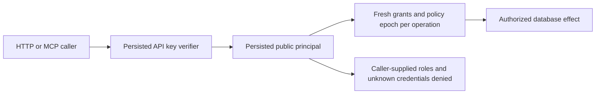
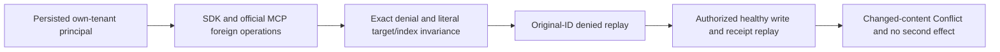

# Authorization

Database-persisted API-key verifiers, principals, grants and policy epochs determine every public operation. HTTP and MCP callers cannot supply trusted roles. The caller's connection grain ([ADR-125](../ADR/ADR-125-connection-owned-execution.md)) authenticates the credential against persisted state and reloads fresh permissions for each operation; the cluster concept is described in [ADR-136](../ADR/ADR-136-orleans-partition-ownership.md). [FoundationOtlp](Authorization/FoundationOtlp.md) defines Aspire OTLP configuration and early initialization of the app-owned telemetry providers.

| Requirement | Acceptance and evidence |
|---|---|
| REQ-AUTH-001: public identity and grants come from persisted database state, loaded freshly for every operation | AC-REP-005: real SDK/MCP invalid, expired, revoked and unauthorized calls fail before effects, including after a node restart |

| Requirement | Acceptance / flows | Test mapping |
|---|---|---|
| REQ-AUTH-004: only a persisted verifier and principal create a public server identity | AC-AUTH-004: a valid stored credential yields the exact principal; an unknown, expired, revoked or malformed key and client-supplied trusted roles fail closed without effects; restart and failover keep the catalog | Existing ClusterTests client-supplied-principal case; invalid catalog tests in TransactionTests; full credential edge/cluster parity |
| REQ-AUTH-005: tenant/database/resource/row capability enforcement is shared by read and write | AC-AUTH-005: wrong scope, owner, project or row grants do not expose data or effects; a forged resource identity does not authorize another collection | Existing `RowScopeAndTenantCannotBeForged` in SecurityAndQueryTests, `AShadowedMutationResourceCannotAuthorizeWritesToAnotherCollection` in TransactionTests; REQ-AUTH-001 retained |
| REQ-AUTH-006: field read/use/write and omit-default projection apply end to end | AC-AUTH-006: nested or aliased protected fields do not leak into payload, headers or metadata; predicate, sort, index and vector use and replace/patch check separate grants; different query adapters have identical omissions | Existing `NestedSensitiveFieldsAreOmittedAndAliasedPredicateAndSortAreDenied`, QueryAdapterTests adapter omission cases, ChangeFeedTests PII cases; the full lineage matrix is tracked separately |
| REQ-AUTH-007: the current policy epoch is checked at the request, page and cache boundary | AC-AUTH-007: a revoke, ACL or policy change invalidates the matching cursor or result without cached payload leakage; an invalid token, history or scope gives a typed failure, and after a refusal a healthy authorized call works | Existing `RevocationInvalidatesCurrentPageAndNeverReturnsCachedPayload` in SecurityAndQueryTests, feed revocation and scope tests; [ADR-022](../ADR/ADR-022-policy-epoch-revocation.md) cluster boundary |
| REQ-AUTH-008: worker required inputs and protected effects gate unsafe delivery and replay | AC-AUTH-008: missing protected-input grants stop claim, replay and checkpoint; a changed principal policy blocks an old delivery; inbox replay cannot bypass the current effect authority | Existing `WorkerRequiredProtectedInputFailsBeforeClaim`, SubscriptionTests `MissingRequiredWorkerInputStopsDeliveryWithoutAdvancingTheCheckpoint`, `AnotherWorkerReusesTheInboxOnlyAfterCurrentEffectPermissionsAreChecked` |
| REQ-AUTH-009: diagnostics and derived projections keep the sensitive classification | AC-AUTH-009: PII and token canaries do not reach errors, logs, traces, search statistics or an unauthorized derived result; omitted-default lineage survives rebuild, replay and backup | Existing safe projector tests (partial source evidence); full cross-interface diagnostics and lineage matrix |

Decisions: [ADR-014 RBAC](../ADR/ADR-014-principals-rbac-row-policy.md), [ADR-015 sensitive lineage](../ADR/ADR-015-sensitive-data-lineage.md), [ADR-022 policy epoch](../ADR/ADR-022-policy-epoch-revocation.md), [ADR-029 event/message privacy](../ADR/ADR-029-event-message-classification.md). Policies and keys are persisted server-side; readers and projections use the current principal and scope. Stored raw history may contain protected input, but that does not permit unsafe replay to a consumer.

### Unit case-to-acceptance crosswalk

| case class | Existing requirement / acceptance | Evidence boundary |
|---|---|---|
| `DocumentRowTenantMutationAuthorizationTests` | REQ-AUTH-005 / AC-AUTH-005, with the owning document boundary REQ-DSTORE-003 / AC-DSTORE-003 | Put/Patch/Delete cannot forge row owner or tenant. It does not cover all row-scoped read/query adapters. |
| `DocumentFieldMutationAuthorizationTests`, `DocumentReplacementFieldAuthorizationTests`, `DocumentDeleteIndexAuthorizationTests` | REQ-AUTH-006 / AC-AUTH-006, with the owning document boundary REQ-DSTORE-003 / AC-DSTORE-003 | Persisted field-write and index-use grants are independently enforced on the tested mutation paths; this is not the complete adapter/lineage matrix. |
| `ResourcePolicyUpdateTests`, `ResourcePolicyUpdateRejectionTests`, `ResourcePolicyUpdateVisibilityTests` | See the exact REQ-RPOL-001..004 mapping in [ResourcePolicyUpdates](Authorization/ResourcePolicyUpdates.md) | The unit cases map to RPOL-001/002/003; RPOL-004 remains the real SDK/MCP cluster criterion. The blob-quota exclusion case is validator-only, not a store-apply flow. |

`SignedEnvelopeTests` is physically under the Authorization test directory but
is owned by InternalSerialization: map it only to REQ-IS-007 / AC-IS-007 in
[InternalSerialization acceptance](InternalSerialization/Acceptance.md#criteria-and-tests).
It is not evidence for public credential verification or persisted principal
authorization.

Slice map: policy code `src/KeyLoad.Core/Authorization/`; focused tests mirror `tests/KeyLoad.UnitTests/Authorization/`. HTTP/MCP adapters remain ClientApi and execute on the caller's connection grain. Principals/API keys remain existing shared public contracts. Frontend: N/A, no independent UI is introduced.

## Same-ID denied replay

REQ-AUTH-008, the original ADR002 same-ID outcome contract and the backup eventing cut contract require current authorization to be checked before outcome reuse, while an unreplicated authorization-denied retry of a retained same command must not append another clock-only commit. A concrete current source path authorizes before outcome selection; denial retains ForNew/persistOutcome=true, skips overwriting an existing outcome, but stages equal ClockBytes. ZoneTree staged writes are real journal changes. Thus repeated denied calls advance the store position despite unchanged immutable receipt.

Reuse the existing one outcome-key presence read in PersistCommandOutcome. If a previously stored key exists and replicationIndex is nonpositive, the denial has no staged domain effect; preserve current error/current policy checks and immutable outcome and return before clock staging. New rejected IDs still persist failure outcome/clock exactly once. Supplied positive replicated indexes retain original applied watermark and supplied-time clock staging unchanged, including distinct log entries that share an ID. Do not return old success after revoked permissions or weaken authorization, fingerprints/incarnation, compiled validation or token checks. No storage/public/serializer format changes.

AC-AUTH-REPLAY-001 has two arguments (same evaluatedAt / later trusted evaluatedAt). CommandFingerprint freezes Id/Kind/PrincipalId/PayloadJson, explicitly excluding evaluatedAt; the tests supply actual typed trusted operation time without substituting a clock provider or waiting. The original ADR002 permission that physical commit position may advance is retained for positive replica indexes and broader historical work; this owner-authorized task tightens only unreplicated, already-retained, no-effect authorization rejection. The regression independently asserts current exact PermissionDenied, one failure/clock commit, immutable full-store bytes under both same-ID times, then genuine Apply indexes1/2 with exact applied watermark and supplied clock, unchanged original outcome bytes, already-applied-index idempotence and a new authorized document operation.

The removed-grant case also first commits a real writer document, removes its persisted grant with the next exact policy epoch, then repeats the original identity and payload with later trusted time: current PermissionDenied, immutable original success receipt, unchanged complete store bytes/position, and a healthy root revision update are required.

## Cross-tenant denial

REQ-AUTH-TENANT-001 / AC-AUTH-TENANT-001 supplements REQ/AC-AUTH-005/009 and REQ/AC-CLIENT-005/006 under existing ADR-002/022/039. A persisted non-admin principal belongs to one tenant, with persisted document read/write/query grants on its resource. Actual SDK and official MCP foreign-tenant GET, bounded full scan, indexed predicate and immutable Batch write must return exact PermissionDenied/safe scope detail and disclose no credential or payload canary. Canonical foreign/owned documents and actual indexed membership remain literal and unchanged after rejection/retry. Same-ID denied replay remains PermissionDenied; authorization precedes fingerprint selection, so different payload under that still-unauthorized ID must likewise remain denied. An authorized healthy command proves exact revision/effect, stable same-ID receipt replay and changed-content Conflict with no second effect.

ADR002 definitive failed writes remain logged: first denied command may advance persisted failure/clock/replica watermark without changing target documents/indexes. Same-ID public retry is stable in result/target effect, not a fabricated global storage position promise. Separate public reads do not guarantee equal cluster-wide cuts while metadata changes; positive cut and complete literal state are checked, and query errors expose no partial page. No pre-submit authorization, product lock, timeout or catalog change is introduced. This cluster scenario separately checks actual public failure envelopes; those envelopes alone do not prove every server exporter. exact-source execution and original receipts are mandatory before acceptance.

REQ/AC-AUTH-005/006/009 and REQ/AC-SQLVIEW-002/003/005 require a failed event/queue SQL request to carry no partial page or protected payload/header metadata.  The existing two real persisted model-authority cases check the SDK error code only at field-use denial and have no actual foreign model partition. Extend those same whole flows using a second genuinely administrator-seeded event/queue partition with its own tenant. The original non-admin persisted own-tenant credential must receive exact PermissionDenied/safe scope detail for both foreign SQL model sources through SDK and official MCP. Every failed SDK result must be IsFailed, Value null and contain no credential or any of the four literal event/queue payload/header canaries in complete serialization; official MCP must retain its exact error envelope and omit those same canaries from the complete result. Apply the complete privacy/no-page oracle to the original same-tenant denied sensitive predicate too.

Before and after foreign rejections, actual administrator stream and message inspection plus SQL rows must equal the literal seeded histories and Ready/unclaimed queue state. Compare ordered logical rows and complete original records, require positive cuts, and never infer equal cluster-wide cuts across separate calls. The original authorized redacted SDK/MCP read follows the denials, then a real persisted field grant exposes the literal selected value, followed by actual revocation. Original transport, topology, grant epoch, deadlines and cleanup stay unchanged. No product fix or new runtime hook is presumed from this coverage gap.

## Exported telemetry privacy

REQ-AUTH-TELEMETRY-001 / AC-AUTH-TELEMETRY-001: actual ASP.NET/HTTP-client spans and OpenTelemetry logs must not export caller payload, raw URL/path/query, credentials, scope state or exception messages. Preserve count/duration, status, fixed normalized operation/category, severity, numeric event identity, timestamps and trace correlation. Unapproved arbitrary attributes do not become telemetry authority. The same real Kestrel request executes actual ZoneTree-backed administration, then a denied request preserves canonical state and an authorized healthy request returns a complete literal catalog. Actual exporters capture immutable span/log snapshots; canary absence alone is insufficient: exported server/client spans and failure/healthy log records must exist and preserve exact safe fields. Existing cluster SDK/official MCP cross-tenant and admission negatives remain mandatory.

[ADR-121](../ADR/ADR-121-exported-telemetry-privacy.md) freezes this boundary. ServiceDefaults owns validated Authorization privacy options, processors and registration; UnitTests Authorization owns real Kestrel/file-backed operation/exporter lifecycle tests. No new package, storage format, trusted role, public endpoint or schema is introduced. Existing Orleans telemetry policy is unchanged. Startup, primary operation, flush, stop and disposal failures remain original errors and all owned resources settle.

AC-AUTH-TELEMETRY-001 permits only ADR-121's closed HTTP connection context link shape. span IDs and complete safe link fields must match the preprivacy observation; events, tagged/state-bearing/extra links and unsafe ancestry still suppress the original span.

## Immutable delivery replay and current classification

REQ/AC-AUTH-006/007/008/009 and REQ/AC-MSG-002 require current persisted field/header policy to protect an original successful queue or subscription receive replay. The original StoredOutcome bytes, original principal-policy fence, group generation/ownership, token and lease fences remain exact. A resource-only policy CAS may change its SchemaVersion without changing principal PolicyEpoch; after successful original lease validation, cached output must therefore be checked against the current projector in the same existing synchronous IKeyValueView. Queue output uses current caller; subscription output uses current persisted data principal followed by current caller, matching genuine acquisition. No nested storage read or await is introduced.

If the common current projector removes an actually retained JSON value, replay refuses PermissionDenied with fixed safe detail and no payload. Complete semantic JSON equality allows formatting changes and hidden paths absent from the retained value; it does not rewrite or redact an original receipt into a different successful receipt. The original outcome, canonical input body, lease and counters stay unchanged. Parsing remains within the existing admitted JSON/receive bounds; no new grant, limit, serializer ID, persisted family, provider, clock, retry or deadline is introduced. Higher-epoch repair never makes an old-epoch result replayable: fresh authorized work produces its own original outcome.

REQ-REQUIRED-PROCESSING-001..005 and AC-REQUIRED-PROCESSING-001..005 refine ADR029 and existing REQ/AC-AUTH-006/007/008/009 plus REQ/AC-MSG-002. The queue Processing authorization must enforce current resource body/header RequiredForProcessing raw-read grants after its original QueueAck check and before authorizing output effects. A resource-only classification change must not leave a signed live delivery able to ACK and publish derived effects without current required input. [Complete required-input operation and evidence boundary](Authorization/RequiredProcessingInput.md) freezes same-lease repair, immutable failed/success outcome replay, fresh epoch fencing, full metadata-only refusals, actual SDK/official MCP/T-SQL privacy, cancellation contracts and both execution/cluster cold attempts. Subscription processing already checks caller and data-principal input; ACK, lease, inbox, subscription and persisted contracts remain unchanged.

## Row authority continuation and visibility acceleration

REQ/AC-AUTH-005/007: the two original GraphIncomingPrivacyTests retain their initial hidden-source empty and hidden-target NotFound outcomes, then repair actual persisted row owners through revision-fenced root commands. A reduced scoped GraphRead grant and revoked principal refuse with complete bytes and cut unchanged. A higher persisted epoch repairs exactly the original grants; independently literal full incoming rows, command outcomes and receipts survive joined same-root cold reopen. No retained principal confers authority; local Unit normal/scalar development does not close all-interface Linux/cluster/cache/Explain gates.

Architecture 29.3 and REQ/AC-AUTH-005/007 require a genuine generation-scoped document-ID visibility acceleration set. Team tranche READY15 is a required source predecessor for team semantics; original owner/project checks remain. This is disposable current-source state, with no persisted/public fields, aliases, protocol changes or replacement storage provider.

Minimum actual scope: Core/Authorization owns an internal RowVisibilityCache, scope identity and disposable build/lookup leases; one DatabaseEngine owns it for one actual store, explicitly borrowing the SAME PartitionHost CacheMemory. Composition closes the cache after operations/apply join and before CacheMemory; embedded test fixture owns its same validated shared budget and cache lifecycle. No separately sized cache ceiling or per-query substitute. Default embedded owners without this collaborator preserve the existing canonical path and cannot be credited as cache tests.

Identity is an exact structured tuple: actual Store.Identity NodeId/incarnation/read generation, current Store.Position observed INSIDE original read view, full PartitionRef (including tenant), collection, resource schema version, source DocumentEpoch, current persisted principal ID/tenant/policy epoch. Existing strict principal epoch CAS is membership version, including owner/project/team changes. No signing key, credential, document JSON, retained PrincipalRecord, live IKeyValueView or caller role is cached.

Fill reuses ONLY the original authorized full collection scan already performed by QueryCandidateReader. It accumulates actual visible document IDs after existing current row policy checks; it does not issue a second scan, affect point/index paths, change their access-path labels, skip original scan/result limits or accept a partial prefix. Publish only after original scan reports HasMore=false, original cancellation/budget remains valid, and owning scan has completed successfully. Partial/failed/cancelled scans dispose the unpublished draft and all accepted reservations, retaining initiating/cleanup failures. Schema/filter/SQL projection does not define visibility: every candidate in the actual complete collection scan contributes independently of residual predicate, paging or result limit.

A later matching full scan may exclude IDs absent from this COMPLETE set before current row policy; all positive IDs STILL deserialize current records, check Deleted and current CanReadRow before materialization. scan/byte/cancellation accounting stays exactly the original scan. Graph may borrow the same matching complete set after its current collection authorization/resource check: known-negative IDs avoid canonical vertex decode; positive IDs STILL perform current canonical read/current CanReadRow, and misses/unsupported/incomplete sets use existing actual canonical path. Never infer completeness from count, requested result limit or a graph traversal's visited IDs. No cache-hit performance claim from result equality.

Bounds/lifetime: modeled retained charge includes scope strings and tuple/index/node/list capacity, each actual copied document ID string, reference/ordinal index state and every cache/build/lookup lease; reserve the original shared byte+entry grant BEFORE owned allocation/copy. Fixed implementation representation-size terms are accounting constants, not new operational limits or measured CLR heap. Refusal to retain accelerator state leaves original canonical execution intact; it cannot authorize/deny a row or change operation outcomes. No unlimited dictionaries or uncharged growth. Retire stale same-scope entries on new current scope/epoch/cut; bounded admission may retire unpinned entries. Retired pinned entries retain the same original charges until actual final lease Dispose. No lease evicted from under caller; no advisory invalidation needed for correctness. On cache Dispose close admission and retire entries; retain uncertain/pinned ownership until actual closure. Restart reconstructs an empty disposable cache using fresh identity; old cursors/sets never bind the new generation.

Required complete operation controls: real team/owner/project corpus with same-ID cross-tenant documents; original SQL complete scan warms a real set, graph/page positive+negative paths retain complete independent literals and fresh final policy. Root revision-fenced row-owner/team changes, delete and real policy membership reduction/revoke ACK yield exact hidden/denied no-effect results despite old pinned set; higher epoch repair fresh healthy set/results. Actual shared budget contention refuses only accelerator retention, original bounded healthy operation remains exact; cancelled original scan publishes no partial set, then fresh healthy scan. Same-root joined cold retains canonical full bytes/receipts and returns current literal pages/graph with empty new cache. Observation of cache reuse/reservations is test-only internal actual owner evidence alongside full operations, not a getter-only test. No fake clock, synthetic trusted state, quotas, deadline changes or performance claims.

Standard ASP.NET Core authentication and authorization (REQ-AUTH-ASPNET-001..003) and the nongeneric credential status acknowledgement are specified in [ClientApi](ClientApi.md#standard-aspnet-core-authentication-and-authorization).
