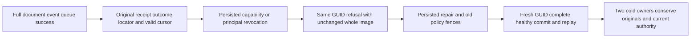

# Admission refusal and immutable outcomes

This extends the [Authorization](../Authorization.md) revocation/epoch/cursor contract with a complete immutable command-outcome operation. No product change is proposed.

## Exact source trace and rejected defect hypothesis

`AtomicCommandCommit.ExecuteAndBuildOutcome` intentionally authenticates the current principal and authorizes the current operation before selecting a prior outcome. If authentication or admission fails, its selection can remain `ForNew`, but that alone does not permit overwriting an existing result. `PersistCommandOutcome` independently checks the actual result key with `outcomeAlreadyStored`; when the original exists it skips both outcome PutRecord and scoped locator publication. For replicationIndex zero, it also returns before the clock write. Transaction Reset clears staged effects/candidates and leaves original committed bytes intact. An empty transaction does not advance its committed position.

Thus the suspected same-scope overwrite is REFUTED by the complete existing persistence path. Do not move cached outcome reads ahead of fresh authorization or duplicate the guard. Positive replication indexes may intentionally advance applied watermark and clock recovery metadata; this is a separate replica-apply contract and is not advertised as whole-image no-effect replay. An already-applied internal replica log replay is also distinct from fresh public submission authority, which revalidates before releasing a result. Global/unknown/partition result keys and locators retain their canonical scope contract; no cross-scope GUID collision rule is added.

## Genuine whole operation

`RevokedOutcomeAdmissionWholeFlowTests` runs two real persisted higher-epoch scenarios: remove only DocumentsWrite while retaining reads/query/event/queue grants, or revoke the whole principal. A first actual command atomically writes documents a/b, appends event original and enqueues message original. Its independently complete success receipt/token/composition field, original outcome bytes and exact scoped locator bytes are retained before any policy change. The first real query page supplies a valid signed continuation; another complete page proves it initially works.

At policy epoch2, repeat the exact original command GUID twice through Apply. Require the actual capability or authentication refusal and no released payload/receipt. Full original outcome and locator bytes, full store image, exact position and all nine storage identity fields including signing-key content must remain unchanged. This catches any future removal of the existing persistence guard through real operations, rather than a getter assertion or synthetic transaction.

Persist epoch3 grant repair. The old successful GUID remains fenced by the exact changed-policy refusal and its original durable success stays immutable. Before any fresh data mutation, require unchanged source epoch/read generation, a still-valid signed MAC and future cursor expiry, then the original policy1 cursor must fail as CursorExpired. This isolates policy-epoch invalidation from TTL expiry or document changes. Fresh authorized pages return both original rows under the current cut. A distinct fresh GUID commits document c/event healthy/queue healthy once, with a complete original success receipt and immutable replay. Every document query row, complete target event page, all message metadata, every outbox field plus row count/byte accounting and original stored result participates in the oracle.

Both subsequent same-root cold owners are attempted independently through retained failure ledgers, including after an earlier primary failure. Each verifies the captured whole image/cut/full identity, old receipt and locator bytes, old-GUID authority fence, nonexpired old cursor refusal, all three current pages, complete event/queue/outbox models and exact fresh-result replay bytes. Every store and original fixture is disposed with joined errors. The original seed and fresh effects use ordinary node-local ZoneTree and the canonical command/apply owner; no corruption HTTP endpoint, provider replacement, new limit, library, migration or trusted caller role exists.

## Full task evidence boundary

This new operation does not replace the existing whole census: exact exclusive TTL boundaries, SQL and JSON AST continuations, the original nonexpired SecurityAndQueryTests policy epoch case, live/feed/checkpoint/current-authority refusal and all six actual public .NET SDK/official MCP routes remain mandatory. Existing TTL-after-repair refusal is TTL proof; it does not independently prove epoch invalidation. Public JsonIgnore mutation metadata is not observable JSON proof. actual UID/count values remain UNKNOWN until fresh Root discovery from current assemblies. UI is N/A because this is a programmable authorization and retry operation.

