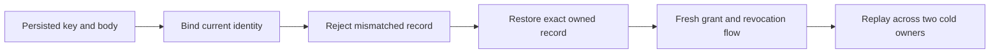

# Canonical persisted identity binding

REQ/AC-AUTH-004/005/007 require the current server-authenticated subject and fresh persisted grants to refer to the same canonical identity. Credential and principal readers previously fetched canonical KeySpace rows without checking the deserialized record Id. A valid privileged principal record copied under another principal key could be returned as that caller's authenticated subject and used by native document/query execution. A credential record with a foreign Id but a valid matching verifier was also accepted. These are KeyLoad catalog key/body integrity defects, not evidence that an ordinary public caller can write raw ZoneTree rows or that ZoneTree wrote a wrong record.

Bind ApiKeyRecord.Id to the authenticated witness CredentialId only AFTER the existing digest, missing/revoked/expired key and expected-principal checks. Bind PrincipalRecord.Id to the requested canonical id only AFTER the existing missing/revoked/expired principal checks. Preserve original typed Corruption for malformed verifiers and original Unauthenticated precedence. Return static safe errors with no subject, credential or payload. No normalization, trusted caller role, codec change, metadata migration, new endpoint, provider or library is introduced.

The two whole native operations use real committed documents, sensitive catalog fields, persisted principal and credential, acknowledged seed/outcome, and actual native authentication followed by SQL/AST/point reads. One case copies the actual privileged root record into the reader's principal row; the other changes only the credential body Id. Each writes exactly one original native row, verifies the complete independently replaced store image at cut+1, requires zero authentication/query/point output as exact Corruption, and retains wrong-secret Unauthenticated precedence. A previously verified native subject cannot read through the mismatched principal row. Both always attempt exact original-row repair even after an assertion fails, then independently compare the complete original image and position at cut+2 before throwing accumulated failures.

After repair, genuine persisted use-only grant epoch2 permits the protected predicate while output stays redacted. Persisted revocation epoch3 refuses authentication and native SQL/AST/point reads without effects. Persisted repair epoch4 permits independently literal complete raw output. A genuine current reader patch returns the complete independent receipt, leaves the catalog unchanged and replays its original GUID/outcome without effects; original seed receipt replay remains intact. Two joined same-root native cold owners preserve the complete native StoreIdentity/image/cut and repeat authentication, full healthy output and both original receipt replays. No bytes containing signing keys, verifier or private payload are dumped in assertions.

The source defect and operation code do not constitute runtime or public transport proof. No public corruption endpoint is added. Existing real ASP.NET subject-only admission, signed server-owned connection execution, row/field/alias/token/session/export/trace adversarial operations and their actual SDK/official MCP Aspire cluster classes remain mandatory. The supported model does not promise timing/statistical noninterference or absence of host-level side channels. Frontend/public schema/data migration are N/A for this current native validation repair.

