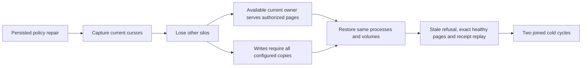

# Current cursor authority availability

REQ-AUTH-007 / AC-AUTH-007 and ADR-022 require fresh persisted authorization before payload disclosure at every request and page boundary. A signed, unexpired cursor identifies its original read and policy context; it does not grant access by itself. Reads use an available canonical copy selected through Orleans and validate the required cut, current principal, resource policy and cursor binding there.

AC-AUTH-CURSOR-AUTHORITY-001 requires the original resource-policy operation to preserve persisted grant reduction, revocation, higher-epoch repair and stale-cursor refusal. After an acknowledged repair, losing other silos does not by itself invalidate a current cursor when the remaining owner has the required data and current authorization. Genuine SDK, official MCP, SQL and AST continuations must return the exact authorized pages from that owner. An absent required cut, changed policy or unavailable owner must return its typed refusal without payload or credentials. Orleans membership settles before the fault observation; no local cursor-only authorization or custom membership logic is permitted.

AC-AUTH-CURSOR-AUTHORITY-002 requires both new writes and same-ID write retries to obtain every configured persisted-copy acknowledgement. Fewer available owners cannot produce a successful write receipt. After restoring the same owned processes and volumes, the same callers must still refuse stale-policy cursors, return complete literal healthy pages, and resolve the original acknowledged command without another effect. Independently observed row/resource state, retained outcomes and current outbox state remain exact. Read cuts are scoped to their actual owners. Both original joined cold cycles and all fault, caller and cleanup errors remain required.

These are acceptance requirements. Source changes and local builds do not establish the real Aspire SDK/MCP fault, authorization or cold-recovery gates. Exact-source Linux execution and original artifacts remain open until those operations pass.
