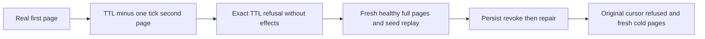

# KL-066: exclusive cursor expiry boundary

REQ-AUTH-007 / AC-AUTH-007 and ADR-022 require an unexpired current authorized read cut at the page boundary. QueryExecutionOptions.CursorLifetime is the maximum age of a newly issued query continuation. The expiry instant itself is excluded, matching persisted principal/API-key authority and the existing ChangeFeed/Event cursor contract.

Source-confirmed gap: QueryCursorExecution.Resolve currently rejects `ExpiresAt < now`, accepting exactly `ExpiresAt == now`. Correct that comparison to `<=` without changing TTL, signed claims, serialization, query semantics, storage or clock authority. This is a boundary correctness correction, not an acceleration or RF3 qualification claim.

AC-AUTH-CURSOR-EXPIRY-001: two native TUnit arguments execute real SQL and direct AST pages over canonical ZoneTree rows with the existing explicit test-owned TimeProvider. A genuinely generated cursor returns the complete independently literal second row one tick before its actual configured TTL, then returns CursorExpired at exact TTL without any partial result or native byte/cut change. An independent fresh first/second page remains healthy at that same time. No invented token, real sleep or test substitute storage is permitted.

AC-AUTH-CURSOR-EXPIRY-002: the same operation persists real reader revocation at epoch2, verifies the original cursor returns Unauthenticated, persists identical scoped repair at epoch3, rejects the old cursor, reads complete healthy pages, and continues through the existing joined same-root current-format cold owner. Retain complete original seed receipt/native same-ID replay and every native byte/cut invariant. SQL and AST arguments have their own actual generated cursor and genuine operation result; existing policy/RF3 case identities remain unchanged.

Frontend is N/A for this server page boundary. Public/persisted contracts and migration are N/A because the existing expiry claim and error remain unchanged. The existing six-route Aspire SDK/official MCP policy/cold gate and separate authority-outage criterion remain mandatory. Native source/compiler/runtime and exact-source Linux qualification are OPEN until actual evidence exists.
