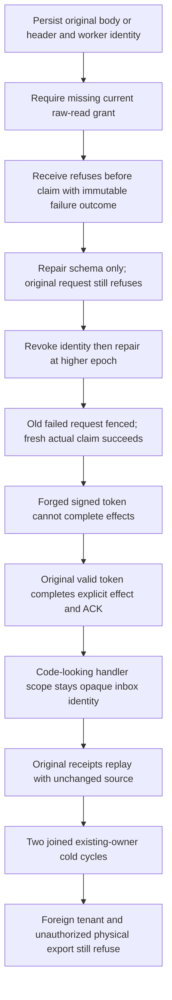

# Eventing adversarial security operations

Canonical slice Authorization; [ADR029](../../ADR/ADR-029-event-message-classification.md), [Authorization](../Authorization.md), [Messaging](../Messaging.md) and [EventStreams](../EventStreams.md). This suite extends the existing canonical required-input case and reuses the [safe delivery replay](SafeAbsentDeliveryReplayPublic.md) suite's genuine persisted-resource/identity fixtures and operation helpers. It adds no authorization provider, server handler runtime, parser, format, observer or test-only production seam.

| Requirement | Acceptance and whole operation |
|---|---|
| REQ-EVENT-SEC-001 current required-input authorization before claim | AC-EVENT-SEC-001: body and header variants begin with an actual persisted message, current schema and persisted worker. Resource-only reclassification requires an unavailable raw-read grant. receive returns the complete literal PermissionDenied result with no RuntimeValue; every canonical record except the genuine new scoped failure outcome, locator and clock remains identical, with independent exact cut increment and store identity. Ready metadata includes all lease/default fields, original raw body/header, projected worker body/header, absent derived document and one-record outbox. Schema repair cannot convert the original failed GUID into a claim. |
| REQ-EVENT-SEC-002 persisted authority and signed-token boundaries | AC-EVENT-SEC-002: original failed receive reauthorizes after actual principal revocation and higher-epoch repair. A new receive claims the original message; a malformed extension of its genuine signed token fails TokenInvalidated before processing effects. The full-store oracle checks the genuine refusal metadata exception and exact subsequent no-effect replay. Foreign-tenant inspection returns no result and the exact scope refusal. Public SDK, official MCP and SQL EXEC through both clients compare full Problems and no-result contracts with source conservation. |
| REQ-EVENT-SEC-003 complete healthy processing and opaque handler identity | AC-EVENT-SEC-003: the original valid lease completes only the explicitly declared document mutation plus ACK, with independently authored complete token, ordered mutation receipt and durability profile. HandlerScope contains code-looking text accepted by the existing bounded identifier validator. It remains a string in the inbox key/fingerprint; there is no server code/delegate loader. A successful receipt and exact document/ACK/outbox show ordinary explicit effects. This does not advertise an arbitrary handler/plugin execution capability. replay checks hidden CompositionReferences and original raw outcome bytes; public proof covers its four serialized mutation fields and full token. |
| REQ-EVENT-SEC-004 export and output privacy | AC-EVENT-SEC-004: the genuinely scoped worker cannot call the physical backup export through the SDK or bodyless official MCP operation. The full safe Problems and absent receipt are checked; connection read dispatch requires current ClusterAdministrator before invoking NodeAdministration.BackupAsync. No export bytes or canary are returned. The public source/document/outbox image is conserved even after an initiating assertion failure. This is an admission/output proof, not a physical archive-directory inventory or administrator backup acceptance. |
| REQ-EVENT-SEC-005 original identity and outcomes across cold | AC-EVENT-SEC-005: both same-root ZoneTreeExistingStore opens preserve every canonical record, cut and complete owner identity; each repeats current epoch fencing, full healthy processing receipt/raw outcome and original producer replay. Both attempts and cleanup join errors independently. Public clients dispose before both Aspire all-three cold operations, reconnect with actual persisted credentials, then repeat authority, complete healthy receipts, foreign-tenant and export refusals and full observed source/document/outbox conservation. No copied database, fake owner receipt or selected-endpoint inference supplies authority. |

The existing `SecurityAndQueryTests.WorkerRequiredProtectedInputFailsBeforeClaim` keeps every original assertion and appends a continuation that attempts both body/header operations independently. `EventingRequiredClaimClusterTests` declares the corresponding two actual public operations. The new and public cases intentionally complement the safe delivery replay suite's post-claim reclassification flow: worker required-input policy requires raw-read only; raw-use is independently mandatory for complete aggregate replay under the existing ReplayInputPolicy. Neither contract is broadened by this suite.

The complete security gate retains, without replacing, original `EventMessageSensitiveReplayTests`, `EventMessageSensitivePublicClusterTests`, `AggregateReplayAuthorityTests`, `AggregateReplayClusterTests`, `StreamTraversalTests`, `StreamTraversalColdClusterTests`, `RequiredProcessingPolicyTests`, `RequiredProcessingPolicyClusterTests`, `ModelHeadAuthorityWholeFlowTests` and `ModelHeadAuthorityClusterTests`. Their complete operations cover current cached-delivery classification, caller/data-principal subscription authority, projected body/header and DLQ inspection/redrive, redacted replay refusal, signed cursor scope, current model-source permissions and pure queue/event view behavior.

Public source conservation covers the complete known message/document/outbox DTOs, not private storage counters or physical owner/cut identity. proof retains complete canonical raw images. No power-loss, production readiness, full SQL or arbitrary code execution claim follows from preparation or peer review. Frontend, migration, new library and new schema are N/A.
