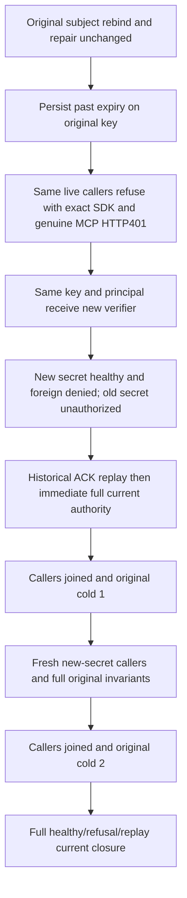

# Persisted expiry and verifier replacement

Operation contract for the existing Authorization `CredentialSubjectReplacementClusterTests.SameCredentialUsesCurrentPersistedSubjectAcrossDiscoveryRebindRepairReplayAndTwoColdWaves`; zero new test, unchanged original deadline and TWO original all-three same-volume cold waves.

## Confirmed gap

Current public credential lifecycle tests persist past expiry/revocation and restore the exact original credential. Current subject-replacement flow changes ONLY ApiKeyRecord.PrincipalId while retaining its verifier/secret. ExecuteConfigureApiKey permits canonical same-ID record replacement; Credential hashes the complete caller secret with SHA256; Require freshly compares the witness digest with current persisted verifier and checks expiry/revocation before ReadPrincipal. No existing inspected wholeflow combines expiry with genuinely DIFFERENT secret/verifier under the SAME key Id, principal, policy epoch and grants, or proves historical successful configuration replay cannot roll current verifier back.

## Requirements and acceptance

- REQ-AUTH-VERIFIER-REPLACE-001 maps REQ/AC-AUTH-004/007/009 and AC-MCP-002: preserve the original subject rebind/repair flow, then persist an already-past expiry on the original key. AC-AUTH-VERIFIER-REPLACE-001: SAME previously successful SDK and official MCP clients refuse actual document access before effects/disclosure; SDK has exact full Unauthenticated Problem/no Value, official MCP genuinely produces HTTP401 authentication admission failure rather than a fabricated dispatched envelope. Each refusal immediately checks both independently literal documents, complete public outboxes and pre-captured partition scope.
- REQ-AUTH-VERIFIER-REPLACE-002: a NEW command replaces the SAME key Id with Credential(keyId, SAME principalId, NEW secret), preserving the principal's epoch/grants and current first/foreign resource authority. AC-AUTH-VERIFIER-REPLACE-002: real new-secret SDK/official clients return complete independent first document; foreign second remains exact PermissionDenied and private value absent. Old secret remains unauthorized before/after every historical configuration replay. No client-supplied role, credential alias fallback or automatic retry is accepted.
- REQ-AUTH-VERIFIER-REPLACE-003: replay ORIGINAL expired/rebind/repair configuration GUID/payload returns exact nongeneric status and MCP/SQL null-data status without overwriting the current replacement key. AC-AUTH-VERIFIER-REPLACE-003: after EACH SDK/MCP/supported SQL replay, new-secret healthy authority/old-secret refusal plus complete two-document/outbox/partition observation remain exact. Original producer full receipts also replay unchanged with per-response current observations. Never interpret old successful ACK as current key state.
- REQ-AUTH-VERIFIER-REPLACE-004: original owned callers join before each of the TWO original cold cycles; fresh callers use the actually active secret. AC-AUTH-VERIFIER-REPLACE-004: same-owner partition scope, full literal model/outboxes, old-secret genuine HTTP401 admission, new-secret complete allowed/foreign-denied operations and all original configuration/seed receipt replays survive both cycles under the unchanged execution token/deadline. No extra cold owner or third/fourth cycle.

## Composition and boundaries

The original credential/subject records and old configuration payloads remain immutable. A separate test-owned active-secret field controls which real caller is constructed; it never mutates persisted authority by itself. Existing Client/CQRS/official SDK and original cold helper remain the owners. Added feature-local roles live within Authorization Contracts/Models/Helpers/Assertions; canonical child doc `docs/Features/Authorization/ExpiredVerifierReplacementPublic.md`. Only the existing State and Clients need composition changes; the original Case, Cold helper, subject flow and all assertions remain unchanged.

A persisted real-past expiration is explicit admission evidence, not a natural-wait/clock-boundary claim. UI, new provider/library/protocol/transport/persisted-format are N/A. The code implements this operation contract.

## Concrete operation map and boundaries

The existing no-argument `CredentialSubjectReplacementClusterTests.SameCredentialUsesCurrentPersistedSubjectAcrossDiscoveryRebindRepairReplayAndTwoColdWaves` first completes its original subject-rebind/repair scenario unchanged. Its original credential payload and both original producer commands/receipts remain immutable. The appended warm phase persists an actual past expiry, refuses the same already-live SDK and official MCP callers, then writes a new SHA-256 verifier for the SAME key ID and principal. The new secret uses the canonical identifier separator. Principal policy/grants and both literal document models remain unchanged.

The canonical parent is [Authorization](../Authorization.md), under [ADR-014 RBAC](../../ADR/ADR-014-principals-rbac-row-policy.md), [ADR-022 policy epoch](../../ADR/ADR-022-policy-epoch-revocation.md) and the existing connection-owned fixture contract.

The test owns the current secret only to construct fresh callers. The two original cold cycles retain their original kill/begin/restart/healthy operations and joined callers. The original historical subject-rebind/repair results and both new credential results replay through SDK and official MCP; SQL refuses credential configuration as unsupported through both existing SQL transports, with no effect. Each replay separately proves current full literal own-document access and foreign-scope denial, old-secret SDK 401, full administrator SDK/MCP document/outbox and partition snapshots. Both original document receipts replay in full; the existing original provision remains the first producer oracle. No private credential-record read or first-receipt shape qualification is invented.

An old official client refusing a live request is an actual HTTP 401. A fresh official client failing initialization after replacement/cold is transport authentication admission, with no fabricated dispatched tool result. Unexpected successful initialization is disposed and every original cause joins through the existing failure observer before throwing. The administrator observer reads full public canonical models and does not recursively call a reader matrix. No new timeout, fixture, test declaration, policy capability or library is introduced.

The authored continuation has a known lower bound of 4,164 public database calls: 98 warm expiry/replacement observations, 76 original replay calls for the extra fresh warm context, and 1,330 calls in each of three replacement contexts. This excludes original provisioning/warm/cold context work, connection authentication, official SDK initialization/discovery and original restart control/readiness operations. The ordinary retained warm and cold read/replay methods separately contribute 302 known calls. No elapsed-time or deadline-fit qualification follows from these counts. No measured latency, constant-time statistical guarantee or naturally elapsed expiry is claimed. The controlled past expiry uses the existing test offset without changing the server clock.
