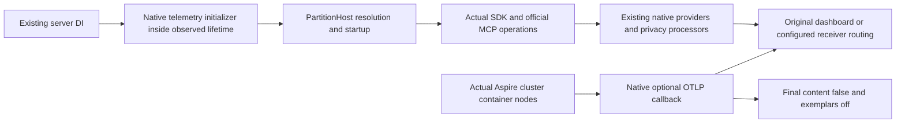

# Native foundation OTLP composition and early startup

Native foundation composition contract. Existing Authorization REQ/AC-AUTH-005/009, ADR121 exported privacy, ADR125 connection execution and root policy apply. This scope adds no package, collector image, public endpoint, authentication source, provider, storage format or clock policy.

| Requirement | Acceptance |
|---|---|
| REQ-OTLP-FOUNDATION-001 | AC-OTLP-FOUNDATION-001: every actual ClusterResources.AddNode container receives the pinned Aspire13.6.1 native OTLP annotation and environment callback. Native gRPC protocol matches the already selected .NET OTLP exporter. The dashboard's original EndpointReference remains responsible for allocated container-network routing. A dashboard-free model without a configured receiver emits no OTLP endpoint/protocol and does not silently select localhost. |
| REQ-OTLP-FOUNDATION-002 | AC-OTLP-FOUNDATION-002: the final feature-owned resource environment callback enforces GenAI content capture=false and exemplars=always_off after the native Development helper. Existing ServiceDefaults processors, views, source/meter selection, native Orleans propagation, provider instances, quotas and health checks stay unchanged. Effective callback results, not annotation presence alone, are asserted in Development and Production with and without configured receiver. |
| REQ-OTLP-FOUNDATION-003 | AC-OTLP-FOUNDATION-003: actual ServerApplication.RunLifetime resolves the existing public ITelemetryHostInitializer and calls Initialize inside the original observed try before PartitionHost/administration resolution. The existing OTel hosted service later resolves those same DI singleton providers; no second provider/host/export pipeline is created. Failure follows the original failure observer and joined shutdown. |
| REQ-OTLP-FOUNDATION-004 | AC-OTLP-FOUNDATION-004: retained TelemetryAdmissionWhole r5 actual native SDK/official MCP current-authorization/privacy/replay/two-cold fixture remains an independently reviewed companion, not Docker receiver proof. Full cluster gate requires the test-owned actual AppHost, discovered SDK/official MCP operations, original per-node remote receiver records for traces/metrics/logs, bounded private-state absence, positive expected export records and joined producers/exporters/receiver. Pinned native dashboard authenticated APIs for spans/logs/traces/resources and browser-token exchange are source-confirmed; metrics query is unavailable. Separate cluster trace/log fixture remains conditional/unexecuted, and full three-signal gate stays OPEN. No custom parser/dependency or console-log inference. |

No provider Flush/Dispose return, native annotation, readiness check or low record count establishes receiver acknowledgement or global zero-drop completeness. Native batch processors may drop before a receiver. Current ServerApplication disposes app/providers before final physical PartitionHost.DisposeAsync: this stage does not claim that final physical disposal is observed or move storage ownership/shutdown ordering.

Source/model verification is distinct from runtime acceptance. Native API sources: [Aspire OTLP13.6.1](https://github.com/microsoft/aspire/blob/v13.6.1/src/Aspire.Hosting/OtlpConfigurationExtensions.cs), [OTel1.19.1 initializer](https://github.com/open-telemetry/opentelemetry-dotnet/blob/core-1.19.1/src/OpenTelemetry.Extensions.Hosting/Implementation/TelemetryHostInitializer.cs). Tests use explicit model-only receiver addresses; they neither start a receiver nor qualify actual export.

## Criterion verification mapping

- AC-OTLP-FOUNDATION-001/002: `ClusterTelemetryResourceTests.ActualClusterModelKeepsNativeOptionalRoutingAndPrivacyAfterAllCallbacks`, all four Development/Production × receiver/no-receiver arguments. Native model/environment callbacks only; actual routing/export qualification remains OPEN.
- AC-OTLP-FOUNDATION-003: source review of exact `ServerApplication.RunLifetimeAsync` call order and pinned `ITelemetryHostInitializer.Initialize` singleton resolution; explicit manual/runtime evidence exception until original native startup, startup failure and shutdown are exercised by Root on exact source. This review is not executed startup proof.
- AC-OTLP-FOUNDATION-004: retained `TelemetryAdmissionWholeTests.RealServerExportsDuringSdkAndOfficialMcpPolicyRefusalRepairAndTwoOriginalRootColdOpens`, plus separately authored `FoundationOtlpClusterTests.NativeDashboardReceivesActualClusterSdkMcpPolicyRepairTracesAndPrivateFreeRejectionLogs`. Both remain unexecuted source inputs in this delivery; full three-signal cluster, loss/drain and final physical disposal gates remain OPEN.

## Every physical group receives native telemetry composition

REQ-FOUNDATION-OTLP-ALL-NODES-001 / AC-FOUNDATION-OTLP-ALL-NODES-001: common `ClusterResourceSettings.Apply` attaches the same native optional exporter and final privacy callback to every actual KeyLoad node. This includes every node of the Aspire-owned cluster. The former single-group call is removed to prevent duplicate registration. Existing four ordinary model cases are retained unchanged; additional `ClusterTelemetryResourceTests` cases execute every native environment callback for every node resource across Development/Production and receiver present/absent. They independently check exact node identity, data roots, endpoint, one exporter annotation, optional endpoint/protocol/service metadata and privacy values. No fake exporter endpoint or new resource/provider is added.
