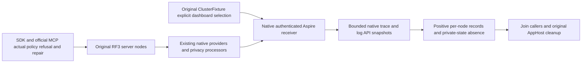

# KL015 native dashboard RF3 trace/log observation

Conditional SourceN fixture increment; parent [FoundationOtlp](FoundationOtlp.md), Authorization, ADR121/125 and existing native Aspire RF3 policies apply. No package, collector image, product endpoint, custom OTLP parser or duplicate telemetry provider is introduced.

| Requirement | Acceptance |
|---|---|
| REQ-OTLP-RF3-001 | AC-OTLP-RF3-001: explicit typed fixture selection enables the pinned Aspire testing dashboard before builder creation, preserving native randomized ports/generated authentication. Default fixture uses the original dashboard-free overload. Same original ClusterFixture owns image/source receipts, all three nodes/readiness, diagnostics and joined shutdown. |
| REQ-OTLP-RF3-002 | AC-OTLP-RF3-002: native GetDashboardUrlAsync waits for actual owned receiver health; its private browser token is exchanged through the supported authenticated native API. Bounded stock HttpClient/JsonDocument reads original receiver trace/log JSON only; never print owner URL/token/key/record content. Reject anonymous API and redirect downgrades; clients dispose before original AppHost shutdown. |
| REQ-OTLP-RF3-003 | AC-OTLP-RF3-003: real existing SensitiveAuthorityWarm flow exercises SDK and official MCP redaction, denied protected write, persisted repair, same denied-original replay and new healthy commit. All three actual nodes then receive an unsupported official MCP initialization (real400/native rejection log), followed by healthy official MCP plus SDK reads of the repaired original document. One opaque caller trace identity selects actual server records, never manufactures them. Require positive native HTTP server spans and sanitized warning logs per original node. Assert private credential/subject/tenant/header/document/path values absent from each original bounded returned receiver response; counts must prove untruncated selected snapshot. |
| REQ-OTLP-RF3-004 | AC-OTLP-RF3-004: one original30-second observation deadline across all nodes/signals and bounded positive polling waits for expected native exports; timeout, collector/auth/schema errors or record bounds fail explicitly. Polling success proves required received records only. No quiet period, ForceFlush true, count ceiling, readiness or successful caller proves global zero-drop/completeness. |

This fixture depends on the separately sealed production/model5 wiring packet; it does not merge or replace it. Native pinned13.6.1 HTTP API has no metrics query route: full three-signal RF3 proof remains OPEN. This does not inspect final physical PartitionHost disposal after app/provider disposal, prove receiver drain/global no-loss or replace original two-cold auth/recovery/endurance suites. No build/runtime result is claimed by SourceN authoring. Native source: [dashboard endpoint registrations](https://github.com/microsoft/aspire/blob/v13.6.1/src/Aspire.Dashboard/DashboardEndpointsBuilder.cs) and [testing options](https://github.com/microsoft/aspire/blob/v13.6.1/src/Aspire.Hosting.Testing/DistributedApplicationTestingBuilder.cs).

## Exact verification and source limits

AC-OTLP-RF3-001..004 map to `FoundationOtlpRf3Tests.NativeDashboardReceivesActualRf3SdkMcpPolicyRepairTracesAndPrivateFreeRejectionLogs`, with actual four-stage native endpoint/receiver, persisted policy workload, per-node original trace/log snapshots and original cleanup. It remains unexecuted; Root source-bound Linux qualification is required. Native testing builder13.6.1 lines392–397 suppresses browser credentials in both AppHost and child dashboard startup summaries; no test disables that protection or writes the returned login URL/API key. Source model labels do not establish Docker runtime identity: original ClusterFixture source/image/discovery/receipt gates remain unchanged.

## Frozen observation policy and owning clock

REQ-OTLP-RF3-005 / AC-OTLP-RF3-005 maps to the same named
`FoundationOtlpRf3Tests.NativeDashboardReceivesActualRf3SdkMcpPolicyRepairTracesAndPrivateFreeRejectionLogs`.
The case composes one feature-local validated `IOptions<FoundationOtlpRf3ExecutionOptions>`
snapshot with the existing native `Validate` then `Options.Create` convention and selects
one `TimeProvider.System`. No second host, service provider or central test-options mutation
is introduced. The feature-local factory/options paths and existing shared fixture opt-in
remain conditional on Main's exact intake; this packet does not reserve or adopt them.

Selected policy remains response8388608 bytes, records4096, private-token4096 characters,
chunk8192 bytes, JSON depth32, attempts80, observation30 seconds, request10 seconds and
poll250 milliseconds. Equal numbers retain distinct policy properties. Validation rejects
nonpositive or above-original bounds, with the original polling cadence fixed. The case
uses the unchanged defaults. Native JSON/query names, span-kind and warning-severity
identities are named test-owned protocol constants; expected private-state oracles do not
borrow product implementation constants.

The observation owns one `CancellationTokenSource(duration, clock)`, linked to the original
caller token, outside every node/signal/poll loop. Polls use that same clock. The native
`HttpClient.Timeout` keeps its original10-second inner bound from the same snapshot; that
framework API has no TimeProvider argument. This does not renew the total observation
deadline or extend the workload/caller lifetime. Native dashboard auth, original per-node
HTTP/SDK/official MCP flows, bounded original snapshots and original cleanup ledgers stay
mandatory. Metrics, global drain/no-loss, physical final disposal and runtime qualification
remain OPEN as above.

## Exact native local-image selection

REQ-OTEL-RF3-LOCAL-SELECTION-001 requires the existing JavaScript caller and native C# local-image admission to accept the same exact full `FoundationOtlpRf3Tests.NativeDashboardReceivesActualRf3SdkMcpPolicyRepairTracesAndPrivateFreeRejectionLogs` case. Its filter is `/*/*/FoundationOtlpRf3Tests/NativeDashboardReceivesActualRf3SdkMcpPolicyRepairTracesAndPrivateFreeRejectionLogs`. Keep the original suite, enabled flag, isolated image/receipt identity, inherited-environment rejection and all other selector constraints. The intended case still owns the original three actual RF3 resources, clients, workloads, receiver assertions and joined cleanup.

AC-OTEL-RF3-LOCAL-SELECTION-001 remains open until Main verifies selection and executes the complete real case against the authenticated exact-source local image, then completes the required Linux delivery gates. The prepared R6 receiver previously omitted this matching local-image filter; source review found that its exact focused local run would be refused before topology startup. Ordinary CI discovery is a separate path. Native C# syntax/numeric checks do not prove JavaScript execution, selected test count, image provenance, actual OTLP exports, metrics points or runtime cleanup.

## R218 explicit native resource ownership

REQ-OTEL-RF3-OWNERSHIP-001 / AC-OTEL-RF3-OWNERSHIP-001 retain the same complete real RF3 case while making native construction and cleanup ownership explicit. The original Activity is owned before W3C configuration/start. Pending HTTP handler/client construction owners are disposed on failure and transferred once to the same receiver on success. Both dashboard GETs use equivalent relative Uri overloads; bounded response accumulation uses asynchronous MemoryStream writes with the same cancellation token and pre-write byte ceiling. Fixture, receiver and workload failure observations retain the initiating error and independent cleanup errors without duplicate disposal.

Original R218 reports eight receiver/workload/fixture analyzer errors, separately from the other unit/recovery/integration defects. These repairs change neither operation oracles, persisted authorization, credentials, source correlation, selected topology, local-image admission nor any numeric limit or timeout. Native prepared-source checks do not establish actual compiler closure, OTLP export, metrics points, joined physical cleanup, RF3 acceptance or Linux qualification; those gates remain open until Main verifies the integrated source.
