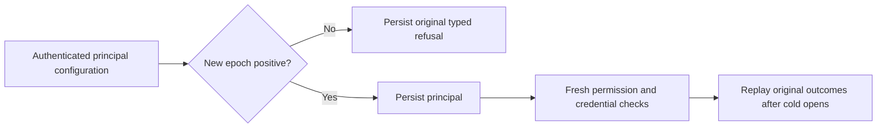

# Positive initial persisted principal epoch

Existing ADR-014/022 and REQ/AC-AUTH-004/005/007 require one persisted identity and current policy epoch across authentication, operations and replay. PrincipalRecord starts at epoch1. Native AnnSeedValidation.ValidateCut requires at least1. Bm25CorpusShape separately rejects negative epochs but currently permits0. ExecuteConfigurePrincipal previously compared epochs only when a previous row existed. A new principal with epoch0 or a negative epoch could therefore be persisted and authenticated, while authorized native operations later rejected its authority shape. This is an admission consistency defect, not a demonstrated privilege escalation.

After existing administrator authorization, protected-principal/structure/identifier validation and the existing target lookup, refuse a new principal whose epoch is below1 with Validation and a fixed safe detail. Keep the original RevisionConflict for an existing nonadvancing update. All positive initial epochs remain accepted. No bootstrap, defaults, grants, account kind, public/persistence format, native authentication provider, migration or fallback changes.

The actual public path remains ASP.NET DatabaseAuthenticationHandler → signed connection-owned CanonicalCredentialDispatch → fresh persisted verifier/principal → subject-only authentication ticket → CanonicalOperationGateway/unique Orleans request → current stored operation authority → ordered native apply. A configuration payload containing administrator or tenant fields is a proposed catalog value, never the authenticated caller. Only the existing server-owned administrator may configure principals/credentials. The prepared change touches only ExecuteConfigurePrincipal inside this established path. Catalog key/body identity binding ([CatalogIdentityAdversarial](CatalogIdentityAdversarial.md)) remains its original owner.

Three native and three real SDK/official MCP cluster operation arguments cover0,-1 and Int64.MinValue. Native first refusal compares the complete source image excluding exactly the newly retained failure outcome and business-clock key, preserves store identity, advances the real position once, and leaves the principal absent. Stable same-ID failure replay then preserves the entire native image and position. The same principal ID is genuinely created at1 with a fresh command, and a separate nonadvancing update retains RevisionConflict. A pre-cancelled native positive configuration has no effect and its exact operation subsequently succeeds; this does not establish admitted or mid-operation cancellation.

The real credential lifecycle covers scoped read/write permission, grant withdrawal, principal revocation/higher-epoch repair, key revocation/repair, past key expiry, and a different verifier under the same key ID. Replaying the old successful key command never restores its old secret. Native catalog equality checks the entire principal and key; original positive-principal replay never rolls epoch4 back. Public equivalent verification uses fresh authenticated operations, historical configuration replay and the preserved epoch4 conflict floor, rather than inventing a catalog API. Scoped SDK/MCP callers cannot configure an administrator or forged tenant.

Native healthy effects verify an independently authored complete process-durable receipt, all three token fields, the hidden empty CompositionReferences field, the exact original raw outcome, and full literal document contents. Two same-owner native cold opens retain full image/cut/identity and original failure/healthy outcome replay. Public operations compare complete observable mutation fields/token against real partition scope and ProcessDurable and the configured PersistedCopies, complete literal documents and outbox status before/after each refusal/replay group, fresh replacement-secret callers, and two actual Aspire-owned cluster cold cycles. Public JSON excludes hidden CompositionReferences; reconstructed client defaults do not prove native field contents. Both cold attempts join their failures before cleanup/final throw.

Existing forged principal/tenant/role, current admitted cancellation and telemetry privacy suites remain mandatory. The fixed error contains no subject, tenant, key verifier or plaintext secret. Refusal body assertions are not a proof about every logger/exporter. A prepared source batch is not task acceptance, delivery, power-loss durability or production qualification.

