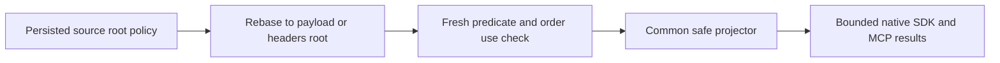

# KL-064: model-source root projection

The persisted sensitive-field catalog distinguishes the empty JSON pointer (`""`, the entire source body) from `"/"` (the literal empty-name child). Direct event/queue reads already enforce this distinction. ModelQueryPolicies previously rebased both source roots to a trailing slash, so a root policy became only an empty-child policy inside the model row. Model SELECT star exposed the body and field predicates could use its descendants without the root-use grant.

The correction rebases the empty source root to `/payload` or `/headers`. Other tokens, including the literal empty child, escaped object keys, numeric object names, wildcard semantics and canonical array handling, retain their existing behavior. It changes no storage format or permission grant.

The actual common chain is WithModelQueryView → ModelQueryExecutor → ModelQueryPolicies.Rebase → current QueryFieldAuthorization and native projector. Event/queue entity-reference joins independently invoke the same Rebase before predicate/reference-use validation and separately authorized projection. Topic-event model rows share the rebase helper; this batch's new operation cases exercise StreamSet and WorkQueue, not a new topic lifecycle.

Four native TUnit operation arguments cover event/queue × payload/header root. Each configures and reads the real persisted resource catalog; seeds a typed target plus event or queue message in one atomic commit; checks a literal full receipt; compares direct reads, SQL/AST star and explicit selections, literal-empty-child controls, filter/order refusals and typed entity-reference joins. The persisted principal passes through no grants, use-only, withdrawn use, and read/use repair. Full store image, cut and original identity are independently conserved after every operation even after assertion failure. Original command/outcome replay and two ordinary same-root cold owners retain full image and identity checks.

The original AcSqlView005 RF3 case retains its original parity calls and all failures. Its original MCP scope is joined before the new Authorization flow. Four source variants use persisted credentials and fresh reader SDK/official MCP sessions per wave. Direct source reads plus SQL/AST star, typed-null explicit selections and protected predicates cover no grant, use-only, use withdrawal and read/use repair. Public receipt checks bind real placement incarnation/atomic-partition/epoch and positive acknowledged position, QuorumProcessDurable, exact mutation and original replay. Every read/refusal/replay independently rechecks the administrator's complete raw model row/cut and outbox even if the primary assertion fails. Two existing Aspire-owned RF3 cold cycles reconnect actual callers. The server-selected event timestamp is a validated authoritative raw-row witness, not a predicted wall-clock literal; native cases use their independently controlled fixed time.

Qualification remains open until actual fresh native discovery, full compile/canonical checks, Unit, process recovery, Aspire Docker RF3 SDK/MCP and exact-source Linux evidence complete. Source review provides no native UID/count, timing/statistical privacy, endurance, power-loss or production claim. Existing non-model document/search/graph-context/CDC projectors and direct graph/event/queue/time-series consumers remain their original gates. Blob byte content is a separately authorized opaque stream, not an invented JSON projector contract. Generic/schema-hidden redaction metadata policy has no current persisted selector and remains an explicit broader feature gap.

This is a repair/evidence note under the existing Authorization requirements, not a replacement feature specification. REQ/AC ownership remains the canonical Authorization feature document.

Native receipt equality additionally asserts every actual `MutationReceipt.CompositionReferences` is empty at initial commit and persisted-outcome replay, including both cold owners. SDK/MCP JSON intentionally omits this native fifth mutation field. Public evidence covers all four observable mutation fields and the full token; a default getter on a deserialized public DTO cannot establish native-field contents.

Public query and stream cuts are opaque local `Store.Position` values. They are positive after this seeded operation, and the fresh one-page stream traversal preserves its exact snapshot cut. They are not numerically ordered against the separately scoped RF3 receipt position. Full literal rows/events, receipt identity/replay and every before/after raw-row/cut and outbox check remain. Binding a public local cut to its actual physical owner and acknowledged replication position is an open qualification gate.
