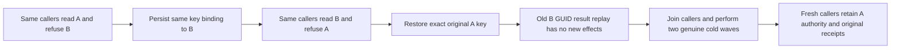

# Persisted credential subject replacement

REQ-AUTH-004/005/007 and AC-AUTH-004/005/007, AC-MCP-002 and REQ/AC-CLIENT-CONNECTION-001 require every protected HTTP/SDK/official MCP request to resolve the current persisted credential subject and permissions. The same public API-key identifier/verifier may be administratively rebound to another valid public principal through the existing ConfigureApiKey command. A previous successful discovery, transport connection or subject-only ticket does not retain the former subject's tenant authority.

CredentialSubjectReplacementClusterTests uses two genuinely distinct persisted tenant/principal scopes and independently literal complete documents. The SAME SDK and discovered official MCP clients keep the original credential string: A reads A and refuses B; persisted key reassignment to B reads B and refuses A; exact key repair to A reads A and refuses B. Untrusted administrator/principal headers never change the verified subject. Each refusal and healthy read compares both entire document/outbox images; no data or credential canary is disclosed.

Both credential mutation GUIDs retain their original complete status results. Replaying the old B-binding GUID AFTER the A repair returns the original result without reapplying B authority; the unchanged images and subsequent A-success, B-refusal prove that boundary. Both original seed command receipts replay exactly. All original SDK/official caller resources join before each of two genuine same-volume three-container cold waves, with fresh clients repeating A authority, old credential receipt replay, full document/outbox conservation and both original seed receipts. Each cold receipt namespace is a captured per-case safe GUID prefix plus a positive cold ordinal. Existing fixture readiness, deadlines, admission, topology and cleanup remain.

This is a missing whole-operation evidence cell, not a proven product defect. Only new Authorization feature-owned test roles and this documentation are proposed. No authentication provider, public endpoint, persisted format, trusted role, timer, quota, migration or package is introduced. The standard ASP.NET handler/current persisted permission boundary and connection-owned Orleans execution stay unchanged. Owning MCPGateway publication and verified official NuGet availability precede consumer integration. Native source preview is not compiler/runtime evidence. These public logical image comparisons do not prove a physical owner/read-cut or request-bound handler execution count; those existing gates remain separate.
