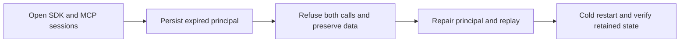

# Persisted principal expiry on already-open public clients

REQ-AUTH-001,004,007 and AC-AUTH-ASPNET-001,002,003 require the existing standard ASP.NET Core admission to resolve the current persisted principal on each operation. ADR-014, ADR-022 and ADR-125 retain subject-only authentication tickets, connection-owned Orleans execution and fresh database permission checks.

The existing `McpPersistedAuthorizationTests.AcMcp002CurrentPersistedPrincipalControlsEachCallAfterDiscovery` keeps its original declaration, deadline, native SDK/official MCP clients, discovery, forged-header controls, grant removal/repair, principal revocation, repair result replay and all-three same-volume cold continuation. Existing credential-expiry cases change `ApiKeyRecord.ExpiresAt`; they do not cover the independent principal-expiry boundary.

After the original revoked principal at epoch4 is refused, persist the same original scoped principal at epoch5 with `Revoked=false` and `ExpiresAt` equal to the actual `TimeProvider.System.GetUtcNow()` minus the existing one-minute expired offset. Do not wait for a deadline, replace the clock, change credentials, reconnect clients or copy permissions into a ticket. The same SDK and official MCP clients must reject the next document operation as Unauthenticated / HTTP401 without returning a protected document. Retain credential/payload omission and the original pre-handler HTTP401/no-operation-header probe. Compare the complete privileged document and all OutboxStatus fields after each SDK, official MCP and native HTTP refusal.

The final repair advances to epoch6 and restores the exact original full principal with no expiry or revocation. Preserve complete acknowledged principal equality, independently literal healthy document, original repair-command result/replay and unchanged model/outbox image. Join original clients before the existing all-three same-volume restart and retain actual identity/generation/applied/routing checks, full retained model/outbox image, fresh healthy calls and original repair replay.

The command validator permits a genuine past principal expiry with a higher policy epoch. DatabaseCredentialValidation.ReadPrincipal rejects it independently from the credential record; the standard authentication handler publishes a ticket only after the native principal reply validates. ServerErrorMiddleware maps that actual native Unauthenticated failure to HTTP401. No product, public schema, serializer, resource catalog, role, provider, quota or timeout changes are required.

