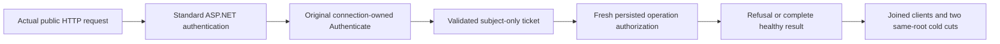

# Request-bound standard authentication observation

REQ-AUTH-ASPNET-OBS-001: the existing standard KeyLoad.Database AuthenticationHandler may borrow one internal nonserialized passive fixture observer. The default null observer retains original registration, signed request bytes, request/connection/context ownership and no observer allocation, storage or export work. No credential, payload, role value, path, endpoint or exception text is passed to the observer.

AC-AUTH-ASPNET-OBS-001: actual credential ExecuteAsync entry and terminal observation carry only the actual HttpContext.TraceIdentifier, genuine original Authenticate RequestId and closed terminal category. The complete genuine SDK and official MCP HTTP workflow requires one entry and one matching terminal per admitted HTTP request, and no entry for absent/malformed Bearer prefix.

REQ-AUTH-ASPNET-OBS-002: ticket publication is observed only after the original principal reply is validated by the existing handler. Observe complete bounded actual ticket claim metadata for the sole NameIdentifier claim, exact subject, authentication scheme and identity shape; no caller roles or new authority enter the pipeline.

AC-AUTH-ASPNET-OBS-002: real SDK and official MCP requests with forged role/principal headers retain one subject-only authenticated ticket. Persisted principal/resource grants alone decide original read/write PermissionDenied and full no-effect state. Revoked/expired stored credentials or principals retain original unauthenticated Problem/refusal without ticket publication. Fresh persisted repair restores only original scoped grants.

REQ-AUTH-ASPNET-OBS-003: the observer is test-owned, synchronous, bounded and nonthrowing; it records overflow/shape failures for assertion without changing dispatch. The real Kestrel/Orleans/PartitionHost owners and official clients retain original lifetime and cleanup. No public endpoint, diagnostic format, persisted alias/Id, current policy, timer, quota, retry or provider changes.

AC-AUTH-ASPNET-OBS-003: original healthy command and same-ID replay retain independent full receipt/result and no-effect observations. All clients and producer callbacks join before both same-volume all-node cold restarts; each cold verifies original authority/identity, exact original receipt and fresh authenticated healthy calls. Initiating and cleanup failures are retained separately.

Implementation owner: Server Authorization observer contract/identity handler/credential resolver plus original ServerConfiguration optional internal injection; narrow same-owner RecoveryProcess host pass-through; uniquely named Authorization whole-operation test owners. No existing substantive test or lifecycle assertion is retired. Current source alone is not a compiler, runtime, coverage or task PASS.

The observed terminal category is the original ExecuteAsync terminal, not a synthesized credential verdict. Only a fully decoded successful principal can publish the observed ticket. The workflow rejects cancellation/startup failures as acceptance evidence. Persisted sensitive-field policy changes prove current resource policy through complete redacted SDK/MCP document output, followed by exact original schema repair and complete healthy output; no derived permissions are copied into a ticket.

Whole operation: AuthenticationExecutionTests.RealHttpSdkAndOfficialMcpAuthenticateOncePerRequestThenFreshPolicyRefusalRepairReplayAndTwoColdCuts. No original declaration/Args/UID is replaced; this dedicated resource-owner case needs actual discovery before a UID can be recorded. This host support must never be counted as the Docker gate. Existing AcMcp002 operation owners remain unchanged.
