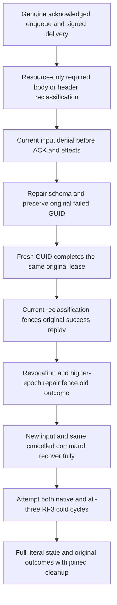

# Current required input before queue processing

Canonical slice: Authorization with Messaging. Refines REQ/AC-AUTH-006/007/008/009, REQ/AC-MSG-002 and KL096 under ADR029. Required processing access applies when committing derived effects from an existing queue delivery, including replay under a current resource policy. Current queue acknowledgement authority still precedes the input check; the unchanged effect authorization follows it. This does not add QueueConsume to acknowledgement/processing authorization, change ordinary ACK rights, or alter lease, inbox, subscription, format or retry identity contracts.

REQ-REQUIRED-PROCESSING-001 / AC-REQUIRED-PROCESSING-001: after a genuine delivery, a resource-only body or header policy update can require a raw-read grant absent from the worker's unchanged principal epoch. A still-valid signed lease must not authorize ACK plus derived effects without that current required-input grant. Both independently declared body and header cases require the complete fixed PermissionDenied result before effect staging. Receive and subscription processing already enforce this policy; the confirmed queue Processing admission branch previously checked QueueAck and output effects alone. Its existing lease check does not carry resource SchemaVersion or required-input grants.

REQ-REQUIRED-PROCESSING-002 / AC-REQUIRED-PROCESSING-002: the failed original processing GUID retains its original failure after schema repair. A fresh GUID can complete the SAME original lease only after current required input is granted. Its complete effect/Ack receipt, target document and immutable original native outcome are independently checked. Reclassification must also reject the original successful outcome while its resource-required access is missing; resource repair restores same-epoch original replay without a second effect. Principal revocation rejects the next request, and a higher epoch repair fences the old principal-epoch success rather than reviving it. Genuine new input then completes a fresh processing command and original receipt.

REQ-REQUIRED-PROCESSING-003 / AC-REQUIRED-PROCESSING-003: native admitted refusal changes only its exact original scoped outcome, exact OutcomeLocatorV2 pointing to that outcome key, and monotonic committed evaluation clock; every other canonical row remains byte-identical and the native store advances exactly once. Original lease/body/counters/indexes, absence of the derived effect and store identity remain unchanged. Replay preserves the entire image, raw original outcome and exact cut. No entire outcome family is excluded, no successful receipt is fabricated, and direct embedded failure metadata is not claimed for an HTTP authentication rejection before database admission.

REQ-REQUIRED-PROCESSING-004 / AC-REQUIRED-PROCESSING-004: real default Aspire RF3 uses the SDK, official MCP, and canonical SQL EXEC through both callers for refusal/success replay and policy changes. Full observable mutation fields, all token fields, independent current placement and quorum durability are required. Complete root-authorized message metadata/payload/header, literal target documents and whole outbox are observed even after a primary failure. Unprivileged inspection and actual AST plus native T-SQL QUEUE_MESSAGES SELECT omit the classified body/header canary while processing refuses. Schema/grant changes use existing persisted administrator operations; no trusted caller roles or duplicate credential provider exists.

REQ-REQUIRED-PROCESSING-005 / AC-REQUIRED-PROCESSING-005: before-cancelled native Processing throws with the original token and leaves the complete image unchanged. Public typed SDK processing is a write, and cancelled SQL EXEC is conservatively a possible write: both return the full native UnknownWriteOutcome/write-response-unavailable Problem with no receipt. Official MCP throws with the original cancellation token. Every original call is awaited, observable model/outbox state remains unchanged, and the SAME healthy command identity then succeeds. This is a before-admission control, not a new admitted response-cancellation or power-loss proof.

Both same-owner native ZoneTree reopen attempts and both all-three Aspire RF3 cold cycles preserve current persisted authorization, original success fencing, complete fresh receipt/outcome replay, original root producers, message ACK state, literal derived documents and outbox. Both cold attempts, conservation observations, caller/store ownership and fixture disposal join through the existing failure ledger. Native actual receipts check hidden fifth CompositionReferences and original raw outcomes. Public JSON exposes four mutation fields and all four token fields; no deserialized hidden getter is treated as server proof. Positive local query/model cuts are never ordered against logical RF3 receipt positions, and public output cannot establish native raw-state or routed owner/cut equivalence.

Current source preparation, independent review, syntax or numeric checks do not qualify execution. Compiler/native discovery, full original related Unit cases, genuine process recovery, SDK/MCP RF3 and exact-source Linux originals remain OPEN. Existing event/topic reads, source/stream schema-bound cursor tests, replay raw-input grants, immutable delivery privacy, required subscription data-principal checks and DLQ/redrive inheritance cases remain mandatory unchanged. This candidate does not close whole KL096, complete log/export/trace canary privacy, endurance, admitted cancellation or production readiness.
