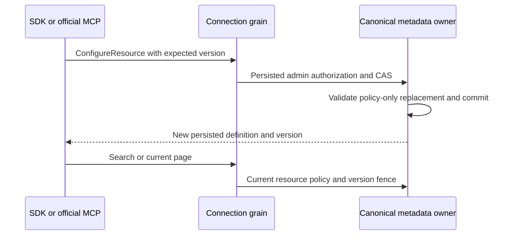

# ResourcePolicyUpdates within Authorization

Accepted source contract: [ADR-093](../../ADR/ADR-093-resource-policy-updates.md). This closes the public metadata update gap exposed by AC-LINEAGE-004 through current policy-only metadata replacement. Physical resource, index, authority, quota and schema shape changes are unsupported. Canonical feature ownership is Authorization. Existing ConfigureResource admission, persisted administrative authority, metadata cluster and outcomes remain the sole write path.

`ConfigureResourceRequest` gains nullable `ExpectedSchemaVersion` at generated Orleans field ID3, omitted from public JSON when null. Null preserves create and identical-definition behavior and still rejects a changed existing definition. A non-null value is a compare-and-set on an existing resource. The replacement must increment SchemaVersion exactly once and may change only FieldPolicies and HeaderPolicies. All other definition properties must be canonically identical. No policy change may bypass the existing complete resource/path/budget validation. No-op version increments are invalid. Current aliases and IDs0–3 stay unchanged; every current executor enforces the same policy-only CAS contract.

| Requirement | Acceptance and automated evidence |
|---|---|
| REQ-RPOL-001: authorized policy replacement is one canonical metadata commit | AC-RPOL-001: real ConfigureResource apply changes only policy arrays and advances the resource version; exact persisted definition and original outcome survive reopen; owner data/vector/event bytes are unchanged. `ResourcePolicyUpdateTests` |
| REQ-RPOL-002: concurrent/retried updates cannot restore stale authority | AC-RPOL-002: stale/missing expected version, missing resource, overflow, unchanged policy/version-only update, changed kind/domain/index/authority/quota/schema/paused state and malformed pointers fail with typed errors and no partial state; same original command retry reuses its receipt. `ResourcePolicyUpdateRejectionTests` |
| REQ-RPOL-003: current reads reauthorize after policy ACK | AC-RPOL-003: projection reclassification, raw-field search denial, graph `/label` denial, and existing change-feed/live-query schema fences use the new persisted definition; old cursors cannot return cached sensitive payload. `EventProjectionPolicyTests`, `ResourcePolicyUpdateVisibilityTests` |
| REQ-RPOL-004: public clients and cluster retain the trust boundary | AC-RPOL-004: SDK and official MCP ConfigureResource carry the CAS field through the connection grain; current-policy queries on all replicas agree after ACK and fail closed after revocation/restart. `ResourcePolicyUpdateClusterTests` |

Null expected version means current create or identical-definition admission; policy replacement requires current CAS. Preserve branch behavior, IDs, canonical fingerprints, typed failure codes, persisted admin checks, exact resource/document bytes and original outcome replay. The static unsupported detail states that the requested definition change is unsupported. Acceptance remains AC-RPOL-001/002/004.

### Public refusal of revoked credentials

REQ-RPOL/AC-RPOL-004 retains the original four SDK/MCP/Q1 routes and complete image, persisted epoch, cursor, repair, replay and cold oracles. Revoked official MCP and Q1/MCP credentials are refused by HTTP401 before tool dispatch. The owning assertion awaits the original CallAsync exception, validates Unauthorized and omission of the actual credential/private canary, then invokes the existing same-node MCP unauthorized protocol probe. CursorExpired remains a dispatched typed tool refusal. No transport, credential, deadline or operation contract changes.
