# Same-partition row revision privacy and batch rollback

REQ-AUTH-ROW-REVISION-BATCH-001 / AC-AUTH-ROW-REVISION-BATCH-001 extends the same foundation correction in [RowRevisionInference](RowRevisionInference.md): a valid own-row mutation placed before a hidden-row mutation must not persist when the latter is denied. Three native test Args execute Put/Patch/Delete with stale/current/future hidden revision guesses, require the same PermissionDenied, and compare every original native key and full outbox except the precisely admitted durable failure outcome/locator and monotonic clock metadata. Both original documents retain complete original JSON and revision1.

Root repairs actual hidden-row ownership without changing principal policy epoch. A fresh two-mutation same-partition command must commit the complete ordered two-result receipt and exact resulting document state (own revision2 and hidden revision3, or absent after Delete). Original failed command IDs stay durable failures and never reapply the first mutation over the later healthy state. Exact full-store bytes, physical position, original outcomes, identity and both row states survive two joined native same-root cold opens. The same actual native database APIs and existing bounded complete-image oracle are used; no database/storage/transport double is added.

```mermaid
flowchart LR
    Own[Valid own-row write] --> Hidden[Denied hidden-row write]
    Hidden --> Rollback[Entire batch model effects roll back]
    Rollback --> Durable[Only canonical failure metadata]
    Durable --> Repair[Actual root owner repair]
    Repair --> Commit[Fresh atomic two-result commit]
    Commit --> Replay[Old failures and successful receipt replay]
    Replay --> Cold[Two original-root cold cuts]
```

Ownership: Authorization native test Helpers/RowRevisionBatchInferenceFlow.cs, Assertions/RowRevisionBatchInferenceAssertions.cs, Helpers/RowRevisionBatchInferenceCold.cs and Cases/RowRevisionBatchInferenceTests.cs. Backend uses the unchanged proposed DocumentMutationCommands correction from the parent packet. Frontend, public transport, infrastructure and new persistence are N/A for this native atomicity regression. Existing [Authorization](../Authorization.md), [DocumentStorage](../DocumentStorage.md), ADR-022 and ADR-011 cover the unchanged authorization, atomic rollback and recovery contracts; a new ADR is N/A.

This is authored source only. Compiler/native test execution, coverage, public SDK/MCP, Docker/Aspire RF3 and exact-source Linux acceptance remain OPEN; process cold opens do not qualify power-loss durability or production readiness. No prior source, original failure or task qualification is replaced.

Native fixture lifetime retains the actual original TestDatabase and every acquired cold ZoneTreeStore. The original JoinOwnedResources is attempted once and counts as closed only after it returns successfully; its native cleanup already attempts independent replica/store settlement. Each cold store receives its own original Dispose and only its successful return admits another cold cycle. Failed close or unknown acquisition stays sticky and retains the root; a repeated no-op Dispose or observed error count is never closure proof. Outer cleanup attempts the original join if it has not yet run, then deletes the exact fixture-owned directory only when the original owner and all acquired cold owners are confirmed closed. It never calls TestDatabase.Dispose or changes that shared fixture. Primary operation and independent cleanup errors remain ordered through ServerFailureObserver. All original image/position/identity/policy/receipt/replay oracles and both cold cycles remain on settled paths; no artificial disposal failure, alternate provider or executed fault qualification is claimed.
