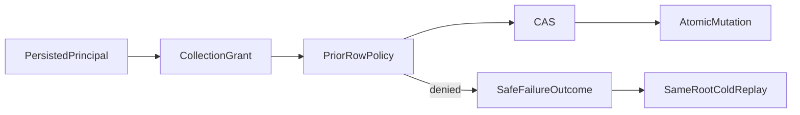

# Row revision inference at persisted write admission

REQ/AC-AUTH-005, REQ/AC-AUTH-009, REQ/AC-DSTORE-003 freeze this foundation threat model: a persisted caller with collection DocumentsWrite but denied existing-row scope must not distinguish a guessed stale/current/future revision by RevisionConflict versus PermissionDenied. Apply the existing row-write policy before CAS for live prior rows. No new policy or trusted caller role is introduced. Authorized replacement checks remain after CAS; only the already required denied prior-row check moves before it. Existing replay semantics are not changed: ordinary Batch failure outcomes remain same-policy durable failures.

The three-argument whole test uses genuine ZoneTree, persisted principal and real Batch admission, all Put/Patch/Delete paths. Each refused write requires the complete null-result PermissionDenied and exact safe detail, complete original row/version and all keys except the precisely scoped new durable failure outcome/locator and existing monotonic clock key. All remaining keys, including every row, version, index, principal and outbox entry, remain byte-identical. Full outbox is unchanged. Durable failure result, original outcome bytes and exact replay are retained; initial refusal does not claim physical position or all metadata unchanged. Own-row stale CAS remains RevisionConflict; missing/deleted Patch/Delete remain NotFound. Root changes actual row ownership at revision2 without principal epoch changes; a fresh authorized revision3 mutation and complete original receipt replay establish healthy continuation. Two joined same-root reopens retain full image/position/identity and both original denied results and the complete fresh successful result, with no further effects. No cluster, HTTP/SDK/MCP, timing or power-loss qualification follows.

Applicable decisions: [ADR022](../../ADR/ADR-022-policy-epoch-revocation.md), [Authorization](../Authorization.md), [DocumentStorage](../DocumentStorage.md). Preserve existing absent/tombstone/upsert/replacement, commit, outbox, cached-current-permission and lifecycle contracts.

fixture lifetime retains the actual original TestDatabase and every acquired cold ZoneTreeStore. The original JoinOwnedResources is attempted once and counts as closed only after it returns successfully; its cleanup already attempts independent replica/store settlement. Each cold store receives its own original Dispose and only its successful return admits another cold cycle. Failed close or unknown acquisition stays sticky and retains the root; a repeated no-op Dispose or observed error count is never closure proof. Outer cleanup attempts the original join if it has not yet run, then deletes the exact fixture-owned directory only when the original owner and all acquired cold owners are confirmed closed. It never calls TestDatabase.Dispose or changes that shared fixture. Primary operation and independent cleanup errors remain ordered through ServerFailureObserver. All original image/position/identity/policy/receipt/replay oracles and both cold cycles remain on settled paths; no artificial disposal failure, alternate provider or executed fault qualification is claimed.
