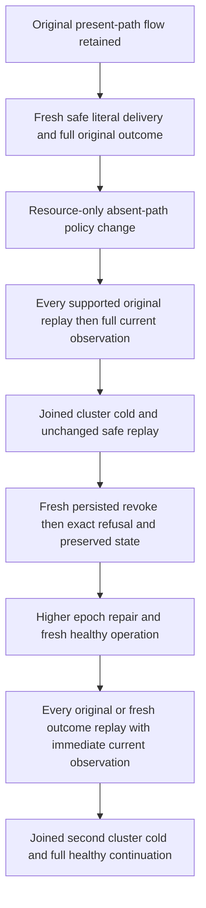

# Current absent-path immutable delivery replay

Preparation for canonical Authorization child specification. This source-only scope preserves `EventMessageSensitivePublicClusterTests.CurrentBodyHeaderPoliciesRevokeRepairOriginalRefusalFreshDeliveryDlqAndSameOwnerColdFourRoutes`, all four Arguments, the original execution token/deadline and the original present-path flow. No new declared test or inferred UID is introduced.

## Requirements and acceptance

- REQ-AUTH-SAFE-DELIVERY-001 maps REQ/AC-AUTH-006/007/008/009 and REQ/AC-MSG-002: a real original queue/subscription delivery containing independently literal Unicode, ordered arrays and null must retain its COMPLETE original typed outcome after a resource-only policy change protects an absent JSON path. Principal epoch and authentic lease/group fences remain unchanged. AC-AUTH-SAFE-DELIVERY-001 compares the complete original result on each supported original caller route, followed immediately by independent canonical model, partition scope and public outbox observation. No result normalization/redaction or output-derived payload expectation is allowed.
- REQ-AUTH-SAFE-DELIVERY-002: fresh persisted authority revocation must reject an actual operation before disclosure/effects; a higher epoch repair permits fresh authorized work and never revives an old principal-epoch outcome. AC-AUTH-SAFE-DELIVERY-002 retains exact owning SDK Problem and official MCP error semantics, independently literal full current state after EACH refusal, and complete new receipt/outcome replay after EACH route. Exact grant, native error precedence and supported SQL invocation bindings remain pending the six resolved public helper bodies; the implementation must use their actual contracts rather than assume PermissionDenied/TokenInvalidated equivalence.
- REQ-AUTH-SAFE-DELIVERY-003: join every original caller/task before each owned cold cut and recreate actual SDK/official MCP callers afterwards. AC-AUTH-SAFE-DELIVERY-003 repeats full literal state/outcome/receipt controls after two genuine all-three cold cycles under the same deadline. The current original Trial contains ONE restart invocation. Its existing cycle is preserved; a second cycle is additional qualification work and must be counted honestly. Runtime deadline fit is OPEN.
- REQ-AUTH-SAFE-DELIVERY-004: preserve the original present-path policy-denial, inspector projection, required-input, DLQ/redrive, repaired fresh delivery and final ACK/empty continuation. AC-AUTH-SAFE-DELIVERY-004 maps unchanged original method/Arguments and complete existing assertions; no subset oracle or new fixture replaces it.

## Ownership and qualification

Authorization feature-local Contracts/Models/Helpers/Assertions owns new private roles; the existing Trial composes them within its original lifecycle. Existing Aspire cluster, RequestCqrsClusterCallers, official MCP, native synchronous cached-projection validation and generated persistence remain authoritative. SDK/MCP are mandatory; both existing SQL routes are included only through proven current native operation bindings. Additional SQL AST syntax not supported for these commands is N/A, not fabricated.

No product/API/provider/dependency/persisted-format/clock/admission-cap change is proposed. UI is N/A for this caller qualification. Initial six source commands/current guards match; this preparation is not ready code or runtime qualification.

## Authored source schedule

The existing four present-path variants still run first without assertion changes. Added fresh scopes use the frozen complete Unicode/array/null payload and headers and an absent policy path. Each successful replay is compared to its COMPLETE original native result; independently literal source/id/type/payload/header checks and full administrator canonical snapshots, prepublication SDK/MCP partition scope and public outbox follow each route. Dynamic lease/timestamp/model metadata are retained from a separately acquired administrator snapshot after legitimate mutations, never from the denied/replayed caller output. Positive local EventSourcePage cuts are observed without claiming cross-domain receipt correlation or snapshot pagination.

The first original restart now also preserves safe cached replay. Actual persisted principal Revoked at epoch2 rejects fresh Receive (the same native authority variant as the original present-path continuation), epoch3 repairs FieldGrants, and old epoch1 outcome remains PermissionDenied. The original epoch1 lease remains fenced and retained; no assumption is made that its token can be ACKed after principal epoch repair. Queue fresh work receives the distinct ready second message while original first remains leased. The subscription healthy group starts at its native original cursor: fresh epoch3 work therefore first receives the original first event, then after second cold and its genuine ACK receives and ACKs the second event. No fabricated group-offset API or cross-epoch ACK is used. Each fresh successful receive is fully replayed while its authentic lease remains live, never after ACK. Each producer/completion result replay is followed immediately by Current. Terminal ACK/body removal and final empty receives are retained. Both callers are joined before cold through the existing RunOwned lifecycle; no new transport/fixture/timeout is introduced.

Current direct native producer proofs close the remaining code contracts: PublishTopic's MutationReceipt revision is the source tail (First1 then Second2), while queue Enqueue uses per-message revision1. The credential write returns nongeneric Result and uses SdkStatusAsync; the original native DatabaseEngine.Credential builder is reused. Queue ACK deletes body/header and advances StateVersion1→2→3. Subscription fresh group deliveries each have LeaseVersion1; ACK receipts use frozen source position1/2 and that independent lease version. Every first ACK validates complete CommandId/token incarnation/atomic partition/positive position/configured persisted copies/full ordered mutations before later receipt replays. ACK is sent and replayed by the actual receive caller (administrator for the data-authority variant), never by a different principal.

For ordinary workers the old-outcome policy mismatch has the native changed-command-policy detail. In the administrator-caller subscription variant, original caller epoch remains unchanged; native GroupClaims independently fences the changed data-principal epoch with its distinct subscription detail. Complete SDK Problems and the canonical five-field MCP safe Problems are compared independently; SQL failed JsonElement must be Undefined rather than a fabricated null reference. Both SQL routes use the native EXEC envelope. Dynamic lease times, recorded event times and positive local source cuts remain explicit observations, not output-derived literal payload/rank fields or cross-domain receipt correlations.

Direct native originals include failed FQN attempts separately from resolved owning bodies. Added known public operation lower bounds remain queue890/subscription903, excluding original present-path work, initialization/discovery and both genuine cold/readiness/fixture controls. No native creation or SourceY is asserted.
