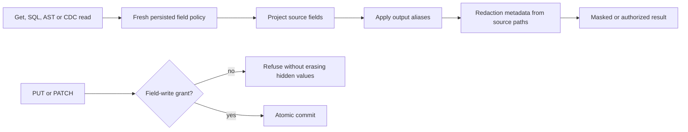

# Safe projector whole operation within Authorization

Authorization uses the existing common source projector: Core Documents.Project delegates to Security AuthorizationPolicy.Project; QueryRowProjection projects that source before applying selected aliases and retains only related original source policy metadata; document CDC projects both authorized Before and After images through the same policy. This operation contract supplements REQ/AC-AUTH-006/007/009, REQ/AC-DSTORE-003 and ADR-014/015/022. It defines no parallel projector, library, trusted caller role or new public/private field.

The operation seeds a genuinely stored document with a public field, a nested classified field, a literal dotted-name classified field and classified array members. Explicit persisted raw-read, raw-use and field-write grants are independent. A second literal document with status=second and profile=7 provides a real bounded page/cursor and a supported scalar ancestor selection against the declared descendant policy. A persisted ordinary reader has scoped Get/Query/ChangesRead/DocumentsWrite capabilities; every grant transition uses an authenticated administrator and a strictly increasing policy epoch.

| Criterion | Required whole operation and source declaration |
|---|---|
| REQ/AC-SAFE-PROJECTOR-OP-001, AUTH-006: source projection and aliases | Get, SQL and typed AST star omit identical classified data. Explicit protected source projected under a public alias produces a typed null and complete current redaction metadata; a permitted public source aliased with a protected-looking output name remains the permitted public value with empty redaction metadata. A literal stored null remains null before and after raw-read repair; the classified source changes from omitted/typed null to the known raw canary. A selected hidden scalar has only its related original source policy paths; an unprotected stored null has Redacted=false and empty fields. Metadata never substitutes output aliases for source classification paths. Native SafeProjectorOperationTests and public SafeProjectorOperationClusterTests cover actual SDK and official MCP calls. |
| REQ/AC-SAFE-PROJECTOR-OP-002, AUTH-006 and DSTORE-003: protected roundtrip | PUT of the actual projected body, unauthorized explicit replacement and a protected-field PATCH refuse without erasing hidden values. A genuine public-field PATCH succeeds and preserves every hidden literal. Raw read alone does not supply field-write authority. A fresh authorized healthy mutation uses a new command identity and exact expected revision. |
| REQ/AC-SAFE-PROJECTOR-OP-003, AUTH-007: fresh use/read policy and immutable outcomes | No-use predicate/order refuses before exposing a page. Persisted use-only repair permits authorized field use while output remains masked. Removal invalidates original cursor/current protected use; current read/use repair returns complete allowed raw output. First failed commands may retain their legitimate failure/clock/applied watermark; their domain images remain unchanged. Same-ID failures stay failures after repair; successful originals retain their exact stored receipt while fresh Resolve rechecks current grants. |
| REQ/AC-SAFE-PROJECTOR-OP-005, AUTH-006/009: selected-source metadata | The shared QueryProjectionRedactions helper uses the existing native GetEffectiveFieldPolicies/segment Overlaps and intersects original omitted source paths in their original order. Star retains complete source metadata. Literal dotted/prefix fields, array-index secret/public siblings, missing descendants and a genuinely stored scalar ancestor distinguish relevant policies without alias matching. Existing scalar-only object/array refusals and route-specific duplicate-alias failures remain exact. Scalar/partition/live/model pages and both join emitters retain original source namespaces. |
| REQ/AC-SAFE-PROJECTOR-OP-004, AUTH-006/009: CDC, original history and lifetimes | CDC exposes literal projected Before/After values for the same real revisions; authorized raw readers see the raw history. Every operation preserves or intentionally changes independently verified complete documents, indexes, outbox/outcomes and original identities. Original replays, a fresh healthy continuation, two ordinary same-root cold owners and two genuine Aspire cluster all-node cold cycles retain complete state/receipt controls. All owned callers, streams, canonical storage owners and cleanup stages settle with original failures preserved. |

Native producers use the actual database EvaluationClock and canonical TestDatabase owner. Ordered atomic apply persists the command outcome before result observation. Expected receipt position comes from the pre-operation canonical applied sequence plus an independently read partition identity; physical store position is a separate value. Cold reopening joins storage and retains the original root, incarnation and signing identity. Fresh replay resolves persisted outcomes under current principal/resource authority and the original command fingerprint; historical content never bypasses current authorization. Full native receipt checks include ordered internal CompositionReferences. Public SDK/MCP checks include every public receipt field only, ProcessDurable and the configured PersistedCopies and actual partition incarnation; public commit positions and query/feed cuts remain opaque, positive returned witnesses and are not guessed from local store positions or compared across separate node calls. Public committed timestamps are first independently observed through the administrator feed, checked against complete literal changes and retained unchanged across every reader/replay/cold wave; they are not a fabricated evaluation clock.

The source/alias oracle uses literal expected field values and redaction paths from the declared policy. It never derives an allowed expectation from the returned payload, relabels an empty/partial result as success or substitutes masked data for required raw use. Every error excludes credentials and canaries. Public secret mutation failures are followed by separate administrative full-state checks and a real healthy request. Existing native CQRS operation/stream admission, cancellation and joined caller lifetimes remain authoritative; no new dispatcher, long-poll guarantee, timeout, capacity or clock override is introduced.

Current scope is the existing path-metadata capability. Architecture section29.5 additionally requires a persisted schema-visibility policy selecting generic redaction without paths and generic denied/unknown-field binding for schema-hidden fields. No such selector currently exists; this remains an explicit unimplemented capability until its consequential persisted/public/default contract is reviewed. No current public safe Export operation was found; raw administrative backup is not safe export and does not qualify it. Existing event/queue model-root, graph/search, required worker input, diagnostics exporter, recovery and retention gates remain necessary. These whole-operation scenarios do not claim every output/log/trace safe or the whole projection scope accepted.

Source review and two process-local cold opens do not establish process-kill or power-loss durability. UI is N/A for this database policy operation.

The native case `SafeProjectorOperationTests.PersistedSourceProjectionRoundtripAndCurrentGrantHistoryRemainExactAcrossTwoColdOwners` covers criteria001–005 with exact independent local source cuts, signed cursor claims, retained original entries, canonical/index/outbox images and two original same-root canonical cold owners. The public case `SafeProjectorOperationClusterTests.SafeSourceAliasesRoundtripAndCurrentCdcSdkOfficialMcpRemainExactAcrossTwoColdRestarts` covers the same declared path-metadata operation through both actual callers, keeps one persisted reader/client pair through every warm policy transition, preserves all original producer/refusal/metadata identities, and disposes callers before each actual all-node cluster cold restart. Its `NotInParallel` scope follows those fixture-wide owned container restarts. These declarations are an execution inventory, not evidence that either case has passed.

QueryRow emitter audit: QueryEngine.BuildPage and partition/live leaf processing reuse QueryEngine.Project; ModelQueryExecutor.BuildModelPage also calls queries.Project after ModelQueryPolicies.Rebase. QueueEntityRefJoinExecutor and EventEntityRefJoinExecutor reuse QueueEntityRefJoinProjection; relational typed joins use RelationalInnerJoinProjection. Those three row projectors share selection metadata filtering while retaining their original JSON/value generation, raw-read/use authorization, source order, budgets and error precedence. Model Explain emits an independent static safe plan rather than classified row data. Existing model-root whole-flow goldens now distinguish selected protected sources from unrelated omitted payload/header fields; existing star/native body assertions retain their complete source metadata. No new model dispatcher or alternative projector is introduced. Public original administrator metadata replay is immediately followed by the same reader's masked SDK/official MCP Get and protected-use refusals, with the complete public domain image bracketed around each original replay.

The acceptance fixtures compare private payloads, bearer cursors, fingerprints and raw images through boolean-only assertions. Each native original retains its first genuine outcome bytes and partition locator bytes immediately after admission; historical Apply, fresh Resolve, same-ID admission and cold observations compare those exact retained bytes. A failed native trial joins every owned resource and retains its original roots for diagnosis; roots are deleted only after work and joined cleanup both succeed. SDK refusals retain the native fixed detail; official MCP refusals verify the independently pinned closed public safe detail for the exercised category.

