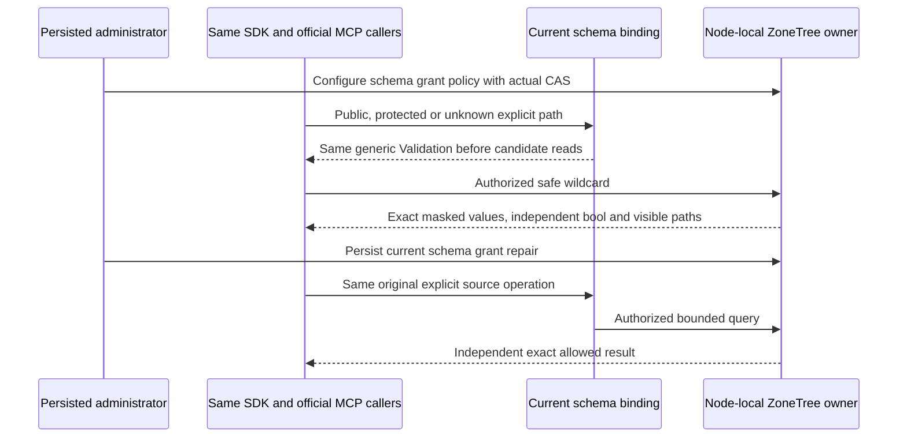

# Schema-visible projection within Authorization

This operation implements ADR-137 under architecture30.2–30.3, KL-062/063/064 and REQ/AC-AUTH-006/007/009. It keeps raw values, raw use, writes and schema metadata as separate persisted grants. See [ADR-137](../../ADR/ADR-137-schema-visible-projection.md) for the exact ID6/null/restricted-binding decision and [Authorization](../Authorization.md) for the original feature authority.

| Requirement | Acceptance and complete operation evidence |
|---|---|
| REQ-SCHEMA-001: one validated persisted schema grant | AC-SCHEMA-001: current-format native serialization preserves exact SchemaReadGrant at ID6, null is public schema, a real nonnull grant persists and is current-principal controlled; invalid nonnull identifiers fail without changing configured metadata. Actual policy CAS and bounds remain enforced. |
| REQ-SCHEMA-002: full internal lineage stays separate from public metadata | AC-SCHEMA-002: wildcard hidden values yield true+empty paths when every omission is schema-hidden; mixed policies expose only permitted original paths while flag remains true. A schema-visible resource's unrelated public alias remains false+empty. Exact root/escaped/array/overlap and two-source join semantics retain complete relevant lineage internally. |
| REQ-SCHEMA-003: restricted explicit query binding is uniform | AC-SCHEMA-003: while any effective source policy is schema-hidden, known public, known protected and absent non-system explicit selections, predicates, order fields and join fields return the same generic Validation before candidates and without partial pages. Actual system ID/revision sources and safe wildcard values follow the declared exceptions. Aliases do not bypass source identity. |
| REQ-SCHEMA-004: fresh schema authority is independent | AC-SCHEMA-004: the same genuine SDK/MCP caller with raw-read/use grants still receives generic binding denial while schema grant is missing; persisted schema grant repair enables the original exact explicit result, revoke restores denial, and each read/refusal preserves complete independent documents/outbox. No cached/ticket role authorizes it. |
| REQ-SCHEMA-005: all current output/binding owners use the same policy | AC-SCHEMA-005: SQL/AST/Q1 and actual public .NET/official MCP wildcard, selected, CDC and model/join metadata obey the same source visibility. Saga body/header/state flags retain complete omissions; emitted metadata excludes hidden paths. Privileged configuration and existing static guide/catalog boundaries stay exact. Restricted EXPLAIN fails generically before any access-path/index/schema detail. |
| REQ-SCHEMA-006: retained effects and owners remain genuine | AC-SCHEMA-006: exact full seed/mutation receipt and replay, canonical documents/index/outbox and current policy survive joined original owners and two actual same-root cold cycles. Failed acquisition and cleanup preserve all original failures. Native unit is not Docker RF3 or process-loss proof. |

The native source operation extends the existing BinderFieldLineageTests class with a distinct schema-authority method and feature-local whole-flow roles, preserving its current null-schema methods. The public operation adds a schema-authority sibling method to existing SafeProjectorOperationRf3Tests and uses the real three-node ClusterFixture, actual .NET SDK and official MCP SDK callers. Distinct methods are justified by the new persisted schema-authority contract: old null-policy goldens and their two cold cycles must remain independently executable. New methods must not clone transport, storage, membership or identity frameworks. Their exact declarations and arguments are recorded only after source is authored; no native UID or passing discovery is invented here.

Discriminating system-source coverage includes a root payload omission with no raw-read grant: exact ID/revision metadata values remain unredacted with empty paths, and their native filter/order operands work without a payload raw-use grant, while safe wildcard reports the genuine root omission. Special join predicates exercise both a supported source path and a syntactically valid unknown path on the SAME schema-hidden resource; both must reach the same generic Validation after structural normalization and before candidates.

Expected public values, flags, visible paths and full model state come from literal configured policy/data and the native contract, not by accepting returned results as an oracle. Complete omitted internal paths never appear in public payloads or diagnostics. Check no credential/private canary in each rejected envelope; compare full safe details within each actual transport, retaining existing official MCP error normalization. Do not replace native exceptions with fabricated success/error replies.

Implementation order is sealed ADR/spec, owning contracts/evaluator and Core lineage, Query/projector and explicit KL-048/Explain-owner overlays, complete native/public operations, full independent review, coherent Main adoption, strict build/native discovery, real operations and exact-source Linux qualification. Existing schema-version cursor invalidation remains Main KL-066 scope; no second cursor protocol is added. Safe Export and the complete diagnostics/inference matrix remain open product gates. No historical binary compatibility, upgrade/migration reader, format fallback, optional SIMD mode or new dependency is added.

Status: implementation and all compiler/native/recovery/RF3/Linux qualification OPEN. This SourceN contract is ordered before implementation; it does not claim current shared-source adoption or test execution.
