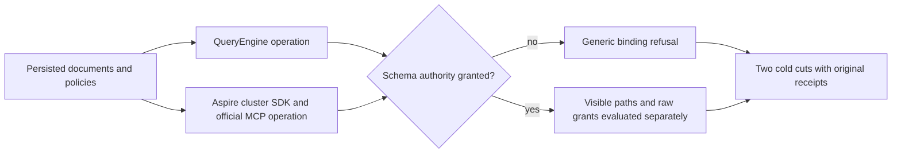

# Schema-visible whole operations

These two additive TUnit operations implement the whole-operation proof in ADR-137 and [SchemaVisibleProjection](SchemaVisibleProjection.md). Existing BinderFieldLineageTests and SafeProjectorOperationClusterTests null-schema methods, their seven and twenty-six public families and their original two cold cuts remain unchanged.

| Entry | Genuine operation and completion gate |
|---|---|
| `BinderFieldLineageTests.PersistedSchemaAuthorityControlsBindingMetadataAndRootSystemOperandsAcrossBothColdCuts` | Actual replica admission, ZoneTree canonical records and QueryEngine SQL/AST. Persist raw-use; deny schema; add raw-read while schema remains denied; repair only schema; revoke schema; expose one mixed omission path; finally hide the root payload with no raw grants. Preserve full seed receipt and replay, complete original store images around every query refusal, exact configured resource on invalid schema grant and separate bounded canonical documents/indexes/outbox image around its durable failed result/replay. Reuse the genuine SafeProjectorOperationDatabase owner, Issue/NextToken/Entry and the existing full stored-outcome replay helper law whose Seed.EqualAsync branch compares actual private composition-reference arrays from each returned and stored receipt: receipt position is the original ordered journal index, independently of canonical store position. Reopen both original canonical and replica owners twice through its actual ZoneTreeExistingStore.Open path, preserving both identities, journal cut and LastApplied. Every initial and replayed receipt compares private CompositionReferences independently. |
| `SafeProjectorOperationClusterTests.SchemaVisibilityAndRawAuthorityRemainIndependentThroughSdkOfficialMcpAndBothColdCuts` | Actual shared three-node Aspire ClusterFixture, persisted principal/API key and same original SDK/official MCP callers throughout warm authority repair/revoke. SQL/AST/Q1, Get and CDC return independently specified values/flags/visible paths. Each refusal retains complete canonical two-document/outbox image; full original seed receipt replays as root through both clients; the public patch replays as its original reader through both clients at its original policy epoch, then the same reader receives changed-policy denial after the root-policy transition. Prior protected-write refusals retain their original issuer and current policy law. Final root-policy metadata selection/filter/order works without raw-read/use while payload wildcard is masked. Actual ModelSqlClusterCold stops/restarts the original topology twice and reacquires genuine clients with current persisted authority. |

The hidden resource rejects public, protected and missing explicit selection/predicate/order sources with identical Validation detail. Both transports retain their declared safe detail policy. Hidden wildcard Explain also fails. Distinct-source joins use explicit aliased selections and configured typed targets; event-reference joins compare a supported payload predicate with an unknown path on the same hidden source and otherwise identical shape, before candidate evaluation. Empty configured join sources are a refusal discriminator, not positive joined-row qualification. The existing typed populated join suites retain positive join qualification; this child operation does not invent positive rows.

The masked field values remain absent. All-hidden omissions yield `Redacted=true` and empty paths. Mixed omissions reveal only the permitted original path. Exact ID/revision metadata sources under a root payload policy return `false` and empty paths; ordinary payload `/id` and `/revision` remain refused. No output alias confers system-source identity. Grant repair changes only current persisted schema authority while raw-read/use stay granted; revoke immediately restores generic binding refusal on the same clients.

Invalid nonnull schema identifiers are actual durable returned failures in the ordered admission fixture. The operation asserts Validation, exact safe detail, null JSON/value, intentional Get failure and stable failed-GUID replay. It compares configured policy and bounded complete domain records; it does not assert unchanged admission clock/applied index/outcome metadata. Query byte invariance proves no effects, not absence of candidate reads. Source review of the owning binding gate remains a separate requirement for before-candidate order.

Original storage owners, failure aggregation, cold primitives, deadlines, topology, persisted authorization and SDKs are reused. No alternate transport, store, clock, test framework or default timeout is introduced.

