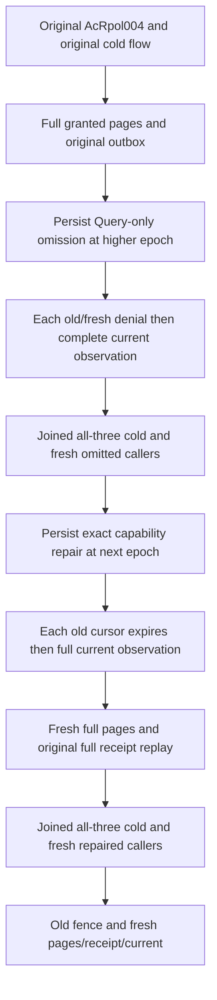

# Selective Query capability and signed page epochs

Owning slice: Authorization. Maps REQ-AUTH-005/007, AC-AUTH-005/007 and the original ResourcePolicyUpdates RPOL-004 public boundary. QueryExecution owns the existing query/cursor contracts; ClientApi owns official MCP admission. ADR-022 and ADR-125 remain applicable.

| Requirement | Measurable acceptance | Automated mapping |
|---|---|---|
| REQ-AUTH-QE-001: each continuation reauthorizes the current persisted Query grant independently of DocumentsRead | AC-AUTH-QE-001: remove ONLY Query at the next principal epoch; both original signed cursors and fresh Query requests refuse, while both literal original documents remain readable through SDK and MCP after EACH refusal | Existing AcRpol004, QueryOnlyEpochR46Flow |
| REQ-AUTH-QE-002: restoring capability cannot revive an earlier signed policy epoch | AC-AUTH-QE-002: restore exact baseline grants at a higher epoch; each old cursor refuses CursorExpired; fresh SDK/MCP first pages and cross-client continuations return the complete independent one-row pages, same signed cut within each pair, no continuation on the last page | Same original case, Pages and Refusals |
| REQ-AUTH-QE-003: no query refusal/replay mutates the owned model or outbox | AC-AUTH-QE-003: immediately after EACH healthy query response, refusal and original commit replay require full privileged two-row query/resource image, both current reader documents and full original outbox on both clients; every replay equals the entire original CommitReceipt | Same original case, Current and Replay |
| REQ-AUTH-QE-004: persisted omission/repair survive owned cluster restart | AC-AUTH-QE-004: dispose all original callers, stop/restart/join health for all three Aspire resources; fresh callers enforce Query omission at first cold cut and higher-epoch repair/old-cursor fence at second cold cut | Same original case, Cold and Flow |

The original declared Test, no-argument shape, data, schema versions, original four-route field-policy/revoked flow, original cold flow and McpCallerDeadline lifetime remain intact. The new two-route continuation begins only after that original invocation returns. No credential/key/row/field grant changes occur in the new continuation. No new SQL dialect, operation, provider, package, topology, clock or timeout is introduced.

SDK failures compare the complete canonical Problem and absent value; MCP failures compare the genuine safe five-field problem, safe detail, privacy and actual pre-/post-dispatch identity according to the owning admission contract. Query capability refusal is not credential revocation or HTTP 401. The actual database WithQueryView reloads the current principal and requires Query|DocumentsRead before the resource/query callback. Actual MCP state/admission do not contain a Query omission predicate; the complete original SqlOffset refusal control uses the canonical dispatched PermissionDenied expectation. The safe codec preserves the owned scope-denied literal, matching the SDK scope detail, whereas CursorExpired uses its fixed generic MCP detail. Existing QueryCursorExecution maps a valid earlier epoch to the authorized-cut CursorExpired detail; combined failed predicates are not diagnosed as a unique runtime cause.

Literal corpus is the original first document/revision1/SeedJson and second policy-page-witness/revision1/SecondJson. Full row JSON, redaction flags/fields, bounded-full-scan path and original full receipt are compared. The same-owner query cut is checked against privileged query samples surrounding acquisition and retained through continuation. It is never compared to logical commit positions, replica AppliedPosition or another node's opaque cut. These are public observations, not a raw journal/no-commit or atomic cross-store snapshot claim.

Slice map: tests/KeyLoad.IntegrationTests/Authorization/{Helpers,Assertions,Models,Contracts}; existing Cases/ResourcePolicyUpdateClusterTests.cs receives a sole continuation. New sub-spec docs/Features/Authorization/SelectiveQueryCursorEpoch.md. Product/frontend/benchmark: N/A; this qualifies existing public policy/cursor contracts and makes no performance claim.
