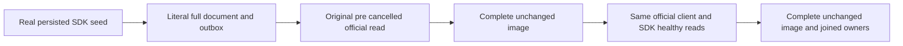

# Standard pipeline cancellation within Authorization

REQ-AUTH-ASPNET-001/003 and AC-AUTH-ASPNET-001/003 retain the original `McpDiscoveryTests.AcMcp005CancelledNativeReadDoesNotPreventTheNextRealCall` declaration, UID, deadline, actual official MCP client and pre-cancelled native read. This child records a test-oracle gap; no product defect or old failure is asserted.

## Contract

REQ-AUTH-CANCEL-IMAGE-001: bracket the original caller-cancelled official capabilities read with an independently specified complete canonical document and every OutboxStatus field, captured through an authorized real SDK on the same node. Preserve the original cancellation exception and following official capabilities result.

AC-AUTH-CANCEL-IMAGE-001: configure and seed a genuine uniquely owned persisted collection through the existing SDK scenario, require the full literal revision1 DocumentResult, capture document/outbox before the original cancelled call and compare the complete image after it. The SAME original official client and the authorized SDK then return that independently literal document; compare the complete image after each healthy read. Original lexical HTTP/client/token lifetimes and Aspire-owned readiness/shutdown remain unchanged.

## Ownership and evidence boundary

Only the existing ClientApi case and the new feature-local Authorization/Assertions/Credentials/Verification/CanceledCredentialAuthorityAssertions own this source proposal. Existing capability assertions remain. The helper uses real SDK and official MCP calls and compares original complete typed images through the existing canonical serializer assertions; it does not remove cuts, derive expected documents from results, introduce trusted users/claims, change grants, add an endpoint, dispatcher, quota, deadline or provider.

This is caller cancellation before an official invocation; it is NOT proof of server callback cancellation, a credential resolution count, a captured ticket, disconnect drain or cold durability. Those criteria retain their separate original operation maps. No new test or UID is introduced. Frontend/public schema/persistence are N/A.

## Existing standard ASP.NET operation map

- Subject-only handler/current signed scope: DatabaseAuthenticationHandler,
  DatabaseAuthenticationComposition and GrainIdentityContext source audit.
  Request-bound handler dispatch count remains OPEN; the phase bank is cumulative
  and RequestFailureDiagnostic stores only the last closed phase.
- Reused SDK/official MCP policy removal, repair, revoke and original result replay:
  McpPersistedAuthorizationTests.AcMcp002CurrentPersistedPrincipalControlsEachCallAfterDiscovery,
  StandardAspNetAuthorityTrial and DiscoveryAuthorityFlow/Cold.
- Concurrent independent principal isolation plus one-principal revoke/repair:
  McpConcurrentIdentityTests.AcMcp002DistinctOfficialClientsKeepTheirOwnTenantsDuringConcurrentCalls
  and ConcurrentPrincipalPolicyContinuation.
- Actual credential revoke/expiry, healthy repair replay and all-three cold:
  McpCredentialLifecycleTests.AcMcp002PersistedCredentialChangesRejectTheClientAfterDiscovery
  with both original bool arguments.
- Missing/unconfigured and malformed persisted credential refusal, full no-effect
  image and cold healthy replay:
  McpCredentialLifecycleTests.AcMcp002NativeDiscoveryRejectsMissingAndUnconfiguredCredentials
  with both original bool arguments and MalformedCredentialAuthorityRefusals.
- Public GET/HEAD static allowlist and protected POST/data boundary:
  AdminDashboardClusterTests.AcAd001CredentialFreeShellNeverExemptsDataOrUnknownAssets
  with AdminShellAssertions. These existing owners are unchanged.

These are source maps only. Historical executions, newly reviewed bodies and future fresh runtime cohorts must retain their own authentic identities and results; none is promoted into a current execution or a once-count claim.
