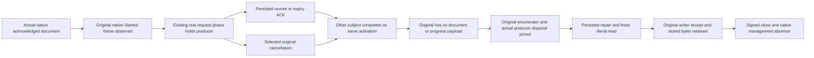

# Started native read stream and current persisted policy

Canonical task: KL-066 / REQ-AUTH-007 / AC-AUTH-007, [Authorization](../Authorization.md), [ClusterRouting](../ClusterRouting.md), [ADR-022](../../ADR/ADR-022-policy-epoch-revocation.md) and [ADR-125](../../ADR/ADR-125-connection-owned-execution.md).

REQ-STARTED-READ-001 / AC-STARTED-READ-001: an original database-signed native ConnectionGrain read which has already produced and delivered its actual Started frame must still load current persisted authority after its existing operation barrier. Retaining the original verified subject/context/connection is not permission to retain the old principal policy. A real root-authorized revocation or expiry policy-change ACK while that original producer is held must prevent its later document payload. The same actual activation must independently serve an authorized sibling subject while the original remains held.

REQ-STARTED-READ-002 / AC-STARTED-READ-002: selected cancellation of that actual original stream must join its own enumerator and actual server ProducerDisposed observation without cancelling the sibling or a following operation. The native read may report its original OperationCanceledException or the exact typed Cancelled terminal; UnknownWriteOutcome and success are not read-cancellation substitutes. No terminal/progress result may disclose document data after cancellation. Every actual initiating error and independent native enumerator/context cleanup failure is retained through the existing ServerFailureObserver.

REQ-STARTED-READ-003 / AC-STARTED-READ-003: root-owned policy repair must restore fresh authorized reads on the SAME activation without reopening a cached permission path. The original separate writer's complete native receipt, original stored outcome bytes, and independent literal current document remain conserved. Successful signed close joins original calls/observations and native management must observe connection activation absence.

## Original whole-operation cases

StartedReadPolicyTests.OriginalStartedReadRequiresCurrentPersistedAuthorityAndSelectedCancellationLeavesSameConnectionHealthy has three Args: revoked, expired, cancelled. Each reuses the actual existing ConnectionNativeScenario, RequestCqrsClusterFixture, native Orleans TestCluster, generated serializer, actual ConnectionGrain, ManagedCode.Communication.CQRS IAsyncEnumerable, NativeCqrsStreamLifetime, native server-owned GrainRequestIdentityScope and real ZoneTree/native replica-log/materializer admission. No fake stream/grain/clock/provider or product dispatcher is introduced. The existing native phase observer pauses the original operation only after writer.StartedAsync; the new actual consumer independently observes that original Started frame before any policy action. Its original GetAsyncEnumerator/MoveNextAsync/DisposeAsync are awaited, not replaced by a fabricated result sequence.

The separate persisted writer first acknowledges the literal revision1 document. Its complete receipt is independently bound to the actual original retained replica entry index, physical incarnation/atomic partition/epoch, literal mutation and ProcessDurable profile. Hidden CompositionReferences are checked only as empty Booleans. Full original stored outcome bytes are retained verbatim. A separate reader's original signed read starts on the same server-owned connection, then the native observer holds it. A real root ConfigurePrincipal ACK sets reader Revoked=true/epoch2 or ExpiresAt=UnixEpoch/epoch2. The expiry variant proves a newly acknowledged persisted past expiry against the unchanged TimeProvider.System; it is not evidence of crossing a timed wall-clock boundary, envelope expiry, API-key expiry or a fake clock advance.

An independent writer read completes with the full literal DocumentResult while the original remains incomplete. After releasing the held producer, the original native frames must be exactly Started then Failed/Unauthenticated with the complete independently expected credential-unavailable Problem and no reply value. The cancellation variant instead cancels only its original linked token and preserves the original cancellation object or exact Failed/Cancelled Problem. No Progress or Completed frame is allowed. After actual native producer disposal, complete canonical key/value bytes, physical store position and original writer outcome bytes remain exact to the post-ACK snapshot.

The original and sibling request IDs/subjects, actual native GrainId/ActivationId and producer-disposed observations prove one reused activation and isolated identities. Actual epoch3 repair restores the same reader's original grants and removes expiry/revocation; a fresh real same-activation read returns the complete original document. The unchanged writer command replays the actual original native reply payload and stored outcome bytes without a new domain effect. These are original observed reply bytes, not a reencoding of a public receipt as persistence proof. The original signed connection close and native management observation join all owners before existing fixture shutdown.

## Scope, ownership and gates

This is a distinct begun-read checkpoint regression. Existing fresh-after-revocation command tests, held-write authority faults, ordinary SQL/AST cursor repair/two-cold, scalar live-current-policy continuation and EventFeedTail cancellation/current-refusal flows remain unchanged. It does not duplicate them or introduce another SQL/live/tail scenario. Feature-owned Contracts/Models/Helpers/Assertions/Cases above and this child doc are new-only SourceN. Product, existing fixture/provider/native serialization identities, routing limits, deadlines and clocks are untouched. Frontend/public HTTP/MCP/new infrastructure N/A for this native foundation stage.

The native fixture has one actual Orleans test silo and real node-local ZoneTree/native RF3-configured journal/materializer admission, with no real three-peer transport/quorum. Its ProcessDurable receipt does not prove Docker/Aspire RF3, public SDK/official MCP, a long multi-page tail, process restart, two cold owners, live expiry timing or complete KL-066 acceptance. Those original required gates remain mandatory and separate; no runtime execution or provider disposal fault was manufactured. The complete native raw image oracle is bounded and source-known. Existing fixture owns the actual native cluster/request-work owner/store shutdown; the new consumer joins its original task and producer before that shutdown, retaining all actual cleanup errors.

Prepared parse/numeric/nesting preflight, source/API review and retained guards are not semantic compilation or execution. Root adoption/independent full peer, native discovery, normal Unit/nativeSIMD50, recovery, public RF3 and exact-source Linux qualification remain OPEN. No SDK/build/test/Git/SourceY command was run by this lane. No task-status or global-plan edit is proposed.
