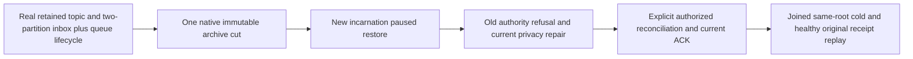
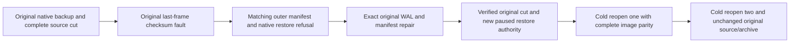
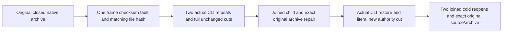
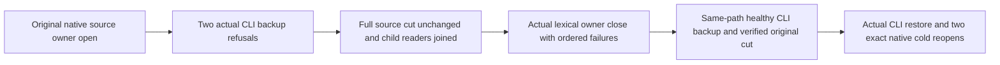
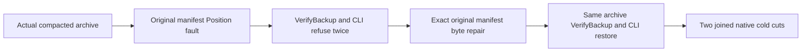
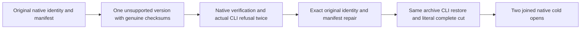
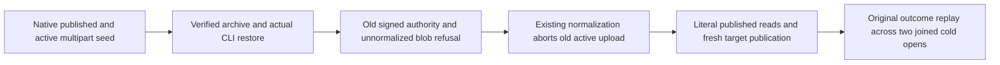
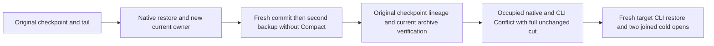
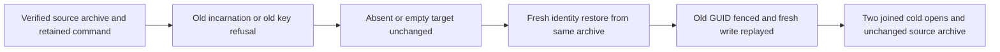

# BackupRestore

BackupRestore creates an offline backup of the canonical ZoneTree files of one store and restores it into a clean location. A replicated cluster is backed up and restored by running the same local operation on each silo's ZoneTree owner files. The slice owns archive verification, restore safety, restored-identity fencing and the persisted credentials/authorization carried through backup and restore.

Status: local verified backup/restore and piecewise archive transfer are present in source; unit and process-recovery test cases exist, but their execution against the current delivered source and exact-SHA Linux GitHub qualification are pending. Docker/Aspire replicated-cluster restore qualification is pending. None of the flows below qualifies power-loss durability, a globally consistent multi-silo cut or production readiness.

## Purpose, actors, and entry points

BackupRestore creates an offline backup of canonical storage and restores it into a clean location. Actors are a database administrator and an operator controlling an offline process. Current entry points are `ZoneTreeStore.CreateBackup` and `ZoneTreeStore.Restore`, CLI commands `backup` and `restore`, Cartograph `pack-backup` / `inspect-backup` / `unpack-backup`, `POST /v1/admin/backup` for server-side backup, and `ArtifactTransfer.CopyToFileStorageAsync` for archive transfer. The CLI requires an offline database for backup and restore. This scope does not define a new backup route or online restore endpoint.

## Canonical slice map and boundaries

| Surface | Current source | Target owner |
|---|---|---|
| Storage backup/restore | `src/KeyLoad.Storage.ZoneTree/ZoneTreeStore.cs` delegates to `Features/BackupRestore/ZoneTreeBackupRestore.cs` and its file/restore helpers | Private behavior is owned by `src/KeyLoad.Storage.ZoneTree/Restore/`; the public facade remains the shared entry point |
| Archive and transfer | `src/KeyLoad.Storage.ZoneTree/Restore/Execution/BackupArtifact.cs`, `ArtifactTransfer.cs` and focused helpers | Same canonical slice; legacy declarations removed |
| CLI | `src/KeyLoad.Cli/Restore/Commands/CliBackupRestore.cs` behind the aggregate Program runner | Slice-local offline operations; exact dispatch/text/disposal parity under AC-CQ-010 and ADR-033 |
| HTTP backup entry | `src/KeyLoad.Server/ApiEndpoints.cs` | Shared server boundary; no public restore route is defined |
| Tests | `tests/KeyLoad.UnitTests/Restore/Cases/Artifact/ArtifactTests.cs`; `tests/KeyLoad.RecoveryTests/StorageRecovery/Cases/RecoveryTests.cs` | Unit source is slice-local; remaining recovery layout debt targets matching `Features/BackupRestore/` |
| Documentation | This spec; detailed storage design in `../design/product-specification.md` | One canonical feature acceptance source |
| UI and public blob API | None | N/A: operators use CLI/admin boundaries; archive chunking is not a user-facing blob contract |
| Official MCP | No backup tool surface verified | Required MCP work is tracked in ClientApi; no tool name or route is inferred here |

Layer-first source locations are migration debt under [ADR-032](../ADR/ADR-032-mcaf-governance.md). BackupRestore owns artifact verification and restore safety, not live replication, blob storage, or power-loss qualification.

[ADR-033](../ADR/ADR-033-code-quality.md) owns the strict artifact-source layout. AC-CQ-001/005/006 and AC-MP-012 join the AC-BACKUP-001/002 real archive round trips, negative-file/checksum cases and transfer assertions. Public signatures, archive bytes/chunks, permissions, cancellation and actual system-clock timestamps stay unchanged.

[ADR-046](../ADR/ADR-046-storage-private-owners.md) accepts a cohesive internal ZoneTreeBackupRestore owner under this slice, borrowing the one node-local runtime and retaining the existing public facade entry points. The unchanged two-file manifest/identity/paused restore recipe and the AC-SQ-005/007 joins are in the [StorageRecovery](StorageRecovery.md) implementation contract. Existing AC-BACKUP-001/002/003 remain mandatory; the decomposition adds no power-loss, bounded-manifest-memory or performance claim.

## Current behavior and planned work

- The current store backup records a verified backup manifest and canonical storage files. Restore verifies the manifest/checksums, requires a clean target, creates a new database incarnation, and pauses dispatch.
- `BackupArtifact.Pack` divides backup files into bounded Cartograph pieces; `Inspect` lists entries; `Unpack` verifies catalog layout and writes to a destination. `ArtifactTransfer` copies an archive through the ManagedCode file-storage abstraction. This is backup artifact transport, not chunked public BlobStorage or partial blob reads.
- `RecoveryTests.VerifiedBackupRestoresDataWithNewIdentityAndPausedDispatch` checks restored data, new identity, paused dispatch, private file mode, and rejection after tampering with `commands.wal`; that is native-store corruption coverage, not Cartograph corruption. `ArtifactTests.ChunkedCartographBackupRoundTripsAndManagedCodeStorageTransfersIt` covers multi-piece archive round trip and byte-identical file-storage copy. Real CLI cases exercise a noncanonical catalog, first/last entry-length mismatch, and missing manifest/identity/journal inputs, with rejected restore attempts and healthy restore/reopen controls. They do not measure peak or retained memory.
- A replicated cluster is backed up and restored as one local backup/restore of each silo's ZoneTree owner files. A consistent cut across silos is not part of the current design; a per-silo local backup must not be described as one.
- Restore of an older cut changes incarnation and must not silently resume external dispatch or claim old cursors remain valid. Operator reconciliation and explicit resume remain a planned workflow.

## Requirements and acceptance

| Requirement | Measurable acceptance | Existing or planned evidence |
|---|---|---|
| REQ-BACKUP-001: produce and package a verifiable offline backup | AC-BACKUP-001 passes when a backup includes its manifest/checksums, archives in bounded pieces, and round-trips canonical files. Separate planned resource verification must measure bounded streaming/peak-memory behavior before making a memory-bound claim. | `ArtifactTests.ChunkedCartographBackupRoundTripsAndManagedCodeStorageTransfersIt` checks multi-piece round trip and copy. Planned real-file resource-bound verification. |
| REQ-BACKUP-002: restore only verified data to a clean target | AC-BACKUP-002 passes when a valid backup restores canonical data to a clean location; missing/tampered files and nonempty or unsafe destinations fail without publishing a usable partial database. | `CliBackupRestoreInvalidCatalogTests`, `CliBackupRestoreLengthMismatchTests`, `CliBackupRestoreMissingInputTests`, `CliBackupRestoreFlowTests`, `BackupRestoreStagingJoinTests`, `ArtifactTests`, and `RecoveryTests.VerifiedBackupRestoresDataWithNewIdentityAndPausedDispatch`. StagingJoin directly tests native ZoneTree restore into absent/empty targets and supports this AC's clean-target behavior; its `AcSqlc011` name does not make it an SQL-client test. The cases cover noncanonical catalog rejection, actual rejected output restore, missing required inputs, nonempty destination, original-byte/state preservation, and healthy restore/reopen controls. Path-traversal/reparse-specific and resource-bound evidence is distinct. |
| REQ-BACKUP-003: fence old identity and pause delivery after restore | AC-BACKUP-003 passes when restore produces a different incarnation, sets dispatch paused, and invalidates old cursor/lease identities until explicit operator reconciliation. | `VerifiedBackupRestoresDataWithNewIdentityAndPausedDispatch`; the flows in the sections below; planned auth/feed/lease token invalidation and explicit resume integration cases. |
| REQ-BACKUP-004: restore the per-silo local backups of a replicated cluster with capability invariants | AC-BACKUP-004 passes when each silo's ZoneTree owner files are backed up and restored with the local operation and the restored document/event/outbox/inbox/queue/group state is consistent, unavailable history is reported explicitly, and no automatic external redelivery happens before resume. | Planned Docker/Aspire replicated-cluster backup/restore and process-recovery scenarios; no current test or GitHub artifact establishes this acceptance. |
| REQ-BACKUP-005: bound local metadata and parse the verified identity region once | AC-BSM-001..005: inclusive16KiB manifest/4KiB identity limits, same-owned-region outer/inner checksum, preserved error/destination/lock ordering and real allocation/restore proof | [ADR-048](../ADR/ADR-048-bounded-storage-metadata.md); Metadata* real-file tests. |
| REQ-BACKUP-006: publish an unpacked archive only after complete native validation | AC-BACKUP-006 passes when first/last entry length failures leave an initially absent destination absent or an initially empty destination empty, the real CLI cannot restore either failed output, and the unchanged original archive still restores canonical data with a new incarnation and paused dispatch. All handles and owned cleanup settle; primary and cleanup failures are preserved. | `CliBackupRestoreLengthMismatchTests.AcBackup006CliLengthMismatchCannotPublishRestorablePartialBackup` and `CliBackupRestoreMissingInputTests.AcBackup002CliMissingRequiredBackupFilesRejectWithoutPublicationAndRestoreAfterRepair`; [ADR-114](../ADR/ADR-114-verified-artifact-publication.md). |


## Negative and boundary flows

Reject checksum mismatch, missing canonical files, malformed catalog entries, path traversal/reparse points, nonempty destinations, and a restore whose manifest/version is unsupported. Preserve the last known materialized state when a restore fails. A process-kill or local round trip is not evidence of power-loss durability, a globally consistent multi-silo cut, or recovery of every optional capability.

## ADRs and verification boundary

Related decisions: [ADR-003](../ADR/ADR-003-durability-ack-barrier.md), [ADR-008](../ADR/ADR-008-backup-log-retention.md), [ADR-011](../ADR/ADR-011-current-native-format.md), [ADR-116](../ADR/ADR-116-first-release-current-format.md), and [ADR-030](../ADR/ADR-030-retention-paused-restore.md). Clustering is native Orleans ([ADR-036](../ADR/ADR-036-orleans-foundation.md), [ADR-136](../ADR/ADR-136-native-orleans-partition-ownership.md)); each silo's ZoneTree owner files are backed up and restored locally. The product-level restore sequence is described in [design sections 6, 14, and 44](../design/product-specification.md).

Unit, process-recovery, and replicated-cluster tests run through the native TUnit entry and exact-SHA Linux GitHub Actions. Test names establish traceability only; delivered-source, replicated-cluster restore, endurance, and power-loss gates are distinct and pending. Do not infer user BlobStorage from Cartograph piece sizes or replica snapshot chunk transport. Every test below executes a complete real operation and verifies its outcome and resulting state; none relies on property access alone, mocks or fake CLIs.

## Indexed documents, dedup and the offline store cut

AC-BACKUP-CONTENT-001 (under REQ-BACKUP-001/002/003) requires a current native backup seeded through actual DatabaseEngine document/index/command operations to restore into a fresh target, reopen exact canonical document/reference/revision state, return independently expected native indexed-query memberships and preserve the original stored dedup bytes. Replaying a pre-backup ID must return the existing TokenInvalidated outcome without overwrite or duplicate effects because its recorded incarnation differs from the new restored identity. A new post-restore command must then replay its exact current-incarnation persisted outcome once, with no additional effects or store-position change. The flow covers insert/replace/delete and a rejected unique-conflict batch with no partial effects, verifies the same content after a further close/reopen and a healthy new command. Raw key/value seeds or getters alone cannot prove it.

AC-BACKUP-CONTENT-002 retains the offline store cut: manifest position and verified source position are exactly the acknowledged backup cut; the target native store position includes the existing single restore-authority commit. Assert those exact values and unchanged source archive bytes. The new-incarnation restore intentionally clears replica LastApplied and clock state and keeps dispatch paused; that reset cannot be advertised as preserving a usable old applied index. Token/lease reconciliation remains a separate gate. Open DatabaseEngine/QueryEngine on the restored data only through the existing offline storage APIs; no authorization bypass, replica-authority replay or replacement query path is permitted. Corrupted or incomplete backups reject. ADR-046/048 and the current native restore contract govern it; there is no new format, migration, compatibility path, dependency or public API.

The native staged-restore caller (`BackupRestoreStagingJoinTests`, REQ-BACKUP-002 / AC-BACKUP-002) directly invokes the native ZoneTree restore; despite its `AcSqlc011` method label it does not execute a SQL client operation and is not evidence for AC-SQLC-011. Its absent/empty-target flows support AC-BACKUP-002 clean-target publication and the identity/paused-dispatch portion of AC-BACKUP-003, with byte/readability and cleanup assertions. They do not establish every old cursor/lease invalidation or operator-reconciliation requirement.

AC-CQ-018 preserves the complete ManagedCode file-storage transfer byte oracle in ArtifactTests through ordered content equivalence under pinned TUnit: both real awaited file reads remain, and a partial checksum or reference comparison does not satisfy byte-identical transfer. The ArtifactTransfer name-resolution join retains its public return type, `Result<ManagedCode.Storage.Core.Models.BlobMetadata>`, through an explicit provider alias; the enclosing `KeyLoad.BlobMetadata` does not change this archive transport contract (AC-CQ-001/007/018).

## CLI operation coverage

`BackupRestoreStagingJoinTests.AcSqlc011AbsentTargetPublishesNativeCutAndPreservesEveryBackupByte` and `AcSqlc011ExistingEmptyTargetPublishesNativeCheckpointAndPreservesEveryBackupByte` each have two trailing-separator cases. Their bodies directly call the native restore API, reopen the target, verify new identity/incarnation, paused dispatch, restored data and exact archive bytes. They map to REQ-BACKUP-002 / AC-BACKUP-002 and the identity/pause portion of REQ-BACKUP-003 / AC-BACKUP-003 only; they do not exercise SQL and do not close the cursor/lease fencing and operator reconciliation parts of AC-BACKUP-003.

REQ/AC-BACKUP-001/002/003 and AC-CQ-031 map to genuine Release CLI child-process flows in `tests/KeyLoad.UnitTests/Restore/Cases/Cli/CliBackupRestoreFlowTests.cs` with feature-local Processes/ and Fixtures/ helpers. The Aspire-owned unit and unit-scalar runners own every child, exit, bounded pipe drain, temporary file and cleanup; validated test execution options supply the bounds; no alternate entry point or fake CLI is permitted. The positive flow commits and closes real ZoneTree storage, then runs backup, pack-backup, inspect-artifact, copy-artifact, unpack-backup and restore through the actual CLI dispatch and verifies copied archive bytes, reopened canonical data, a new incarnation and paused dispatch. Negative flows pass corrupted artifacts or nonempty destinations through the same CLI boundary, observe the nonzero exit, preserve existing destination bytes and storage state, and complete a healthy follow-up operation.

The standalone CLI binds `KEYLOAD_STORAGE__` and `KEYLOAD_POINTCACHE__` through the native environment configuration provider. Missing variables preserve the typed defaults; supplied values are validated before opening storage. An invalid-budget backup child leaves the committed source unchanged and the backup destination absent, and is followed by a successful backup and restore. Overrides are confined to that child process.

`CliBackupRestoreInvalidCatalogTests` and `CliBackupRestoreLengthMismatchTests` (REQ-BACKUP-002 / AC-BACKUP-002): the first uses Cartograph's native writer with a noncanonical identity entry, executes the rejected unpack, preserves source/archive/backup bytes, and completes a valid unpack/restore with reopened data, new incarnation and paused dispatch. The second changes only the declared length of the first or last native catalog entry, executes unpack and then tries to restore its output. A failed unpack must not publish a usable backup, including when the last entry fails after all payload files were copied; the untouched original still restores, and all CLI children/readers and owned files settle. A reproduced production gap requires its failure/publication contract to be frozen in an ADR before changing archive execution.

`ArtifactTransferRejectedInputFlowTests` (REQ-BACKUP-001/002/003, AC-BACKUP-001/002/003) executes the actual transfer with a directory source and the actual pack with a piece size one byte below the accepted minimum. Both errors leave source and backup bytes unchanged and publish no artifact or destination. The same fixture then completes native pack/inspect, ManagedCode file-storage transfer, unpack and ZoneTree restore, checks exact archive and backup bytes, and reopens both the seeded and the large records under a new incarnation with dispatch paused.

`MissingBackupManifestTests` (REQ-BACKUP-002 / AC-BACKUP-002): the real embedded restore normalizes only a missing manifest or its directory to the `FormatUnsupported` Problem with the fixed manifest detail, leaves the other required-file contracts intact, and verifies unchanged source and valid-backup bytes, original store identity and data, no published or staged destination, and a healthy following restore.

### Bounded missing-input errors in the offline restore CLI

REQ-BACKUP-002/006 and AC-BACKUP-002/006 under [ADR-114](../ADR/ADR-114-verified-artifact-publication.md): native restore exposes FileNotFoundException and DirectoryNotFoundException for missing required backup inputs. At the offline CLI restore adapter those two types are translated into the KeyLoad Problem JSON with `Corruption`, detail `The backup is missing a required file.`, and exit code 1; the embedded storage API and all other exception contracts are unchanged. No source path, raw exception, credentials or caller data are emitted, and there is no blanket catch, prevalidation substitute, fabricated process result or larger output budget.

The shared manifest reader rejects a missing manifest/directory as native `FormatUnsupported` with detail `The backup manifest is unsupported.`, which is preserved without remapping. Consequently both failed-unpack restore attempts and the missing-manifest case expect that Problem, while missing identity/journal inputs exercise the CLI Corruption mapping. The first/last length-mismatch workflow executes both rejected restore attempts, asserts the native FormatUnsupported Problem and the joined process, retains the absent/preserved-empty and byte-preservation oracles, then restores the healthy archive and reopens its exact data/new identity/paused dispatch. The missing-input workflow covers each required manifest, identity and journal file: remove one file, execute the rejected restore, verify no published destination and preserved remaining inputs, replace the original file, then verify a healthy restore in the same fixture.

### Restore execution options

REQ/AC-BACKUP-001/002/003 (with StorageRecovery REQ-STORAGE-MAINTENANCE-JOIN-003 / AC-STORAGE-MAINTENANCE-SNAPSHOT-005 and ADR-046): the restore owner carries its centrally bound `IOptions` into ApplyRestoreAuthorityState and resolves the canonical execution options before opening the staging runtime. Validation, canonical data, new authority and paused dispatch are unchanged.

## Admin SDK and MCP backup parity

AC-BACKUP-001 is observable through the ClientApi contract and ADR-039. The Aspire cluster case uses SDK and discovered official MCP backup operations after an SDK seed commit, locates each distinct archive on the silo that produced it, verifies its native cut, restores/reopens exact canonical state and joins disposal and exact-root deletion. Tests: `src/KeyLoad.Client/Restore/Transport/BackupClient.cs`; `tests/KeyLoad.IntegrationTests/Restore/Cases/AdminBackupClientParityTests.cs` and `Restore/Assertions/Archives/AdminBackupArchiveVerifier.cs`. Bounded archive pieces/peak memory and capability-state reconciliation remain separate requirements; this flow does not close AC-BACKUP-001 in full or AC-BACKUP-004.

## Eventing capability-state cut

REQ/AC-BACKUP-001/002/003/004 with REQ/AC-EVENT-004/005/006 and REQ/AC-MSG-003/005/006: seed actual native resources, three canonical source events, two independent subscription groups, an out-of-order completion gap, one persisted subscription-processing inbox with document and queue effects, and a real leased queue message. Capture the native backup cut, pack/unpack the current-format artifact, restore into a clean target and reopen real ZoneTree. Independently require stable positions/content/generation, literal group checkpoint/issued/gap state, exact document/message state and byte-identical retained event/subscription/inbox/queue/outbox records. The manifest/source cut and the single restore-authority position increment are exact; archive bytes remain unchanged.

Before explicit operator resume, a fresh subscription and queue receive must fail exactly DispatchPaused; old source cursor/delivery tokens and pre-restore command outcomes must fail exactly TokenInvalidated without effects. Persisted narrow principal denial remains enforced. Failed owned Apply outcomes commit exactly once and same-ID failed replay preserves the complete result and store position. Old stored outcomes are retained; no old-incarnation receipt is fabricated as current success.

Reconciliation uses existing public native operations only: seek the restored group from the retained beginning to a new subscription generation, clear that group's explicit pause, set dispatch running as administrator, and obtain new-incarnation claims. Reprocessing the completed source position with the same handler scope/execution generation returns AlreadyProcessed with the original effects token and no second document/enqueue. Contiguous gaps close with actual acknowledgements; a new bounded producer/claim/ack and a final close/reopen prove healthy continuation and all canonical state. The healthy continuation oracle checks every new EventData field, RecordedAt/sequence/source, delivered queue payload/headers/attempt/lease version/generation/deadline and the complete canonical Acked metadata/body absence against independent literals; the signed delivery token is nonempty and verified by the authorized ACK; the original derived message stays leased with its exact literal metadata/body. No sleeps, fake providers, raw system-key resume or implementation-only migration APIs. History-loss reconciliation and event/topic purge/pin implementation are separate criteria; the test must not synthesize history loss by deleting canonical keys.

## Topic retention contract

[REQ/AC-EVENT-RETENTION-001–003](EventStreams.md) and [ADR-030](../ADR/ADR-030-retention-paused-restore.md) govern PurgeTopic through the existing Batch. SDK CommitAsync, official MCP `keyload_documents_commit` and SQL CALL `keyload_documents_commit` use the same typed mutation decoder through the connection grain with fresh persisted authorization; there is no operation catalog, route or SQL dialect expansion. The canonical mutation schema includes the frozen `purgeTopic` discriminator (26 total) with topic, throughPosition and generation. Raw backup/snapshot includes bounded native identity tombstones inside the existing topic-event-id family without a format migration. Read-cut/restore authority, receipts, paused groups and other models are unchanged. `AcMcp001EveryCanonicalMutationIsRepresentedAndRoundTripsThroughTypedDecoder`, `TopicRetentionClusterTests` and the native `TopicRetentionOperationTests` bind this contract.

## Link and unsafe-destination restore flows

### Canonical identity-file link

REQ-BACKUP-002/003 and AC-BACKUP-002/003 (ADR-008/030/048) extend `MetadataIntegrityTests.ReparsePointCanonicalFileFailsBeforeDestinationCreation` without a duplicate test. Before the fixture-owned canonical identity file is replaced with its exact relative journal link, retain the complete seeded source and canonical backup bytes and the original identity mode. The real `ZoneTreeStore.Restore` must return Corruption/BackupFileLinkDetail with the destination absent and every source and manifest/journal byte unchanged. No link target is read as authorization and no canonical record or result is fabricated.

In a real finally, repair only the same fixture-owned relative link after Restore has returned or thrown and released its owners: remove the link, create the original file with CreateNew, write its exact bytes under the validated StreamBufferBytes and the test token, `Flush(true)`, restore the original Unix mode where supported, and assert the complete original backup bytes. Unexpected absence, a wrong link target or a non-link replacement is a cleanup failure, never permission to overwrite. The initiating exception and any repair failure are retained together in the ServerFailureObserver ledger and the cleanup stages run in order before the failures are thrown; a failure or cancellation never starts the healthy restore. The durable `Flush(true)` stays synchronous in a private helper.

On refusal plus successful repair, restore to the same previously denied destination through the native API and require a new incarnation/signing identity, paused dispatch and the literal stored value; reopen after all prior owners close and require the same identity, paused dispatch and value, with all backup bytes and the source cut rechecked. The destination is a fixture-owned sibling of `MetadataBackupFixture.BackupDirectory` (basename `MetadataTestContract.LinkRestorePath`), outside the backup, because `CliBackupRestoreAssertions.CaptureFilesAsync` recursively captures every backup file. `MetadataBoundaryTests` and `MetadataAllocationTests` remain independent resource evidence. This is a native unit flow, not replicated-cluster, public-client, path-traversal or memory-bound qualification.

### Leaf and ancestor destination links in restore

REQ/AC-BACKUP-002/003 (ADR-008/030): ordinary native `ZoneTreeStore.Restore` and CLI restore reject an existing destination leaf or ancestor link before staging or data publication, preserving the original nonempty-conflict precedence. The chain `ZoneTreeStore.Restore` → `ZoneTreeBackupRestore.Restore` → `ZoneTreeBackupRestoreRestore` previously checked only `Directory.Exists`/nonempty at initial admission and at Publish, so a valid empty leaf link could be replaced and an ancestor link directed staging and publication through its target. This is an owning KeyLoad wrapper defect, not a ZoneTree dependency defect.

The existing internal `RequirePath(directory)` guard runs immediately after the nonempty check inside `EnsureDestinationIsEmpty`, which already runs before staging and at Publish. The original Conflict/closed destination detail stays exact, nonempty still refuses first with `RestoreDestinationNotEmpty`, and archive verification and fresh restore authority are unchanged. The check is a snapshot validation; it does not claim concurrent path-swap or dangling-link hardening.

`CliBackupRestoreUnsafeDestinationTests.AcBackup002CliLeafAndAncestorLinksRefuseBeforePublicationThenSameDestinationRestoresCold(bool ancestor)` creates an actual native backup, retains full source and archive bytes, then creates only a fixture-owned destination leaf link (false) or parent link (true) to a separate empty fixture-owned directory. The real CLI restore must fail with Problem Conflict/detail and empty stdout, with every process/stdout/stderr/disposal joined; the link target and identity stay unchanged, the referenced directory stays empty, source and archive bytes stay identical and no restore staging remains under the fixture root. After the CLI is joined, a real finally removes only that exact link (ReparsePoint and LinkTarget must still match), preserving the original failure alongside any cleanup failure. The same backup is then restored through the CLI to the same lexical destination (creating an ordinary owned parent for the ancestor variant), verifying the literal value, new incarnation, paused dispatch and native receipt, and a native cold reopen with the stable restored identity/cut/value. There is no timeout, retry, fake result, provider or skip; a successful old implementation is a test failure.

### Unsafe native restore destination continuation

REQ-BACKUP-DESTINATION-PATH-001 / AC-BACKUP-DESTINATION-PATH-001 refine the unsafe-destination clause of REQ/AC-BACKUP-002. `MetadataIntegrityTests.UnsafeDestinationLinkRefusesThenExactRepairRestoresWholeImageAndTwoCold` covers a genuine direct directory symlink and a symlinked ancestor, separately from the canonical source-file link case. Native restore returns the existing Conflict/path diagnostic before publication; the link, resolved empty target, complete canonical source image/cut and every archive byte remain unchanged, with no restore staging owner left behind.

The operator removes only the owned link. The same logical destination and archive then restore with a new node/incarnation/key and paused dispatch. The literal restored image holds the original current value plus paused state; source replica-applied/clock rows are absent under the restore contract. A genuine target Commit adds one literal healthy value. Two further sequential cold opens retain that three-row image, the exact physical source-cut+2, the complete returned identity and the source/archive bytes. Initiating failures are captured before owner disposal and all owned cleanup is observed. This is not a race-resistant OS path capability guarantee.


### Ordinary native backup destination authority

REQ-BACKUP-001 / AC-BACKUP-001 and REQ-BACKUP-002 / AC-BACKUP-002 require `CreateBackup` to retain the same clean-path authority as restore. After the nonempty-target check, validate the destination and every existing ancestor through the native `RequirePath` before creating a directory, flushing/copying canonical files or publishing a manifest. An empty direct destination link or linked ancestor returns the Conflict/clean-path detail and writes nothing into its resolved directory. Nonempty-target precedence, formats, checksums, bounds, ownership gate and valid backup behavior are unchanged.

`NativeBackupCutTests.UnsafeNativeBackupDestinationRefusesBeforeCopyThenSamePathRepairRestoresAcrossTwoCold` (`ancestorLink` false/true) opens the genuine checkpoint-and-tail owner, verifies exact source identity/cut/records and original backup conservation on refusal, removes only the owned link, then creates a valid backup at the same destination. That archive restores its complete canonical records with a new paused identity, executes a healthy raw commit and preserves the full image through two joined cold opens. Every archive byte and the untouched resolved directory remain exact; body, source disposal and fixture cleanup failures keep their ordered ledger. Concurrent path-swap protection is not claimed.

## Mixed retained eventing archive cut

REQ-BACKUP-MIXED-RETENTION-001 / AC-BACKUP-MIXED-RETENTION-001 refine REQ/AC-BACKUP-003/004 and REQ/AC-EVENT-RETENTION-001–005 (ADR-008/030). `EventingArtifactStateTests`, `QueueLifecycleBackupRestore`, the target-inbox cold/process suites and the topic retention suites cover the components separately; they are not a coherent mixed backup proof.

The unit whole operation `RetainedEventsQueueLifecycleAndTargetInboxSharePausedBackupCutThenAuthorizedColdContinuation` composes the native event/subscription-gap/subscription-inbox/leased-queue seed, real pending/parked/held queue operations and a real target inbox with document/stream/queue effects on a distinct source atomic partition, all in one physical-store archive. An independent auxiliary topic first refuses an unread purge with unchanged protected model state, then a genuine authorized seek leaves a paused checkpoint pin. PurgeTopic through position 2 leaves head (3,3,1), literal event 3 at sequence 6 and the full typed event 1/2 digest-position-generation records. All creation uses current native commands, the fixture clocks and limits; no fake system rows or provider.

Capture/pack/unpack/restore compares the complete canonical key/value bytes, retained outcomes and locators across both partitions, plus queue metadata/body/counters, subscription checkpoint/generation/windows/inbox/source values and the target inbox/capacity. The current `PartitionRecordFamilies` list is the scan list. The restore has a new incarnation and paused dispatch; old source tokens, cursors and original commands refuse as authority while their native outcome bytes remain retained. Fresh stored refusals commit once and replay the complete original result; read-only refusals acquire no effects.

A persisted narrow inspector has no trusted role or private field grant: restored pending/parked metadata and public headers match while the sensitive knowledge body is projected to `{}`; persisted revocation denies and a higher-epoch repair restores the projection. The target-inbox permission flow checks current effect grants, higher-epoch repair and old-epoch cached-command denial. Authorized SetDispatch/seek/unpause and Cancel/Park/Redrive preserve version/generation fences. Original target-inbox effects stay deduplicated history and never authorize a source ACK: the old source ACK refuses, while an operator cancellation and a new source input create a fresh target receipt and a current-token ACK. Full body/headers/lease/generation/metadata and retained capacity are asserted.

The partition event sequence is shared: three topic events, three auxiliary events and one target-inbox stream event precede the new healthy topic event (sequence 8). Outbox changes from the mixed commands stay in the full cut and the native head/consumer value. After continuation all models, outcomes and physical bytes are captured, all owners close, and the same restored root reopens with exact identity/cut/images, current receipt replay, privacy and a new healthy document/replay. Source and archive stay byte-identical. Process-cut and replicated-cluster restore of the same corpus, Phase 2 queue ordering, rebuild pins and receipt-horizon pruning are separate gates.



### Restored held-lease cancellation before receive

REQ/AC-BACKUP-MIXED-RETENTION-001 and REQ/AC-BACKUP-003/004 on the same whole operation: the source-held message has the fixed thirty-second lease, version 2 and generation 1. The restored target uses its own `EvaluationClock`; it must not stamp an old clock or extend the lease. The operation waits naturally, under its caller cancellation, until the held lease is due on the target clock. It first verifies the full leased metadata and deadline and captures all bounded queue-family bytes and the physical cut, which must be unchanged after the wait. No Receive, deadline mutation or background drain happens during the passive wait. Then the authorized cancel of the held message with its original version 2/generation 1 precedes the fresh Receive, which would otherwise run due-lease maintenance and invalidate those conditions. The pending-message claim/ACK, parked cancellation, retained events/inbox/privacy/current authority, old-token refusal, source/archive and target images, receipt replay, joined cold reopen and new healthy work are asserted as before. No returned-result-derived expected version, fake timestamp, retry or production behavior change is introduced.

### Natural lease requeue state after restore

REQ/AC-BACKUP-MIXED-RETENTION-001 and REQ/AC-MSG-RETRY-ORDER: after the held-message cancellation the healthy check must account for a different derived message that correctly becomes Ready under the fresh Receive after its unchanged thirty-second lease. `DatabaseEngine.DueMetadata` clears LeaseOwner/LeaseUntil/NotBefore, advances StateVersion from 2 to 3 and appends the next ReadySequence while preserving attempt 1, LeaseVersion 1, DeliveryGeneration 1 and the body. The healthy enqueue has ready sequence 2 and the derived message requeues at 3; this transition is specified independently, never inferred from the returned metadata.

The passive wait retains every bounded native store row and the physical cut, proving time alone causes no persisted transition. The healthy Receive/ACK then requires the complete literal Acked inspection and the complete derived Ready inspection (state 3/ready 3, attempts 1, leaseVersion 1, generation 1, null deadline/owner, unchanged payload/headers and all other fields), repeated after the joined same-root cold reopen alongside the raw image, signing-key digest, receipts, current authorization, inbox, topic and healthy continuation. Fixed-time backup fixtures keep their complete Leased oracle.

## Journal, checkpoint, manifest and identity refusal with exact repair

### Native journal repair

REQ-BACKUP-JOURNAL-REPAIR-001: a native backup whose outer manifest matches the stored WAL bytes must still reject a corrupted committed frame checksum without publishing a destination. Repair restores the exact original WAL and manifest; the original archive then restores canonical data under new authority with dispatch paused. No checksum, identity, durability or cut check is relaxed.

AC-BACKUP-JOURNAL-REPAIR-001 maps to `NativeBackupJournalRepairTests.HashConsistentJournalRefusalRepairsExactArchiveAndSurvivesTwoColdReopens` with checkpoint=false and checkpoint=true. The `NativeBackupCutFixture` creates each archive; a one-byte checksum fault in the last WAL frame is followed by the native manifest update. The real Restore must report Corruption with the journal-checksum detail; destination publication and staging leftovers are refused, the faulted archive stays byte-identical, and the source identity, rows and position remain unchanged.

AC-BACKUP-JOURNAL-REPAIR-002 maps to the same cases. Journal and manifest bytes are restored under an ordered failure ledger. VerifyBackup must again return the original identity and cut. Restore must create distinct node/incarnation/signing authority, preserve durability, pause dispatch and advance only its authority transaction; the literal metadata value and pause row are the complete restored image. Two separately disposed and reopened native owners preserve that image, position and native identity. Source and repaired archive remain unchanged. Cancellation is checked before new work; repair and disposal still join and preserve primary plus cleanup failures. Tests: `NativeBackupJournalRepairTests` with `NativeBackupJournalRepairTrial` and `NativeBackupJournalRepairAssertions`. This uses native Restore/VerifyBackup only; it is not public SDK/MCP, replica admission, process-kill or replicated-cluster evidence.



### Actual CLI native-frame refusal and repair

REQ-BACKUP-CLI-JOURNAL-001 / AC-BACKUP-CLI-JOURNAL-001 refine REQ/AC-BACKUP-002: the `NativeBackupCutFixture` with checkpoint false/true creates a native archive and closed source. Change only the last WAL frame's checksum byte and update its manifest hash. The Release CLI restore must twice report exit 1, Corruption and the `JournalChecksumInvalid` detail, with empty stdout, joined child/stdout/stderr/disposal, no destination, unchanged damaged archive and source cut. Native frame verification is not weakened merely because the archive file hash matches.

REQ-BACKUP-CLI-JOURNAL-002 / AC-BACKUP-CLI-JOURNAL-002 refine REQ/AC-BACKUP-002/003: after all child joins, repair the exact journal and manifest under the ordered failure ledger. A fresh CLI restore must return NodeId/Incarnation/DispatchPaused bound to the reopened target, new authority and the literal restored rows at the original backup cut plus the single authority-reset commit. Two further joined close/reopens retain every identity field, the canonical image and the physical cut; source and repaired archive remain exact. No failed branch continues to a healthy restore. Tests: `CliBackupJournalRepairTests`, `CliBackupJournalRepairTrial`, `CliBackupJournalRepairAssertions` (reusing the `NativeBackupJournalRepairAssertions` archive/row reader); the two bool arguments select the checkpoint mode.



### Open-owner refusal and joined continuation

REQ-BACKUP-CLI-OWNER-001 / AC-BACKUP-CLI-OWNER-001 refine REQ/AC-BACKUP-001/002. Reopen the closed `NativeBackupCutFixture` source with its actual `ZoneTreeStore` owning the exclusive `owner.lock`. While the owner remains open, two Release CLI backup attempts must fail with a nonzero exit, nonempty stderr and empty stdout, with exit/stdout/stderr/disposal joined, no backup destination and exact same-view source identity/physical cut/rows; the existing archive remains exact. No synthetic lock, delay, owner flag, store copy, detached child or network is used.

REQ-BACKUP-CLI-OWNER-002 / AC-BACKUP-CLI-OWNER-002 refine REQ/AC-BACKUP-001/002/003: the borrowed source owner always disposes in its lexical scope, with body and cleanup failures ordered in the ServerFailureObserver ledger. Only after that close and with no failures may the same CLI backup succeed at the attempted path; verify its native identity and cut, restore through the CLI, bind the identity receipt, and require literal new paused-authority rows. Two joined cold reopens retain identity/position/rows, the repaired source stays unchanged, and both archives keep exact bytes. The CLI catches only `KeyLoadException` while a FileStream sharing refusal can surface as `IOException`, so the test retains the actual native process failure through the existing `RejectedProcessAsync` contract and does not invent a typed Problem, portable exit number or OS-specific sharing detail. Tests: `CliBackupOwnerExclusionTests` and `CliBackupOwnerExclusionTrial`.



### Checkpoint footer refusal and repair

REQ-BACKUP-CHECKPOINT-REPAIR-001 / AC-BACKUP-CHECKPOINT-REPAIR-001 (REQ/AC-BACKUP-002 and the identity/pause subset of BACKUP-003): `CheckpointFooterRepairTests.HashConsistentCheckpointFooterRefusalRepairsOriginalArchiveAndPreservesTwoColdCuts` extends the `NativeBackupCutTests` footer negative with a complete native and CLI flow. Only the compacted fixture's generated footer record count increases by one, keeping position, digest, remaining checkpoint frames and later WAL intact. The native frame checksum and manifest file hash are regenerated, so the expected rejection is the complete-checkpoint verification `Corruption`, not an outer hash mismatch.

Native restore and the CLI each reject twice; the destination stays absent and the faulted archive bytes and source cut stay unchanged (the refusal baseline is after the controlled fault write). The journal and manifest bytes are repaired under the ordered body/repair failure ledger. The same archive then succeeds through the real CLI; its receipt binds to the opened new identity, paused dispatch, the literal data/system-row image and the single restore-authority position increment, and two further closed and reopened target cuts preserve the identity, position and rows. These are controlled persisted-file validation inputs, not fabricated journal entries. Tests: `CheckpointFooterRepairTests`, `CheckpointFooterRepairTrial`, `CheckpointFooterRepairFault`.


### Manifest cut refusal and repair

REQ-BACKUP-MANIFEST-CUT-REPAIR-001 / AC-BACKUP-MANIFEST-CUT-REPAIR-001 (REQ/AC-BACKUP-002 and the identity and paused-dispatch subset of BACKUP-003): `ManifestCutRepairTests.InvalidManifestPositionRefusesNativeAndCliRestoreThenExactRepairPreservesTwoColdCuts` has two boolean controls derived from the compacted backup's generated manifest. False changes only Position to -1 and expects native `FormatUnsupported` with the manifest detail. True changes only Position to the original cut plus one, preserving every descriptor name, length, checksum, identity, checkpoint and WAL byte, and expects `Corruption` with the journal/manifest cut-mismatch detail. These are controlled persisted-descriptor inputs, not product defects.

VerifyBackup and the CLI restore each refuse twice; the destination stays absent and the faulted archive bytes and source identity, position and rows remain unchanged. The manifest bytes are repaired under the ordered failure ledger even when the body fails. VerifyBackup on the same archive must then recover the original identity and cut, and the CLI restore must publish its new identity and paused state with the literal restored image; two further joined cold reopens preserve that cut, and source and archive bytes remain equal. Tests: `ManifestCutRepairTests`, `ManifestCutRepairTrial`.



### Unsupported identity format refusal and repair

REQ-BACKUP-IDENTITY-REPAIR-001 / AC-BACKUP-IDENTITY-REPAIR-001 refine REQ/AC-BACKUP-002/003: `IdentityVersionRepairTests.HashConsistentUnsupportedIdentityRefusesCliThenExactRepairPreservesTwoColdCuts(bool codecVersion)` decodes the generated native identity envelope, changes only the `KeyCodecVersion` (true) or `FormatVersion` (false) by checked +1, recomputes its native payload SHA and updates the outer manifest descriptor through `MetadataTestFiles`. Native VerifyBackup and the CLI restore twice require `FormatUnsupported` with the `IdentityFormatUnsupported` detail, no destination publication, and the unchanged source image/cut and faulted bytes.

REQ-BACKUP-IDENTITY-REPAIR-002 / AC-BACKUP-IDENTITY-REPAIR-002: the identity and manifest bytes repair uncancelled under the ordered failure ledger; the same archive verifies its original identity/cut, restores through the CLI with its receipt, and retains the literal restored image and new paused authority across two further joined cold opens, with source and archive exact. `NativeMetadataFormatTests` already cover native identity defects and one restore; this adds the CLI, repeated refusal, full-image preservation and two-cold boundary, not a new parser rule. Versions, aliases, signing key, limits and readers are unchanged; there is no compatibility decoder or data migration.



### Outer identity checksum refusal

REQ-BACKUP-005 / ADR-048 file verification: `MetadataIntegrityTests.IdentityOuterChecksumMismatchFailsBeforeDestinationCreation` (no arguments) keeps its byte-0 outer-checksum fault, the Corruption/backup-file verification detail and the absent destination. The same corrupt archive must also refuse through the real CLI with process/readers/disposal joined, no output database and the unchanged source cut/identity/rows and corrupt archive bytes; this is distinct from the inner-checksum fixture whose outer manifest is rewritten.

The identity bytes are repaired under the ordered original/repair/source failure ledger even if the refusal assertions fail. The same archive and the same nested destination then restore through the real CLI: the CLI's public node/incarnation/paused receipt is compared with the opened owner, private signing-key conservation is checked only through the complete native identity, and the literal records, new node/incarnation/signing key, preserved durability, paused dispatch and single restore-authority increment are required. One literal native healthy mutation is added and the identity/cut/rows plus original and healthy values are retained across two joined cold owners. The new nested destination is an explicitly owned restored owner; the original archive file inventory stays complete.

## Portable persisted authorization and current field-use cold flow

REQ-BACKUP-PERSISTED-POLICY-001 refines REQ/AC-BACKUP-003/004: a verified native backup and CLI restore preserve the complete API-key, principal and sensitive resource records, including revoked-key state and principal policy epoch. AC-BACKUP-PERSISTED-POLICY-001 maps to `BackupPersistedPolicyTests.CliRestoredCredentialsAndCurrentFieldPolicySurviveTwoColdOpens`: the source seed uses the generated native ConfigureResource/ConfigurePrincipal/ConfigureApiKey and Batch commands. The live credential authenticates; a second persisted revoked key is rejected. The restored owner is new and dispatch-paused; a source-signed mutation refuses Corruption under the new signing key, while the old minimum token refuses Corruption with the safe detail `The canonical applied position is invalid.` and the postrestore image unchanged. The test binds the restored incarnation to the original receipt and proves canonical LastApplied is absent before the refused read. TokenInvalidated for a replicated-cluster restore is a separate REQ/AC-BACKUP-004 gate. New target identity, current persisted credentials/policy and fresh target-issued receipts are asserted independently.

REQ-BACKUP-PERSISTED-POLICY-002 requires current FieldUse checks from the restored persisted principal. AC-BACKUP-PERSISTED-POLICY-002 maps to the same case: epoch 2 contains DocumentsRead/Query plus pii.read but no pii.use, so the secret predicate is PermissionDenied warm and after the first joined cold open, with the raw rows and physical cut unchanged. The same live secret remains usable; the revoked secret remains Unauthenticated. A native epoch-3 permission repair then returns the literal document and query rows. A fresh target batch produces an actual receipt; warm and second-cold same-operation replay preserves the complete result and the raw outcome/image/cut. Source image and archive remain unchanged.

```mermaid
sequenceDiagram
    participant S as Native source owner
    participant C as Actual CLI process
    participant T as New paused target owner
    S->>S: Native persisted keys, epoch2, protected document
    S->>S: CreateBackup and verify original archive
    C->>T: Restore exact verified archive
    T->>T: Credential and FieldUse refusals; complete no-effects image
    T->>T: Joined first cold open; repeat literal refusals
    T->>T: Persist epoch3 permission repair and fresh batch
    T->>T: Replay actual receipt; joined second cold open and replay
```

## Native multipart and active-upload portable backup continuation

REQ-BACKUP-BLOB-PORTABLE-001 / AC-BACKUP-BLOB-PORTABLE-001 refine REQ/AC-BACKUP-002/003 and REQ/AC-BLOB-001/002/004. `BlobPortableBackupTests.NativeMultipartAndActiveUploadRestoreThroughCliThenFreshPublicationSurvivesTwoColdOwners` uses the native `CreateNativeOperation` and `ApplyEmbedded` kernel execution. A published 65,537-byte two-part blob and a creator-owned active upload with its first 65,536-byte part have complete native results/receipts and replay cuts. VerifyBackup and the CLI restore produce a new paused owner. Before explicit normalization the source-signed command refuses Corruption and the blob metadata refuses RecoveryRequired, each retaining the restored cut. The complete StoredOutcome bytes of every source blob command stay exact in the restored owner before normalization and after the cold sequence. The existing `NormalizeRestoredStore` rebinds authority and aborts the old active upload, releases its unused reservation and preserves its accepted raw part and the published version/integrity chain. No old active upload resumes.

REQ-BACKUP-BLOB-PORTABLE-002 / AC-BACKUP-BLOB-PORTABLE-002 map to the same case: literal first/cross-part/last/zero-end reads retain complete metadata and no-effect cuts; a fresh target upload publishes the same independently expected bytes with native receipt token/incarnation/partition/position/durability checks. All fresh outcomes replay with no effects before and after two joined cold target opens, and the source image/cut and every archive byte stay unchanged. `BlobRestoreNormalizationTests` keeps its native restore case; this adds the CLI, native command/receipt, multipart/full-cut and two-cold coverage without changing the normalizer or storage format. Tests: `BlobPortableBackupTests` with `BlobPortableBackupSeed`/`Trial` and `BlobPortableBackupAssertions`.



## Portable time-series retention and receipt cold continuation

REQ-BACKUP-SERIES-PORTABLE-001 / AC-BACKUP-SERIES-PORTABLE-001 refine BACKUP-002/003/004 and SERIES-013..016. `SeriesPortableBackupTests.NativeSeriesFloorAndIdReceiptsRestoreThroughCliThenBoundedContinuationSurvivesTwoColdOwners` uses the native backup/CLI fixture: native resource, append and bounded expiry leave one physically retained below-floor sample and exact literal visible records/status. VerifyBackup and the joined CLI restore preserve the source outcome bytes, sample-family bytes, fresh paused identity and physical restore cut. A source-issued mutation refuses Corruption with no change to the image or cut; this is source-MAC fencing, not a minimum-token or replica-admission claim.

REQ-BACKUP-SERIES-PORTABLE-002 / AC-BACKUP-SERIES-PORTABLE-002 require a target-issued mixed append containing a new late sample to refuse HistoryUnavailable without partial sample rows or floor changes. A durable failed outcome may legitimately advance the physical position, so the no-effects replay baseline is taken after that settlement; same-ID replay preserves the complete OperationResult and canonical image/cut. A fresh same-floor expiry finishes the bounded purge and a fresh append yields literal sequence 5, visible samples 3/4/5 and the complete retention floor/count/HasMore. The `AggregateSamples` half-open read uses the same full-cut no-effects bracket: before continuation Count 2/Sum 7/Minimum 3/Maximum 4/Average 3.5; afterward Count 3/Sum 12/Minimum 3/Maximum 5/Average 4, independently required after restore, after the late-batch refusal and after each joined cold reopen, never reconstructed from returned rows. Two joined target close/reopens preserve every identity scalar and key byte, the canonical image/cut, archived source outcomes and the exact target success/failure replays. Tests: `SeriesPortableBackupTests` with `SeriesPortableBackupSeed`/`Trial` and `SeriesPortableBackupAssertions`; the factory uses `DatabaseEngine.CreateNativeOperation`, `NativeSerialization` and the current `EvaluationClock`.


## Second-generation current-format checkpoint lineage

REQ-BACKUP-SECOND-GENERATION-001 / AC-BACKUP-SECOND-GENERATION-001 refine BACKUP-002/003. `SecondGenerationBackupTests.RestoredOwnerWithoutNewCheckpointProducesVerifiedBackupThenConflictAndTwoColdReopens` starts the `NativeBackupCutFixture` with a compacted checkpoint and retained tail, performs the native restore, then a fresh current-owner Commit and CreateBackup without another Compact. The original checkpoint metadata stays byte-identical and its incarnation belongs to the original source, while the verified second archive identity belongs to the restored owner; requiring those incarnations to be equal would reject a legitimate archive, so recovery/backup readers and formats are unchanged.

REQ-BACKUP-SECOND-GENERATION-002 / AC-BACKUP-SECOND-GENERATION-002 require native and CLI restore into the occupied current owner to return Conflict with no change to the canonical image/cut or archive bytes. The same second archive then restores through the CLI into a fresh owned target, preserving literal current-value and paused rows, a new node/incarnation/key, the exact physical source-cut+1, the CLI receipt and two joined cold opens; the source and both archives remain exact. Native reader owners dispose before the next open and body, cleanup and fixture failures keep their ordered ledger. Tests: `SecondGenerationBackupTests`, `SecondGenerationBackupTrial`, `SecondGenerationBackupAssertions`.



## Restored dispatch authority and token fencing

### Old tokens remain fenced after explicit resume

`EventingArtifactStateTests.OldCursorAndLeasesStayFencedAfterAuthorizedResumeTwoColdAndHealthyDelivery` supplements REQ-BACKUP-003 / AC-BACKUP-003. The source publishes three retained events, processes the inbox effect and claims the queue/group leases. Native backup/restore creates the paused fresh identity; the continuation performs authorized seek to generation 2 and resume, exact inbox deduplication and a healthy event 4/queue ACK. Only then must the original source queue/group tokens produce exact TokenInvalidated outcomes with no domain effect. Those outcomes and the old source cursor's refusal stay unchanged through two joined cold owners, with the restored image/position/identity conserved. A fresh literal event 5/queue operation then receives and ACKs; source cut/image and every backup byte remain exact. Tests: `EventingArtifactStateTests` with `RestoreResumedTokenFlow`/`RestoreResumedTokenHealthy` and `RestoreResumedTokenAssertions`. This is local native restore and offline authorized database execution, not replicated-cluster operator reconciliation.

### Resumed dispatch authority

The native Messaging reader selects the committed system/dispatch-paused record when present and uses `Store.Identity.DispatchPaused` only when that record is absent, so the restored identity-file paused flag is not the current authority after a successful explicit `SetDispatch(false)`. After that genuinely authorized outcome, and through both joined cold owners, the restored identity must remain exact and the committed dispatch record must be present with the independently authored native false value/bytes. The test does not mutate the identity file, delete the dispatch record, weaken permissions or bypass command admission; delivery/checkpoint/ACK continuation and old-token refusal remain mandatory.

### Archive with committed active dispatch

The same operation commits `SetDispatch(false)` in the source before capture and requires its successful result, the stored outcome bytes, the committed false bytes and a no-effect matching replay, so the archive contains an active canonical dispatch record rather than relying on the absent-record fallback. After native restore, committed true bytes are required before and after the real paused queue/group refusals, original failed outcomes and denied operator-resume checks; the restore writer already resets that record in its atomic authority reconciliation. The generation-2 reconciliation, authorized resume, canonical false authority, original cursor/lease failures, stored result replay, two joined cold owners and a healthy event 5/queue settlement follow.

### Resumed healthy queue ledger

The restored-token whole flow has three immediate queue admissions: subscription processing in the source enqueues `derived` (sequence 1); the authorized generation-2 continuation publishes event 4 and enqueues `healthy` (sequence 2); the final continuation publishes event 5 and enqueues `resumed-token-healthy` (sequence 3). Matching command/inbox replay and refused old-token operations do not allocate another sequence and ACK retains the admitted sequence. These are independently authored counts, not values read from the returned inspection. The final Acked MessageInspection requires attempts 1, stateVersion 3, readySequence 3, null scheduling/expiry/lease-owner/payload/header fields and leaseVersion 1, with every delivery/event/receipt/stored-outcome/source/archive/dispatch/authority/no-effect assertion and both cold owners preserved.

## Explicit restore identity overrides

REQ-BACKUP-IDENTITY-OVERRIDE-001 / AC-BACKUP-IDENTITY-OVERRIDE-001 refine AC-BACKUP-002/003 for the ordinary native restore API: after verifying the complete source archive and before publishing the target, the resolved new incarnation and signing key must both differ from the verified source identity. Explicit reuse of either value returns the existing Validation identity diagnostic. Destination admission and source verification keep their order; absent destinations remain absent, empty destinations remain empty, staging ownership is cleaned up, and source records, cut, command outcome and archive bytes remain unchanged.

The same archive then restores with distinct supplied identity values. The authored document result and stored command-outcome bytes survive; the old command GUID is incarnation-fenced without a write. A fresh command commits its literal mutation receipt and document, and matching native replay preserves the result, persisted outcome and target image. Two sequential cold opens preserve the new identity, paused dispatch, current records, old command refusal and fresh replay. Every operation failure is retained before lexical owner disposal. Test: `RestoreIdentityOverrideWholeFlowTests` (emptyDestination false/true).



## Truncated archive and file-access boundaries

### Unavailable suffix of a packed archive

REQ/AC-BACKUP-001/002/006 require a physically truncated one-file Cartograph archive to refuse unpack without publishing a usable backup. Bounded pieces are internal records of the one `.ctg` file; there are no external piece files or rewritten catalogs. Retain the native refusal object/type/HResult/text, all primary and cleanup failures, the unchanged truncated bytes and the absent or preserved-empty output/private mode, with no staging residue. The CLI restore of that rejected output keeps the `FormatUnsupported` Problem with joined process/readers/disposal. Exact repair of the archive at the same path and output then executes CLI unpack/restore, preserving every backup and source byte and the literal model, admits a literal native healthy commit, and retains the target bytes/identity/cut across two joined cold owners. No archive format, parser, error mapping, budget or authority contract changes.

### Journal permission and exact piece boundaries

REQ/AC-BACKUP-002: a valid required journal file made unreadable through its Unix permission boundary after an owned read-only descriptor is acquired. Native Restore and the CLI refuse, preserving the absent/empty target, joined staging/child cleanup, the source and cut, and the archive contents. The retained descriptor proves the journal bytes unchanged without early permission repair, and the other archive bytes and name set stay exact. The original permission is restored even on primary failure, the descriptor is joined, and any ledger failure stops the flow before the healthy same-path CLI restore, which verifies the literal identity/paused/cut/public receipt, a healthy mutation and two cold owners. There is no fake I/O exception, checksum rewrite or byte mutation.

AC-BACKUP-001/002 exact journal piece boundary: the CLI policy whole flow plus native and CLI pack/unpack/restore run at the configured journal input length minus one, exactly the length, and plus one. The literal journal piece counts are two/one/one; canonical entry names/input lengths and single metadata pieces, exact unpacked file bytes, the rejected policy with no artifact, same-path repair, joined process output/error/disposal and the restore receipt/data are retained. Each restored owner reopens twice with the persisted cut and large literal payload intact; source and archive bytes remain unchanged.

AC-BACKUP-001/002 creation input access boundary: deny new-reader access to the source journal while its native owner and byte descriptor remain alive. The CreateBackup failure is preserved, the failed output lacks the final manifest and cannot be restored through the CLI, and the source cut and journal bytes stay unchanged. Only known unpublished files under the operation-owned backup path are reconciled, the original mode restored and all owners joined before a healthy same-path native capture; the CLI restore then verifies the literal rows, new authority, paused dispatch, receipt and two native cold owners. No automatic CreateBackup rollback/absent-directory guarantee is introduced and no error is relabelled Corruption.

### Mixed eventing cut phases

The mixed-cut regression preserves each captured eventing phase independently: the three-entry outbox precedes the separate acknowledged document mutation, and the later cut has four entries. Replaying either retained command preserves its whole original outcome, source position and raw image. Earlier and later restores retain their respective document/outbox phase through healthy native writes and both cold owners.
