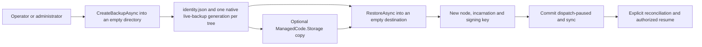
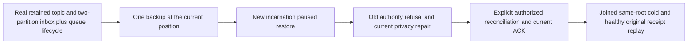

# BackupRestore

BackupRestore backs up one store with ZoneTree's live backup and restores it into an empty location under a new identity with dispatch paused. KeyLoad owns no backup, snapshot or archive format: a backup is the store's `identity.json` plus one native snapshot generation of each of its MVCC and plain trees ([ADR-011](../ADR/ADR-011-current-format.md)). A replicated cluster is backed up and restored by running the same local operation on each silo's ZoneTree owner files. The slice owns the backup position, restore safety, restored-identity fencing and the persisted credentials/authorization carried through backup and restore.

Status: the ZoneTree backup/restore wrapper, its CLI commands and the node backup operation are present in source with unit, CLI and cluster cases; their execution against the delivered source and exact-SHA Linux GitHub qualification are pending. Docker/Aspire replicated-cluster restore qualification is pending. None of the flows below qualifies power-loss durability, a globally consistent multi-silo cut or production readiness.

## Purpose, actors, and entry points

Actors are a database administrator and an operator controlling an offline process. Entry points:

- `IAtomicStore.CreateBackupAsync(directory, cancellationToken)` on an open store.
- `ZoneTreeStore.RestoreAsync(backup, destination, executionOptions, newIncarnation?, newSigningKey?, cancellationToken)`.
- `ZoneTreeBackupCopy.CopyToFileStorageAsync(backupDirectory, destinationRoot, cancellationToken)`, which copies a backup into ManagedCode.Storage file storage.
- CLI commands `backup <store> <destination>`, `restore <backup> <destination>` and `copy-backup <backup> <storageRoot>`. `backup` opens the store offline and refuses a store whose owner is open with `RecoveryRequired`; `restore` prints the restored `nodeId`, `incarnation` and `dispatchPaused` as JSON.
- The server node backup: `POST /admin/backup`, the official MCP tool `keyload_admin_backup` and `GrainReadKind.Backup`, executed by `NodeAdministration` on the addressed silo.

No online restore endpoint exists.

## Canonical slice map and boundaries

| Surface | Current source | Owner |
|---|---|---|
| Storage backup/restore | `src/KeyLoad.Storage.ZoneTree/Restore/Execution/ZoneTreeBackup.cs` behind `ZoneTreeStore.CreateBackupAsync` and `ZoneTreeStore.RestoreAsync` | This slice; the public facade remains the shared entry point |
| File-storage copy | `src/KeyLoad.Storage.ZoneTree/Restore/Execution/ZoneTreeBackupCopy.cs` over ManagedCode.Storage `FileSystemStorage` | This slice |
| CLI | `src/KeyLoad.Cli/Restore/Commands/CliBackupRestore.cs` behind the aggregate Program runner | Slice-local offline operations; exact dispatch/text/disposal parity under AC-CQ-010 and ADR-033 |
| Node backup | `src/KeyLoad/OrleansHosting/Transport/NodeAdministration.cs`, `src/KeyLoad/ClientApi/Transport/ApiEndpoints.cs`, `src/KeyLoad.Client/Restore/Transport/BackupClient.cs` | Shared server boundary; no public restore route is defined |
| Tests | `tests/KeyLoad.FunctionalTests/Restore/` and `tests/KeyLoad.ClusterTests/Restore/` | Feature-owned tests in their owning test projects |
| Documentation | This spec; product storage design in `../design/product-specification.md` | One canonical feature acceptance source |
| UI and public blob API | None | N/A: operators use CLI/admin boundaries |

Orleans owns clustering; a local backup establishes no globally consistent multi-silo cut or power-loss qualification. [ADR-046](../ADR/ADR-046-storage-private-owners.md) keeps backup and restore as a private component that borrows the one node-local runtime behind the public facade.

## Current behavior

- **Backup.** `CreateBackupAsync` requires an empty or absent directory; a nonempty one fails `Conflict` and is left unchanged. It checks cancellation before it creates anything, copies `identity.json`, then writes one ZoneTree `LiveBackup` generation (in-memory mode `Snapshot`) of the MVCC tree's storage into `<directory>/tree` and the plain tree into `<directory>/plain-tree`, in ZoneTree's own layout. The captures are independent; no common cut across both trees is promised. It returns the store position read before the generation: the backup holds every commit through that position and may also hold later ones. A backup that fails or is cancelled after it started leaves an incomplete directory, which the operator discards.
- **Restore.** `RestoreAsync` validates the execution options and requires an empty or absent destination (otherwise `Conflict`); it checks cancellation before it creates the destination. It reads and validates the backed-up identity, writes a new identity to `<destination>/identity.json` — new `NodeId`, the requested or a new incarnation, the requested or a new signing key, `DispatchPaused = true` — restores both backup trees with ZoneTree's `RestoreFromLatestLiveBackup` into `<destination>/tree` and `<destination>/plain-tree`, then opens the restored store, commits `system/dispatch-paused = true` and syncs. ZoneTree's restore takes no cancellation; once the tree is restored the pause completes as well. The restored store reads its own position from the tree: the position captured in the MVCC generation plus the pause commit. Restore writes directly into the destination; a restore that fails after it created the destination leaves an incomplete destination to discard. The backup is never changed.
- **Restored authority.** Canonical records, sequences, clocks, stored command outcomes and the partition roster are restored unchanged. The default new incarnation and signing key fence old outcomes, cursors, leases and signed tokens. Explicit overrides retain only their supplied authority guarantees. Dispatch stays paused until the authorized dispatch operation resumes it.
- **Copy.** `CopyToFileStorageAsync` uploads every backup file to `FileSystemStorage` at its relative path; the copy root is itself a restorable backup directory. The source must exist, the destination must be empty, and their paths must not overlap. Pre-cancellation and admission failures create no destination. A failed upload fails `RecoveryRequired` and leaves the incomplete copy to discard.
- **Node backup.** `NodeAdministration` awaits `Store.CreateBackupAsync` into `<partition>/backups/<id>` and returns `BackupReceipt(Id, Position)`; the layout is `identity.json` plus `tree/` and `plain-tree/`. Independent backups write distinct native generation directories without a node-wide count limit. Node shutdown joins every accepted backup before the store closes.
- **Cluster.** A replicated cluster is backed up and restored as one local backup/restore of each silo's ZoneTree owner files. A consistent cut across silos is not part of the current design; a per-silo local backup must not be described as one.
- **Older cuts.** Restore of an older cut changes incarnation and must not silently resume external dispatch or claim old cursors remain valid. Operator reconciliation uses existing public operations and an explicit resume.

## Requirements and acceptance

| Requirement | Measurable acceptance | Evidence |
|---|---|---|
| REQ-BACKUP-001: produce a backup that holds every commit through its returned position | AC-BACKUP-001 passes when the backup layout is `identity.json` plus ZoneTree's `tree/`, the returned position equals the store position at backup time, a later commit does not change the backup, the file-storage copy keeps every file at its relative path and restores, and the CLI and node backup produce the same layout. | `ZoneTreeBackupTests.BackupHoldsCommitsThroughItsPositionAndRestoreOpensPausedUnderNewIdentity`, `ZoneTreeBackupTests.CopyToFileStorageKeepsEveryBackupFileAtItsRelativePathAndTheCopyRestores`, `CliBackupRestoreFlowTests.AcBackup001CliCommandsBackupCopyAndRestoreCommittedStore`, `CliBackupRestoreFlowTests.AcBackup001CliRejectsInvalidStorageBudgetBeforeOpeningSourceThenRestoresHealthyBackup`, `AdminBackupClientParityTests`. |
| REQ-BACKUP-002: restore only into an empty target and never change the backup or the source | AC-BACKUP-002 passes when a backup restores canonical data into an absent or empty location; a nonempty backup or restore destination fails `Conflict` and stays unchanged; cancellation before work creates no destination; backup and source bytes stay unchanged. | `ZoneTreeBackupTests.NonEmptyDestinationsAreRejectedWithConflictAndLeftUnchanged`, `ZoneTreeBackupTests.CancelledBackupAndRestoreCreateNoDestination`, `CliBackupRestoreFlowTests.AcBackup002CliRestoreRejectsNonemptyDestinationWithoutChangingEitherStore`, `EventingArtifactStateTests.RestorePreCancellationPreservesArchiveThenSamePathRepairAndTwoColdOwners`. |
| REQ-BACKUP-003: fence old identity and pause delivery after restore | AC-BACKUP-003 passes when restore produces a new node, incarnation and signing key, sets dispatch paused, and old cursor/lease/command identities refuse until explicit operator reconciliation. | `ZoneTreeBackupTests.BackupHoldsCommitsThroughItsPositionAndRestoreOpensPausedUnderNewIdentity`, `ZoneTreeBackupTests.RestoreAppliesTheRequestedIncarnationAndSigningKey`, `EventingArtifactStateTests`, `BackupPersistedPolicyTests`, `BackupIndexedDocumentDedupCases`. |
| REQ-BACKUP-004: restore the per-silo local backups of a replicated cluster with capability invariants | AC-BACKUP-004 passes when each silo's ZoneTree owner files are backed up and restored with the local operation and the restored document/event/outbox/inbox/queue/group state is consistent, unavailable history is reported explicitly, and no automatic external redelivery happens before resume. | Local supporting cases: `EventingArtifactStateTests.AcBackup004LocalEventingBackupRetainsGroupInboxQueueCutAndRequiresExplicitResume`, `MixedEventingRetentionBackupTests`, the `AtomicPartitionRoster*` cases. No current test or GitHub artifact establishes the replicated-cluster acceptance. |
| REQ-BACKUP-005: bound the identity metadata | AC-BSM-001/003/005: the identity read is bounded by the validated `MaximumIdentityFileBytes` before allocation, at startup and when restore reads the backed-up identity. | [ADR-048](../ADR/ADR-048-bounded-storage-metadata.md); `MetadataEntryOpenTests`. |



## Local partition-roster preservation

REQ-BACKUP-004 retains its complete multi-silo qualification boundary above. The current local roster is also part of the canonical records: successful scoped writes register their first-seen partition coordinates, rejected commands retain their proper outcome scope, and reset retains only the final staged writes. Each current roster entry stores Partition, FirstSeenStorePosition and FirstSeenAppliedIndex without an application format number. Candidate count, exact key grammar and persisted coordinates must be validated without publishing a partial mutation. The existing `AtomicPartitionRosterBudgetTests`, `AtomicPartitionRosterPlacementTests`, `AtomicPartitionRosterRegistrationTests` and `AtomicPartitionRosterValidationTests` exercise these real local commit, refusal, reset, replay and reopen oracles. These are supporting local cases for REQ/AC-BACKUP-004; they cannot establish its complete replicated-cluster acceptance.

REQ-BACKUP-ROSTER-RESTORE-001 requires a local backup/restore to preserve historical canonical roster rows while the restored owner accepts new current commands. Each new owner uses its actual canonical sequence and apply path. The backup and the source cut remain unchanged. The two instances of `AtomicPartitionRosterRestoreTests.AcBackupRoster001ReplicatedHistoricalRowsSurviveFirstWriteColdAndSecondRestore` select ordinary local apply or the next ordered storage sequence after a real `ZoneTreeStore.RestoreAsync`.

| Acceptance ID | Current local observable oracle |
|---|---|
| AC-BACKUP-ROSTER-RESTORE-001 | The historical literal document, complete resource-bound reference and original roster bytes survive the first restore. A fresh current command commits its literal document and full receipt; same-ID replay before and after a joined cold reopen adds no effect or physical position. A second backup/restore preserves the historical document, admits a fresh command and retains that complete document after another joined reopen. |
| AC-BACKUP-ROSTER-RESTORE-002 | Reusing the pre-restore command returns `TokenInvalidated`, preserves the complete canonical digest and physical position and leaves the original persisted outcome bytes unchanged. Fresh current-command replay preserves its complete receipt. Every checked literal document retains the original roster bytes; the first backup keeps its full file inventory and the source store retains its captured cut. |

The cases use actual local owners, generated commands and the ZoneTree backup/restore wrapper. Source traceability is not execution evidence. Current-source execution, delivered-source Linux artifacts, coordinated multi-silo restore and power-loss qualification remain separate open gates.

## Negative and boundary flows

Reject nonempty backup and restore destinations with `Conflict`, an unsupported or corrupt backed-up identity before the destination exists, and work that is cancelled before it starts. The backup and the source never change. Destination paths are checked for emptiness only; link and path-swap safety is not claimed. A process-kill or local round trip is not evidence of power-loss durability, a globally consistent multi-silo cut, or recovery of every optional capability.

## ADRs and verification boundary

Related decisions: [ADR-003](../ADR/ADR-003-durability-ack-barrier.md), [ADR-008](../ADR/ADR-008-backup-log-retention.md), [ADR-011](../ADR/ADR-011-current-format.md), [ADR-116](../ADR/ADR-116-first-release-current-format.md), and [ADR-030](../ADR/ADR-030-retention-paused-restore.md). Clustering is Orleans ([ADR-036](../ADR/ADR-036-orleans-foundation.md), [ADR-136](../ADR/ADR-136-orleans-partition-ownership.md)); each silo's ZoneTree owner files are backed up and restored locally. The product-level restore sequence is described in [design sections 6, 14, and 44](../design/product-specification.md).

Unit, process-recovery, and replicated-cluster tests run through the TUnit entry and exact-SHA Linux GitHub Actions. Test names establish traceability only; delivered-source, replicated-cluster restore, endurance, and power-loss gates are distinct and pending. Every test below executes a complete real operation and verifies its outcome and resulting state; none relies on property access alone, mocks or fake CLIs.

## ZoneTree backup wrapper cases

`tests/KeyLoad.FunctionalTests/Restore/Cases/ZoneTreeBackup/ZoneTreeBackupTests.cs` owns the wrapper contract on real stores:

- `BackupHoldsCommitsThroughItsPositionAndRestoreOpensPausedUnderNewIdentity`: two commits, a backup that returns position 2, a third commit after it; the backup layout, the restored new identity with dispatch paused, the restored cut through the backup position plus the pause commit, a healthy restored follow-up commit, unchanged backup files and the source identity and later commit.
- `RestoreAppliesTheRequestedIncarnationAndSigningKey`: the supplied incarnation and signing key are the restored identity and survive reopen.
- `NonEmptyDestinationsAreRejectedWithConflictAndLeftUnchanged`: a nonempty backup and restore destination each fail `Conflict` and keep their exact files; existing empty directories are then accepted.
- `CancelledBackupAndRestoreCreateNoDestination`: a cancelled token fails backup and restore before either destination exists; the same operations then succeed.
- `CopyToFileStorageKeepsEveryBackupFileAtItsRelativePathAndTheCopyRestores`: the copy holds every backup file at its relative path with identical bytes and restores to the expected position and records.

## Indexed documents, dedup and the backup position

AC-BACKUP-CONTENT-001 (under REQ-BACKUP-001/002/003) requires a backup seeded through actual DatabaseEngine document/index/command operations to restore into a fresh target, reopen exact canonical document/reference/revision state, return independently expected indexed-query memberships and preserve the original stored dedup bytes. Replaying a pre-backup ID must return the existing TokenInvalidated outcome without overwrite or duplicate effects because its recorded incarnation differs from the new restored identity. A new post-restore command must then replay its exact current-incarnation persisted outcome once, with no additional effects or store-position change. The flow covers insert/replace/delete and a rejected unique-conflict batch with no partial effects, verifies the same content after a further close/reopen and a healthy new command. Raw key/value seeds or getters alone cannot prove it. Test: `BackupIndexedDocumentDedupCases.AcBackupContent001CurrentIndexedDocumentsRestoreWithIncarnationFencedDedup`.

AC-BACKUP-CONTENT-002 retains the backup position: the position `CreateBackupAsync` returns is the source position at backup time, and the restored store position is that position plus the single dispatch-pause commit. Assert those exact values and unchanged backup files. Restore preserves the canonical LastApplied and clock bytes with the retained records, command outcomes and business partition inventory; the node identity, incarnation and signing key are fresh. New canonical commands continue above the retained sequence, while old-incarnation command outcomes and tokens remain fenced. Token/lease reconciliation remains a separate gate. Open DatabaseEngine/QueryEngine on the restored data only through the existing offline storage APIs; no authorization bypass, replica-authority replay or replacement query path is permitted.

## CLI operation coverage

REQ/AC-BACKUP-001/002/003 and AC-CQ-031 map to genuine default Debug CLI child-process flows in `tests/KeyLoad.FunctionalTests/Restore/Cases/Cli/CliBackupRestoreFlowTests.cs` with feature-local Processes/ and Fixtures/ helpers. The TUnit fixtures own every CLI child, exit, bounded pipe drain, test-owned file and cleanup; validated test execution options supply the bounds; no alternate entry point or fake CLI is permitted.

- `AcBackup001CliCommandsBackupCopyAndRestoreCommittedStore` commits and closes real ZoneTree storage, then runs `backup`, `copy-backup` and `restore` from the copy through the actual CLI dispatch, and verifies the backup layout, byte-identical copied files, the reopened canonical data, a new incarnation, paused dispatch, an unchanged backup and the seeded source.
- `AcBackup002CliRestoreRejectsNonemptyDestinationWithoutChangingEitherStore` observes the nonzero exit for a nonempty destination, the preserved destination file, unchanged backup and source, then a healthy restore.
- `AcBackup001CliRejectsInvalidStorageBudgetBeforeOpeningSourceThenRestoresHealthyBackup` runs `backup` with `KEYLOAD_STORAGE__MAXIMUMRANGERECORDS=0`; the child fails with the storage validation message, the source stays unchanged and no backup directory exists; a following backup and restore succeed.

The standalone CLI binds `KEYLOAD_STORAGE__` and `KEYLOAD_POINTCACHE__` through the environment configuration provider. Missing variables preserve the typed defaults; supplied values are validated before opening storage. Overrides are confined to that child process.

### Open-owner refusal and joined continuation

REQ-BACKUP-CLI-OWNER-001 / AC-BACKUP-CLI-OWNER-001 refine REQ/AC-BACKUP-001/002. Reopen the closed `BackupCutFixture` source with its actual `ZoneTreeStore` owning the exclusive `owner.lock`. While the owner remains open, two default Debug CLI backup attempts must fail with a nonzero exit, a `RecoveryRequired` Problem on stderr and empty stdout, with exit/stdout/stderr/disposal joined, no backup destination and exact same-view source identity/physical cut/rows; the existing backup remains exact. No synthetic lock, delay, owner flag, store copy, detached child or network is used.

REQ-BACKUP-CLI-OWNER-002 / AC-BACKUP-CLI-OWNER-002 refine REQ/AC-BACKUP-001/002/003: the borrowed source owner always disposes in its lexical scope, with body and cleanup failures ordered in the ServerFailureObserver ledger. Only after that close and with no failures may the same CLI backup succeed at the attempted path; verify its identity and position, restore through the CLI, bind the identity receipt, and require literal new paused-authority rows. Two joined cold reopens retain identity/position/rows, the source stays unchanged, and both backups keep exact bytes. Tests: `CliBackupOwnerExclusionTests.ActualCliBackupRefusesOpenOwnerThenRestoresAfterJoinedCloseAndTwoColdReopens` and `CliBackupOwnerExclusionTrial`.


### Restore execution options

REQ/AC-BACKUP-001/002/003 (with StorageRecovery REQ-STORAGE-MAINTENANCE-JOIN-003 / AC-STORAGE-MAINTENANCE-SNAPSHOT-005 and ADR-046): restore validates its centrally bound `IOptions<ZoneTreeStorageExecutionOptions>` before it creates the destination and opens the restored store through the canonical execution options for its dispatch-pause commit.

## Admin SDK and MCP backup parity

AC-BACKUP-001 is observable through the ClientApi contract and ADR-039. The Aspire cluster case uses SDK and discovered official MCP backup operations after an SDK seed commit, locates each distinct node backup at `<partition>/backups/<id>` on the silo that produced it, verifies its `identity.json` plus `tree/` and `plain-tree/` layout and receipt position, restores it and reopens exact canonical state, and joins disposal and exact-root deletion. Tests: `src/KeyLoad.Client/Restore/Transport/BackupClient.cs`; `tests/KeyLoad.ClusterTests/Restore/Cases/AdminBackupClientParityTests.cs` and `Restore/Assertions/Archives/AdminBackupArchiveVerifier.cs`. Capability-state reconciliation remains a separate requirement; this flow does not close AC-BACKUP-004.

## Eventing capability-state cut

REQ/AC-BACKUP-001/002/003/004 with REQ/AC-EVENT-004/005/006 and REQ/AC-MSG-003/005/006: seed actual resources, three canonical source events, two independent subscription groups, an out-of-order completion gap, one persisted subscription-processing inbox with document and queue effects, and a real leased queue message. Take a backup at the current position, restore it into a clean target and reopen real ZoneTree. Independently require stable positions/content/generation, literal group checkpoint/issued/gap state, exact document/message state and byte-identical retained event/subscription/inbox/queue/outbox records. The backup position and the single dispatch-pause position increment are exact; backup files remain unchanged. Test: `EventingArtifactStateTests.AcBackup004LocalEventingBackupRetainsGroupInboxQueueCutAndRequiresExplicitResume`.

Before explicit operator resume, a fresh subscription and queue receive must fail exactly DispatchPaused; old source cursor/delivery tokens and pre-restore command outcomes must fail exactly TokenInvalidated without effects. Persisted narrow principal denial remains enforced. Failed owned Apply outcomes commit exactly once and same-ID failed replay preserves the complete result and store position. Old stored outcomes are retained; no old-incarnation receipt is fabricated as current success.

Reconciliation uses existing public operations only: seek the restored group from the retained beginning to a new subscription generation, clear that group's explicit pause, set dispatch running as administrator, and obtain new-incarnation claims. Reprocessing the completed source position with the same handler scope/execution generation returns AlreadyProcessed with the original effects token and no second document/enqueue. Contiguous gaps close with actual acknowledgements; a new bounded producer/claim/ack and a final close/reopen prove healthy continuation and all canonical state. The healthy continuation oracle checks every new EventData field, RecordedAt/sequence/source, delivered queue payload/headers/attempt/lease version/generation/deadline and the complete canonical Acked metadata/body absence against independent literals; the signed delivery token is nonempty and verified by the authorized ACK; the original derived message stays leased with its exact literal metadata/body. No sleeps, fake providers, raw system-key resume or implementation-only APIs. History-loss reconciliation and event/topic purge/pin implementation are separate criteria; the test must not synthesize history loss by deleting canonical keys.

`EventingArtifactStateTests.RestorePreCancellationPreservesArchiveThenSamePathRepairAndTwoColdOwners` (absent and existing-empty target) cancels a restore before work: the original OperationCanceledException carries the exact token, the target stays absent or empty, and the source image, outcome replay and every backup byte stay unchanged. The same backup then restores into the same path and survives two joined cold owners.

## Topic retention contract

[REQ/AC-EVENT-RETENTION-001–003](EventStreams.md) and [ADR-030](../ADR/ADR-030-retention-paused-restore.md) govern PurgeTopic through the existing Batch. SDK CommitAsync, official MCP `keyload_documents_commit` and SQL CALL `keyload_documents_commit` use the same typed mutation decoder through the connection grain with fresh persisted authorization; there is no operation catalog, route or SQL dialect expansion. The canonical mutation schema includes the frozen `purgeTopic` discriminator (26 total) with topic, throughPosition and generation. A backup holds bounded identity tombstones inside the existing topic-event-id family with the rest of the tree. Read-cut/restore authority, receipts, paused groups and other models are unchanged. `AcMcp001EveryCanonicalMutationIsRepresentedAndRoundTripsThroughTypedDecoder`, `TopicRetentionClusterTests` and the execution `TopicRetentionOperationTests` bind this contract.

## Mixed retained eventing backup cut

REQ-BACKUP-MIXED-RETENTION-001 / AC-BACKUP-MIXED-RETENTION-001 refine REQ/AC-BACKUP-003/004 and REQ/AC-EVENT-RETENTION-001–005 (ADR-008/030). `EventingArtifactStateTests`, the target-inbox cold/process suites and the topic retention suites cover the components separately; they are not a coherent mixed backup proof.

The unit whole operation `MixedEventingRetentionBackupTests.RetainedEventsQueueLifecycleAndTargetInboxSharePausedBackupCutThenAuthorizedColdContinuation` composes the event/subscription-gap/subscription-inbox/leased-queue seed, real pending/parked/held queue operations and a real target inbox with document/stream/queue effects on a distinct source atomic partition, all in one physical-store backup. An independent auxiliary topic first refuses an unread purge with unchanged protected model state, then a genuine authorized seek leaves a paused checkpoint pin. PurgeTopic through position 2 leaves head (3,3,1), literal event 3 at sequence 6 and the full typed event 1/2 digest-position-generation records. All creation uses current commands, the fixture clocks and limits; no fake system rows or provider.

Backup and restore compare the complete canonical key/value bytes, retained outcomes and locators across both partitions, plus queue metadata/body/counters, subscription checkpoint/generation/windows/inbox/source values and the target inbox/capacity. The current `PartitionRecordFamilies` list is the scan list. The restore has a new incarnation and paused dispatch; old source tokens, cursors and original commands refuse as authority while their outcome bytes remain retained. Fresh stored refusals commit once and replay the complete original result; read-only refusals acquire no effects.

A persisted narrow inspector has no trusted role or private field grant: restored pending/parked metadata and public headers match while the sensitive knowledge body is projected to `{}`; persisted revocation denies and a higher-epoch repair restores the projection. The target-inbox permission flow checks current effect grants, higher-epoch repair and old-epoch cached-command denial. Authorized SetDispatch/seek/unpause and Cancel/Park/Redrive preserve version/generation fences. Original target-inbox effects stay deduplicated history and never authorize a source ACK: the old source ACK refuses, while an operator cancellation and a new source input create a fresh target receipt and a current-token ACK. Full body/headers/lease/generation/metadata and retained capacity are asserted.

The partition event sequence is shared: three topic events, three auxiliary events and one target-inbox stream event precede the new healthy topic event (sequence 8). Outbox changes from the mixed commands stay in the full cut and the head/consumer value. After continuation all models, outcomes and physical bytes are captured, all owners close, and the same restored root reopens with exact identity/cut/images, current receipt replay, privacy and a new healthy document/replay. Source and backup stay byte-identical. Process-cut and replicated-cluster restore of the same corpus, queue ordering, rebuild pins and receipt-horizon pruning are separate gates.



### Restored held-lease cancellation before receive

REQ/AC-BACKUP-MIXED-RETENTION-001 and REQ/AC-BACKUP-003/004 on the same whole operation: the source-held message has the fixed thirty-second lease, version 2 and generation 1. The restored target uses its own `EvaluationClock`; it must not stamp an old clock or extend the lease. The operation waits naturally, under its caller cancellation, until the held lease is due on the target clock. It first verifies the full leased metadata and deadline and captures all bounded queue-family bytes and the physical cut, which must be unchanged after the wait. No Receive, deadline mutation or background drain happens during the passive wait. Then the authorized cancel of the held message with its original version 2/generation 1 precedes the fresh Receive, which would otherwise run due-lease maintenance and invalidate those conditions. The pending-message claim/ACK, parked cancellation, retained events/inbox/privacy/current authority, old-token refusal, source/backup and target images, receipt replay, joined cold reopen and new healthy work are asserted as before. No returned-result-derived expected version, fake timestamp, retry or production behavior change is introduced.

### Natural lease requeue state after restore

REQ/AC-BACKUP-MIXED-RETENTION-001 and REQ/AC-MSG-RETRY-ORDER: after the held-message cancellation the healthy check must account for a different derived message that correctly becomes Ready under the fresh Receive after its unchanged thirty-second lease. `DatabaseEngine.DueMetadata` clears LeaseOwner/LeaseUntil/NotBefore, advances StateVersion from 2 to 3 and appends the next ReadySequence while preserving attempt 1, LeaseVersion 1, DeliveryGeneration 1 and the body. The healthy enqueue has ready sequence 2 and the derived message requeues at 3; this transition is specified independently, never inferred from the returned metadata.

The passive wait retains every bounded store row and the physical cut, proving time alone causes no persisted transition. The healthy Receive/ACK then requires the complete literal Acked inspection and the complete derived Ready inspection (state 3/ready 3, attempts 1, leaseVersion 1, generation 1, null deadline/owner, unchanged payload/headers and all other fields), repeated after the joined same-root cold reopen alongside the raw image, signing-key digest, receipts, current authorization, inbox, topic and healthy continuation. Fixed-time backup fixtures keep their complete Leased oracle.

### Mixed eventing cut phases

The mixed-cut flow preserves each captured eventing phase independently: the three-entry outbox precedes the separate acknowledged document mutation, and the later cut has four entries. Replaying either retained command preserves its whole original outcome, source position and raw image. Earlier and later restores retain their respective document/outbox phase through healthy writes and both cold owners.

## Portable persisted authorization and current field-use cold flow

REQ-BACKUP-PERSISTED-POLICY-001 refines REQ/AC-BACKUP-003/004: a backup and CLI restore preserve the complete API-key, principal and sensitive resource records, including revoked-key state and principal policy epoch. AC-BACKUP-PERSISTED-POLICY-001 maps to `BackupPersistedPolicyTests.CliRestoredCredentialsAndCurrentFieldPolicySurviveTwoColdOpens`: the source seed uses the generated ConfigureResource/ConfigurePrincipal/ConfigureApiKey and Batch commands. The live credential authenticates; a second persisted revoked key is rejected. The restored owner is new and dispatch-paused; a source-signed mutation refuses Corruption under the new signing key, while the old minimum token refuses Corruption with the safe detail `The canonical applied position is invalid.` and the postrestore image unchanged. The test binds the restored incarnation to the original receipt and proves canonical LastApplied is absent before the refused read. TokenInvalidated for a replicated-cluster restore is a separate REQ/AC-BACKUP-004 gate. New target identity, current persisted credentials/policy and fresh target-issued receipts are asserted independently.

REQ-BACKUP-PERSISTED-POLICY-002 requires current FieldUse checks from the restored persisted principal. AC-BACKUP-PERSISTED-POLICY-002 maps to the same case: epoch 2 contains DocumentsRead/Query plus pii.read but no pii.use, so the secret predicate is PermissionDenied warm and after the first joined cold open, with the raw rows and physical cut unchanged. The same live secret remains usable; the revoked secret remains Unauthenticated. An epoch-3 permission repair then returns the literal document and query rows. A fresh target batch produces an actual receipt; warm and second-cold same-operation replay preserves the complete result and the raw outcome/image/cut. Source image and backup remain unchanged.

```mermaid
sequenceDiagram
    participant S as source owner
    participant C as Actual CLI process
    participant T as New paused target owner
    S->>S: persisted keys, epoch2, protected document
    S->>S: CreateBackupAsync at the current position
    C->>T: Restore the backup
    T->>T: Credential and FieldUse refusals; complete no-effects image
    T->>T: Joined first cold open; repeat literal refusals
    T->>T: Persist epoch3 permission repair and fresh batch
    T->>T: Replay actual receipt; joined second cold open and replay
```

## Physical file backup and restore

File content lives in ManagedCode.Storage physical providers; a store backup contains
file metadata and object references, not payloads. Metadata-plus-object capture,
reference verification, publication and cleanup across cold owners remain open under
[ADR-038](../ADR/ADR-038-chunked-blob-storage.md). Restoring metadata alone must not
be presented as restoring physical payloads.

## Portable time-series retention and receipt cold continuation

REQ-BACKUP-SERIES-PORTABLE-001 / AC-BACKUP-SERIES-PORTABLE-001 refine BACKUP-002/003/004 and SERIES-013..016. `SeriesPortableBackupTests.SeriesFloorAndIdReceiptsRestoreThroughCliThenBoundedContinuationSurvivesTwoColdOwners` uses the backup/CLI fixture: resource, append and bounded expiry leave one physically retained below-floor sample and exact literal visible records/status. The backup and the joined CLI restore preserve the source outcome bytes, sample-family bytes, fresh paused identity and physical restore position. A source-issued mutation refuses Corruption with no change to the image or cut; this is source-MAC fencing, not a minimum-token or replica-admission claim. The independent row wire oracle is [SeriesIndependentRowWireOracle](BackupRestore/SeriesIndependentRowWireOracle.md).

REQ-BACKUP-SERIES-PORTABLE-002 / AC-BACKUP-SERIES-PORTABLE-002 require a target-issued mixed append containing a new late sample to refuse HistoryUnavailable without partial sample rows or floor changes. A durable failed outcome may legitimately advance the physical position, so the no-effects replay baseline is taken after that settlement; same-ID replay preserves the complete OperationResult and canonical image/cut. A fresh same-floor expiry finishes the bounded purge and a fresh append yields literal sequence 5, visible samples 3/4/5 and the complete retention floor/count/HasMore. The `AggregateSamples` half-open read uses the same full-cut no-effects bracket: before continuation Count 2/Sum 7/Minimum 3/Maximum 4/Average 3.5; afterward Count 3/Sum 12/Minimum 3/Maximum 5/Average 4, independently required after restore, after the late-batch refusal and after each joined cold reopen, never reconstructed from returned rows. Two joined target close/reopens preserve every identity scalar and key byte, the canonical image/cut, backed-up source outcomes and the exact target success/failure replays. Tests: `SeriesPortableBackupTests` with `SeriesPortableBackupSeed`/`Trial` and `SeriesPortableBackupAssertions`; the factory uses `DatabaseEngine.RuntimeCreateOperation`, `OrleansSerialization` and the current `EvaluationClock`.


## Restored dispatch authority and token fencing

### Old tokens remain fenced after explicit resume

`EventingArtifactStateTests.OldCursorAndLeasesStayFencedAfterAuthorizedResumeTwoColdAndHealthyDelivery` supplements REQ-BACKUP-003 / AC-BACKUP-003. The source publishes three retained events, processes the inbox effect and claims the queue/group leases. Backup/restore creates the paused fresh identity; the continuation performs authorized seek to generation 2 and resume, exact inbox deduplication and a healthy event 4/queue ACK. Only then must the original source queue/group tokens produce exact TokenInvalidated outcomes with no domain effect. Those outcomes and the old source cursor's refusal stay unchanged through two joined cold owners, with the restored image/position/identity conserved. A fresh literal event 5/queue operation then receives and ACKs; source cut/image and every backup byte remain exact. Tests: `EventingArtifactStateTests` with `RestoreResumedTokenFlow`/`RestoreResumedTokenHealthy` and `RestoreResumedTokenAssertions`. This is local restore and offline authorized database execution, not replicated-cluster operator reconciliation.

### Resumed dispatch authority

The Messaging reader selects the committed `system/dispatch-paused` record when present and uses `Store.Identity.DispatchPaused` only when that record is absent. Restore commits that record as `true`, so after a successful explicit `SetDispatch(false)` the committed record, not the restored identity flag, is the current authority. After that genuinely authorized outcome, and through both joined cold owners, the restored identity must remain exact and the committed dispatch record must be present with the independently authored false value/bytes. The test does not mutate the identity file, delete the dispatch record, weaken permissions or bypass command admission; delivery/checkpoint/ACK continuation and old-token refusal remain mandatory.

### Backup with committed active dispatch

The same operation commits `SetDispatch(false)` in the source before the backup and requires its successful result, the stored outcome bytes, the committed false bytes and a no-effect matching replay, so the backup contains an active canonical dispatch record. After restore, committed true bytes are required before and after the real paused queue/group refusals, original failed outcomes and denied operator-resume checks; restore's dispatch-pause commit overwrites that record. The generation-2 reconciliation, authorized resume, canonical false authority, original cursor/lease failures, stored result replay, two joined cold owners and a healthy event 5/queue settlement follow.

### Resumed healthy queue ledger

The restored-token whole flow has three immediate queue admissions: subscription processing in the source enqueues `derived` (sequence 1); the authorized generation-2 continuation publishes event 4 and enqueues `healthy` (sequence 2); the final continuation publishes event 5 and enqueues `resumed-token-healthy` (sequence 3). Matching command/inbox replay and refused old-token operations do not allocate another sequence and ACK retains the admitted sequence. These are independently authored counts, not values read from the returned inspection. The final Acked MessageInspection requires attempts 1, stateVersion 3, readySequence 3, null scheduling/expiry/lease-owner/payload/header fields and leaseVersion 1, with every delivery/event/receipt/stored-outcome/source/backup/dispatch/authority/no-effect assertion and both cold owners preserved.

## Explicit restore identity overrides

REQ-BACKUP-IDENTITY-OVERRIDE-001 / AC-BACKUP-IDENTITY-OVERRIDE-001 refine AC-BACKUP-002/003 for the ordinary restore API: a caller may supply the new incarnation and signing key, and the restored identity carries exactly those values (`ZoneTreeBackupTests.RestoreAppliesTheRequestedIncarnationAndSigningKey`). Default values differ from the backed-up source identity so old tokens stay fenced. An empty incarnation or a signing key whose length differs from 32 bytes fails `Validation` before destination creation. `ZoneTreeBackupAdmissionTests.RestoreRejectsInvalidAuthorityBeforeCreatingDestination` verifies those refusals and a healthy restore. Default restore generates a fresh incarnation and signing key. Explicit overrides can retain the configured group authority for a replica; in that case old tokens under that authority are not fenced by a key or incarnation change. `CopyRejectsOverlapMissingSourceCancellationAndOccupiedDestinationBeforeEffects` verifies copy admission, unchanged source bytes and a healthy subsequent copy.
