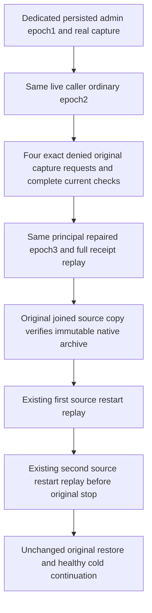

# Persisted principal authority before cluster archive replay

REQ-KL042-PRINCIPAL-CAPTURE-001 / AC-001 contributes to canonical REQ/AC-BACKUP-001/004 and fresh persisted authorization. A dedicated database principal and real credential start with ClusterAdministrator=true at epoch1. On the SAME connected actual SDK and official MCP clients, capture a genuine current Control owner archive. Persist the SAME principal as ordinary at epoch2; four real SDK/MCP/direct/selected-SQL requests with the original CaptureId/owner/node must return exact PermissionDenied with no receipt or credential disclosure. The early native GrainRequestAuthority detail is `Cluster administration is required.`; official reply uses its closed safe canonical Problem. Repair the SAME persisted principal to administrator epoch3 and require full original archive receipt on all four routes. Seed model/blob administrator remains unchanged at epoch1.

REQ-KL042-PRINCIPAL-CAPTURE-002 / AC-002: after every new capture/refusal/replay response retain complete original literal model/receipt/blob checks and full SDK/MCP outbox including consumers. Principal writes are genuine authorized effects; do not assert whole-store position equality across them. Per-context outbox baselines precede capture/replay, and later contexts preserve legitimate original eventing/post-capture writes.

REQ-KL042-PRINCIPAL-CAPTURE-003 / AC-003: use original CredentialTrial source stop/copy boundary to pack/unpack and independently read the dedicated native archive. All typed Cut fields and manifest/position must equal that actual immutable archive input. Repeated StopForDirectoryRead on the already joined application is idempotent and adds no restart. Full original receipt is replayed after existing first source restart and inside original second ColdCapture restart before its stop. Every replay verifies copied original archive again. No extra Case, Args, UID, clock, deadline or restart. Existing restore credentials, mixed-model/eventing/full native archives/targets, cancellation, failure ledger and all target cold continuations remain.

Applicable decisions: ADR-117 native TUnit fixture ownership, ADR-125 current connection-owned execution, canonical BackupRestore requirements and persisted Authorization. UI N/A: existing administrator API. Transport/public API/product authorization implementation unchanged. This adds a missing operation acceptance cell; it does not prove a producer defect, full release readiness, elapsed deadline fit or Linux qualification.

SourceN only. Native admission, full compiler/analyzers, runtime/deadline, exact image/source/run and all mandatory Linux RF3/recovery/endurance gates remain OPEN. Initial archive metadata is checked against actual native owned archive input, not represented as an independently predicted concurrent physical cut.
