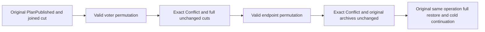

# KL042 original restore-plan voter and endpoint bindings

REQ/AC-BACKUP-RESTORE-RESUME-001/002 and REQ/AC-BACKUP-CLUSTER-002/003/004, architecture KL042, ADR008/030/123: resume the same admitted offline restore operation only with its original complete owner/voter/path/endpoint/signing bindings. Existing seven original process-cut Arguments and full source/target/SDK/official MCP/selected SQL/receipt/cold oracles remain intact, without new deadline or topology.

AC-KL042-PLAN-BINDINGS-001: after the genuine original PlanPublished process cut and joined original process/resources, submit two separately valid prospective configurations: exchange the first two existing target voter identities while retaining all actual voters/paths/endpoints, then exchange the first two existing endpoints while retaining all actual endpoint values and owner identities. No network request uses a fabricated address. Canonical structural validation accepts these bounded permutations, but ordered mapping digest and admitted original plan must reject each as exact Conflict/detail before slot effects. Each original process exits, all six dependent servers refuse startup and original readers/shutdown settle.

AC-KL042-PLAN-BINDINGS-002: after EACH new refusal require exact full stopped plan/operation filesystem digest and existing published target digest or unchanged target absence, plus all original immutable native source archives. These are complete fixture-owned byte/shape cuts, never a hash-based replacement for canonical result equality. No raw payload, paths, identifiers, signer bytes or secrets are logged. The original same OperationId/signer/mappings/credentials then resumes genuine native slots and completes all original full receipts/canonical state/paused dispatch/operator resume/old-authority fences/healthy SDK+MCP+SQL and cold continuation.

Existing signer and changed physical-owner negative operations remain in the same order under one feature-local binding role. Only the PlanPublished Argument adds the two new complete CLI operations; the other six stage flows keep their original operations. The supporting fixture accepts only explicit optional prospective mappings through its original checked rejection/owned Aspire graph path; omitted input retains the old PhysicalShardId-mismatch candidate byte semantics. It adds no product API, provider, migration, authority, retry or timing seam.

Frontend/schema/public API N/A. Full source peer, current semantic/numeric/compiler and actual Linux process/RF3/deadline/RPO/RTO remain OPEN. Complete KL042 cluster/cross-model/resource/auth/corruption/cancellation/restore acceptance is not inferred from these source controls. SourceN only; Main owns adoption/SDK/Git.

