# Bounded native required archive entries

REQ-BACKUP-001/002/003, AC-BACKUP-002 and AC-BACKUP-CONTENT-001/002; ADR-046/048/116. Original source, indexed documents, dedup and current restore authority remain authoritative. This is no migration, archive format, transport or durability-profile change.

REQ-ARCHIVE-ENTRY-001: every required closed archive input (backup.json, identity.json and commands.wal) must be a genuinely native regular file, opened no-follow/nonblocking with descriptor/path identity validation and the original shared-read contract. A FIFO must refuse before a blocking read. Preserve existing manifest schema/version/byte bounds, identity codec/checksum, file size/SHA256, journal frame/checksum/cut validation, cancellation, symlink literals and missing-file mappings. Unsupported native capability must not be relabelled a successful archive check.

Manifest/identity use the existing native metadata reader. Journal uses the same existing native regular-file primitive, maps only the exact invalid-entry failure (OfflineNativeErrors.IsInvalidEntry) to existing Corruption/A backup file failed verification, and retains its original native cause. Existing explicit symlink refusal is unchanged. No competing StorageIO/metadata/journal-codec body is supplied. The native opener adds nonblocking open to the metadata guard.

REQ-ARCHIVE-ENTRY-002 / AC-ARCHIVE-ENTRY-001 maps to NativeArchiveEntryTests.RequiredClosedArchiveFifoRefusesThenExactRepairRestoresIndexedDocumentsAndOriginalOutcomes, with the three required filenames. A genuine persisted authenticated database seeds a unique indexed document and original stored outcome. Close the original owner, then actual Release CLI backup opens/closes that same store and produces its native closed cut. Replace exactly one required archive file with a real native FIFO, retaining the original file privately. Invoke the actual Release CLI restore through its existing bounded process owner; require exact domain problem, no stdout, original exit/both readers/disposal settled and absent destination/staging. Parent never opens FIFO data. Original FIFO identity/mode, hidden original bytes, other two archive bytes and source cut stay unchanged.

Repair only the original renamed file after actual child settlement. Verify all original archive bytes/cut, perform actual Release CLI restore, check new node/incarnation/key and paused dispatch, full independent original document and native indexed-query membership, exact stored original outcome and old-incarnation replay refusal/no effects. A genuine new current command changes the document/index and replays its exact current receipt/outcome without extra position/effects. Two actual same-root cold opens retain complete final canonical rows/position, both original outcome bytes and current command replay, plus independently literal document/index membership. Original archive bytes stay exact throughout. No raw-only seed or parent-generated refusal substitutes for these operations.

REQ-ARCHIVE-ENTRY-003 / AC-ARCHIVE-ENTRY-002: test owners retain actual original/cold store refs, close-success latches and sticky uncertainty. Failed native close prevents a further open/root deletion; no repeated no-op Dispose proves closure. A child exception without an actual joined result retains root and the FIFO/original file without unsafe repair. Primary, native process and independent cleanup errors remain visible. Original process limits and native50 remain unchanged.

```mermaid
flowchart LR
 Source[Actual indexed document and persisted outcome] --> Close[Original owner closes]
 Close --> Backup[Actual CLI closed backup]
 Backup --> Entry[One required file becomes genuine FIFO]
 Entry --> Refuse[Bounded actual CLI rejection and full conservation]
 Refuse --> Repair[Exact original file restored after child join]
 Repair --> Restore[Actual CLI restore and authority reset]
 Restore --> Healthy[Original replay fence and new healthy receipt]
 Healthy --> Cold[Two native cold opens with full image and outcome proof]
```

The CLI process is an offline closed-store operation; it does not qualify configured-copy acknowledgements, full replicated-cluster restore, power loss, performance or production readiness. The existing full content, restore and corruption suites remain required. UI, new provider/package and public API are N/A.
