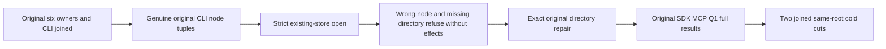

# Native restored-target read authority

Current superseding test-read contract under ADR-116 and ADR-123; maps to REQ/AC-BACKUP-CLUSTER-003/004 and REQ/AC-BACKUP-003/004. This is a private source proposal, not runtime qualification.

REQ-BACKUP-EXISTING-TARGET-001: after the actual six target resources, operator and observers join, retain the genuine original CLI receipt before any canonical store open. Validate its original capture identity and ordered six source-owner/target-owner/voter/directory/incarnation tuples, distinct nonempty newly allocated node identities and original paused publication. NodeId is a native storage identity, not physical shard ID, voter name or SiloName. Every subsequent stopped target/canonical read must use ZoneTreeExistingStore.Open with that retained NodeId and mapped target incarnation. Never mint identity from an empty directory or read expected authority back from the store being validated. No new provider, codec, friendship, public API, schema, alias, field, migration or fallback.

AC-BACKUP-EXISTING-TARGET-001: existing ClusterRestoreRf3Scenario callers keep their original declarations/arguments/UIDs, full catalog/marker/slot/signer and canonical partition-family assertions. A genuine sibling NodeId must yield TokenInvalidated with the complete stopped target file digest unchanged. Temporarily move only the stopped first database directory: strict opening its original path must yield DirectoryNotFoundException, not create that path, and leave the complete displaced layout unchanged. Restore that exact original directory even on initiating assertion/cancellation failure; retain initiating and repair failures in original order. Require the original complete physical digest after successful repair. No manufactured node identity or alternate data source can satisfy the oracle.

REQ-BACKUP-EXISTING-TARGET-002: retain first CLI node authority across original replay and both same-volume cold cuts; a later original receipt cannot replace it. Reuse original storage execution limits, parent cancellation/deadline, actual join/disposal and fatal/nonfatal failure propagation. Wrong-node construction cleanup belongs to the native strict opener; successful stores retain the existing explicit disposal ledger.

AC-BACKUP-EXISTING-TARGET-002: after both genuine no-effect refusals and exact file repair, require all six strict target identities and the original canonical archive comparison, then the unchanged real SDK, official MCP and Q1 multi-model operations, persisted-credential negatives, old-authority fences, original receipts and new authorized healthy work. Both existing same-root cold cuts compare every canonical partition-family key/value and repeat original caller outcomes. Native compiler, discovery/source-PDB binding, original RF3 operations and exact-source Linux qualification remain OPEN; source alone supplies no acceptance evidence.

Ownership: four existing Integration BackupRestore owners TargetRead, CanonicalCut, Fixture and Verification; new Helpers/ClusterRestoreRf3ExistingTarget and Assertions/ClusterRestoreRf3ExistingTargetRefusal. The CLI log is the pre-open independent authority. Existing operator receipt replay, existing storage formats and product restore behavior are unchanged. No shared ClusterRouting/Blob docs or other feature source is modified. Rollback these seven paths together while retaining original failed/successful reports.

