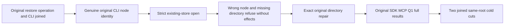

# Native restored-target read authority

Test-read contract under ADR-116; maps to REQ/AC-BACKUP-003/004. A replicated cluster is restored by restoring each silo's ZoneTree owner files locally; this document covers how a restored local target is read back.

REQ-BACKUP-EXISTING-TARGET-001: after the actual restore operation, its operator and any observers join, retain the genuine original CLI receipt before any canonical store open. Validate its original capture identity, the distinct nonempty newly allocated node identity of each restored target and its original paused publication. NodeId is a native storage identity, not a silo name. Every subsequent stopped target/canonical read must use ZoneTreeExistingStore.Open with that retained NodeId and the target incarnation. Never mint identity from an empty directory or read expected authority back from the store being validated. No new provider, codec, friendship, public API, schema, alias, field, migration or fallback.

AC-BACKUP-EXISTING-TARGET-001: existing restore callers keep their original declarations, arguments and UIDs and their canonical partition-family assertions. A genuine sibling NodeId must yield TokenInvalidated with the complete stopped target file digest unchanged. Temporarily move only the stopped first database directory: strict opening its original path must yield DirectoryNotFoundException, not create that path, and leave the complete displaced layout unchanged. Restore that exact original directory even on initiating assertion/cancellation failure; retain initiating and repair failures in original order. Require the original complete physical digest after successful repair. No manufactured node identity or alternate data source can satisfy the oracle.

REQ-BACKUP-EXISTING-TARGET-002: retain the first CLI node authority across original replay and both same-volume cold cuts; a later original receipt cannot replace it. Reuse original storage execution limits, parent cancellation/deadline, actual join/disposal and fatal/nonfatal failure propagation. Wrong-node construction cleanup belongs to the native strict opener; successful stores retain the existing explicit disposal ledger.

AC-BACKUP-EXISTING-TARGET-002: after both genuine no-effect refusals and exact file repair, require the strict target identities and the original canonical archive comparison, then the unchanged real SDK, official MCP and Q1 multi-model operations, persisted-credential negatives, old-authority fences, original receipts and new authorized healthy work. Both existing same-root cold cuts compare every canonical partition-family key/value and repeat original caller outcomes.

The CLI log is the pre-open independent authority. Existing operator receipt replay, existing storage formats and product restore behavior are unchanged.

