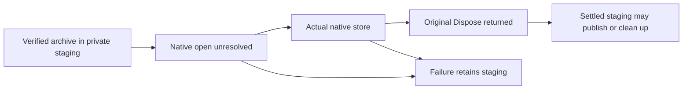

# Native restore staging ownership

KL-005 / REQ-BACKUP-002 / AC-BACKUP-002. Preserve the current native archive format, original authoritative rows, catalog reconciliation, restored identities, paused dispatch and one restore-authority commit. This correction composes with the current Root019 retirement, native owner.lock opener and existing native runtime lifetime implementations without replacing any of them.

REQ-STAGING-OWNER-001: mark native acquisition unresolved before constructing either catalog-verification or restored-authority runtime. Only an actual successful Dispose of that original store settles that acquisition. A constructor exception or Dispose exception must preserve the private staging directory; neither a caught exception nor releasing one lock proves settlement of all native resources. Do not retry Dispose or publish a partial restore. Keep the original initiating and independently observed close failures unchanged.

REQ-STAGING-OWNER-002: deletion remains permitted before any native acquisition, after a fully successful catalog close, and after a fully successful authority close. Existing destination refusal, cancellation, archive validation and publication failure behavior remain unchanged when ownership is settled.

AC-STAGING-OWNER-001 maps to NativeRestoreStagingOwnershipTests.NativeCatalogAcquisitionRefusalRetainsOriginalStagingThenRepairAndHealthyTwoCold: real native catalog reconciliation, relocate the currently owned owner.lock and install a real native FIFO at its pathname, original catalog store closes, subsequent actual authority acquisition rejects that FIFO. Verify the exact original native failure, retained staging/withheld original lock/identity/journal, no target publication, unchanged original source and every archive byte. Repair the native path, open and successfully close the actual retained staging owner, then restore the same original archive and authority tuple into the intended target. Verify complete mixed-model original records/dedup, healthy write and original replay with two real cold owners through the existing native helpers.

The regression is a genuine failed acquisition operation. It does not manufacture a Dispose failure or claim one was observed. Actual Dispose-failure runtime reproduction remains OPEN, as do semantic compilation, TUnit, real process recovery, Docker/Aspire SDK/MCP RF3, Linux GitHub fault/endurance gates and power-loss qualification. Required archive entry hardening is a separate guarded SourceN packet, not copied into this correction.
