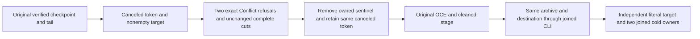

# Restore destination refusal, cancellation and same-archive continuation

REQ-BACKUP-DESTINATION-CANCEL-001 / AC-BACKUP-DESTINATION-CANCEL-001 refine [BackupRestore](../BackupRestore.md) REQ/AC-BACKUP-002 and the existing owner error contract. A genuine checkpoint-and-tail BackupCutFixture creates and independently verifies the current-format archive. With a genuinely canceled token and a nonempty destination containing one independent four-byte sentinel, two actual ZoneTreeBackupRestoreRestore.Restore calls must report the original Conflict and exact existing safe detail. Destination validation precedes stage creation and the first cancellation check in the current owner. Preserve every sentinel byte and the complete destination and parent entry sets, bounded original archive bytes, and full source identity, canonical rows and physical cut after each refusal.

REQ-BACKUP-DESTINATION-CANCEL-002 / AC-BACKUP-DESTINATION-CANCEL-002 remove only that owned sentinel and retain the SAME canceled token and now-empty destination. The same original owner must report OperationCanceledException with the exact token, remove its stage and retain the empty destination, complete parent entry set and unchanged original source/archive. This distinguishes the destination refusal from the existing valid-destination cancellation case without a fake verifier, callback, clock, provider or race.

REQ-BACKUP-DESTINATION-CANCEL-003 / AC-BACKUP-DESTINATION-CANCEL-003 then restore the SAME immutable verified archive into the same destination through the real CLI using the original live test token. Require actual process exit/stdout/stderr/disposal joins and the independently verified CLI receipt. Original RestoredAsync compares the complete literal target rows, source physical cut plus the restore-authority commit, fresh node/incarnation/signing key, original durability and DispatchPaused=true. Two further separately opened and disposed target owners retain the entire target identity/key bytes, rows and physical cut. Source and archive stay exact.

Tests: `RestoreDestinationCancellationPrecedenceTests`, `RestoreDestinationCancellationPrecedenceTrial` and `RestoreDestinationCancellationPrecedenceAssertions`. The case NonemptyTargetRefusesBeforeCanceledTokenThenSameArchiveRepairsThroughCliAndTwoColdOwners is a genuine owner and CLI functional unit flow. Product, SDK/MCP, frontend, server topology and protocol surfaces are N/A: no implementation or API changes. It reuses existing friend access and bounded archive/cut/process assertions; the public Restore wrapper has no cancellation parameter. ADR is N/A because the current destination-first and pre-read cancellation behavior is unchanged.

The exact internal Restore references include the existing valid-destination VerifiedArchiveCancellationTrial, but no existing nonempty-destination-plus-canceled-token case. Existing CLI owner exclusion, archive length/checksum corruption, successful staging publication, and missing-input repair remain separate unchanged flows. This case establishes neither mid-copy cancellation, CLI kill/cancellation, denied live-owner acquisition, replicated-cluster restore, power loss nor production readiness. Fixture and CTS bodies use ordered ServerFailureObserver ledgers so body failures precede disposal failures.
