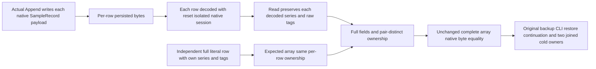

# Series portable backup independent row wire oracle

Existing [BackupRestore](../BackupRestore.md) and [TimeSeries](../TimeSeries.md) REQ-SERIES-003 and AC-SERIES-005/014/015, portable series current-format archive acceptance and strict native format contracts remain unchanged. No serializer, alias/Id, stored bytes, canonical value, retention, public protocol or provider changes.

REQ-BACKUP-SERIES-ROW-WIRE-001: the complete independent expected SampleRecord array must represent the actual independently serialized and independently decoded per-row object graph, in addition to every literal field. Persisted sample rows are separate native payloads; their original in-memory cross-row string aliases are not part of an archive or read identity contract. Native serialization of an entire returned array preserves actual reference identity and is not a value-canonical encoding. Expected rows therefore each own nonempty series/tags string objects from the frozen literal cpu/{}; actual rows are left untouched. Do not normalize, intern, reserialize each actual row or switch to a subset/value-only wire assertion.

AC-BACKUP-SERIES-ROW-WIRE-001 maps existing SeriesPortableBackupTests.NativeSeriesFloorAndIdReceiptsRestoreThroughCliThenBoundedContinuationSurvivesTwoColdOwners. Preserve all complete independent sample literals (id, exact UTC/offset timestamp, IEEE value bits, sequence, series, tags), complete ordered record equality, whole array native-byte equality, raw row bytes, floor/status, aggregate2/7/3/4/3.5 then3/12/3/5/4, original outcomes/receipts, fresh restored placement authority, exact source/archive preservation and both joined cold owners. Before unchanged whole-array wire comparison explicitly require expected AND actual cross-row SeriesId/TagsJson references to be distinct for this actual per-row read path; unexpected ownership sharing is not ignored. Fresh immutable literal string ownership changes only the expected test construction, never actual returned objects or storage format.

Canonical role: existing Unit Features/BackupRestore/Assertions/SeriesPortableBackupAssertions.cs owns ExpectedRow construction and exact ownership prerequisites only. Existing case, Seed/Trial/Continuation/outcome/full-cut/cold helpers unchanged. No new case/UID/fixture; no API or granted authority changes. The original joined R37 TRX SHA 3b59f4eb2320d5ea9485f37b03b633b7e006b99d9276b7dd7cf5a2b055c5fd1c binds this unchanged case failure: all six field dimensions true, expected cross-row SeriesId/TagsJson aliases true and actual aliases false; count2/2, bytes174/179, firstDifference114. The Main original image/source binding is retained separately; this does not claim a corrected current-image PASS. This code is a source-supported test-oracle correction, not a serializer/product defect or runtime PASS. Compiler/current-image full original whole operation, corrected whole-flow runtime and Linux qualification remain OPEN.
