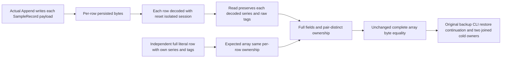

# Series portable backup independent row wire oracle

Existing [BackupRestore](../BackupRestore.md) and [TimeSeries](../TimeSeries.md) REQ-SERIES-003 and AC-SERIES-005/014/015, portable series current-format archive acceptance and strict format contracts remain unchanged. No serializer, alias/Id, stored bytes, canonical value, retention, public protocol or provider changes.

REQ-BACKUP-SERIES-ROW-WIRE-001: the complete independent expected SampleRecord array must represent the actual independently serialized and independently decoded per-row object graph, in addition to every literal field. Persisted sample rows are separate payloads; their original in-memory cross-row string aliases are not part of an archive or read identity contract. serialization of an entire returned array preserves actual reference identity and is not a value-canonical encoding. Expected rows therefore each own nonempty series/tags string objects from the frozen literal cpu/{}; actual rows are left untouched. Do not normalize, intern, reserialize each actual row or switch to a subset/value-only wire assertion.

AC-BACKUP-SERIES-ROW-WIRE-001 maps existing SeriesPortableBackupTests.SeriesFloorAndIdReceiptsRestoreThroughCliThenBoundedContinuationSurvivesTwoColdOwners. Preserve all complete independent sample literals (id, exact UTC/offset timestamp, IEEE value bits, sequence, series, tags), complete ordered record equality, whole array byte equality, raw row bytes, floor/status, aggregate2/7/3/4/3.5 then3/12/3/5/4, original outcomes/receipts, fresh restored authority, exact source/archive preservation and both joined cold owners. Before unchanged whole-array wire comparison explicitly require expected AND actual cross-row SeriesId/TagsJson references to be distinct for this actual per-row read path; unexpected ownership sharing is not ignored. Fresh immutable literal string ownership changes only the expected test construction, never actual returned objects or storage format.

The test assertions `SeriesPortableBackupAssertions` own the ExpectedRow construction and the exact ownership prerequisites only; the existing case and its seed, trial, continuation, outcome, full-cut and cold helpers are unchanged, with no new case, fixture, API or granted authority. The observed failure was an expected-side artifact: the field dimensions matched, but the expected rows shared cross-row `SeriesId`/`TagsJson` string objects that the independently decoded actual rows do not. This is a test-oracle correction, not a serializer or product defect.
