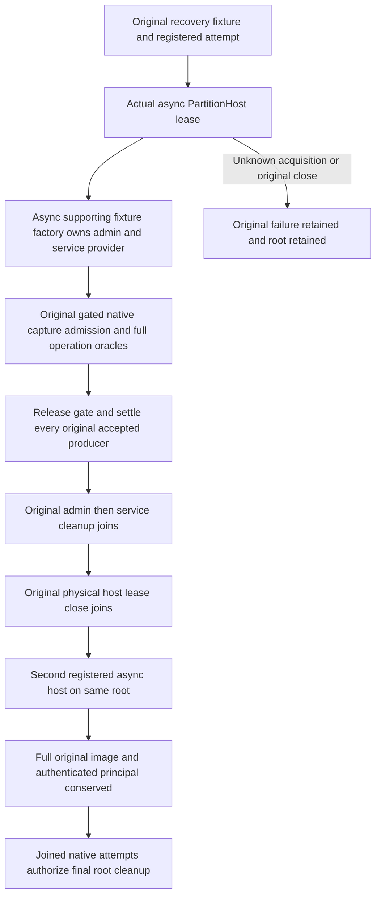

# Supporting native backup admission: async physical-owner lifetime

REQ/AC-BACKUP-CLUSTER-001/002/003/004 preserve the original supporting native
admission operations under [BackupRestore](../BackupRestore.md),
[ADR-123](../../ADR/ADR-123-native-rf3-cluster-restore.md) and
[NativeOwnerAcquisitionSettlement](../StorageRecovery/NativeOwnerAcquisitionSettlement.md).
The two existing declarations remain unchanged:

- `ClusterBackupAdmissionWholeFlowTests.ActualNativeCaptureOverloadRejectsWithoutEffectsThenSettledFailuresPermitHealthyBackup`.
- `ClusterBackupAdmissionWholeFlowTests.ActualNativeShutdownJoinsEveryAcceptedCaptureAndRejectsNewDirectAdmission`.

No physical host escapes its `PartitionHostRecoveryFixture.RunHostAsync` callback.
The supporting fixture borrows that original host; its async factory owns only the
original `NodeAdministration` and `ServiceProvider`. Factory failures preserve the
initiating error and independent original cleanup errors. Its memoized disposal
joins those original resources once. Only the exact already observed shutdown
AggregateException may be recognized as the same expected terminal result; unrelated
failures remain in the ledger. The physical host remains owned by the registered
attempt/lease throughout body and supporting cleanup, then genuinely closes before
cold acquisition. No failed original close is retried as a release witness.

The native gate, four accepted producers, overload/refusal/error identities, original
shutdown drain and healthy ordinary backup remain. Every accepted task and original
native gate settles in the unchanged finally choreography before the callback exits.
The cold host is a new real registered acquisition on the same files, checks complete
ordered native image bytes and authenticates the original persisted administrator.
Every independent body, administration, service, physical-host and outer fixture
cleanup failure is preserved. Unknown native acquisition/close retains the root via
the existing attempt ledger. No synthetic release witness or owner counter is added.

The retired synchronous fixture constructor/OpenHost path and its GetResult cleanup
are removed together with all actual callers. No product API, native provider,
transport, membership, deadline, bound or successful RF3 capture claim changes. These
remain supporting native controls: successful cluster archive/restore qualification
requires genuine RF3. Source preparation/numeric preflight do not prove compilation
or execution; Root owns strict build, both actual declarations and Linux evidence.
