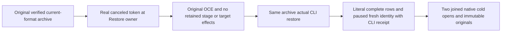

# Verified archive pre-read cancellation and same-archive continuation

REQ-BACKUP-PRE-READ-CANCEL-001 / AC-BACKUP-PRE-READ-CANCEL-001 refine the original [BackupRestore](../BackupRestore.md) REQ/AC-BACKUP-002 error and native-owner cleanup contract. A real NativeBackupCutFixture first creates and independently verifies its current-format compacted checkpoint plus retained tail. The actual existing ZoneTreeBackupRestoreRestore.Restore owner receives a genuinely canceled CancellationTokenSource token. This owner validates destination policy and creates its owned staging directory before its first token check; cancellation must preserve the original OperationCanceledException and exact token, remove that stage, preserve the absent or originally empty target, every bounded archive byte and the complete original source identity/position/canonical image. Comparing the complete fixture parent entry set rejects any extra staging residue, rather than accepting only target absence.

REQ-BACKUP-PRE-READ-CANCEL-002 / AC-BACKUP-PRE-READ-CANCEL-002 require the SAME immutable archive to continue through the real CLI restore process after the failed owner has settled. Native process exit/stdout/stderr/disposal joins and actual CLI receipt are mandatory. The complete independent literal target is the original value row plus native DispatchPaused=true, with new physical node/incarnation/signing key, original durability and original source physical cut plus the genuine restore authority commit. Two further native target opens each join disposal and preserve the entire target identity/key bytes, canonical rows and physical cut. Original source and all archive bytes remain exact.

Canonical roles are BackupRestore Cases/VerifiedArchiveCancellationTests and Helpers/VerifiedArchiveCancellationTrial. The actual case CanceledOriginalRestoreBeforeArchiveReadLeavesNoStageThenSameArchiveCliRestoreSurvivesTwoColdOwners has literal Arguments(false/true), using modern TestContext.Current.Execution.CancellationToken. Existing native archive/cut/CLI assertions retain their original bounds. Source roles outside this slice are N/A because no product, SDK, MCP, topology, serializer, provider or public cancellation API changes are made. The ordinary public Restore wrapper has no cancellation argument; the negative directly tests its existing internal owner primitive through existing assembly friend access. No synthetic verifier, catalog metadata, clock, task or storage is introduced.

This is specifically already-canceled pre-read owner cleanup, not mid-copy cancellation, CLI/process kill or cancellation, stable command resumption, catalog rebind/token fencing, replica/domain-command receipt, Docker/Aspire RF3, power-loss or production qualification. The positive is one CLI restore and two native cold reopens. Primary fixture/body and CTS/body failures precede genuine cleanup failures under original ServerFailureObserver lexical lifetimes. Existing constructor and inherited nested fixture cleanup adverse cases remain unqualified. Source integration and the complete local R36 Release build passed. Both original cancellation Argument instances passed in the current-source R36 local cohort and are bound to actual native discovery. Linux and adverse cleanup gates remain OPEN.
