# BenchmarkComparisons

BenchmarkComparisons compares KeyLoad with fifteen other databases on the same corpora,
oracles and acknowledgement/durability contracts. Every engine, node count and scenario
cell runs on its own isolated Linux runner with a one-node and three-node
topology, and website figures come exclusively from authenticated GitHub Actions JSON.
The [additional database contract](BenchmarkComparisons/AdditionalDatabases.md) records the SQL/analytical targets and current deployment limits. This document holds the stable requirements (`REQ-*`) and acceptance criteria (`AC-*`);
the linked ADRs own the implementation decisions, and measured values, run identities
and qualification receipts live in the original GitHub artifacts rather than here.

The [vector qualification](BenchmarkComparisons/VectorQualification.md)
under [ADR-109](../ADR/ADR-109-vector-comparisons.md) adds SurrealDB/HelixDB
and scaled exact/HNSW/IVFFlat, filtered and concurrent-update evidence to the
website-producing pipeline. Implementation and genuine qualification are pending.

[Live progress repair](BenchmarkComparisons/LiveProgress.md) under ADR-085 owns
bounded Actions visibility and cancellation diagnostics for workloads.

## Shared live benchmark sessions

[SessionExecution](BenchmarkComparisons/SessionExecution.md) and
[ADR-142](../ADR/ADR-142-shared-live-benchmark-sessions.md) define the active
measurement shape: exactly two measurement jobs per database (one and three
nodes), many real TUnit cases on one live Aspire-owned topology, a measured initial
million records, no warmup and no per-case reset. Linux qualification and complete
model-family coverage are separate acceptance gates.

## Canonical engine decision

[ADR-071](../ADR/ADR-071-canonical-zonetree-providers.md) records ZoneTree and
ZoneTree.FullTextSearch as the canonical engines.

| Requirement | Acceptance | Mapping |
|---|---|---|
| REQ-ZT-001: active storage experiments use the selected canonical engine | AC-ZT-001: real ZoneTree raw/scaled correctness, full loaded-record counts, bounds and cleanup still hold; removed labels fail explicitly | existing RawStorage and ScaledRawStorage TUnit cases, dependency/source inspection |
| REQ-ZT-002: delete discarded plans and unused pipeline paths immediately | AC-ZT-002: active docs have no dead candidate-plan links; Benchmarks has no raw/internal-codec job or diagnostic-only bypass, and preserves every comparison/source/aggregate/site gate | workflow contract TUnit cases, governance and root diff review |

Result files are immutable evidence of their own source. This decision establishes
no performance, durability or production-readiness claim. UI is N/A:
internal diagnostics do not produce the public comparison website.

[ADR-068](../ADR/ADR-068-benchmark-gate-repair.md)
define the same-ID current-job refresh, the exact canonical fixture metadata and the
Kurrent leader-routing contracts that keep the full isolated scope intact.

## Core comparison requirements

[ADR-034](../ADR/ADR-034-cluster-comparisons.md) defines the engine, deployment and
evidence contracts.

[ADR-021](../ADR/ADR-021-comparable-postgres-baseline.md) owns PostgreSQL as the primary general-purpose baseline and the equivalent workload/guarantee contract; specialized engines remain separate workload arms. Neither decision establishes a performance winner without successful matched GitHub evidence.

KeyLoad nodes in a comparison run with no request throttling and no admission profile ([ADR-145](../ADR/ADR-145-no-request-throttling.md)), the same as the other databases' clients. Overload therefore appears in the measured latency, not as KeyLoad refusals.

| Requirement | Type / priority | Behavior and rationale | Acceptance |
|---|---|---|---|
| REQ-BC-001 | Correctness / P0 | Use one deterministic dataset and exact caller-visible correctness oracle for every supported equivalent workload. | AC-BC-001; stable hash and verified documents/vectors/graph/events. |
| REQ-BC-002 | Topology / P0 | Run every database, KeyLoad included, as digest-pinned containers and keep the workload client outside the selected LoadTests AppHost infrastructure. KeyLoad runs the latest public released server image, resolved once per run to its registry digest. Preserve real cluster and SDK calls. | AC-BC-002; actual container graph, image references with digests, endpoints and joined runtime evidence. |
| REQ-BC-003 | Replication / P0 | Add replicated engine groups with observed membership/copy/acknowledgement state. | AC-BC-003; real connected cluster proof before timing. |
| REQ-BC-004 | Engine coverage / P0 | Compare the canonical 11-target inventory: KeyLoad, PostgreSQL + pgvector, Qdrant, RabbitMQ, Redis, Neo4j, MongoDB, OpenSearch, KurrentDB, SurrealDB and HelixDB. Preserve actual topology support and explicit unsupported profiles. | AC-BC-004; complete current plan and honest support matrix. |
| REQ-BC-005 | Event streams / P0 | Add expected-no-stream single-event append and bounded single-event read with identity/revision/cardinality/payload validation. | AC-BC-005; four supported engine implementations and readback. |
| REQ-BC-006 | Provenance / P0 | Use exclusively successful GitHub Actions JSON as public benchmark data and automatically derive graphs. | AC-BC-006; immutable evidence, successful-source gate and no hand-coded measured values. |
| REQ-BC-007 | Product presentation / P0 | Explain KeyLoad clearly in README and present qualified profiles/charts with raw data and guarantee differences. | AC-BC-007; generated SVGs, public links and real first-render proof. |
| REQ-BC-008 | Performance / P1 | Optimize measured bottlenecks without changing contracts and report matching before/after evidence. | AC-BC-008; comparable CI reports and focused correctness/security proof. |
| REQ-BC-009 | Qualification / P0 | Keep all required gates and unsupported readiness/durability boundaries honest. | AC-BC-009; exact delivered-source GitHub results and status docs. |
| REQ-BC-010 | Resource bounds / P0 | Stream JSON and raw CSV reports without creating a complete second copy of sample data as text; preserve every attempt and the report schema. | AC-MP-010; real-file roundtrip/quoting/cancellation regressions and CI resource evidence under ADR-035. |
| REQ-BC-022 | Tooling / P0 | Keep embedded microbenchmarks externally consumable by BenchmarkDotNet's generated child while all source quality rules and real fixture lifetime apply. | AC-EM-001..004; real metadata/store/TUnit process Dry proof under Accepted ADR-047, never comparative/cluster evidence. |
| REQ-BC-023 | Correctness and ownership / P0 | Replace fake harness verification with genuine pinned Neo4j public runner/response/data checks and limit cleanup to acknowledged acquired resources. | AC-GH-001..007 under [ADR-049](../ADR/ADR-049-genuine-neo4j-harness.md), [acceptance](../ADR/ADR-049-genuine-neo4j-harness.md) and [ordered graph](../ADR/ADR-049-genuine-neo4j-harness.md). |
| REQ-BC-026 | Time-series comparison / P0 | Compare persisted KeyLoad and Timescale paths over one deterministic UTC sample set, and exercise ManagedCode.TimeSeries as an in-memory aggregation library with separate guarantee metadata. | AC-BC-026 / AC-TSC-001..006 under [ADR-050](../ADR/ADR-050-timeseries-timescale-comparison.md) and [acceptance](../ADR/ADR-050-timeseries-timescale-comparison.md). |

## Slice map

- Harness/adapters: `benchmarks/KeyLoad.Comparisons/`.
- Embedded scenario library: `benchmarks/KeyLoad.BenchmarkScenarios/`; `KeyLoad.Benchmarks` retains only its typed executable runner under [ADR-047](../ADR/ADR-047-embedded-benchmark-host.md).
- Aspire engine resources: `build/KeyLoad.LoadTests.AppHost/`.
- Session orchestration: `benchmarks/KeyLoad.ComparisonHost/Orchestration/`; measured workload cases: `benchmarks/KeyLoad.ComparisonHost/Session/`. No separate comparison test project exists.
- Evidence/chart tooling: `scripts/Features/BenchmarkComparisons/`.
- Site: `site/Features/BenchmarkComparisons/`.
- Docs: this spec, ADR-034, `implementation/comparative-benchmarks.md` and the README presentation.
- Time-series profile: Aspire resource in `build/KeyLoad.LoadTests.AppHost/`; profile/targets under `benchmarks/KeyLoad.Comparisons/TimeSeries/`; isolated composition in `benchmarks/KeyLoad.ComparisonHost/`; [ADR-050](../ADR/ADR-050-timeseries-timescale-comparison.md).
- Product persisted schema/public API changes: N/A; engines use isolated per-run benchmark databases/collections/streams.

## host execution and source evidence

The primary `build/KeyLoad.AppHost` owns development and functional-test KeyLoad
server projects with in-memory RapidMembership for Orleans membership. The separate
`build/KeyLoad.LoadTests.AppHost` owns the selected database infrastructure,
readiness, discovered endpoints and cleanup. `KeyLoad.ComparisonHost` runs the
client-owned workload outside that resource graph.

The manual Release workflow publishes the KeyLoad server image with the SDK
`PublishContainer` target to `ghcr.io/managedcode/keyload` under commit and `latest`
tags. Benchmarks resolves the latest public released image once and pins its digest.
It never calls Release or Build and Tests, builds a product image, or publishes one.
Both KeyLoad cells use `ghcr.io/managedcode/keyload:latest@sha256:…`
and receive it as `Benchmarks__KeyLoadImage`, and the LoadTests AppHost starts each
KeyLoad node as an Aspire container from that digest. KeyLoad nodes keep the image
user, write their ZoneTree data to an anonymous session volume under the image
user's home, reach each other by their Aspire network aliases and form the Orleans
cluster with in-memory RapidMembership discovery on the container network. Single
node cells store files under the node's data directory; the three-node cells
configure no shared file root because the workload uses no file storage. Local
benchmark sessions supply `Benchmarks__KeyLoadImage` explicitly in the same
`ghcr.io/managedcode/keyload:<tag>@sha256:<digest>` form. Ordinary builds and
functional tests never build or publish a KeyLoad image.

REQ-BC-001/002/003/005/009/019/021 and AC-PERF-006/009 require original outcomes,
the real workload-client source/DLL/PDB and process start identity, and bounded
joined cleanup. Every database server, KeyLoad included, is identified by its image
reference and digest in `images.server` and the target profile, with container
resource evidence in `session-resource-evidence.json`. Databases retain their pinned
images, entry points/users, readonly bootstrap files and anonymous writable session
volumes. Only resources owned by that selected execution may be removed.

AC-KLEVENT-001..003 retains existing public SDK event readback, strict cardinality,
seeded/new/conflicting/cancelled operations and healthy follow-up. Copy counts
come from actual acknowledged writes and original data/restart oracles.
AppHost-owned abrupt faults validate actual PID plus Aspire and OS start times,
kill the owned process tree and await its real exit. Graceful stop cannot replace
that evidence.

Local sessions preserve actual workload/corpus/result evidence without invented
GitHub provenance. Public figures additionally require authenticated original
source/run/attempt/job artifacts and equivalent measured resources. External
advertised-endpoint reachability remains open until actual execution proves it. A
model or source review closes neither runtime nor publication qualification.

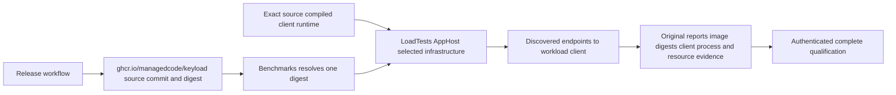

## Harness collection and PostgreSQL lifecycle

REQ-BC-020 is specified in
[ADR-044](../ADR/ADR-044-benchmark-immutable-contracts.md). It covers the nine
diagnosed mutable collection properties/cached oracles and the solution-only CLR naming
migration. Valid schema3 JSON and Single configuration spelling, corpus, scalar vector
arithmetic and engine/wire semantics stay stable; required malformed-array rejection is
intentional hardening. Real JSON/configuration/corpus/file fixtures prove it.

REQ-BC-021 maps to AC-PG-001..006 in
[ADR-045](../ADR/ADR-045-postgres-schema-ownership.md). A duplicate run-ID target
must never delete another target's schema after failed initialization. Constant
client commands bind values; a transaction-local server context, namespace
lock and durable private owner marker preserve exact workload tables and measured
operations while guarding cleanup. Real PostgreSQL helpers reuse the existing pinned
Aspire container after measurement without extra startup. The documented
commit-response fault qualification gap remains open. Product persistence/API is N/A:
only transient benchmark lifecycle metadata changes.

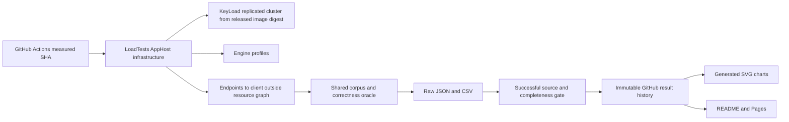

## Caller composition

REQ-BC-001/002/003/005/009/019/021 map to AC-PERF-001..009 in
[performance acceptance](../ADR/ADR-034-cluster-comparisons.md). ADR-034 freezes the
three actual KeyLoad node endpoint bindings, authenticated Rabbit management client
ownership and PostgreSQL public event readback.

| Acceptance | Owning scope | Caller-visible verification |
|---|---|---|
| AC-PERF-004 | Harness PostgresComparisonSession; ComparisonHost live PostgreSQL checks and schema-lifetime joins | Existing real Aspire PostgreSQL target: seeded, absent, append, conflicting duplicate/no corruption, cancelled and healthy following event reads; no new SQL or doubles. |
| AC-PERF-002/003 | ComparisonHost settings/constants/owner and host-only validation; UnitTests real-child startup/bindings/cleanup cases | Exactly three distinct HTTP(S) node origins with index 0 matching primary; safe early invalid config; actual Basic-auth management client; all existing precedence/cleanup/secret checks retained. |
| AC-PERF-002/003 | AppHost BenchmarkComparisons/BenchmarkCallerBindings and the existing composition call | Actual node endpoints and broker management/user/password references; three-copy and queue-member proofs remain mandatory. |
| AC-PERF-001/009 | Full relevant main baseline | Original GitHub results retain byte hashes, counts and failing cases; source-only builds cannot qualify tests. |
| AC-PERF-005..007 | resource graph/registration, workload client, bounded CI | Coverage follows the 11-target source plan and the current scaled/vector profile inventory. |
| AC-PERF-008 | Search, ResourceExecution and StorageRecovery contracts | SIMD/.NET intrinsics first, Rust only after profiling; correct ZoneTree APIs and bounded Orleans parallelism preserve atomic apply, read cuts and faults. |

Constraints: real regressions are authored first and located bindings and the public
delegate are repaired; no timeout increase, terminal-gate substitution, unpublished
package, paid clustering or secret output; benchmark measurements are produced only in
GitHub Actions; numeric product coverage and all endurance/fault gates need actual
evidence. Product persisted schema/API is N/A for this composition. Website delivery is
owned separately under REQ-BC-028.

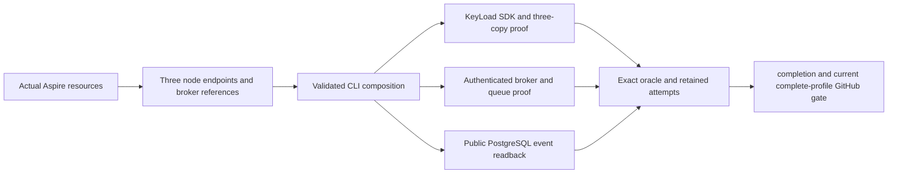

## Comparison library and host

REQ-BC-019 maps to AC-HOST-001..007 in [ADR-043](../ADR/ADR-043-comparison-library-host.md).
The existing KeyLoad.Comparisons assembly/public API becomes a library; the new host
owns sole CLI composition and lifecycle. The LoadTests AppHost owns infrastructure and discovered endpoints; the execution
client stays outside its resource graph and preserves configuration/topology. Public collections/enum/report/workload changes are
outside this contract. Host tests use actual child processes; success, cleanup and
cancellation qualification uses the real GitHub comparison suite. Private construction
ownership requires explicit source review plus runtime evidence as stated in
acceptance. Frontend/persistence/auth surfaces are N/A because this prerequisite changes
only build/CLI ownership.

## Parallel performance pipeline

REQ-PIPE-005/006 and AC-UB-001..006 under
[ADR-064](../ADR/ADR-064-workflow-release-delivery.md) repair orchestration:
one preparation builds and source-binds the runtime and runs shared
contracts. The current 32 topology sessions import its authenticated bundle
without rebuilding; independent database groups run without an arbitrary cap.
Every authored job/step has a concrete readable name. Exact-source display-name
validators and independent test oracles change together, preserving internal job
IDs, artifact/schema/permission contracts and report bytes.

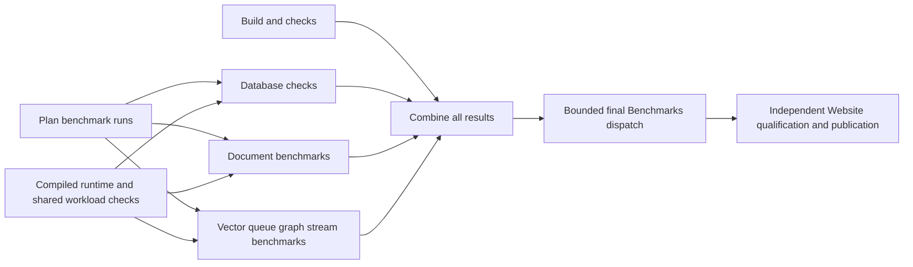

Scaled and vector applicable workloads retain at least 100,000 measured operations at
the 100,000 and 1,000,000 record scales. The separate intensive TimeSeries family
retains its own cell contract under ADR-059. Source and model checks are not TimeSeries
performance measurements. Source graph regressions and real exact-SHA GitHub
jobs/artifacts qualify the pipeline; local source checks do not.

The pipeline uses exactly four workflows under
[ADR-064](../ADR/ADR-064-workflow-release-delivery.md): Build and Tests owns
ordinary build/test/rule gates; Benchmarks owns load/comparison/TimeSeries
checks and complete authenticated JSON aggregation; Website owns site/browser
checks and Pages deployment; manual Release owns canonical database publication.
Benchmarks resolves the latest public KeyLoad image to one digest and runs it like
the other database images. It does not invoke Release or Build and Tests.
After successful aggregation, Benchmarks may dispatch the independent Website
workflow. Website also runs for site changes and trusted-main manual dispatch,
with no workflow_run executor. It publishes figures only from the latest completed
successful full authenticated cohort; newer failed or incomplete runs leave those
figures in place. Content-only publication applies when no successful measurement
producer exists. Original job/artifact identities, workloads and topology remain required.

The additive [serialization diagnostics](BenchmarkComparisons/OrleansSerialization.md)
map REQ-IS-PERF-001..004 to AC-IS-PERF-001..004 under ADR060/ADR047. They are
local development profiling; internal codec jobs and dispatch modes are removed
from Benchmarks. Public figures require the complete database cohort.

The pure/mixed/ingestion benchmark contract is [Methodology](BenchmarkComparisons/Methodology.md)
and [ADR-122](../ADR/ADR-122-benchmark-methodology.md) (REQ/AC-METH-001..005). Only
one-node and three-node comparison arms are active; original records keep
their own settings and are never relabelled.

## Isolated Linux performance matrix

The favicon/search/social-preview presentation contract is
[SiteMetadata](BenchmarkComparisons/SiteMetadata.md), REQ-SEO-001..006 /
AC-SEO-001..007 under ADR-053. It preserves every benchmark/evidence gate.

[ADR-056](../ADR/ADR-056-isolated-linux-comparison-cells.md) and its canonical
acceptance/plan replace the three-OS and all-engine-on-one-runner producer.
Evidence of another source keeps its own topology/source/format and is not
qualification of this matrix.

| Stable requirement | Acceptance | Automated evidence |
|---|---|---|
| REQ-BC-050 Linux-only complete qualification | AC-ISO-001 | workflow inventory + actual full Linux CI |
| REQ-BC-051 one isolated agent per engine/node/scenario | AC-ISO-002 | closed current source plan (see SessionExecution and the scaled/vector qualification documents) and resource inventory |
| REQ-BC-052 actual execution1/3 and honest unsupported topology | AC-ISO-003 | independent membership/copies/ACK proof |
| REQ-BC-053 safe benchmark-only KeyLoad replica-count selection | AC-ISO-004 | negative configuration, SDK/MCP restart, required-copy-loss and replicated-cluster contract proof |
| REQ-BC-054 intensive shared CRUD correctness and raw failures | AC-ISO-005 | deterministic plan/oracle + real full body/cardinality/absence |
| REQ-BC-055 exact per-worker versioned JSON/provenance | AC-ISO-006 | strict single-target/scenario report and actual job identity |
| REQ-BC-056 complete authenticated aggregation | AC-ISO-007 | real Node/files/TUnit corruption checks + GitHub job/artifact manifest |
| REQ-BC-057 site metrics derived from isolated raw JSON | AC-ISO-008 | full site validators/oracles/browser/coverage |
| REQ-BC-058 publish only fresh complete successful cohort | AC-ISO-009 | authenticated aggregate/worker/archive freshness + provider/live proof |

AC-ISO-006 admits worker envelopes using the supplied verified contract's
`workerSchemaVersion` (5 for current workers; aggregate schema 4 is independent).
Failed-worker output and active parser inputs use the actual current contract.
Wrong-version rejection, original raw hashes, null unsupported reports and complete
provenance remain mandatory under ADR-056's canonical worker-version admission.

Public SQL/MCP contracts are N/A changed because existing execution
operations/authorization remain.

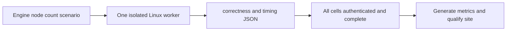

REQ-BC-056/057/058 and AC-ISO-007/008/009 (ADR-056): the mandatory SiteCoverageGate
prepares the authenticated immutable current composite ZIPs through BCL before source
capture and rechecks the private original receipt bytes and every source-defined input
after the full suite. SiteIsolatedCoverageInventoryTests exercises actual Node/V8 and
rejects omitted current publisher sources. Every remaining production and critical
source retains the 80/70/90 gates. ADR-076 governs the
collector and profile renderer; the source closure includes the current producer tools
and every actual builder/browser consumer, compared against trusted control source. The
exact current original authority and website SHA must still match before Pages. Source
readiness is not coverage, complete-profile publication or live proof.

## Current complete-cohort publication

[ADR-076](../ADR/ADR-076-current-cohort-publication.md) governs the live path: the
complete cohort is the only publication producer, with no comparison-smoke/comparison-suite
or three-profile publication; immutable evidence keeps its original provenance. ADR-080 defines
explicit failed/null cell accounting; ADR-112 defines newest-ready optional metric
selection and independent Website publication.

| Requirement | Measurable acceptance | Tests and evidence |
|---|---|---|
| REQ-BC-CURRENT-001: the complete current cohort is the sole live producer | AC-BC-CURRENT-001: session accounts for 32 workers across 16 databases x node counts[1,3], each with thirteen original TUnit case outcomes on one live topology. One preparation job builds the exact-source compiled client runtime once and resolves the released KeyLoad image to one digest; workers import those authenticated bundles and run KeyLoad from that digest. Initial1m loading is measured, each applicable operation lane has100k attempts, and no warmup/reset/reseeding occurs between cases. Retain actual failures/null metrics and genuine unavailable outcomes with the original source/run/attempt/job/TRX/report, client DLL/PDB/process and server image digest identity. Missing, malformed, expired, mixed, skipped, unaccounted or mismatched evidence rejects; publication requires every applicable correctness/fairness/provenance/resource/functional gate. Seven document cases do not qualify remaining model families or physical100k-corpus coverage | SessionCohortContractTests, CompiledBenchmarkRuntimeBundleTests, current session/aggregate/site gates and original authenticated GitHub archives |
| REQ-BC-CURRENT-002: one collector, one archive set and one current-profile asset set | AC-BC-CURRENT-002: no active comparison-smoke/comparison-suite collector, twelve-file precondition or three-profile current renderer remains; replacement retains all applicable safety, accessibility, vendor, arithmetic and browser criteria | scoped dependency inventory, workflow source tests and standalone isolated site/browser tests |
| REQ-BC-CURRENT-003: preserve unchanged qualified authority around final build | AC-BC-CURRENT-003: bounded immutable receipt, original archives and every file in the current composite plan/proof inventory match before/after builder; emitted aggregate bytes match; every remaining coverage/no-skip/source-closure gate passes | SiteIsolatedGitHub integrity/build/coverage tests, original TRX/Cobertura/Node/browser artifacts and the current source-bound publication receipt |
| REQ-BC-CURRENT-004: deploy only fresh exact-source evidence | AC-BC-CURRENT-004: current main and exact original producer tuple match immediately before needs-gated least-privilege Pages delivery; altered source/attempt/artifact rejects and actual provider receipt records outcome | SiteIsolatedGitHubFreshnessTests, workflow source tests, genuine same-run qualification and Pages provider receipt |

Canonical ownership remains BenchmarkComparisons under site/scripts/workflows and
SiteTests; the integration points are in ADR-076.

## Separate intensive TimeSeries family

[ADR-059](../ADR/ADR-059-isolated-intensive-timeseries.md) and its canonical
acceptance/plan specify 20 additional isolated cells: KeyLoad/TimescaleDB × 1/3
nodes × Append/RawRangeRead/Latest/Aggregate/Windows, preceded by four private
preflights. The TimeSeries comparison criteria are AC-TSI-001..008. Their exact corpus, direct
timestamp/sequence ordering, SQL ownership, real public negatives, ACK versus
all-copy proof and bounded response validation are normative in the acceptance; the
family does not change the current control/scaled/vector profile contracts or the
48-sample wire. image feasibility and exact internal/SQL/provider
contracts precede their implementation scopes. The frozen
16-client/five-repetition/10000-operation profile records latency through complete
decode and wall throughput including synchronous per-attempt validation. All 20 raw
results, authentic jobs/images and a separate complete family projection are required
before new TimeSeries metrics publish.

Canonical technical ownership is BenchmarkComparisons/TimeSeries/Intensive in
Comparisons, mirrored by ComparisonHost files and AppHost/host helpers. Product
API/data migration is N/A: existing authorized SDK/MCP operations remain.
Library-only memory aggregation is N/A in this node matrix; its semantic
regressions remain.

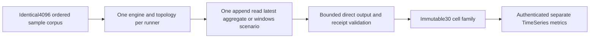

| Acceptance | Contract |
|---|---|
| AC-TH009-001..004 / AC-TB009-001 (AC-TSI-001/003/006/007/008; ADR-059) | The host takes strict private settings and composes one selected family with its original family hash and cell identity; closed private settings use shared actual source/image provenance. A closed internal preflight/intensive TimeSeries selection, a dedicated node-local composition context and a real Timescale primary/physical-standby model apply for 1/3 nodes. Caller-visible positive, negative, edge, mixed and secret-safe input assertions are in the canonical acceptance. Configuration and model assertions are source checks, not role, copy or ACK proof. The settled-run JSON writer retains every planned slot and the original observed ACK/count/failure; unstarted attempts carry no invented timing, and `workloadSucceeded` preserves the original DTO predicate and cannot certify copies or publication. |
| AC-TW009-001..003 (ADR-059) | All 1280 real warmup attempt/ACK/sequence slots are retained. |
| AC-ISO-002/003/005/006 (REQ-BC-052/055; ADR-056) | Genuine per-engine SDK, Redis-copy, PostgreSQL-slot and Mongo-auth regressions run in each selected engine's isolated topology job. |
| AC-KC-001/002/003 (REQ-BC-054/055, AC-ISO-005/006; ADR-056 canonical teardown) | The 1/3 full-volume fixture independently derives 55378 real acknowledged streams, retains a foreign event, applies 120s/180s untimed production cleanup at concurrency 16 and reads every actual tombstone. |
| AC-MR-001..005 (REQ-BC-052/055, AC-ISO-002/003/006/007; ADR-056) | Exact same-image BSON integral fields, the intended first writable primary and two fresh valid 500ms rounds within the existing 120s; a genuine 20s lower-priority election and observed automatic return under the 300s parent. 1/3 plus persisted authentication regressions and immutable failed-source evidence remain mandatory. |
| AC-HT-001..003 (ADR-056) | One referenced original HTTP lifetime timer is retained until the original promise settles after abort; the real Node regression uses an unreferenced completion timer and preserves the original result/reason plus process-exit assertions. |

Source discovery, stable admission and development builds do not establish measured
performance, failover tolerance, role, copy or ACK proof.

## Lossless series-codec development controls

REQ-BC-CHUNK-001 maps to AC-CHUNK-006 in [TimeSeries](TimeSeries.md) and
[ADR-079](../ADR/ADR-079-lossless-series-chunk-codecs.md). The shared microbenchmark
library owns public generated-consumer SampleChunk codec fixtures in
`benchmarks/KeyLoad.BenchmarkScenarios/`; the typed
KeyLoad.Benchmarks switcher remains their CLI. The compared code paths are the current
per-record SampleRecord encoding/decoding and the bounded candidate chunk codec.
Retain exact actual bytes/sample, source, corpus, settings, machine, cost and
allocations. Fixed small batches are explicitly microbenchmark controls, never the
required 100k/1m database datasets, replication/durability evidence, public website
comparisons or an acceleration claim. Canonical rewrite cost, correction recovery,
storage, representative database scale and Linux gates remain open.

The generated consumer executes the real benchmark fixtures. `scripts/Features/BenchmarkComparisons/sample-chunk-development*.mjs` binds
the actual child execution, all 36 original BDN cases and 9 corpus manifests to
unchanged source and Release dependency inventories, retaining the original settings
and rejecting public or database-scale qualification. The owning
`sample-chunk-development-inventory.mjs` derives a bounded current filesystem snapshot
from validated Git paths: it omits only absent paths reported by ENOENT, rejects
symlink parents and unsafe or non-regular present files, and retains exact
per-file/total bounds, hashes and unchanged before/after source and Release
inventories. A path disappearing during hashing still fails; no allowlist for removed paths
or ignored non-ENOENT failure is permitted. The consumer runs through the separate benchmark entry; neither source review nor a build establishes consumer execution
or comparative performance qualification.

## Failed-cell publication contract

The Website accounts for every planned database/topology row from one authenticated
completed run/attempt/source. Independently successful complete sessions retain
measured values; failed, skipped and missing sessions show an em dash and no numeric
value. The original run remains linked. Every admitted session still requires its
complete original TRX, qualification, runtime/resource identities, hashes and
correctness evidence. Incomplete server resource telemetry does not hide recorded
operation measurements. Preserve resourceQualified=false and label these rows
Measured · incomplete telemetry. Missing resource observations remain an em dash;
server resource comparability remains unverified. Website records original operation timings independently of hosted-runner hardware equality. The hosted Benchmarks workflow explicitly collects with `--resource-policy=recorded`, retaining every execution, correctness, accounting and provenance check without claiming matched hardware. The native aggregation CLI defaults to `comparison`; that policy still rejects unequal observed hardware and resource profiles. Its aggregate artifact includes `resource-policy.json` so the selected policy stays explicit outside the workflow log. A green collection run does not qualify cross-hardware performance comparisons. Selected corrupt, expired, foreign or mixed evidence is
rejected. Workflows and triggers are defined in ADR-062, ADR-064 and ADR-112:
Website intake reads the complete original worker/runtime artifacts from only the
latest completed successful measurement run. Failed or unfinished new runs leave
the previously verified figures intact. There is no `workflow_run` executor.

| Requirement | Acceptance | Verification |
|---|---|---|
| REQ-BC-FAIL-001 independent workloads finish | AC-BC-FAIL-001 failed matrices do not skip aggregate; no fail-fast or arbitrary parallel cap | actual GitHub job outcomes and complete aggregate accounting; source presence checks are not acceptance evidence |
| REQ-BC-FAIL-002 explicit unavailable cells | AC-BC-FAIL-002 workload failure produces a bounded null-report envelope before artifact upload; original job failure remains visible | real Node/files TUnit tests, actual failed-job artifact |
| REQ-BC-FAIL-003 authenticated partial results | AC-BC-FAIL-003 only the latest completed successful measurement run supplies figures; all 32 original sessions must remain complete, and selected malformed/expired/mixed evidence is rejected | producer/aggregate/site negative and positive TUnit regressions |
| REQ-BC-FAIL-004 honest site | AC-BC-FAIL-004 successful competitors retain values; absent sessions have no numeric values, display an em dash and link the actual run | independent numeric oracle, projection validation and real Chrome |
| REQ-BC-FAIL-005 repair shared preparation | AC-BC-FAIL-005 diagnose exact failed logs, repair benchmark setup/build invocation, retain isolated topology and Aspire ownership; bounded transient GET retries cover HTTP 503 as well as 403/429, and a failed shared setup finalizes a null-report envelope | exact failed-source log, focused regression, delivered-source GitHub rerun |
| REQ-BC-FAIL-007 Kurrent writer starts after membership | AC-BC-FAIL-007 verify all execution1/3-member views before constructing the SDK writer; retain DNS seeds, TLS verification, leader preference, NoStream semantics, acknowledgements, replica-copy oracle and cleanup | `IsolatedKurrentDiscoverySettingsTests`:3 actual SDK/resource-model cases; genuine Aspire-owned StreamAppend preflights for1/3 nodes |
| REQ-BC-FAIL-008 explicit cancellation stops owned work | AC-BC-FAIL-008 workload, finalization and result upload use `!cancelled()` so ordinary failure still finalizes while cancellation stops execution/publication; `always()` cleanup retains bounded diagnostics and safely removes owned registries whose setup was cancelled | canceled-job/producer rejection operation regressions and actual GitHub lifecycle; no source-text substitute |
| REQ-BC-FAIL-009 align Redis transport | AC-BC-FAIL-009 each isolated Redis resource uses the documented certificate opt-out for its existing authenticated RESP/TCP bootstrap; after actual Aspire startup, primary/replica endpoints retain scheme `redis` and target port6379 with TLS disabled. Discovered mapped host ports remain dynamic; client settings retain a password without `ssl=true`. Preserve health checks, wait dependencies, AOF `always`, membership, direct-copy/cancellation checks and WAIT/WAITAOF acknowledgements | actual pinned resource-model regressions plus genuine Aspire-owned Redis 1/3-node preflights; complete matrix and site qualification remain mandatory |
| REQ-BC-FAIL-010 preserve exact OpenSearch vector ordering | AC-BC-FAIL-010 the query preserves the unchanged shared float32-input/double-accumulated cosine oracle and ordinal ID tie order. Use execution `scripted_metric` map/combine/reduce over actual vector doc values; round parsed query values back to float32 before double arithmetic, retain at most TopK candidates per shard, merge only bounded shard TopK states, validate finite double scores and retain projected content from the existing source only for admitted candidates. Do not sort through float `_score`, weaken recall/tolerances, rerank/fetch in the client, duplicate stored vectors, use ANN or change the corpus/topology/ACK contracts | independent deterministic precision witness for query d000000170 (documents2289/1272), positive/negative query/response TUnit checks, and genuine Aspire-owned OpenSearch VectorExact1/3 jobs with every five10000-operation repetition passing the unchanged oracle; complete same-run aggregate/site/Pages still required |
| REQ-BC-FAIL-011 create the qualification evidence parent | AC-BC-FAIL-011 initialization creates the real workspace artifacts/site-evidence parent before any capture redirection, preserves existing directories/files, rejects file or symlink collisions at artifacts or site-evidence before output, and leaves isolated-capture absent for its exclusive producer. Never skip/rebind source/archive/current-plan/input/test/coverage/browser/freshness gates | SiteQualificationStartupTests executes the actual initialization Bash block in fresh owned filesystems (new/existing parent, file/base-link/parent-link collisions), checks actual envelope redirection and unchanged targets, and runs as a mandatory Aspire-owned unit preparation gate; genuine new-source website qualification/Pages remains required |
| REQ-BC-FAIL-012 execute the actual probe contract | AC-BC-FAIL-012 C# probe requests serialize the existing lowercase operation/values contract; median arithmetic and odd/even/empty assertions remain unchanged. error probes preserve string error codes and use the actual error name for numeric DOMException codes; real AbortController cancellation must still assert AbortError | Existing SiteMeasurementArithmeticTests and SiteIsolatedHttpTests, original failed TRX and focused genuine-input development checks |
| REQ-BC-FAIL-013 complete disposable builder source | AC-BC-FAIL-013 SEO/vendor disposable repositories copy the actual canonical session-contract.mjs and its source dependencies before invoking the actual builder. Vendor-only mutations use the accepted fixture's unchanged full original aggregate and its source-bound worker inventory; they must not substitute an aggregate-only directory or duplicate the original raw inventory for each metadata mutation. Existing missing/link/corrupt-asset negatives must reach their intended checks before output; the valid vendor compression case must succeed. No fabricated contract, provider input, replacement builder or weaker assertion | Existing four SiteMetadataRejectionTests and three SiteVendorBuildTests, with actual source-byte copying and unchanged input authority |
| REQ-BC-FAIL-014 bound heavy qualification children | AC-BC-FAIL-014 expensive full-cohort builder/archive-verification children share bounded admission before their existing 300s active execution deadline starts. The approved policy is two active children, a FIFO queue of at most 64 waiters and a 20-minute cancellable admission deadline; heavy classification covers actual builders, produce requests and inputs/verify-inputs probes, while light probes and network capture keep their existing paths and deadlines. An unsettled child or reader poisons admission and rejects pending requests rather than releasing unsafe capacity. Retain the complete source-bound current input/worker inventory, stdout/stderr bounds, caller cancellation and original-byte verification. Hold ownership until actual child exit and readers settle; cancelled queued requests start no child. Every complete site test and coverage gate runs in genuine Linux GitHub | Real-process admission regressions (FIFO/capacity, queued cancellation, queue-full/deadline rejection before start, start failure, active cancellation, output bounds, unsafe-ownership fail-closed), complete unfiltered Aspire-owned GitHub site/TRX/Node+Chrome coverage and Pages |
| REQ-BC-FAIL-015 emit a confined browser catalog URL | AC-BC-FAIL-015 the actual built HTML uses `data/isolated-catalog.json`, which the existing strict `confinedUrl` accepts. Retain rejection of dot segments, traversal, foreign origins, credentials, redirects, mismatched hashes and unavailable evidence. Real Chrome must reach the existing Ready predicate and preserve every numeric/null, provenance, responsive and lifecycle assertion | Existing SiteIsolatedBuildTests, SiteIsolatedBrowserTests, SiteIsolatedFailedCellBrowserTests, SiteIsolatedStandaloneBrowserTests and SiteBrowserBehaviorTests; genuine Linux full site and coverage |
| REQ-BC-FAIL-016 validate the actual PNG-backed ICO structure | AC-BC-FAIL-016 distinguish the ICO file header type1 from each directory entry's color-count0 and reserved0. The canonical PNG-backed entries retain planes0, bits32, bounded16/32/48 frames and actual8-bit RGBA PNG payloads. Preserve exact console/site/output bytes, frame bounds, dimensions and missing/corrupt asset checks | Existing SiteMetadataTests.AC_SEO_001_IconsAreValidSharedBytesAndEmittedFromTheRealBuild; genuine Linux full site and coverage |
| REQ-BC-FAIL-017 database-only benchmark graph | AC-BC-FAIL-017 Benchmarks owns preparation, database comparisons, authenticated result validation and JSON aggregation. It has no browser/site qualification, coverage or Pages dependency; its final bounded job dispatches the separate Website workflow after dependencies settle. Independent cells finish and failed workloads retain null data. | actual completed planned cells/aggregate JSON and original GitHub job graph; source-only workflow tests are not evidence |
| REQ-BC-FAIL-018 independent automatic website | AC-BC-FAIL-018 Website runs independently on trusted own-main manual dispatch and on the final bounded Benchmarks dispatch. It consumes authenticated ready metrics when available or qualifies content without figures; website qualification/deployment does not affect Benchmarks results. | Website workflow and optional producer-selection TUnit cases; genuine standalone Website/Pages evidence |
| REQ-BC-FAIL-019 authenticate the bounded producer wait | AC-BC-FAIL-019 Website accepts the optional benchmark run ID only from its trusted manual/final-dispatch input, validates the actual own-repository main Benchmarks run identity, and waits within the frozen bound for completion. The supplied run is the sole candidate for qualification and predeploy recheck; its complete original provenance is revalidated. Empty manual input retains newest-ready selection. | Actual Website input/context/selection rejection tests and final-dispatch plus standalone Website workflow evidence |
| REQ-BC-FAIL-020 newest ready optional metrics | AC-BC-FAIL-020 select the latest completed successful own-main measurement run with all original session artifacts and valid archive/proof inventory. Failed, cancelled or pending new runs never replace existing verified figures. Corrupt, expired or missing evidence for a selected ready producer fails closed without an older fallback; recheck the selected tuple before deploy. | Real producer-selection positive/negative TUnit cases, Website capture and freshness/provider join |
| REQ-BC-FAIL-021 independent Website lifecycle | AC-BC-FAIL-021 Website qualification and deployment retain separate serialized job groups with cancellation disabled; content-only and measured modes both revalidate current source and the selected producer tuple before publication. Build and Tests remains independent. | Actual Website job graph, source/tuple freshness cases and provider receipts |

OpenSearch note for AC-BC-FAIL-010: pinned OpenSearch 3.6.0 / k-NN 3.6.0.0 registers
vector doc-values access for scripted-metric contexts but not `NumberSortScript`, and
generic vector `get(int)` throws, so numeric `_script` sorting cannot use that accessor.
The selected map/combine/reduce path avoids that unsupported API and float
`_score` ordering. Source/response helpers remain benchmark-owned; unchanged execution
VectorExact jobs must prove the strategy and resource bounds.

OpenSearch note for the session index case: OpenSearch 3.6.0 answers a synchronous
`_update_by_query` with one `TASK_RESOURCE_USAGE` response header per scroll batch, so
the one-million-document backfill returns about 1,000 headers (roughly 230 KB), above
the .NET default 64 KB response-header bound. The backfill runs on the target's own
HTTP client, not on a document session client, so every target and document HTTP
client the comparison host creates declares `DocumentClientMaxResponseHeadersKilobytes`
(1024) as recorded policy instead of changing the server's task resource tracking.

The workload client runs on the runner host, while Aspire starts every database as a
container on its session network. Database topology stays real inside that network:
MongoDB replica-set members advertise their container names (`isolated-mongo-N:27017`)
so they replicate to each other. Those names do not resolve on the host, so the MongoDB
client connects directly (`directConnection`) to the endpoint Aspire publishes for the
bootstrap's preferred primary (the first member), and the replica verifier connects
directly to each secondary's published endpoint.

Namespace cleanup after measurement behaves like an application purging a large data
set, not like one giant operation. Neo4j deletes the run's nodes in bounded transactions
(10,000 nodes each) within `ComparisonLifecycleOptions.Neo4jCleanupTimeout` (10 minutes,
the lifecycle maximum); deleting a million nodes in one transaction exceeds the server's
transaction memory pool. KeyLoad keeps deleted documents as tombstones in the collection
range, so its cleanup reads every identifier in one cursor pass before writing anything
and then deletes them in batches of `KeyLoadDocumentSeedBatchSize`; re-querying from the
start after each batch would re-read every earlier tombstone. The session owner waits
`DocumentCleanupTimeout` (20 minutes) for a document target's cleanup instead of the
30-second client `CleanupTimeout`, because a million-record purge in bounded batches
takes longer than closing a client.

Full readbacks page by key, never by offset. Neo4j's corpus page is
`WHERE n.id > $after ... ORDER BY n.id LIMIT n` starting from the empty string, so the
uniqueness constraint's range index seeks past the previous page and supplies the
order; an `$after IS NULL OR ...` predicate made every page scan and sort the whole
namespace. KeyLoad's readback relies on the server continuing an identifier-ordered
query after the last identifier, which the released image must include.

SurrealDB verifies an HTTP Basic credential with Argon2 on every request, which caps a
client near one hundred requests per second. The SurrealDB document target therefore
signs in once through `POST /signin` and sends the root bearer token, renewing it before
new clients open when it is older than 30 minutes (root tokens last one hour).

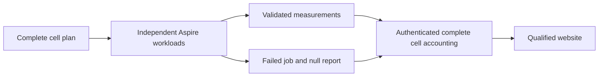

## Database job groups

REQ-BC-GROUP-001 maps to AC-BC-GROUP-001: Benchmarks exposes sixteen separately named
database job matrices matching the current target inventory. Each matrix contains its
target's preflight checks and canonical node/scenario workloads. Every cell retains its
own Linux runner. Database groups run concurrently with only runtime/plan dependencies;
steps inside each cell run in order. No shared cross-database matrix or arbitrary
parallelism cap. Aggregate waits for every group and retains failed/null results.

REQ-BC-GROUP-002 maps to AC-BC-GROUP-002: readable database/node/scenario job names
must agree with authenticated job discovery, finalization, aggregation and website
receipt validation. Canonical plan schema, cell IDs, workload counts, artifacts,
measurements and topology remain unchanged. Cell names in original authenticated
receipts remain exact cell-name contracts; no result bytes are rewritten. ADR-080 owns the implementation contract.

Source-only WorkflowLayout, WorkflowBenchmarkFailure and SerializationWorkflow
assertions are not acceptance evidence; IsolatedPlanCli operation assertions and
original GitHub execution evidence are. Backend/API/storage/transport and database tests are
outside this contract.

## Process identity observation

REQ-BC-PROCESS-IDENTITY-001 / AC-BC-PROCESS-IDENTITY-001 require that the
original PID and captured UTC start identity stay mandatory. CaptureIdentity remains
strict. A later identity observation may treat a Win32 failure (for example while
reading StartTime after HasExited in
AcImageLife003CancellationKillsAndReapsRealNodeProcessTree) as exited only when a
subsequent HasExited on that same actual Process confirms exit. An unconfirmed/live
observation preserves the original failure; a failed confirmation retains both
original errors and fatal-runtime priority. No broad Win32-to-success handling, PID-only
replacement or synthetic process is allowed.

The existing support and reaper probes share one cohesive
IsolatedAggregateNodeIdentityObservation helper and preserve all original
cancellation, process-tree kill/reap, stdout/stderr joins, exact streams, 5s cleanup
and test deadlines. The cancellation aggregate from a failed run stays evidence and is
not removed as presumed expected cancellation. The existing five real Node lifetime
cases provide the runtime regression through the actual Aspire unit caller. ADR-056
records the implementation contract; no benchmark runner, database, website,
public contract or persisted data changes.

AssertExitedAsync may retain an original unconfirmed Win32Exception and observe the same
captured PID/start identity again at the existing 10ms cadence until the unchanged test
deadline. An unknown observation remains pending, never false/success and never
authority to kill. Only confirmed absence/exit or a verified different start
identity establishes that the old process exited. If no proof arrives, rethrow the
retained original failure; dual/fatal confirmation failures remain immediate.
CaptureIdentity, the kill/reaper identity checks, original process/cancellation
ownership and 5s cleanup are unchanged, with no synthetic process or broader
Win32-to-success handling.

## Exact clean source checkout before delivered-source packaging

REQ-BC-SOURCE-001 / AC-BC-SOURCE-001 retain the existing REQ-BC-001/009/055 source
contract. Actual Git HEAD equals the declared source and no tracked changes or
unignored untracked inputs exist. Git honors repository ignore rules for
build/test output. Check before runtime packaging, receipts and GitHub outputs.
This proves source admission only, independently of runtime execution.

`SourceCheckoutIdentityTests.CleanSourceIdentityRejectsUntrackedInputAndRecoversWithoutChangingHead`
uses its real committed checkout, execution `verifySourceCheckout`/`runBounded`, an
unignored source file and an ignored generated file. It rejects the owned new
source for the exact dirty diagnostic, admits the same HEAD after its removal and
preserves tracked bytes throughout. Missing Git/Node, unexpected child errors or
incorrect rejection reasons fail. The production owner is
`scripts/Features/BenchmarkComparisons/source-checkout.mjs`; bounded process
and source-context owners are shared by actual compiled-runtime/GitHub tooling.

## image annotation model admission

REQ-BC-IMAGE-MODEL-001 / AC-BC-IMAGE-MODEL-001 require the pinned Aspire 13.6 execution
image annotation representation in the complete isolated resource-model suite.
`AddContainer` retains a registry-qualified image in `Image`; without an explicit
`WithImageRegistry`, `Registry` is exactly null, not an empty string. The HelixDB and
SurrealDB complete model flows assert that exact absence alongside the unchanged image,
SHA256, null tag, anonymous writable session volume, target port, actual
client endpoint binding and readiness owner. Their unsupported two/three-node
models allocate no database resource and never fabricate a cluster.

ADR-056 owns this model admission contract. Verification is the comparison
selection `/*/*/Isolated*Resource*/*` at the original concurrency 20, followed
by exact-source startup and the complete comparison sessions. A model
pass does not prove startup, membership, corpus correctness or performance, and
it does not alter images or production resource composition, configuration, providers,
topology, execution or evidence gates.

## TUnit result for host child processes

REQ-BC-EXECUTION-CONTRACT-RESULT-001 / AC-BC-EXECUTION-CONTRACT-RESULT-001 retain execution
safe-failure and AC-ISO-006/007 process gates under ADR-117. The comparison host is the
TUnit executable, not a CLI. A real child must fail with a nonzero
exit and report the original ClientWorkloadProducesSuccessfulOriginalReports
case plus the exact expected safe detail in its bounded drained stdout/stderr result.
Confidentiality checks still examine both complete captured streams and deny every
existing private canary. No error code, privacy, process drain, clock, timeout or test
count is weakened. ComparisonHostBindingsSupport supports the AcImage002/005 and
AcPerf002/003 real-child cases; no child is replaced by an in-process test or a
fake successful CLI. Fixture construction is test-owned input and never authenticates
GitHub provenance or qualifies publication.

## Bounded original evidence on capture failure

REQ-BC-EXECUTION-FAILURE-DIAGNOSTICS-001 and AC-BC-EXECUTION-FAILURE-DIAGNOSTICS-001 refine
AC-ISO-007 and AC-BC-WEB-002. The request flow requires both HTTP 200 and exit 0;
on any other outcome it retains the non-successful body and the child's code or
signal, observed stderr byte count/hash, timeout/bound/cancellation facts and a
no-follow, exclusive, mode 0400 stderr sidecar capped by the unchanged GH.stderrBytes.
Raw diagnostic text stays in private failure artifacts; the public CLI envelope remains
unchanged and contains no stderr. A captured credential matching the actual
GH_TOKEN/GITHUB_TOKEN, including its partial prefix crossing the capture cap, is
excluded from the raw sidecar with explicit exclusion metadata; its bytes are never
persisted or printed. Oversized stderr retains only its exact bounded prefix and reports
observed/captured sizes and truncation truthfully. request metadata records the
actual exit facts and the failure artifact path. Metadata/archive bounds, deadlines,
retry statuses/counts, selection, hashing, no-fallback, content/metric gates and
source closure remain unchanged.

Acceptance requires actual TUnit IsolatedGitHubFailureDiagnosticsTests children
for nonzero exit, stderr one-over, full and boundary-prefix credential exclusion, and an
existing no-follow diagnostic conflict. Seal, close and diagnostic retention are
independently attempted after child exit; any failure preserves the ordered original
primary and secondary errors. The real retention-conflict operation proves unchanged
original diagnostic bytes, a joined child, both original failure identities and
healthy continuation; genuine close/chmod failures remain subject to actual execution
failure evidence rather than injected API doubles. Each refused process is joined, exact
emitted/retained bytes and error-state files are checked, signals/listeners are
restored, and a fresh healthy capture preserves original failure evidence. These
are real process/file tests, not HTTP/provider proof. Every existing complete
large-stream, metadata/archive and site gate is retained; no product, storage,
serialization, dependency, provider, workflow-permission or publication contract
changes.

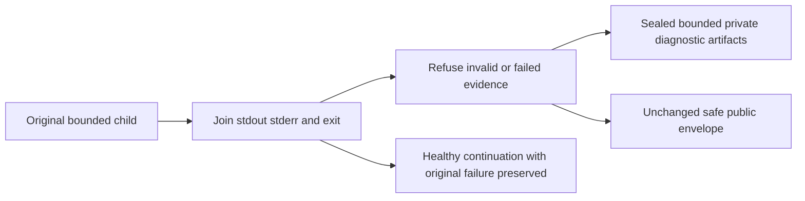

## Landing presentation

The landing carries the original frosted-glass, graphite, peach/lilac/periwinkle
KeyLoad illustration and the same visual style. This is presentation work in the existing BenchmarkComparisons slice under
[ADR-040](../ADR/ADR-040-static-site-threejs-evidence.md); no new architectural
boundary, database contract, measurement authority or renderer is introduced.

| Requirement | Acceptance and evidence |
|---|---|
| REQ-BC-PRESENTATION-001: lead with the reason Managed Code built KeyLoad and translate the selected original artwork into a live Three.js scene. | AC-BC-PRESENTATION-001: the first product screen names one database for AI agents; the opening story explains years of agent development and the progression from vectors to SQL, graphs, events, files and workflows. Desktop and mobile show a procedural frosted-glass database core and connected model objects, with moving requests and SQL in the connected table model, under the original-artwork composition contract REQ/AC-BC-PRESENTATION-005. The original image remains the README artwork and accessible static fallback; it does not substitute for the landing renderer. Manual screenshot/motion/prose review is the ADR-040 visual-composition exception; source text is not functional proof. |
| REQ-BC-PRESENTATION-002: make the existing landing coherent with the selected visual style. | AC-BC-PRESENTATION-002: warm light surfaces, restrained peach/lilac/periwinkle details, graphite controls and readable glass surfaces carry through product, composition, model cards, status and credits. Actual Chrome at 1440, 768, 390 and 320 pixels has no page-level overflow; navigation, code scrolling, existing scene motion/pause/fallback and lower-section layout retain their existing browser assertions. |
| REQ-BC-PRESENTATION-003: preserve honest product status and all publication gates. | AC-BC-PRESENTATION-003: current source capability and unfinished full SQL/protocol/cross-partition/production work stay explicit; credits thank actual projects with working links. The genuine content-only builder emits no measurements and passes existing asset budgets/vendor checks. Existing SiteContentBuilderTests, SiteContentBrowserTests, SiteContentCoverageModeTests and scene lifecycle assertions remain required; renderer budgets are 30 draw calls, 120,000 triangles, 1,000,000 pixels and DPR <=1.5 under the owner's explicit detail correction. Measured/provenance gates and genuine Linux Website publication remain independent and unchanged. |
| REQ-BC-PRESENTATION-004: make the model geometry recognizable and finished in the owner-identified scene. | AC-BC-PRESENTATION-004: actual desktop/mobile frames show layered document pages with content, a table grid/header, a connected graph, vector points, queued cards, an event clock, a folder/file, a plotted time series, with SQL represented in the table model. REQ/AC-BC-PRESENTATION-005 defines the scene without a separate SQL terminal or projected captions. Beveled edges, distinct silhouettes and deliberate model anchors replace obscuring grain spheres/plain blocks. Motion remains visible; accessible names and the current composition, lifecycle, vendor, coverage and resource limits pass. Screenshot/motion review is the same ADR-040 visual exception; the existing real Chrome/TUnit cases qualify runtime and budgets. The surrounding landing composition stays unchanged. |
| REQ-BC-PRESENTATION-005: faithfully recreate the owner-selected original agent-context.png composition with detailed Three.js geometry. | AC-BC-PRESENTATION-005: actual desktop/mobile frames show one central three-layer steel/glass database, a human-agent silhouette above it and exactly eight model platforms, each connected to the database by a cable: upper-left Tables/SQL grid, upper-right Graphs nodes/edges, left-middle Time series plot, right-middle Vectors point cloud, lower-left Events orbits, front-left Queues cards, front-right Blobs folders and lower-right Documents pages. Smooth curves, finished bevels, graphite metal, frosted glass and peach/lilac/periwinkle lighting match the selected artwork. No generic client boxes, repeated logo or cluster-diagram substitute appear. The scene is actual geometry, with no raster plane replacing it. renderer attributes report data-scene-models=8, data-scene-agents=1, data-scene-links=8 and data-scene-clients=0; no cluster counts are shown. A semantic sr-only list retains all nine model names Documents, Tables, Graphs, Vectors, Queues, Events, Blobs, Time series and SQL, with SQL combined visually with Tables. The original agent-context.png is the exact static fallback. TUnit/Chrome asset and scene assertions verify graph-derived counts, meaningful rendered frames, actual motion/pause, fallback delivery, accessible names, responsive bounds and <=120,000 triangles, <=30 draws, <=1,000,000 pixels, DPR <=1.5. Owner screenshot/motion review remains the explicit ADR-040 visual exception; no external requests, new packages or changed vendor/lifecycle/coverage gates. |

REQ/AC-BC-PRESENTATION-005 map to [ADR-040](../ADR/ADR-040-static-site-threejs-evidence.md).
They define the hero topology, captions and SQL presentation of
PRESENTATION-001/004 and change neither the Orleans cluster, replication nor database
storage. The scene geometry is built and batched ly, the original fallback is part
of the canonical emitted asset inventory, TUnit/Chrome assertions cover it, and
a desktop/mobile animated review precedes delivery. Rollback is a reviewed source revert
of the coherent scene/semantics/fallback/test asset unit; it never restores a competing
active renderer or weakens evidence gates. Backend, public API, persistence, SQL
dialect, packages and deployment topology are N/A because this changes only the
existing product illustration.

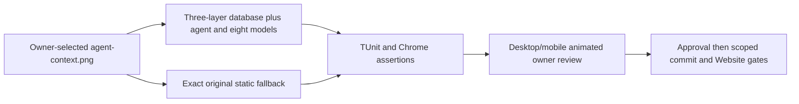

The central three-layer database, recognizable model objects and procedural studio
reflections follow the original artwork, which also supplies the static fallback: the
exact PNG is the poster, the canvas draws the mark, and renderer limits use the
120,000-triangle bound. The mobile browser case opens
a fresh document through `about:blank` before the mobile navigation, retaining real
request-origin assertions with the shared PNG fallback. The README uses the original
generated artwork with its generation prompt in
`docs/assets/readme/agent-database.prompt.txt`. Motion, fallback, accessibility,
coverage and publication gates remain mandatory, and content-only results do not
qualify database behavior or benchmark measurements.

## Product website

[ADR-040](../ADR/ADR-040-static-site-threejs-evidence.md) owns the site design, acceptance
and ordered plan. The existing BC001–010 and all product/evidence criteria remain
mandatory. Reader, keyboard/screen-reader user, constrained browser and evidence
publisher are the actors; the generated index is the entry, with independent graphics
and report mounts. Backend/public API/persistence N/A: no database behavior changes.

| Requirement | Measurable acceptance | Test or review mapping |
|---|---|---|
| REQ-BC-011: product-first responsive design | AC-BC-011: purpose/status/navigation visible at1440/768/390/320px in a single-row header; at ≤760px the same links open from a visible menu control and close after a selection without losing the section scroll. No page overflow, wrapped header or clipped controls; select text fades before its chevron key; labelled table scroll only | SiteBuildTests plus explicit real-browser desktop/mobile visual review |
| REQ-BC-012: bounded conceptual Three product scene | AC-BC-012: Three0.186.1 backend recorded; one renderer/canvas, correct cancellation/disposal/resize/pause; DPR≤1.5,≤1M pixels,≤30 calls,≤120K triangles under PRESENTATION-005; visible bounded motion, no hidden/offscreen/paused idle loop | vendor/build TUnit contracts; explicit real-browser graphics lifecycle/device evidence exception |
| REQ-BC-013: accessible independent content | AC-BC-013: semantic labels/focus/tabs and no-JS/reduced/coarse/unavailable-graphics retain text/poster/evidence access | SiteBuildTests plus required keyboard/no-JS/reduced-motion browser review |
| REQ-BC-014: unchanged arithmetic and controls | AC-BC-014: all6 scenarios/11 metrics/profile/repetition/log/whiskers/table/downloads match independent oracle over authentic successful-CI reports | SiteMeasurementTests/SiteMeasurementOracle using actual JS child process; real browser control review |
| REQ-BC-015: atomic validated report state | AC-BC-015: invalid/path/hash/rapid/error loads never mix data/provenance/downloads; abort and stale generation fencing | SiteEvidenceValidationTests over real production validators and controlled corrupt inputs; required rapid/error browser review |
| REQ-BC-016: canonical complete asset/build migration | AC-BC-016: feature-owned assets, exact verified vendor/raw bytes and clean isolated output; authored JS≤40KiB gzip/CSS≤20KiB gzip; vendor lazy and separately recorded | SiteBuildTests and source/static/vendor/size/raw-byte checks |
| REQ-BC-017: GitHub TUnit site qualification | AC-BC-017: independent centrally pinned TUnit/MTP/net10 suite, real bounded Node probe, preserved edge intentions; only exact GitHub run qualifies | KeyLoad.WebsiteTests full suite in GitHub; explicit visual/lifecycle review exception; numeric coverage per REQ-BC-024 |
| REQ-BC-018: honest source/evidence/delivery | AC-BC-018: site/measured revisions, successful run and hashes distinct; no inference from another source, schema3, publication or CLI model | SiteEvidenceValidationTests and strongest complete source/evidence review |

Canonical site files, mounts, TUnit project and limits are frozen in ADR-040. Positive
flow: read product→inspect actual report→download raw data. Negative/error:
corrupt/unavailable report clears all dependent state; GPU failure stops decoration
only. Edge: rapid profile changes cannot reintroduce stale data; reduced motion and
narrow/no-JS views remain readable. No source/module name is a passing test or public
publication result.

| Requirement | Measurable acceptance | Test or review mapping |
|---|---|---|
| REQ-BC-024: measure mandatory authored-site coverage | AC-BC-024: exact-source GitHub execution reports at least80% authored JavaScript line coverage, at least70% available V8 block-branch coverage and at least90% line coverage for critical measurement/validation/build/provenance modules; missing required files fail. Raw ranges, source hashes, runtimes, conversion semantics and first baseline are retained. | Strict V8 range/report regressions and after-session threshold gate; unchanged vendor/tests/assets excluded, no source ignore directives. |
| REQ-BC-025: exercise the generated site in a real CI browser | AC-BC-025: TUnit uses an already available real Chrome process and BCL CDP/WebSocket against real isolated emitted files/HTTP; controls, numeric correspondence, rapid/error/retry/provenance/download/focus and renderer lifecycle paths have assertions and precise coverage. Missing browser, incomplete source coverage or unexpected console failures fail; no installation, fake DOM/fetch, alternate runner or substituted measurements. | Actual browser suite, retained version/coverage/source packet. Visual judgment and physically unexercised GPU loss retain the narrower manual evidence boundary. |

Manual design proof does not waive numeric root rules; pending coverage is never a
completed acceptance criterion. The exact source inventory and converter semantics are
frozen in [ADR-040](../ADR/ADR-040-static-site-threejs-evidence.md).

REQ/AC-BC-016/017/024/025 additionally require a strict byte-identity/current-runtime
vendor compression receipt and bounded persistent builder diagnostics. Real
isolated-builder success/corruption regressions with specific intended negative errors
map to those criteria, and the full GitHub Analyzer/execution/site/Chrome/coverage gate is
required.

AC-BC-024/025 additionally retain actual CDP blank/no-script empty deltas with their raw
hashes and zero line/branch contribution. Each session must independently map authored
functions; empty-only/unmapped-only sessions and malformed/Node-empty receipts fail.
Every earlier source inventory, numeric threshold and complete real-browser assertion
remains required.

AC-BC-WEB-003 / AC-BC-011 navigation: the mobile menu action must close its popover, reach
the actual `#product` fragment and finish scrolling to the target's computed CSS scroll
padding/margin and clamped document scroll range before the next action. After leaving
the document and returning to `#benchmarks`, the test must observe that fragment at its
actual target and the lazy poster with no canvas before navigating to the hero. The
actual Chrome/CDP caller clicks the observed visible menu toggle and link centers
through mouse press/release rather than DOM `.click()`, which does not model
pointer focus. No forced focus, scroll, renderer mutation, changed destination
oracle, deadline or coverage allowance is permitted. The visible-scene ready/unsupported,
frame, poster, same-origin requests, empty content, popover closure, repeated
opening/viewport closure, scene lifecycle, coverage and joined child cleanup assertions
remain mandatory; a closed menu and `document.readyState` alone do not prove completed
navigation. `SiteContentBrowserTests` retains the full action chain with genuine
pointer inputs, and failure diagnostics additionally retain active-element tag/id and
real scroll bounds, never credentials or user payload. No production renderer, timeout,
allowed-state, dependency or coverage-threshold change is authorized.

## Required analyzer dependency for the website

REQ-BC-027 is specified in [site acceptance](../ADR/ADR-040-static-site-threejs-evidence.md)
and [ADR-033](../ADR/ADR-033-code-quality.md). The website must qualify its actual
KeyLoad.Analyzers dependency using the complete real TUnit suite and MTP 18.11.2
Cobertura counts at the same candidate SHA. Freeze all 30 source files and
configuration; include all 25 executable sources. Enforce module 80% line/70% branch and
each of 12 critical diagnostic pipelines 90% line coverage from integer counts.
Missing, malformed, ambiguous, changed or empty evidence fails. Retain raw XML, exact
source/runtime hashes, the derived report and pure gate boundary/error regressions. This
establishes only the first analyzer module baseline; broader AC-CQ-009, replication
and repository no-decrease qualification stay open. Mandatory website no-decrease
coverage is retained in AC-BC-024.

## Website delivery from authenticated evidence

REQ-BC-028 maps to AC-BC-028 in [publication acceptance](../ADR/ADR-040-static-site-threejs-evidence.md)
and [ADR-040](../ADR/ADR-040-static-site-threejs-evidence.md). Every published number is
read from actual comparison-job JSON; separate sibling website/measured/control
checkouts retain accurate revisions; invalid selected evidence fails without fallback,
and existing verified public data remains until a successful update. Exact
comparison-step/artifact/ZIP proof and full current-main website qualification precede
deployment. The selection, trigger and freshness rules are REQ/AC-BC-WEB-001..008 and
AC-BC-FAIL-018..021 below. Backend/contracts/database persistence N/A: no runtime/data
API changes. Pure controlled metadata/ZIP tests are not fake API transport evidence;
real workflow/provider/live evidence remains mandatory.

## Independent website with optional benchmarks

Website source changes publish independently of benchmark results; ready execution
metrics enrich the website, and newly ready metrics trigger another Website build.
Unavailable metrics produce no figures, catalogs, raw aggregates or invented
provenance. Existing measurement qualification remains mandatory for measured
publication. ADR-112 owns the conditional artifact and qualification boundary.

| Requirement | Acceptance | Tests / evidence |
|---|---|---|
| REQ-BC-WEB-001 independent source publication | AC-BC-WEB-001 own-main manual dispatch runs website jobs without a benchmark dependency; no ready cohort yields a content-only website | static workflow graph/lint, executor TUnit operations, genuine Website/Pages |
| REQ-BC-WEB-002 optional authenticated metrics | AC-BC-WEB-002 select the newest ready completed own-main producer with a successful authenticated aggregate and valid current archives; failed/incomplete producers supply no measurements, and no ready producer yields explicit bounded unavailability. Corrupt, duplicate, expired or missing selected evidence and API failures fail closed without silent fallback. | real retained GitHub metadata selection positive/negative TUnit cases; authenticated capture |
| REQ-BC-WEB-003 accurate empty publication | AC-BC-WEB-003 explicit `--benchmarks=none` emits product/scene/SEO/vendor assets, no numeric data/catalog or measurement requests, plain empty state, source-bound publication receipt with benchmarks null | new SiteContent build/assets/browser/error cases using real Node, files and Chrome |
| REQ-BC-WEB-004 automatic refresh | AC-BC-WEB-004 the final bounded Benchmarks dispatch supplies a run ID only for a bounded completion wait; Website independently selects the newest ready producer. Predeploy reselects and rejects a changed available tuple or newly available data after a no-data qualification. | workflow and selection/freshness TUnit cases; genuine separate Website dispatch/Pages |
| REQ-BC-WEB-005 scoped complete qualification | AC-BC-WEB-005 no-data artifact runs complete closed SiteContent tests through the same Aspire `site` entry, original TRX/no-skip checks, source/asset/vendor/Chrome and scoped coverage thresholds; measured artifact retains full existing site/archive/numeric/browser/coverage tests | original TRX/coverage/source inventories and final build; content is never labeled full metric qualification |

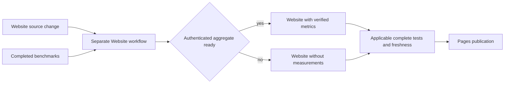

AC-BC-WEB-002 uses the current authenticated producer workflow and exact source
contract. Known unsupported sources become unavailable before reading their jobs or
archives; unknown or malformed metadata remains an error. The current
SiteUnsupportedProducerSelectionTests exercise the real optional capture, unchanged
controlled inputs and healthy newest-ready selection. Original external run/artifact
provenance remains immutable; previous producer formats are not executable publication
inputs.

REQ-BC-WEB-008 / AC-BC-WEB-008 (ADR-112) keep the workflows independent:
Benchmarks deploys public released images, runs applicable scenarios and returns
original results. It may dispatch a separate Website rebuild after completion.
Website retains trusted-main push/manual entries and selects only the latest
completed successful measurement run. The optional triggering run ID is a
completion barrier and never forces publication from a failed run. Original
archive, browser, coverage, freshness and provenance gates remain mandatory.

### Standalone Website acceptance

REQ-BC-WEB-006 / AC-BC-WEB-006: expose Build and Tests, Benchmarks, Website and
Release. Build and Tests runs the complete solution build and every existing
ordinary/analyzer/scalar/recovery/Aspire cluster test gate. Website runs its qualified
site build/deployment on trusted-main manual/final dispatch, with independent source
publication. Benchmarks has a final dispatch-only job as specified below.
Optional metrics, strict selected-evidence rejection and the no-data path remain
AC-BC-WEB-001..005. executor authentication admits only Website at
`.github/workflows/website.yml` with the permitted event and job identity.

The mandatory Aspire-owned SiteOptionalBenchmarkSelectionTests preparation gate
has seven complete operation cases: push/manual admission; unsupported event,
Build and Tests executor, foreign path and unsupported job rejection; strict
optional arguments. It checks immutable inputs and successful healthy follow-up.
The current SiteTests also exercise authenticated capture, unavailable producer
classification, newest-ready selection, source freshness and complete archives.
These pipeline metadata cases remain in the measured qualification group with
its complete source/critical90 inventory.

The current Website executed dependency closure contains exactly 80 regular
source paths. The producer-only scaled-cohort-aggregate-cli.mjs remains owned by
Benchmarks and is outside that executed closure. Validate the sorted unique
manifest, actual imports and exact source bytes/hashes in both measured and
content-only modes. Preserve every authored source and the execution80/70/90
thresholds; a manifest change cannot waive an executed source or coverage gate.

The closed SiteContent group retains its eight executed sources and five cases.
Its actual browser flow checks desktop/mobile viewports, lazy scene navigation,
menu opening and link/viewport closure, denied clipboard-write fallback and
rejection of the protected site source as output. It checks the complete manifest
for its actual mode. No clipboard substitution or receipt exclusion is allowed.

Tests use real TUnit/Node/Chrome operations. Infrastructure review uses parsed
YAML and actionlint without presenting source-text assertions as behavior.
Current Linux site qualification and a genuine standalone Website/Pages provider
run are required for publication closure. Earlier source-local passes do not
qualify the changed inventory. ADR-112 owns the ordered implementation. Engine workloads, package changes, DNS and product Release
are outside this Website change. Numeric product coverage/CRAP remains unmeasured
until eligible current functional coverage exists.

### Final Benchmarks trigger

REQ-BC-WEB-007 / AC-BC-WEB-007: the final Benchmarks job only dispatches the
separate Website workflow on main after successful aggregation. It runs
on trusted own-main push/manual after the complete database cohort succeeds,
and never builds/tests/deploys the website. Scope `actions: write` to that job;
retain read-only database jobs and unchanged workloads. Website uses workflow_dispatch events, with its independent source publication intact.

A failed or incomplete run cannot dispatch an automatic empty replacement of the
deployed site. Independent Website changes retain the latest successful figures.

Dispatch supplies an optional `benchmark_run_id` for bounded completion waiting.
Website authenticates the actual original run's repository, branch, workflow
name/path, event and source through GitHub; bounded waiting resolves the race
between dispatch and producer completion. Publication then selects the latest completed successful full run. Reject
invalid/foreign metadata and timeout, preserve failure/absence handling and
source/tuple freshness. The input is only a completion barrier and never replaces authenticated
archive provenance or successful-run selection. Empty manual input needs no producer wait. The 270-second
wait retries failed GitHub status requests within that same deadline, with each
request bounded to 30 seconds and fresh metadata requested. Successful responses
must pass the unchanged run identity checks before use. Existing execution TUnit
executor operations cover manual admission and unsupported executor-event
rejection, unchanged inputs and a healthy follow-up. Static actionlint and YAML
graph review verify infrastructure; a genuine final dispatch and separate
workflow_dispatch Website/Pages run supply provider evidence. ADR-112 owns the ordered implementation.

### Current Website capture and archive consumers

The current capture (AC-BC-WEB-001/002/004/006/007 and AC-BC-FAIL-019) admits trusted
push/manual/final-dispatch executors, performs bounded authenticated optional-run waiting, and selects
producers through the current REST API. REST workflow_runs paging and
artifact.workflow_run provenance remain mandatory authority checks, including
unsupported producer-list event rejection. Capture has no executor event-file input.
All API/archive/request bounds and coverage thresholds retain their original values.
Authenticated capture, immutable inputs, healthy follow-up, exact-source freshness,
complete source inventories and real Node/Chrome coverage remain required; source
integration is distinct from exact-source Linux and actual provider qualification.

The current QualifySite action (AC-BC-CURRENT-001..004 and AC-BC-WEB-002/004/006/007)
validates the complete executed dependency manifest derived by
session-source-closure.mjs; there is no inherited fixed path count. Regular-path,
byte/hash, archive, source, coverage and freshness checks remain strict. Current readers
admit only the session cohort: 32 workers (16 databases x 1/3), thirteen
source-bound case outcomes per shared live topology, common compiled
runtime built once, measured initial 1m loading and no warmup/reset/reseeding.
Every original report, TRX, process/runtime identity and resource observation
remains authenticated. Unsupported sources are classified before jobs/archive reads and
cannot supply live metrics. Remaining model-family and physical 100k qualification
requirements stay open; these seven document cases do not complete them.

Website preparation invokes SiteQualificationStartupTests and SessionCohortContractTests
through the comparison entry. SiteTests retain authenticated capture, optional
unavailability, newest-ready selection, strict selected-evidence rejection, unchanged
inputs and healthy follow-up under AC-BC-WEB-002 and AC-BC-FAIL-019/020. The session,
browser and executor tests and SiteIsolatedInventory consume the canonical session
inventory. Real Node/Chrome, all applicable TUnit/coverage/no-skip gates,
complete source/input hashes and final freshness remain mandatory. Full ordinary unit
tests run separately from eligible functional coverage; removed source and a passing
local build do not establish publication qualification.

## Chrome session admission

Website qualification selects eight concurrent TUnit cases through the existing
execution option. Full-archive children retain their two active slots, 64-entry
FIFO queue and 20-minute admission deadline. The complete unfiltered test suite,
original-byte verification and coverage thresholds remain mandatory.

`REQ-BC-CHROME-001`: Real Chrome work performed by one `KeyLoad.WebsiteTests`
process is admitted through a bounded session owner. At most one real
Chrome process may be active in that process. Admission is acquired before
the Chrome version probe or original browser launch and remains owned until
the real CDP socket and browser instrumentation/coverage are closed and the
same original process is observed exited. A caller cancellation while queued
withdraws that waiter with the original token. Incomplete or failed execution
cleanup poisons this browser-only admission pool; it cannot free capacity for a
new launch.

`AC-BC-CHROME-001`: A genuine TUnit case using the workflow-provided Chrome and
BCL CDP starts one session, starts a second session while the first
holds admission, observes that the second remains queued without launching,
cancels it and verifies cancellation retains the exact caller token and removes
that waiter. A successor session starts only after the first session's actual
coverage completion/stop, CDP socket disposal and original process exit; the
case verifies the distinct process identity and exit observation. The
pool has capacity one, at most 64 queued sessions, and the existing 20-minute
cancellable admission bound. Existing browser assertions, page content,
coverage inventory/thresholds, commands and startup/active deadlines remain
unchanged. An unsafe/unjoined original process or teardown failure poisons the
pool and rejects queued/future sessions.

The existing keyboard-selection acceptance continues to require real ArrowUp
and Enter actions, selected value `2`, and the independent rendered-row oracle.
On a failed selection only, bounded evidence may report each actual CDP
keyDown/keyUp acknowledgement plus a post-action snapshot containing only the
active-control boolean, bounded select value and selected index. The record is
fixed-size, truncated before formatting, and MUST NOT include result rows,
projection/report bytes, query text or benchmark payload. This evidence records
the observed interaction; it does not presume the cause of CI failure.

The admission implementation retains each actual queued waiter's original
`CancellationToken` in the existing bounded waiter node and exposes, only through
`SiteBrowserSessionAdmission`, a read-only membership observation of the exact token
under the existing lock. The list is capped at 64 waiters, so the observation is bounded
O(64), retains no additional state, invokes no callbacks and does not alter admission,
cancellation, FIFO, deadline or cleanup behavior; token values are never logged. The
genuine Chrome lifecycle case creates its unique linked cancellation token, starts the
real second Chrome session while the first session holds its lease, and asserts
that the exact token is present in the actual admission waiter list before
cancellation. It cancels that same token, awaits the original
`OperationCanceledException`, verifies the exact original token on that exception, then
asserts that this exact token is absent from the pending list. The existing aggregate
queue-count assertions, no-start assertion, successor queueing and all real
coverage/CDP/process lifetime observations are preserved. This is a direct
identity/removal oracle against the bounded queue, not a mock queue, synthetic
provider, timer or inferred count. All capacity, queue, admission-deadline, Chrome
process/CDP/coverage ownership, failure behavior, keyboard assertions and evidence
limits remain unchanged, and the test does not serialize unrelated tests globally.

Mapping: `REQ-BC-025` and `AC-BC-025` (real browser criteria), plus this focused
admission acceptance. New TUnit source belongs to
`tests/KeyLoad.WebsiteTests/`; no site runtime,
workflow, publication or measurement behavior changes.

Browser lease transfer at factory return: the browser session factory admits one actual
browser lease before the version child, endpoint/Chrome startup and CDP/coverage setup.
Its lexical `using` owns all failure paths. Immediately before a successful return it
marks that same lease transferred to the returned process owner; only the
factory's scope disposal consumes this transfer marker, leaving the actual lease held
until the returned owner settles its original process, CDP and HTTP resources. Existing
non-browser callers never set this marker. This is an ownership-transfer marker, not a
readiness, exit or coverage proof. Failed setup follows the existing resource joins and
the bounded pool poison rule. AC-ISO-009's real cancellation/successor/PID
regression remains the evidence; the keyboard assertion retains its exact predicate and
prints only bounded observed failure diagnostics through TUnit output.

## Landing lower-section layout

REQ-BC-LAYOUT-001 / AC-BC-LAYOUT-001: qualification status retains two desktop columns
and one mobile column; methodology retains three desktop columns and stacked mobile
steps. The reproduce command stays inset within its padded terminal, and footer links
align with the main content without horizontal page overflow at the existing responsive
viewport widths. The stylesheet carries only styles used by the current semantic
landing. ADR-040 remains the owning design decision; no new boundary, dependency or
public contract is introduced.

Automated mapping: `SiteBrowserVisualAssertions.AssertLowerSectionsAsync` checks
real rendered bounding boxes in both the measured responsive browser case and
`SiteContentBrowserTests` desktop/mobile case through the Aspire `site` entry.
A missing lower-section stylesheet must fail these assertions. build,
site qualification and actual Website/Pages delivery evidence remain required.

## REQ-BC-029: shared KeyLoad visual identity

### AC-BC-029 visual identity

- **Concept.** The landing is an editorial product page that reads like a spec sheet, in the shared identity from [ADR-053](../ADR/ADR-053-unified-visual-identity.md):
  - paper surfaces, oversized black display type and mono chapter eyebrows (`01 — …`);
  - graphite instrument panels;
  - Managed Code's iridescent marker as the only accent. There is no green or lime.
- **Order.** The page presents KeyLoad as the AI database for AI agents on .NET 10 and Orleans, keeps the early-development wording, and runs in this order:
  1. a hero with the live scene;
  2. a fact strip;
  3. why an AI database: the stitched stack against one database, and why we think one database is the future (AC-COMP-009);
  4. connected data in one request ([DatabaseComposition](DatabaseComposition.md));
  5. the anatomy of one agent call;
  6. a data-shape bento;
  7. an engine cross-section;
  8. why .NET, Orleans and ZoneTree (AC-COMP-009);
  9. the evidence instrument, with a perforated provenance receipt;
  10. a ledger of claims that are not made yet;
  11. the method;
  12. reproduce;
  13. the footer.
- **Search metadata.** The title is "KeyLoad — the AI database for AI agents". Description, Open Graph, Twitter and JSON-LD copy use the same AI positioning within the AC-SEO-002 contract; JSON-LD stays a two-node WebSite/SoftwareSourceCode graph without offers, ratings, reviews or actions.
- **Agent call anatomy.** A numbered timeline beside a graphite terminal shows the real MCP tool `keyload_query_execute` and the real .NET SDK atomic command. It describes the path, not live data.
- **3D scene motion contract.**
  - The hero scene of REQ/AC-BC-PRESENTATION-005 starts moving as soon as it is ready.
  - It pauses offscreen, on hidden pages and when the visitor pauses it. It never moves under `prefers-reduced-motion`.
  - `AssertMotionPlaysThenSettles` proves that render calls advance while playing and are identical after pause. Renderer budgets are those of REQ/AC-BC-PRESENTATION-005.
  - The static fallback is the exact original artwork of REQ/AC-BC-PRESENTATION-005. The canvas is transparent, so the scene sits on the glass stage.
- **Comparable engines only.** The chart and table omit engines that do not implement the selected workload, and KeyLoad is highlighted. Their DOM rows, downloads and the engine count stay intact.
- **Attribution.** The footer reads "Developed by Managed Code" and links to https://www.managed-code.com/ with a normal followed link (no `nofollow`).

- **AC-BC-029:** the public site uses the shared light identity from [ADR-053](../ADR/ADR-053-unified-visual-identity.md):
  - the same logo, tokens and sans display type, plus cards, buttons, tabs, bars and tables;
  - brand-palette engine colours and scene colours.
- `site/Features/BenchmarkComparisons/brand.css` and `site/favicon.svg` are byte-identical mirrors of the console's canonical `brand.css` and `logo.svg`. The test is `SiteBrandParityTests.AC_VI_001_SiteAndConsoleShareByteIdenticalBrandSources` in pages.yml.
- Every existing site hook, the size budgets, no-overflow widths, poster/scene lifecycle, zero console errors and the JS inventory remain unchanged. Copy keeps the early-development and no-winner wording.
- Subjective visual quality is a desktop/mobile screenshot review. It is not a numeric gate.

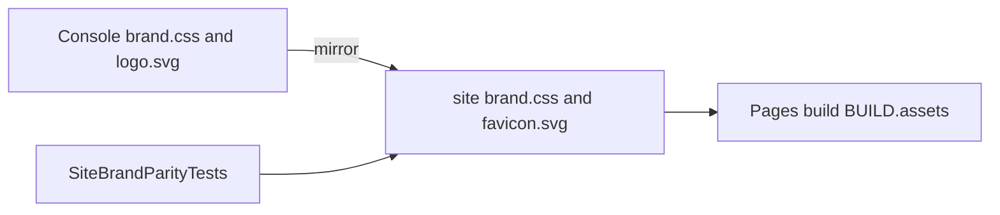

### Session workload evidence

The separate benchmark host validates the thirteen original workload results, case hashes,
source/run cohort and original TUnit receipt before retaining its session manifest.
Deleted comparison-test suites do not contribute qualification steps. Product fault,
durability and endurance qualification remain separate gates; workload evidence does
not close them.
