# BenchmarkComparisons

BenchmarkComparisons measures KeyLoad against specialist databases, one data type
at a time, and publishes the results on the website. Every database of a type runs
the same standard dataset and the same scenario; KeyLoad runs every type. The
decision is [ADR-150](../ADR/ADR-150-per-type-benchmark-jobs.md).

## Requirements

| Requirement | Acceptance |
|---|---|
| REQ-BC-030: one job per database, data type and node count | `benchmarks.yml` has one `measure` job per row of the [type table](#data-types); a job deploys one database and runs only the TUnit class of its type. |
| REQ-BC-031: one shared module per data type | The dataset, scenario (cases, schedule, verification) and driver interface of a type exist once; a database implements only the driver. |
| REQ-BC-032: the same standard size everywhere | Seed 1729, 16 concurrent clients, 100,000 planned operations per measured case, at most 15 minutes per measured case, and 1,000,000-record datasets, unless a local run overrides them. Dataset loads are never stopped by the limit. |
| REQ-BC-033: results survive failure | The job writes its result file after startup, after every case and on disposal, and uploads it whether the job passed or failed. |
| REQ-BC-034: no invented numbers | A failed case keeps its real first error; a case that never ran, a missing node count or an unsupported database has no number. |
| REQ-BC-035: the website shows one run | Website publishes the result files of the dispatched run, or of the latest completed run; without result files it publishes nothing and the current Pages stay. |
| REQ-BC-036: the released KeyLoad image | KeyLoad jobs run `ghcr.io/managedcode/keyload:latest`, resolved once per run to one digest; Benchmarks never builds a KeyLoad image. |
| REQ-BC-022: embedded microbenchmarks | BenchmarkDotNet's generated child consumes the public scenario library with all source rules and real fixture lifetimes ([ADR-047](../ADR/ADR-047-embedded-benchmark-host.md), AC-EM-001..004). |
| REQ-BC-029: shared visual identity | The website uses the shared KeyLoad identity of [ADR-053](../ADR/ADR-053-unified-visual-identity.md) and the hero scene of [ADR-040](../ADR/ADR-040-static-site-threejs.md). |

## Pipeline

```mermaid
flowchart LR
    Push[Push to main or manual run] --> Image[image job: latest KeyLoad image to one digest]
    Image --> Jobs[45 measure jobs: database x type x nodes]
    Jobs --> Build[Build ComparisonHost in Release]
    Build --> Fixture[BenchmarkDeployment starts the database through LoadTests AppHost]
    Fixture --> Cases[The type's cases in order on one live deployment]
    Cases --> File[results/slug-type-nN.json after every case]
    File --> Artifact[Artifact benchmark-slug-type-nN, also on failure]
    Artifact --> Dispatch[website job dispatches Website with the run id]
    Dispatch --> Merge[results.mjs merges the run's result files]
    Merge --> Site[build.mjs renders one table per type]
    Site --> Pages[GitHub Pages]
```



- **Benchmarks** (`.github/workflows/benchmarks.yml`) runs on pushes to `main` and
  on manual dispatch. The `image` job resolves the KeyLoad image digest. Each
  `measure` job checks out the source, sets up .NET, builds
  `benchmarks/KeyLoad.ComparisonHost` in Release with warnings as errors and runs
  the TUnit class of its type. The final `website` job dispatches Website with the
  run id, also when some measure jobs failed.
- **The job's database.** The shared TUnit fixture
  `Deployment/Hosting/BenchmarkDeployment.cs` starts `build/KeyLoad.LoadTests.AppHost`
  through `Aspire.Hosting.Testing` with the job's database, node count, KeyLoad
  image and a data root below the test binaries. It waits until every published
  node is healthy and every bootstrap container has exited with code 0, then reads
  the published connection string, endpoints and credentials. The AppHost owns all
  containers and removes them when the fixture disposes the application.
- **Cases.** The TUnit class of the type runs its cases in order against that one
  live deployment. Each case depends on the previous one with
  `ProceedOnFailure`, so a failed case is recorded and the next case still runs.
- **Website** (`.github/workflows/website.yml`) downloads the `benchmark-*`
  artifacts of the requested run (or of the latest completed Benchmarks run on
  `main`), merges them with `node site/scripts/results.mjs`, builds the static site
  with `node site/scripts/build.mjs` and deploys GitHub Pages. If the run has no
  result file, the merge fails and the current Pages stay. Website never builds
  .NET, starts Aspire or runs tests. The page contract (table layout, "Failed",
  "No data" and "Single node" cells) is in the
  [site protocol](../../site/Features/BenchmarkComparisons/protocol.md).

## Data types

| Type | TUnit class | Cases | Databases (nodes) |
|---|---|---|---|
| documents | `DocumentBenchmarks` | load, point-read, range-query, update, delete, mixed | MongoDB (1, 3), SurrealDB (1), KeyLoad (1, 3) |
| key-value | `KeyValueBenchmarks` | load, get, set, delete, mixed | Redis (1, 3), KeyLoad (1, 3) |
| relational | `RelationalBenchmarks` | load, pk-select, range-select, update, delete, mixed | PostgreSQL (1, 3), SQL Server (1), MySQL (1), KeyLoad (1, 3) |
| graph | `GraphBenchmarks` | load, neighbors, traverse (depth 3) | Neo4j (1), HelixDB (1), SurrealDB (1), KeyLoad (1, 3) |
| vector | `VectorBenchmarks` | load, exact-top10 (cosine, 32 dimensions) | Qdrant (1, 3), PostgreSQL + pgvector (1, 3), KeyLoad (1, 3) |
| search | `SearchBenchmarks` | load, index, term-query, and-query | OpenSearch (1, 3), KeyLoad (1, 3) |
| time-series | `TimeSeriesBenchmarks` | load, range-read, aggregate, windows | TimescaleDB (1), InfluxDB (1), KeyLoad (1, 3) |
| analytics | `AnalyticsBenchmarks` | load, group-by, filtered-aggregate | ClickHouse (1), KeyLoad (1, 3) |
| queue | `QueueBenchmarks` | cycle (publish, receive, ack) | RabbitMQ (1, 3), KeyLoad (1, 3) |
| events | `EventBenchmarks` | load, append, read, mixed | KurrentDB (1, 3), KeyLoad (1, 3) |

Each database and node count in this table is one job: 45 jobs. PostgreSQL runs
as one deployment name, `PostgreSQL + pgvector`, for both relational and vector
jobs. A load case counts records (vertices plus edges for the graph); the index
case is one call that makes the loaded search dataset searchable; every other case
counts requests.

## Shared modules: change a dataset or scenario once

Every type has one module in `benchmarks/KeyLoad.ComparisonHost/<Type>/`
(`Documents`, `KeyValue`, `Relational`, `Graph`, `Vectors`, `Search`, `TimeSeries`,
`Analytics`, `Queues`, `Events`):

- `Dataset/` generates the standard records deterministically from the seed, and
  any independent oracle (for example the exact cosine top-10 of `VectorOracle`).
- `Scenario/` defines the case ids, the operation schedule over the clients and the
  verification of every answer: document bodies and range ids, graph neighbours and
  reachable counts, exact top-10 order, search matches, series aggregates and
  windows, exactly-once queue delivery, event stream contents.
- `Cases/` is the TUnit class that runs the scenario's cases in order.
- `Drivers/` holds the driver interface and its factory. A driver performs only the
  interface's operations with the database's own client or HTTP API; it never
  generates data, schedules calls or checks answers.

`Deployment/` reads the job, starts the AppHost and connects (`KeyLoadDatabase`
gives every KeyLoad driver the same SDK clients and partition). `Measurement/`
owns the settings, the concurrent `OperationLanes` and the result records.

A change to a dataset or a scenario is made once and applies to every database of
the type. Adding a database to a type adds one driver, its factory entry, its
AppHost resource in `BenchmarkDatabases` and its workflow matrix rows. Adding a
type, case or database, or changing a dataset, schedule or count, changes the
benchmark meaning and needs the owner's approval.

## Result file

Each job writes `results/<database-slug>-<type>-n<nodes>.json`, for example
`postgresql-pgvector-vector-n3.json`. The slug is the lowercase database name with
every run of other characters replaced by one `-`. The file is written to a
temporary name and then renamed, so a reader never sees a partial file.

| Field | Meaning |
|---|---|
| `database`, `type`, `nodes` | The job's cell. |
| `image` | The image the AppHost published for the database, or the KeyLoad image reference. |
| `commit`, `runId` | `GITHUB_SHA` and `GITHUB_RUN_ID`; null outside GitHub Actions. |
| `startedAt`, `finishedAt` | Fixture start and disposal; `finishedAt` is null while the job runs. |
| `records`, `operations`, `clients` | The dataset size, planned operations per case and concurrent clients used. |
| `caseLimitMinutes` | The wall time after which a measured case takes no new operation. |
| `error` | The error that stopped the job before its cases (for example a failed startup), or null. |
| `cases[]` | One entry per case that ran, in order. |

Each case has `id`, `status` (`passed` or `failed`), `planned` (units the
scenario schedules), `operations` (units attempted; fewer than `planned` when the
case time limit stopped it), `errors` (units that failed), `seconds` (wall time), `opsPerSecond`
(successful units per wall second), `p50Ms`, `p95Ms` and `p99Ms` (nearest-rank
latency per call over successful calls; 0 when no call succeeded), `batchSize`
(units per call) and `error` (the first error, at most 600 characters). A case
fails when any unit fails or its after-the-fact verification finds a problem, and
the TUnit test fails with it. No value is ever estimated or filled in.

The case time limit is 15 minutes, set by the owner. It applies the same way to
every database: once it has passed, clients take no new operation, operations already
started finish, and `opsPerSecond` and the latencies cover only what ran. The
site shows such a case as "<ran> of <planned>". Loads always finish, because the
following cases read the loaded data. `Benchmarks__CaseMinutes` overrides the
limit for a local run.

## Running one cell locally

Run one cell at a time. Set the job through the environment, build in Debug and
run the type's class:

```sh
export Benchmarks__Database=KeyLoad
export Benchmarks__Type=graph
export Benchmarks__Nodes=1
export Benchmarks__KeyLoadImage=ghcr.io/managedcode/keyload:latest@sha256:<digest>
export Benchmarks__Records=100000      # optional, default 1000000
export Benchmarks__Operations=10000    # optional, default 100000
export Benchmarks__Output="$PWD/results"  # optional, default results/ beside the DLL
dotnet build benchmarks/KeyLoad.ComparisonHost/KeyLoad.ComparisonHost.csproj -warnaserror
dotnet benchmarks/KeyLoad.ComparisonHost/bin/Debug/net10.0/KeyLoad.ComparisonHost.dll \
  --output Detailed --treenode-filter "/*/*/GraphBenchmarks/*"
```

`Benchmarks__Database` uses the names of the type table (`PostgreSQL + pgvector`,
`SQL Server`, ...). `Benchmarks__KeyLoadImage` is required only for KeyLoad; `docker
buildx imagetools inspect ghcr.io/managedcode/keyload:latest` prints the digest.
A smaller dataset must still fit the scenario (documents need more than twice as
many records as operations); the scenario rejects it before measuring. Local
results are development evidence: Website only reads GitHub Benchmarks artifacts.

## Local development benchmarks and profiling

`benchmarks/KeyLoad.BenchmarkScenarios` holds BenchmarkDotNet scenarios that help
find or prove a KeyLoad change, run through the `benchmarks/KeyLoad.Benchmarks`
executable: the embedded engine scenarios (REQ-BC-022, ADR-047), the ZoneTree raw
read lane ([ADR-069](../ADR/ADR-069-zonetree-raw-read-lane.md)), commit, journal
flush and cosine scenarios, and the serialization scenarios of
[InternalSerialization](InternalSerialization.md). They are never jobs of
`benchmarks.yml` and never published as comparisons.

Before choosing an optimization, profile the actual process with
`dotnet-diagnostics-mcp` and the installed profiling skill, map the capture to the
owning source, repair it with meaningful regressions and repeat the matched
profile. A trace or a local measurement alone proves no performance change.

## Limits

- The figures describe one Benchmarks run on GitHub-hosted `ubuntu-22.04` runners.
  Different jobs run on different machines; hardware is not matched or measured.
  The figures are not production readiness, durability or endurance evidence.
- Each database runs with the settings of its AppHost resource. Acknowledgement and
  durability differ between databases; the same node count does not mean the same
  guarantees.
- KeyLoad writes every type into one partition of one tenant per job. Its 3-node
  jobs (three silos, three copies) measure replication of that partition, not
  partition fan-out.
- Only the node counts in the type table exist. The AppHost rejects 3 nodes for
  SurrealDB, HelixDB, Neo4j, SQL Server, MySQL, TimescaleDB, InfluxDB and
  ClickHouse; the site shows them as single-node.
- The load is a closed loop of 16 clients; it does not correct coordinated
  omission and does not test overload.
