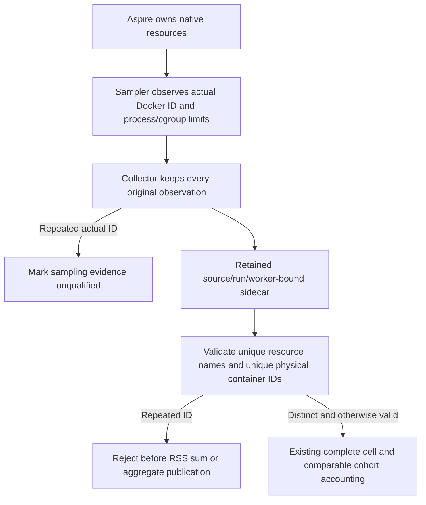

# Distinct native resource owners in scaling evidence

This contract follows [BenchmarkComparisons](../BenchmarkComparisons.md), ADR-034, ADR-056, ADR-103 and ADR-122. The active native deployment arms are one and three nodes. Logical partitions, silo-local ZoneTree owners, replica copies, resource names and Docker container IDs remain separate identities. This stage changes no database profile, package, topology, acknowledgement mode, resource limit or measured metric.

REQ-SCALE-OWNERS-001 / AC-SCALE-OWNERS-001: the native sampler already captures the actual `docker inspect` container ID, image ID and start identity; replacement invalidates that sampler. Collector completeness must additionally require ordinal-distinct actual container IDs among its observed records. Preserve every original record and mark `serverCpuRss` missing, rather than renaming, removing or fabricating a replacement observation.

REQ-SCALE-OWNERS-002 / AC-SCALE-OWNERS-002: supported sidecar validation must reject a duplicate actual container ID, even when resource names differ and each individual row has valid source, hardware, limits, samples and mounts. Reject before summing per-container RSS or exposing comparable proof. Existing resource-name, topology, native membership, image, limit, acknowledgement, source/run/attempt/job/worker provenance and all missing-evidence checks remain unchanged. Identity comparison is exact ordinal Docker ID comparison, not alias guessing.

REQ-SCALE-OWNERS-003 / AC-SCALE-OWNERS-003: complete controlled canonical 100,000 and 1,000,000 profile workflows use the production sidecar validator and aggregate API. Retain complete original inputs and an existing healthy aggregate; corrupt only one three-node cell's second or third actual container ID and refresh its independently retained sidecar SHA in the proof so stale-checksum rejection cannot hide the identity defect, require rejection and byte-for-byte preservation of source/publication inputs and prior aggregate, restore exact original sidecar and proof bytes, then require identical healthy cell proof and complete aggregate. No fake measured report is authored: controlled workload envelopes retain null reports and explicit failed workload accounting. A structurally healthy aggregate is not a passing benchmark cohort or authenticated GitHub measurement.

This is a source/content-validation correction, not an observed runtime duplicate, native membership proof, Linux resource measurement or speed claim. Normal Aspire resource names are unique; uniqueness of labels is not proof of physical-ID uniqueness at an evidence boundary. The current producer/consumer chain is sampler → collector snapshot → native sidecar writer → GitHub native ZIP capture → sidecar validator → complete aggregate/source retention and comparable cohort gates. Caller-supplied fixtures never authenticate GitHub.

Qualification remains OPEN: independent source/native-API review, actual functional tests through the canonical runner, Linux native one/three-node deployment/membership/acknowledgement evidence, full 100k/1m loaded-record and at-least-100k measured-operation workloads, canonical ingestion1/10/500 cases, fair total resources and shard-skew/fan-out/recovery/open-loop/endurance results. No local benchmark execution or performance inference is authorized. Frontend N/A: an invalid resource proof is rejected before website-producing aggregation. Rollback restores the exact two guarded predicates and removes additive functional cases/doc; no data format or migration is introduced.

The four functional cases cover each scale profile with either later physical identity duplicated. Both complete aggregates retain all 88 canonical cells as explicit failed workload accounting with null reports; they provide diagnostic source conservation, not successful workload or metric publication. The native collector duplicate-record branch is source-reviewed without a new test-only injection seam; genuine Aspire/Docker producer and Linux measurements remain required.
